# styrman-harness

Your rules, skills and subagents for the **Antigravity CLI** (`agy`), kept in one repository and installed the same way on every machine you work from, plus `sh-agent`, a small Go binary that does the installing and keeps what a session cannot hold on its own: the searchable trail of each project, its memory, the shape of every session and a nightly consolidation. One operator, their own machines, a private repository. No hooks, no gates, no CI, no service.

## Why it exists

- **Context drifts.** A rule you add on the laptop is missing on the workstation a week later. Here every rule, skill and agent is a file in this repository; `sh-agent install` puts the same set on every machine, and `sh-agent update` moves a machine forward when you say so.
- **Sessions forget.** A CLI session ends and its lessons go with it. The harness writes them down in the project's own trail (handoffs, decisions, bugs, plans) and in a memory store the CLI reads at the start of the next session.
- **A CLI cannot measure itself.** `sh-agent metrics` records the shape of every session (tools, tokens, errors, never your prose), so you can see where the work goes and tune the harness from numbers instead of impressions.

## What you get

| | |
|---|---|
| One global context | `context/AGENTS.md`, in the [agents.md](https://agents.md) standard, deployed as `~/.gemini/config/rules/AGENTS.md` |
| Skills | 36 of them, each a directory with a `SKILL.md` in the [Agent Skills](https://agentskills.io) standard; the model loads one when its description matches, and you can type any of them as `/name` |
| Subagents | 8, written once in Claude Code's format; the Antigravity flavour is derived at install |
| Rules | always-on rules under `rules/` (today: critical thinking, and one session per task or phase) |
| The binary | `sh-agent`: install, update, status, uninstall; `search` over a project's files and trail records; `memory`; `metrics`; the nightly `dream` |

## Quick start

You need Go 1.24 or newer and git. The repository is private, so clone with your own SSH key or `gh` login.

```bash
git clone git@github.com:kesokaj/styrman-harness.git ~/workspace/styrman-harness
cd ~/workspace/styrman-harness
go run ./cmd/sh-agent install     # builds the binary, installs it to ~/.local/bin/sh-agent, deploys everything
sh-agent status                   # ends with "drift none"
```

Put `~/.local/bin` on your `PATH` if it is not already. Then start a session in any project: the global context loads, and the `/init-project` skill scaffolds a new project's trail. The first build fetches one Go module, the pure-Go SQLite driver behind `search` and `metrics`.

Two things to know about your home directory. `install` writes only under `~/.gemini/config/` (and `~/.local/bin/sh-agent`); it never reads or writes `~/.claude`. A machine an older version installed for Claude Code keeps its `~/.claude/settings.json` keys (`attribution`, `autoCompactWindow`) as yours; the first install after the upgrade removes the `~/.claude` files that older install listed in its manifest, and nothing else there (ADR-062). And the harness's own state lives in `~/.config/sh-agent/` (feedback log, retro proposals, the search index, the metrics store); Antigravity prompts for paths outside the workspace, so it may ask before first using that directory.

## Daily commands

| Command | What it does |
|---|---|
| `sh-agent status` | What is installed, from which commit, the binary's build, drift against the repository, the dream timer, and a note for a `PATH` shadow. Exit 1 on drift. |
| `sh-agent update` | At a checkout: fetch, refuse a dirty tree, fast-forward, rebuild, reinstall. At a release-binary install: download the newest release, check it against its `SHA256SUMS`, replace the binary, reinstall. `--check` only reports (exit 2 when behind). `--from-zip FILE` installs a downloaded repository zip. |
| `sh-agent install` (or `sync`) | Deploys the repository (or the harness built into a release binary) and removes files a previous install wrote that the repository no longer has. Idempotent; `--dry-run` prints without changing. |
| `sh-agent diff` | A unified diff of every drifted file. |
| `sh-agent uninstall` | Removes exactly what it installed, the dream timer included; the metrics store stays. |
| `sh-agent list` / `render` | The skill and agent inventory; the assembled context as deployed. |
| `sh-agent search <words>` | Ranked full-text search over the current project's files and trail records (bugs, decisions, plans, changes), with each record's id and status; `--refs BUG-NNN` finds everything that cites one; `--open` lists what is still open. `sh-agent index` maintains the index. |
| `sh-agent memory add` / `show` | The project memory store (`.agents/memory/`), `show` prints the index a session loads at start. |
| `sh-agent metrics ingest` / `show` / `report` / `export` | Reads every session's shape into `~/.config/sh-agent/metrics.db`, summarises it (outcome, efficiency, process adherence, reliability; `--json`), renders it as one HTML page with charts, backs it up as JSONL. Ingest reads Antigravity only; rows an older version stored for Claude Code are kept and shown as a historical column. Never arguments, prose or tool output. |
| `sh-agent dream --install-timer` | A nightly job (systemd or launchd user timer) that ingests metrics and, for every project that changed, sends its memory, new trail and transcripts, redacted, to `agy` in plan mode; the proposals land under `~/.config/sh-agent/proposals/dream/` for `/retro` to apply. `--remove-timer` undoes it. |
| `sh-agent adopt <name>` | Copies a skill installed elsewhere (for example by `npx skills add -g`) into `skills/`. |
| `sh-agent version` | The build version. |

`sh-agent` with no verb prints the usage. A flag a verb does not know is a usage error, exit 2. The global flags are `--repo DIR` and `--home DIR` (install somewhere other than `$HOME`, which the tests use); `--vendor` no longer exists and is a usage error. The full behaviour of each verb is in `.agents/docs/specs/sh-agent/`.

## How it works

This map is the contract for how the harness reaches a machine and for what leaves one: nothing but the dreamer's redacted prompt. The strict rules that keep it true are in `AGENTS.md` § How the harness works; `TestHarnessMap` fails when the map names a command the binary does not have.

```mermaid
flowchart LR
    subgraph checkoutLane["Your harness checkout"]
        edit["Edit context/, skills/, agents/, commands/, rules/"]
        ship["gofmt, vet, test -race<br/>commit and push main"]
        preflight["/preflight vX.Y.Z<br/>tag, binaries and zip, no key"]
        retroHarness["/retro --harness<br/>applies the proposals queued on this machine"]
    end
    subgraph githubLane["GitHub, private"]
        harnessRepo[("styrman-harness<br/>main: what checkout places follow<br/>tags: release markers")]
        releases[("Releases<br/>platform binaries + release zip + SHA256SUMS")]
    end
    subgraph placeLane["Each place"]
        checkoutPlace["Checkout<br/>the normal path"]
        binaryPlace["Release binary<br/>harness built in, no repository"]
        zipPlace["Zip place<br/>repo zip downloaded by hand, no tree kept"]
        installer["sh-agent install / sh-agent update"]
        homeFiles["~/.gemini/config<br/>installed files, no repository"]
        sessions["Antigravity sessions<br/>feedback-log skill logs, /retro queues"]
        configDir["~/.config/sh-agent/<br/>feedback.jsonl, retros.jsonl, proposals/, state.json, search.db, metrics.db<br/>stays on this machine"]
        dreamer["sh-agent dream --all<br/>nightly user timer, a CLI with no tools"]
    end
    edit --> ship
    ship -- "git push" --> harnessRepo
    ship --> preflight
    preflight -- "tag marks a version" --> harnessRepo
    preflight -- "binaries, zip and SHA256SUMS" --> releases
    harnessRepo -- "clone once, update pulls" --> checkoutPlace
    releases -- "update downloads and checks" --> binaryPlace
    harnessRepo -. "zip, downloaded by hand; update --from-zip repeats it" .-> zipPlace
    releases -. "release zip + SHA256SUMS, by hand; checked" .-> zipPlace
    checkoutPlace --> installer
    binaryPlace --> installer
    zipPlace -.-> installer
    installer -- "writes files" --> homeFiles
    homeFiles -- "read at session start" --> sessions
    sessions -- "logs" --> configDir
    configDir -. "same machine only" .-> retroHarness
    retroHarness --> edit
    sessions -- "memory, trail, transcripts" --> dreamer
    dreamer -- "proposals/dream/, metrics.db" --> configDir
    dreamer -. "redacted prompt, no tools" .-> provider[("the CLI's model provider")]
    linkStyle 0,1,5,6,7,8 stroke:#0B7A74,stroke-width:2px
    linkStyle 2,3,4 stroke:#8A3A78,stroke-width:2px
    linkStyle 9,10,11,12,13 stroke:#3B4FB8,stroke-width:2px
    linkStyle 14,15,16 stroke:#A8660F,stroke-width:2px
    linkStyle 17,18,19 stroke:#5B7F1E,stroke-width:2px
```



Teal is **update**, indigo **install**, amber **the loop on this machine** (corrections and proposals stay in `~/.config/sh-agent/` and reach this repository only through `/retro --harness`, run by you on the machine that logged them; ADR-062), plum **release**, olive **learn** (the nightly dreamer: on the machine, not a way in; its one dashed line is the only thing that leaves the machine, a redacted prompt to the CLI's model provider, ADR-049). A dashed line is a gap: done by hand, or limited to one machine.

In words: you edit this repository and push `main`. A machine gets the harness one of three ways, a checkout it keeps current with `sh-agent update`, a release binary with the harness built in (§ Install without cloning), or a repository zip you downloaded by hand (§ Install from a zip). Nothing is ever pushed to a machine; what a release delivers to each kind of place is stated once, in `.agents/docs/specs/sh-agent/delivery.md` § The model. Nothing comes back: experience stays on the machine that logged it (ADR-062). A release is `/preflight vX.Y.Z` from your own turn: it gates the tree, tags `main`, and publishes the tag's binaries, a zip of its tree and their `SHA256SUMS`; no signing key is involved, so any machine where you are logged in to GitHub can cut one. The dreamer is the one thing that runs on its own, nightly, and it only proposes.

## Install without cloning

A machine that only uses the harness needs no checkout: a release binary carries `context/`, `skills/`, `agents/`, `commands/` and `rules/` inside it. Each route below ends with the binary in `~/.local/bin`; each needs your own GitHub credential, because the repository is private. Set `V` to the version you expect from a source outside the download (the person who cut it, or a checkout's changelog), never from the Releases page itself: the guarantee is "the version you named, or nothing". The checksums prove the download is whole; who made the release rests on your GitHub login and HTTPS (ADR-053).

With `gh`, one chained command, so a failed check stops the move (on macOS replace `sha256sum -c -` with `shasum -a 256 -c -`):

```bash
V=vX.Y.Z \
&& D=$(mktemp -d) && cd "$D" \
&& gh release download "$V" --repo github.com/kesokaj/styrman-harness --clobber \
     --pattern 'sh-agent-linux-amd64' --pattern 'SHA256SUMS' --dir "$D" \
&& grep -qxF "# styrman-harness $V" SHA256SUMS \
&& grep -v '^#' SHA256SUMS | sha256sum -c - --ignore-missing \
&& chmod +x sh-agent-linux-amd64 \
&& test "$(./sh-agent-linux-amd64 version)" = "sh-agent $V" \
&& mv sh-agent-linux-amd64 ~/.local/bin/sh-agent && cd ~ && rm -r "$D"
```

With `go install`, for v1.1.0 or newer. The module path is an https URL and the repository is private, so git is told to fetch over SSH for this one command; this route trusts your SSH connection and git's object hashes, not a checksum file, so use it where you already trust the repository:

```bash
GOPRIVATE='github.com/kesokaj/*' \
  GIT_CONFIG_COUNT=1 \
  GIT_CONFIG_KEY_0='url.git@github.com:.insteadOf' GIT_CONFIG_VALUE_0='https://github.com/' \
  go install github.com/kesokaj/styrman-harness/cmd/sh-agent@v1.1.0
```

From the Releases page in a browser, shown for a Mac (on Linux use `sha256sum -c -` and drop the `xattr` line, which lifts the browser quarantine that would otherwise stop the binary from running):

```bash
V=vX.Y.Z \
&& ls ~/Downloads/sh-agent-darwin-arm64 ~/Downloads/SHA256SUMS >/dev/null \
&& D=$(mktemp -d) && mv ~/Downloads/sh-agent-darwin-arm64 ~/Downloads/SHA256SUMS "$D" && cd "$D" \
&& grep -qxF "# styrman-harness $V" SHA256SUMS \
&& grep -v '^#' SHA256SUMS | shasum -a 256 -c - --ignore-missing \
&& chmod +x sh-agent-darwin-arm64 && { xattr -d com.apple.quarantine sh-agent-darwin-arm64 2>/dev/null || true; } \
&& test "$(./sh-agent-darwin-arm64 version)" = "sh-agent $V" \
&& mv sh-agent-darwin-arm64 ~/.local/bin/sh-agent && cd ~ && rm -r "$D"
```

Then, in this order:

```bash
sh-agent version     # first, unqualified: the version you just downloaded, or another sh-agent on PATH is winning
sh-agent install     # installs the harness built into the binary
sh-agent status      # "source embedded vX.Y.Z" and "drift none"
```

`version` comes first on purpose: an earlier `PATH` entry holding another `sh-agent` would run instead and report success about the wrong tree (BUG-078). `install` and `status` warn about such a shadow; if `version` names the wrong build, `hash -r` (bash) or `rehash` (zsh) first, then `which -a sh-agent` to find the earlier copy and point it at this binary or remove it. The assets are `sh-agent-linux-amd64`, `sh-agent-darwin-arm64` and `sh-agent-linux-arm64`, beside `SHA256SUMS`. To move such a machine forward later, `sh-agent update` there: it needs `gh` on `PATH`, accepts only a canonical `vX.Y.Z` tag newer than what is installed, checks the binary against the release's checksums, and only then replaces itself and reinstalls.

## Install from a zip (no SSH, no gh)

A machine that can neither hold your SSH key nor run `gh` still gets the harness: download a release's `styrman-harness-vX.Y.Z.zip` and `SHA256SUMS` from the Releases page into one folder, together with its `sh-agent` binary (verified as above), and run:

```bash
sh-agent update --from-zip ~/Downloads/styrman-harness-vX.Y.Z.zip   # SHA256SUMS beside it: the zip is checked first
sh-agent status                                                      # "installed … from zip sha256:<hex> (verified vX.Y.Z)"
```

A zip of `main` ("Code → Download ZIP") works too, but no release lists it, so it installs marked unverified. The zip is unpacked into a temporary directory under `~/.config/sh-agent/`, installed, and the directory removed; nothing of the zip is kept. To move forward, download the next zip and repeat.

## Adding your own skills, agents and rules

Every customization is a file in a directory: drop it in, run `sh-agent install`, commit. Nothing to register.

| Put it in | What it is | Antigravity gets |
|---|---|---|
| `skills/<name>/SKILL.md` | a skill (Agent Skills standard); loaded when its description matches, typed as `/name` | `~/.gemini/config/skills/<name>/` |
| `agents/<name>.md` | a subagent in Claude Code's format (`name`, `description`, `tools`, `model`, …) | `~/.gemini/config/agents/<name>/agent.md`, tools and model translated |
| `rules/<name>.md` | an always-on or path-scoped rule; it shares the context's 24,000-byte rules block | `~/.gemini/config/rules/<name>.md` |
| `commands/<name>.md` | a plain markdown prompt invoked as `/name` (prefer a skill) | `~/.gemini/config/workflows/<name>.md` |
| `context/<name>.md` | more global context, appended after `AGENTS.md` | part of `~/.gemini/config/rules/AGENTS.md` |

The installer refuses what would grant a permission behind your back: a skill without a `description`, a skill or rule that sets `allowed-tools` or `hooks`, an agent with a key outside its allow-list, a frontmatter value a strict YAML parser would read as a comment, and an agent tool name Antigravity cannot map (an unknown name hangs its subagent). `AGENTS.md` § Rules for working here lists each refusal and why.

Third-party skills go in verbatim and are listed in `skills/VENDORED.md`; from [skills.sh](https://skills.sh), `npx skills@<version> add <owner/repo> -s <skill>` lands in `skills/` through the `.agents/skills` symlink, then `sh-agent install` and commit. A skill you already installed globally comes in with `sh-agent adopt <name>`.

## Skills

`sh-agent list` prints every skill with its description. By purpose:

| Group | Skills |
|---|---|
| Work protocols | `feature` (design before code, a plan file, a cold-reader check, phases), `bug` (diagnose, failing test first, smallest fix, record), `review` (one review command with lenses `--code --security --simplify --docs --prompts --tests --all --resume`), `review-standards` (what the reviewer checks), `preflight` (the release gate), `harness-audit` (audits this repository area by area) |
| Project shape | `init-project` (scaffold or update a project's trail), `requirements`, `spec`, `testing-strategy`, `explain-project` (onboarding notes for a person), `research`, `handoff` (the session's checkpoint, ending in the Kickoff that starts the next session) |
| Learning loop | `feedback-log`, `project-memory`, `retro`, `distill`, `dream` |
| Code | `golang`, `typescript`, `frontend` (TanStack Start + Tailwind), `bash`, `json-api-style`, `docker`, `mermaid-syntax` |
| Google Cloud | `gcloud-setup`, `cloud-run-deploy`, `terraform`, `operate-gcp`, `data-gcp`, `api-auth-gcp`, `gke-basics`, `google-catalog` (routes to Google's published skills, vendored as data under its `catalog/`) |
| Vendored verbatim | `grilling`, `codebase-design`, `find-skills`; provenance in `skills/VENDORED.md` |

## Layout

```
context/      AGENTS.md (the global context) and dev-setup.md (environment, stack, GCP rule)
agents/       subagents in Claude Code format, the single source; Antigravity's flavour is derived at install
skills/       one directory per skill (SKILL.md, references/, assets/)
rules/        always-on or path-scoped rules
commands/     markdown prompts invoked as /name (empty; prefer skills)
cmd/sh-agent  the binary; internal/harness the installer, internal/search, internal/memory, internal/metrics, internal/dream the second-brain verbs, internal/trail the git reads they share
embed.go      the go:embed of the five content directories, pinned to what git tracks
.agents/      this repository's own trail (docs/: plans, decisions, bugs, changes, handoffs, testing, specs, deploy guides) and scratch/ (gitignored)
```

## Working on the harness

```bash
gofmt -l cmd internal && go vet ./... && go test -race -timeout 30m ./...   # before any completion claim; -timeout 30m for a one-CPU box
go run ./cmd/sh-agent install --home .agents/scratch/home                    # never against your real $HOME
```

Two tests pin the deployed context's size (`internal/harness/size_test.go`): the hand-written context under 15,000 bytes, and the whole rendered block, skill inventory included, under 22,000 bytes, inside Antigravity's 24,000-byte limit. `govulncheck` has two known, unreachable advisories (`AGENTS.md` § Setup commands).

Where to read more: `AGENTS.md` for the rules of this repository and how the harness works; `REQUIREMENTS.md` for what must never drift; `.agents/docs/specs/sh-agent/` for each verb's exact behaviour and `delivery.md` for what a release delivers to each kind of place; `.agents/docs/deploy/remote.md` for the machines, the resync loop and the release procedure (`/preflight vX.Y.Z`, no key); `.agents/docs/architecture/DECISIONS.md` for every decision and why.
