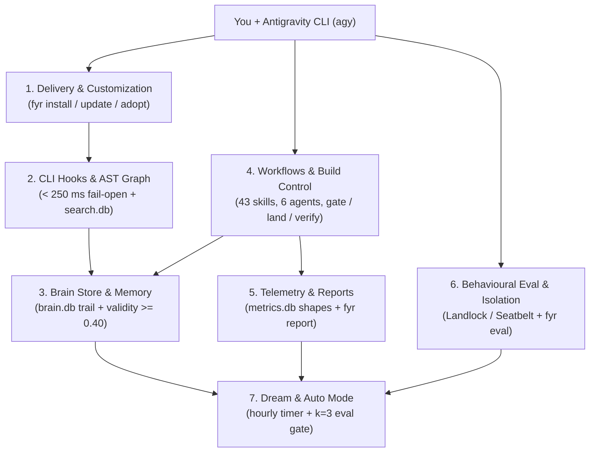
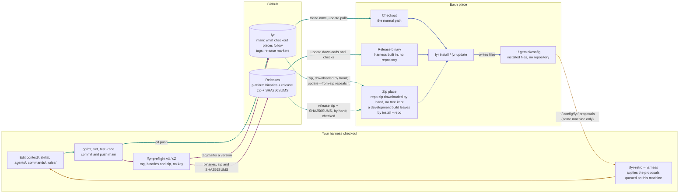
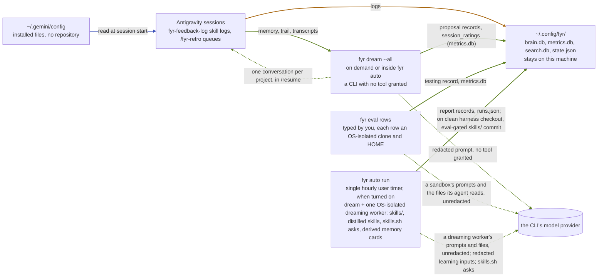
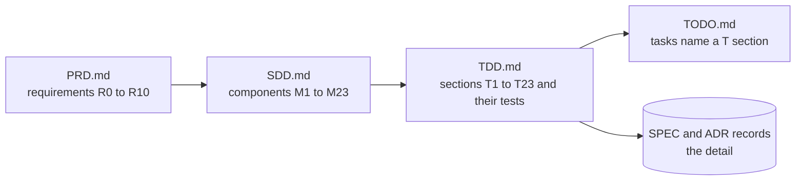

# fyr

**`fyr`** is an open-source agentic coding harness, build controller, and zero-daemon SQLite/AST second brain for the **Antigravity CLI** (`agy`) on Linux and macOS (`Apple Silicon`).

It packages one global context (`context/AGENTS.md`, [agents.md](https://agents.md) standard), 43 skills ([Agent Skills `SKILL.md`](https://agentskills.io) standard), 6 specialized subagents (`agents/<name>/agent.md`), 5 rules (`rules/*.md`), native parallel workflows (`workflows/*.py`), and a single static Go binary (`fyr`, built with `CGO_ENABLED=0` and `modernc.org/sqlite`). No background daemons, no proxies, no commit gates, no CI, and no hosted service (`PRD.md` R0–R10, MIT License in [`LICENSE`](LICENSE), security policy in [`SECURITY.md`](SECURITY.md)).

Quick links: [Workflow Guide](Workflow.md) (plan to finish, feature to finish & DoD) · [Feature Guides](#feature-guides--architecture) · [How It Works](#how-it-works) · [Quickstart](#quickstart-three-ways-in) · [Daily CLI Reference](#daily-cli-reference)

## Why it exists

Antigravity sessions start stateless and truncate global rules beyond `24,000` bytes. `fyr` solves three operational gaps without adding persistent background services:

- **Context drifts across machines.** Rules and skills tweaked on a laptop are missing on a workstation a week later. `fyr install` deploys the exact same context, skills, subagents, rules, and `< 250 ms` fail-open CLI hooks (`~/.gemini/config/hooks.json`) on every machine, and `fyr status` / `fyr diff` catch drift immediately.
- **Sessions forget.** When an `agy` conversation ends or compacts, architectural decisions, bug root causes, and multi-phase plans disappear unless recorded. `fyr` keeps a searchable SQLite + FTS5 trail (`~/.config/fyr/brain.db`) and validity-scored `semantic`/`procedural`/`episodic` memory (`project` and `--global`), backed by a pure-Go AST symbol/call graph (`.agents/scratch/search.db`) that injects Turn-0 context capsules and re-primes state after compaction.
- **A CLI cannot measure or verify itself.** `fyr metrics` and `fyr report` track session shapes, token trajectories, conversation ratings, and trigger coverage without storing prose; `fyr eval` runs behavioral suites inside OS-isolated sandboxes; and `fyr dream` / `fyr auto` consolidate memory, rate stale conversations, and propose eval-gated skill improvements across all workspaces.

## Feature Guides & Architecture

`fyr` divides its capabilities into seven focused subsystems that work together around every Antigravity CLI session. Start with the [Workflow Guide](Workflow.md) for the end-to-end engineering lifecycle (goal, turn classification, plan-to-finish, feature-to-finish, and step-by-step Definition of Done), or explore each subsystem deep-dive below for Mermaid lifecycle diagrams, internal thresholds, and collapsible flag references.



| Feature Guide | Components | Key CLI Verbs | What It Covers |
|---|---|---|---|
| [Delivery, Installer & Customization](features/delivery-and-customization.md) | M1–M6 | `fyr install`, `fyr update`, `fyr status`, `fyr adopt` | Atomic `~/.gemini/config/` deployment, three delivery paths, stack overrides, size budgets, and allowlist lint |
| [CLI Hooks, Prompt Vetting & AST Graph](features/hooks-and-ast-graph.md) | M8 | `fyr search`, `fyr index` | `< 250 ms` lifecycle hooks, 9-mode intent vetter, subtask decomposition, worker JIT capsules, `[COORDINATOR_GUARD]`, SHA-256 read ledger, `[CLAMPED]` skeletons, and PageRank AST slicing |
| [Brain Store, Trail & Memory](features/brain-and-memory.md) | M7, M15 | `fyr record`, `fyr memory`, `fyr resume` | 15 record kinds in `brain.db`, seven-step resume, `.agents/trail.jsonl` export/sync, and validity-scored memory |
| [Workflows, Swarm & Build Control](features/workflows-and-build-control.md) | M2, M3, M14, M20, M21, M23 | `fyr verify`, `fyr gate`, `fyr land`, `fyr close`, `fyr watch`, `fyr check`, `fyr models` | 43 skills, 6 subagents, `run_workflow` parallel scripts, live model/quota routing, out-of-band hang checks, and deterministic verification |
| [Telemetry, Trajectories & Reports](features/metrics-and-reports.md) | M10 | `fyr metrics`, `fyr report` | Shape-only `metrics.db` ingestion, `180k` context-knee trajectory anomalies, and 6-section HTML/Markdown reports |
| [Behavioural Eval & OS Isolation](features/eval-and-isolation.md) | M13, M22 | `fyr eval` | Sandboxed multi-turn/ACP behavioral testing, Wilson 95% intervals, host-safety checks `a`–`e`, subagent check `f`, Landlock, and Seatbelt |
| [Dream Consolidation & Auto Mode](features/dream-and-auto.md) | M11, M12, M19 | `fyr dream`, `fyr auto` | Global binary `on \| off` `fyr auto` timer, all-workspace stale-conversation rating (`session_ratings`), zero-tool dreamer, gates `G1`–`G3`/`G8`/`G9`, risk rubric, and `k=3` eval-gated skill edits |

## How it works

This map is the contract for how the harness reaches a machine and for what leaves one: the dreamer's redacted prompt, the operator's `fyr eval` runs, and `fyr auto`'s isolated dreaming workers. The strict rules that keep it true are in `.agents/rules/delivery-map.md`; `TestHarnessMap` fails when the map names a command the binary does not have.

### Delivery, Release & Local Loop



### On-Machine Sessions, Dream, Eval & Auto



| Colour | Path | What it carries |
|---|---|---|
| Teal | **update** | a place moving forward |
| Indigo | **install** | a place writing the installed files |
| Amber | **the loop on this machine** | corrections and proposals stay in `~/.config/fyr/` and reach this repository only through `/fyr-retro --harness`, run by you on the machine that logged them (ADR-062), or an eval-gated `fyr auto` commit to this checkout's local branch (R9, ADR-090), which you push |
| Plum | **release** | `/fyr-preflight` tagging `main` and publishing the release |
| Olive | **learn** | `fyr dream` (on demand or inside `fyr auto`), `fyr eval` and `fyr auto`: on the machine, not ways in. Their dashed lines to the CLI's model provider are the things fyr sends off the machine by design: the dreamer's redacted prompt (ADR-049); the prompts of an eval sandbox you started and the files its agent reads, unredacted as in any session (ADR-065); the same for a `fyr auto` dreaming worker (`skills/`, distilled skills, `skills.sh` asks, `derived` memory cards) started by the hourly timer when you turned auto on (`fyr auto` and `fyr eval` isolate sessions under Landlock on Linux / Seatbelt on macOS, failing closed when unavailable; ADR-076, ADR-090, ADR-522, ADR-523), plus a learning worker's redacted conversations, memory, proposals and trajectory/metric digests and a missing-skill worker's search on skills.sh and the npm registry: fyr sends nothing else, but its agent runs with `command(*)` and the network, so a misled agent could send what it reads elsewhere; OS isolation keeps it off your files, not off the network. The dreamer's line to the sessions, one conversation per project that `/resume` lists, is dashed because only Linux has run it end to end; the operator's macOS run turns it solid (ADR-073). |

A dashed line is a gap: done by hand or limited to one machine. The design around the map is `SDD.md` § Deployment; what a release delivers to each kind of place is stated once, in `SPEC-fyr-delivery` § The model.

## What you get

Installing `fyr` deploys seven managed surfaces into `~/.gemini/config/` and `~/.local/bin/fyr` without writing to any vendor `settings.json` (`PRD.md` Non-goals). See [Delivery, Installer & Customization](features/delivery-and-customization.md) for allowlists and size budgets.

| Surface | Installed path & details |
|---|---|
| **Global context** | `context/AGENTS.md` + `context/dev-setup.md`, rendered and deployed as `~/.gemini/config/rules/AGENTS.md` |
| **Skills (43)** | `skills/<name>/SKILL.md` → `~/.gemini/config/skills/<name>/`; auto-loaded by description or invoked as `/name` |
| **Subagents (6)** | `agents/<name>/agent.md` → `~/.gemini/config/agents/<name>/agent.md` (`documentation`, `dreamer`, `explorer`, `reviewer`, `security`, `verifier`) |
| **Rules (5)** | `rules/*.md` → `~/.gemini/config/rules/*.md` (`agy-dispatch`, `code-modularity`, `critical-thinking`, `fyr-features`, `session-sizing`) |
| **Workflow scripts (2)** | `workflows/*.py` → `~/.gemini/config/workflows/*.py` (`review_parallel.py`, `preflight_gate.py`) for native `run_workflow` parallel orchestration |
| **Lifecycle hooks** | `~/.gemini/config/hooks.json` invoking `fyr search --hook` (`session-start`, `pre-invocation`, `pre-tool-use`, `post-tool-use`, `stop`) with `< 250 ms` fail-open timeout and `PreToolUse`/`PostToolUse` Watchdog breakers (`watchdog_ring`, interactive-stdin/loop/budget guards) |
| **Binary (`fyr`)** | `~/.local/bin/fyr` + local stores under `~/.config/fyr/` (`brain.db`, `metrics.db`, `search.db`, `state.json`, `0700` mode) |

## Quickstart: Three Ways In

Ensure `~/.local/bin` is on your `PATH` and the Antigravity CLI (`agy`) is installed before choosing a delivery path. What each kind of place fetches when moving forward is defined in `SPEC-fyr-delivery` § The model.

### 1. From a source checkout

Recommended when you customize skills, rules, or global context (`go` 1.24.4+ and `git` required):

```bash
git clone https://github.com/kesokaj/fyr.git ~/workspace/fyr   # or SSH: git clone git@github.com:kesokaj/fyr.git ~/workspace/fyr
cd ~/workspace/fyr
go run ./cmd/fyr install          # builds the binary, installs ~/.local/bin/fyr, deploys ~/.gemini/config/
fyr status                        # ends with "drift none"
```

Keep a checkout place current with `fyr update` (`fyr update` refuses a checkout with uncommitted local changes; `fyr update --check` only reports and exits `2` when behind).

### 2. Install without cloning

Release binaries (`fyr-linux-amd64`, `fyr-darwin-arm64`, `fyr-linux-arm64`) embed all six content directories with no git or Go toolchain required. Pin `V` from a trusted out-of-band source (not the Releases page itself) and verify against `SHA256SUMS` over HTTPS (ADR-053, ADR-515):

```bash
V=vX.Y.Z && ASSET=fyr-linux-amd64 \
&& D=$(mktemp -d) && cd "$D" \
&& curl -fsSLO "https://github.com/kesokaj/fyr/releases/download/$V/$ASSET" \
&& curl -fsSLO "https://github.com/kesokaj/fyr/releases/download/$V/SHA256SUMS" \
&& grep -qxF "# fyr $V" SHA256SUMS \
&& grep -v '^#' SHA256SUMS | sha256sum -c - --ignore-missing \
&& chmod +x "$ASSET" \
&& test "$("./$ASSET" version)" = "fyr $V" \
&& mkdir -p ~/.local/bin && mv "$ASSET" ~/.local/bin/fyr && cd ~ && rm -r "$D"
```

Then deploy the embedded harness into `~/.gemini/config/` without touching any vendor `settings.json`:

```bash
hash -r         # bash (zsh: rehash) so the shell resolves ~/.local/bin/fyr
fyr version     # verify the expected version is first on PATH (BUG-078)
fyr install     # installs the harness built into the binary
fyr status      # "source embedded vX.Y.Z" and "drift none"
```

Update a release-binary machine anytime with `fyr update`, which checks GitHub Releases over HTTPS against `SHA256SUMS` with no `gh` CLI required.

<details>
<summary>Alternative binary download methods (gh, go install, macOS browser)</summary>

With GitHub CLI (`gh`):

```bash
V=vX.Y.Z \
&& D=$(mktemp -d) && cd "$D" \
&& gh release download "$V" --repo github.com/kesokaj/fyr --clobber \
     --pattern 'fyr-linux-amd64' --pattern 'SHA256SUMS' --dir "$D" \
&& grep -qxF "# fyr $V" SHA256SUMS \
&& grep -v '^#' SHA256SUMS | sha256sum -c - --ignore-missing \
&& chmod +x fyr-linux-amd64 \
&& test "$(./fyr-linux-amd64 version)" = "fyr $V" \
&& mv fyr-linux-amd64 ~/.local/bin/fyr && cd ~ && rm -r "$D"
```

With `go install`:

```bash
GOBIN="$HOME/.local/bin" go install github.com/kesokaj/fyr/cmd/fyr@vX.Y.Z
```

From a browser download on macOS (verifying checksum and lifting quarantine):

```bash
V=vX.Y.Z \
&& ls ~/Downloads/fyr-darwin-arm64 ~/Downloads/SHA256SUMS >/dev/null \
&& D=$(mktemp -d) && mv ~/Downloads/fyr-darwin-arm64 ~/Downloads/SHA256SUMS "$D" && cd "$D" \
&& grep -qxF "# fyr $V" SHA256SUMS \
&& grep -v '^#' SHA256SUMS | shasum -a 256 -c - --ignore-missing \
&& chmod +x fyr-darwin-arm64 && { xattr -d com.apple.quarantine fyr-darwin-arm64 2>/dev/null || true; } \
&& test "$(./fyr-darwin-arm64 version)" = "fyr $V" \
&& mv fyr-darwin-arm64 ~/.local/bin/fyr && cd ~ && rm -r "$D"
```

</details>

### 3. Install from a zip (no SSH, no gh)

Download `fyr-vX.Y.Z.zip` and `SHA256SUMS` beside your `fyr` binary and run `fyr update --from-zip`:

```bash
fyr update --from-zip ~/Downloads/fyr-vX.Y.Z.zip   # verifies against SHA256SUMS when beside the zip
fyr status                                         # "installed … from zip sha256:<hex> (verified vX.Y.Z)"
```

`fyr` unpacks the zip into a temporary directory inside `~/.config/fyr/`, installs the files, and deletes the temporary directory (`SPEC-fyr-delivery` § The model).

## First 5 Minutes in Any Repository

Once `fyr install` reports `drift none`, initialize indexing and query the AST graph inside any project repository:

1. **Choose your indexing tier:** Run `/fyr-index-project` (`fyr index`) for zero-scaffold `.agents/scratch/search.db` AST/FTS5 indexing (also auto-initialized on Turn 1 by `pre-invocation`), or run `/fyr-init-project` to scaffold `AGENTS.md`, `PRD.md`, `SDD.md`, `TDD.md`, `TODO.md`, `GUIDE-testing`, and `DEPLOY-local`.
2. **Start every session with `fyr resume`:**
   ```bash
   fyr resume   # prints AGENTS.md, open records, newest handoff, TODO.md Now, open plans, recent changes, and semantic memory
   ```
3. **Query the AST graph and trail before reading files:**
   ```bash
   fyr search --slice "handlePreInvocation"   # tiered AST context capsule + linked records
   fyr search --affected "CheckAndRecordRead" # callers, importers, and blast radius
   fyr search --path "run" --to "Install"     # shortest call/import path between symbols
   fyr search --skeleton internal/search/vet.go
   fyr search --map                           # architectural God Nodes, package deps, and cycles
   ```
4. **Drive work through `/fyr-*` workflows:** Use `/fyr-feature` for phased plans with pre-build interviews, `/fyr-bug` for symptom-only diagnosis and red-first tests, `/fyr-review` for parallel multi-lens review, and `/fyr-handoff` (or `fyr close`) at completion — see [Workflow.md](Workflow.md) for the full lifecycle and Definition of Done.

## Second-Brain Architecture

`fyr` pairs `< 250 ms` fail-open CLI hooks with three local SQLite stores and OS-native process sandboxing so sessions stay fast, accurate, and measurable:

- **`< 250 ms` fail-open CLI hooks (`internal/search/hook.go`, `ADR-511`, `ADR-525`, `ADR-526`):** Serve `session-start` (`<= 1,500 B` capsule), `pre-invocation` (9-mode intent vetter, 6-anchor score, `improvedPrompt`, compaction-deduplicated `skillDigests`, deterministic `subtasks[]` with `COORDINATE_SUBTASKS`, Hop-0 PageRank AST slice, on-demand `procedural`/`episodic` memory, cryptographic `=====<18-hex>=====` data fence, and zero-token `{}` on `PASS_THROUGH`), `pre-tool-use` (`[CLAMPED]` `>= 400`-line unranged read guard, SHA-256 `read_ledger` deduplication, `invoke_subagent` / `run_workflow` / `swarm` quota routing with `needsGuardedProUpgrade`, fenced `<= 1,200 B` `[FYR_WORKER_CAPSULE]` worker prompt injection, `[COORDINATOR_GUARD]` direct-edit protection, `[INTERACTIVE_STDIN]` prompt guard, and Watchdog `[POLL_LOOP]`/`[TOKEN_LOOP]`/`[SUBAGENT_BUDGET]` breakers), `post-tool-use` (`watchdog_ring` tool-error marking), and `stop` (`co_activity` + `[VERIFY_STAMP]` check), with `.agents/scratch/search.db` at `schemaVersion = "9"` (camelCase/snake_case `chunks.tokens` FTS5 indexing and `refs_oid` index). See [CLI Hooks, Prompt Vetting & AST Graph](features/hooks-and-ast-graph.md).
- **Brain store (`~/.config/fyr/brain.db`, `internal/brain`):** Holds 15 project and global record kinds (`plan`, `review`, `testing`, `change`, `handoff`, `bug`, `adr`, `retro`, `learning`, `spec`, `guide`, `deploy`, `memory`, `feedback`, `proposal`) with deterministic memory validity scoring (`>= 0.40`) and on-demand `.agents/trail.jsonl` export/sync. See [Brain Store, Trail & Memory](features/brain-and-memory.md).
- **Session telemetry & trajectory (`~/.config/fyr/metrics.db`, `internal/metrics`):** Stores shape-only tool, token, `model`/`tool`/`wait`/`idle` wall-time splits, trajectory anomalies (`KNEE_EXCEEDED`, `REDUNDANT_READ`, `RETRY_LOOP`), stale-conversation `session_ratings`, post-gate `judge_verdicts` (`metrics.db` v9), v9 orchestration/quota/health signals, and six-section usage reports via `fyr report`. See [Telemetry, Trajectories & Reports](features/metrics-and-reports.md).
- **Sandboxed evaluation (`internal/isolate`, `internal/eval`):** Runs `fyr eval` and `fyr auto` workers inside Linux Landlock or macOS Seatbelt confinement (failing closed when unavailable) with host-safety checks `a`–`e` and subagent check `f`. See [Behavioural Eval & OS Isolation](features/eval-and-isolation.md).
- **Idle-time consolidation & dreaming (`internal/dream`, `internal/auto`):** Runs `fyr auto` as a binary `on` / `off` global switch (`--conversation-idle` default `1h`), discovers all Antigravity workspaces and conversations (including non-git directories and `search.GlobalWorkspace`) without registration, rates stale conversations in tool-free plan mode into `session_ratings` and `target: harness` proposals (`G4`–`G7` retired for dreaming), and executes eval-gated `skills/` workers on clean checkouts under `G1`–`G3`/`G8`/`G9`, a strict risk rubric, and a `k=3` behavioral eval gate (`ADR-090`, `ADR-522`, `ADR-523`, `ADR-524`). See [Dream Consolidation & Auto Mode](features/dream-and-auto.md).

## Customizing the Harness for Your Stack

`context/AGENTS.md` and `context/dev-setup.md` configure a default stack (**Go** backend, **TypeScript/Tailwind** frontend, **Google Cloud / Cloud Run** infrastructure), while project rules always override global context (`context/AGENTS.md` line 3). You can tailor `fyr` either per project (`<project>/AGENTS.md`, `.agents/rules/*.md`, `.agents/skills/<name>/SKILL.md`) or globally inside your `fyr` checkout (`context/*.md`, `rules/*.md`, `skills/*/SKILL.md`, `agents/*/agent.md`, `workflows/*.py`, or `fyr adopt`), then run `fyr install`.

To prevent Antigravity's `24,000`-byte global rules block from silently dropping instructions, `internal/harness/size_test.go` pins hand-written `context/*.md` under `13,000` bytes, always-on context plus `always_on` rules under `9,000` bytes, repository `AGENTS.md` under `4,500` bytes, and the combined deployed rules block under `19,500` bytes (`PRD.md` `22,000`-byte cap), ending the rendered block with the canary word `GANNET` so truncation is immediately visible. Global rules also enforce that temporary/scratch files belong in `.agents/scratch/` and never `/tmp`, and commits carry no co-author trailer (`check-trailers.sh`). See [Delivery, Installer & Customization](features/delivery-and-customization.md) for frontmatter allowlists and `knownTools` rules.

## Daily CLI Reference

Use these ten commands in daily workflows, and expand the full reference below for all 27 `fyr` commands (`fyr help <verb>` prints full flags and `SPEC-fyr-*` holds complete contracts).

| Command | What it does |
|---|---|
| `fyr install` | Deploy context, skills, agents, rules, workflows, and hooks to `~/.gemini/config/` |
| `fyr update` | Move a checkout, release binary, or `--from-zip` place forward |
| `fyr status` | Check installed version, drift, auto/dream state, and PATH shadowing |
| `fyr resume` | Print seven-step read-only session resume (`AGENTS.md`, plans, handoff, changes, memory) |
| `fyr search <words>` | Search `brain.db` + FTS5/AST graph (`--slice`, `--skeleton`, `--path`, `--affected`, `--map`, `--vet`, `--hook`) |
| `fyr record add` / `get` / `edit` / `list` | Manage project and `--global` trail records (`export` / `sync` for `.agents/trail.jsonl`) |
| `fyr memory add` / `show` | Save or view validity-scored `semantic`, `procedural`, and `episodic` memories |
| `fyr verify` | Run `gofmt`, `go vet ./...`, `go test -race ./...`, and `fyr check`, writing `.agents/scratch/verify.stamp` |
| `fyr report` | Render the six-section Economist HTML or `--md` usage report |
| `fyr auto on` / `off` / `status` / `run` | Global binary on/off switch for hourly stale-conversation rating, dreaming, and eval-gated skill improvement |

<details>
<summary>Complete CLI command reference (all 27 commands)</summary>

| Command | What it does |
|---|---|
| `fyr status` | What is installed, from which commit, and any drift; exit 1 on drift |
| `fyr update` | Moves this place forward: a checkout pulls, a release binary downloads the newest release, a zip place passes the zip with `--from-zip` |
| `fyr install` (or `sync`) | Deploys the harness and removes what the repository no longer has |
| `fyr diff` | A unified diff of every drifted file |
| `fyr uninstall` | Removes exactly what it installed plus `fyr auto`'s timer and any legacy dream timer; the metrics store and `fyr auto`'s config and state stay |
| `fyr list` | Prints the skill, subagent, rule, and workflow script inventory |
| `fyr render` | Prints the assembled `AGENTS.md` context file as `fyr install` deploys it |
| `fyr record add` / `get` / `edit` / `list` / `export` / `sync` / `import` | The brain store: this project's trail records and the global ones (`export` writes `.agents/trail.jsonl` on demand; `sync` loads it into `brain.db`) |
| `fyr resume` | Prints this checkout's seven-step session resume (`AGENTS.md`, open records, newest handoff, `TODO.md` Now, open plans, recent changes, memory) in one read-only call |
| `fyr search <words>` | Matching records first, then ranked files (`--slice`, `--skeleton`, `--path`, `--to`, `--affected`, `--map`, `--refs`, `--open`, `--vet`, `--hook`) |
| `fyr index [--rebuild] [--register]` | Reconciles or clean-rebuilds `.agents/scratch/search.db` (and `~/.config/fyr/search.db` with `--global`); `--register` opts the project into `fyr search --global`, `fyr record import --global`, and the metrics join |
| `fyr memory add` / `show` | Project and `--global` memory (`semantic`, `procedural`, `episodic`), validity-scored (`--include-low` shows `< 0.40`) |
| `fyr metrics ingest` / `show` / `report` / `evals` / `trajectory` / `export` | The shape of every session: stored, summarised, charted, trended (`trajectory`), and backed up |
| `fyr report [--project [DIR] \| --global] [--md] [--out FILE]` | Renders the six-section project or global usage report (`1. Executive Pulse`, `2. Second-Brain Leverage`, `3. Quality & Learning Loop`, `4. Autonomy & Model Routing`, `5. Trigger coverage`, `6. Per-Project / Project Breakdown`) as HTML or Markdown (`--md`) |
| `fyr dream --all` / `--project DIR` | One-shot dreamer (also invoked hourly by `fyr auto run`): discovers git, non-git, and `__global__` workspaces without registration, rates stale conversations (`session_ratings`), and proposes memory, trail, and skill improvements in plan mode with zero tools granted |
| `fyr auto on` / `off` / `status` / `run` / `--dry-run` | Single hourly background runner with global binary switch (`--conversation-idle D` defaults to `1h`; `on`/`off` also take `--dry-run` and retire any legacy `fyr-dream` timer), running `dream`, rating stale conversations, free checkout checks, and OS-isolated dreaming workers with `k=3` eval gates |
| `fyr check` | Read-only drift check of docs, specs, `PRD.md`, and `SDD.md`/`TDD.md` traces against the binary and tree |
| `fyr git-check` | Runs the three post-dispatch git checks (`git status --short --untracked-files=all`, `git log --branches --not --remotes --oneline`, `git tag`) in one read-only call |
| `fyr watch --check [--conv ID] [--idle-sec N] [--json]` | Out-of-band `< 30 ms` read-only hang, interactive-stdin, stale-artifact, and subagent-budget check (`[INTERACTIVE_WAIT]`, `[STUCK_NO_PROGRESS]`, `[BUDGET_NEAR_LIMIT]`) |
| `fyr verify` | Runs `gofmt`, `go vet ./...`, `go test -race ./...`, and `fyr check`, guarding against mid-run tree mutation and writing `.agents/scratch/verify.stamp` (`0600`) |
| `fyr gate [--base REF] [--lease GLOB] [--lease-file FILE] [--max-files N] [--max-lines N] [--judge TEXT] [--judge-model ID] <worktree>` | Deterministic worktree gate: `Files:` lease globs, symlink/gitlink modes, secret filenames, numstat caps, added-line secret scan, commit trailers, and optional cross-family `--judge` verdict |
| `fyr land [--lease GLOB] [--lease-file FILE] [--message TEXT] [--max-files N] [--max-lines N] [--timeout D] [--judge TEXT] [--judge-model ID] <branch>` | Gates `<branch>` (plus optional `--judge` verdict), squash-merges and runs `fyr verify` in a detached scratch worktree, fast-forwards the clean base branch, deletes `<branch>`, and refreshes `verify.stamp` |
| `fyr close --title TEXT [--body-file FILE]` | Stores an immutable `handoff` record embedding `## Verification Digest` from a fresh `verify.stamp` without mutating or deleting prior records |
| `fyr models [--explain ID] [--json] [--pick ROLE] [--refresh] [--tier T]` | Lists the live `agy models` + `agy changelog` catalog cached in `~/.config/fyr/models.json`, explains model profiles (`--explain`), and resolves evidence-judged role picks |
| `fyr eval --home DIR [--runs N] [--parallel N] [--runner isolate] [--acp] [--suite-file PATH] <row>...` | Runs behavioral evaluation rows against `agy` inside OS-native `isolate` sandboxes (or `--acp` sessions) and stores trials in `metrics.db` |
| `fyr adopt <name>` | Copies a skill installed elsewhere into `skills/` |
| `fyr version` | Prints the build version |

</details>

## Skills & Subagents

`fyr list` prints every skill, subagent, rule, and workflow script installed from the harness.

### Skills (43)

| Group | Skills |
|---|---|
| **Work protocols** | `fyr-feature` (phased plan, cold-reader check, checkpoints), `fyr-swarm` (native parallel swarm routing, `Files:` leases, and `fyr gate`/`fyr land`), `fyr-bug` (diagnose, red-first test, smallest fix, bug record), `fyr-triage` (GitHub issue/PR and local queue triage into Agent Briefs or `/fyr-swarm` Kickoffs), `fyr-review` (`--code --security --simplify --docs --prompts --tests --all --resume --judge --fix`), `review-standards`, `fyr-preflight` (release gate & publisher), `fyr-harness-audit`, `fyr-auto` (worker contract for `fyr auto`) |
| **Project shape & indexing** | `fyr-init-project` (full scaffold + trail + index), `fyr-index-project` (zero-scaffold MVP `.agents/scratch/search.db` indexing & AST graph), `fyr-refresh-project-index` (reconcile or `--rebuild` index + `--map` diagnostics), `fyr-docs` (BLUF, airy prose, Mermaid diagrams & `<details>` doc standard + docset audit), `fyr-requirements`, `fyr-spec`, `testing-strategy`, `fyr-explain-project` (`GUIDE-onboarding`), `fyr-research`, `fyr-handoff` (session checkpoint + Kickoff block) |
| **Learning loop** | `fyr-feedback-log`, `fyr-project-memory`, `fyr-retro`, `fyr-distill`, `fyr-dream` |
| **Code & UI** | `golang`, `typescript`, `frontend-ui-modern` (shadcn/ui + Tailwind + React), `frontend-ui-economist` (editorial HTML/CSS/SVG), `bash` (incl. interactive setup wizards), `json-api-style`, `docker`, `mermaid-syntax` |
| **Google Cloud** | `gcloud-setup`, `cloud-run-deploy`, `terraform`, `operate-gcp`, `data-gcp`, `api-auth-gcp`, `gke-basics`, `google-catalog` (routes to pinned Google skills under `skills/google-catalog/catalog/`) |
| **Vendored & forks** | `grilling`, `codebase-design`, `discover-skills` (forked from `find-skills`), `fyr-docs` (forked from `docs-writer`), `fyr-triage` (forked from `triage`), `bash` wizard, and `gke-basics`; provenance in `skills/VENDORED.md` |

### Subagents (6)

| Subagent | Default Model | Role |
|---|---|---|
| `explorer` | `flash` | Read-only codebase reconnaissance (10+ files) drafted under `.agents/scratch/agents/` and stored as a `plan` record |
| `reviewer` | inherit | Independent severity-ranked code, docs, and prompt review drafted under `.agents/scratch/agents/` (`review` record) |
| `security` | inherit | Defensive security audit of diffs touching auth, crypto, secrets, IAM, input parsing, frontmatter allowlists, or dependencies (inherits session model) |
| `verifier` | inherit | Runs browser e2e, container build/smoke, and live local HTTP smoke (`fyr verify` runs unit, vet, and `fyr check`) on the live tree and drafts a `testing` record |
| `documentation` | `flash` | Maintains living docs (`README.md`, `SDD.md`, `TDD.md`, `SPEC-*`, `GUIDE-*`, `DEPLOY-*`) when changes exceed 30 lines |
| `dreamer` | inherit | Consolidation judgement for `/fyr-retro` and `/fyr-distill`, proposing `skills/` edits, new skill drafts, and memory card consolidation (project + `--global`, validity `< 0.40`, using trajectory digest) |

## Repository Layout

The repository separates immutable requirements, architecture, and verification traces (`PRD.md` → `SDD.md` → `TDD.md` → `TODO.md`) from the six embedded harness directories and per-feature documentation (`features/`).

```
PRD.md        what the harness is for and what must never drift (R0–R10)
SDD.md        how the parts fit: components M1–M23, the main flows, the decisions
TDD.md        how each part is built: sections T1–T23 and their tests
TODO.md       Now, Next and Backlog; the active plan record wins
Workflow.md   end-to-end engineering workflow (goal, plan-to-finish, feature-to-finish, DoD)
AGENTS.md     the rules of this repository, for agents
LICENSE       MIT License
SECURITY.md   vulnerability reporting and security boundary overview
features/     deep-dive feature guides with Mermaid architecture and lifecycle diagrams
context/      AGENTS.md (the global context) and dev-setup.md (environment, stack, GCP defaults)
agents/       one directory per subagent (agent.md, in Antigravity's format, installed as written)
skills/       one directory per skill (SKILL.md, references/, assets/)
rules/        always-on or path-scoped rules
commands/     markdown prompts invoked as /name (empty; prefer skills)
workflows/    native run_workflow scripts (review_parallel.py, preflight_gate.py)
cmd/fyr       the binary; internal/ its packages, each named in AGENTS.md § Layout
embed.go      the go:embed of the six content directories, pinned to what git tracks
.agents/      this repository's .agents/skills symlink, .agents/eval/ suite, and .agents/scratch/ (gitignored)
```



## Working on the Harness

Run formatting, static analysis, the race-enabled Go test suite, and scratch-home verification before claiming completion (`AGENTS.md` § Setup commands):

```bash
gofmt -l cmd internal && go vet ./... && go test -race -timeout 30m ./... # auto: test
go run ./cmd/fyr install --home .agents/scratch/home   # exercise installer in scratch home
go run ./cmd/fyr list   # sanity-check skills and agents parse
go mod download   # cache the one module (R4) for offline builds
"$(go env GOPATH)/bin/govulncheck" ./...   # watch for NEW findings (known: DEPLOY-local § Operator steps)
```

Every stateful `fyr` command run during development must pass `--home .agents/scratch/<name>` (`cmd/fyr/realhome_guard.go`, `ADR-505`), and `internal/harness/size_test.go` must pass without raising any byte ceiling.

Where to read more: [`Workflow.md`](Workflow.md) for the end-to-end engineering workflow and DoD; [`AGENTS.md`](AGENTS.md) for repository rules; [`PRD.md`](PRD.md), [`SDD.md`](SDD.md), and [`TDD.md`](TDD.md) for requirements, architecture, and test pins; [`SECURITY.md`](SECURITY.md) for security boundaries; [Feature Guides](features/delivery-and-customization.md) for subsystem deep dives; and `fyr record list --kind spec` / `fyr record list --kind adr` for surface specs and architecture decisions.
