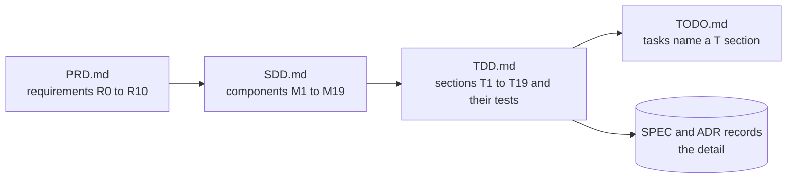

# fyr

**`fyr`** is an open-source agentic coding harness and zero-daemon SQLite/AST second brain for the **Antigravity CLI** (`agy`) on Linux and macOS (`Apple Silicon`).

It packages one global context (`context/AGENTS.md`, following the [agents.md](https://agents.md) standard), 41 skills ([Agent Skills `SKILL.md`](https://agentskills.io) standard), 8 specialized subagents (`agents/<name>/agent.md`), 4 always-on rules (`rules/*.md`), and a single static Go binary (`fyr`, built with `CGO_ENABLED=0` and one pure-Go dependency, `modernc.org/sqlite`). No background daemons, no proxies, no commit gates, no CI, and no hosted service (`PRD.md` R0–R10, MIT License in [`LICENSE`](LICENSE), security policy in [`SECURITY.md`](SECURITY.md)).

## Why it exists

- **Context drifts across machines.** Rules and skills tweaked on a laptop are missing on a workstation a week later. `fyr install` deploys the exact same context, skills, subagents, rules, and `< 250 ms` fail-open CLI hooks (`~/.gemini/config/hooks.json`) on every machine, and `fyr status` / `fyr diff` catch drift immediately.
- **Sessions forget.** When an `agy` conversation ends or compacts, architectural decisions, bug root causes, and multi-phase plans disappear unless recorded. `fyr` keeps a searchable SQLite + FTS5 trail (`~/.config/fyr/brain.db`) of plans, ADRs, bugs, reviews, test logs, changes, handoffs, and project memory, plus a pure-Go AST symbol/call graph (`.agents/scratch/search.db`) that pre-seeds Turn-0 structural context capsules and re-primes state after compaction.
- **A CLI cannot measure or verify itself.** `fyr metrics` records the structural shape of every session (token economics, tool calls, `model`/`tool`/`wait`/`idle` wall-time splits, redundant file reads, and multi-day trajectory trends — never your prose), `fyr eval` runs repeatable behavioural suites in isolated sandboxes, `fyr work` runs parallel unattended worker waves in Docker or host sandboxes, and `fyr dream` / `fyr auto` consolidate memory and run eval-gated maintenance during idle hours.

## How it works

This map is the contract for how the harness reaches a machine and for what leaves one: the dreamer's redacted prompt, the operator's `fyr eval` runs, the operator's `fyr work` workers and `fyr auto`'s workers. The strict rules that keep it true are in `AGENTS.md` § How the harness works; `TestHarnessMap` fails when the map names a command the binary does not have.

```mermaid
flowchart LR
    subgraph checkoutLane["Your harness checkout"]
        edit["Edit context/, skills/, agents/, commands/, rules/"]
        ship["gofmt, vet, test -race<br/>commit and push main"]
        preflight["/fyr-preflight vX.Y.Z<br/>tag, binaries and zip, no key"]
        retroHarness["/fyr-retro --harness<br/>applies the proposals queued on this machine"]
    end
    subgraph githubLane["GitHub"]
        harnessRepo[("fyr<br/>main: what checkout places follow<br/>tags: release markers")]
        releases[("Releases<br/>platform binaries + release zip + SHA256SUMS")]
    end
    subgraph placeLane["Each place"]
        checkoutPlace["Checkout<br/>the normal path"]
        binaryPlace["Release binary<br/>harness built in, no repository"]
        zipPlace["Zip place<br/>repo zip downloaded by hand, no tree kept<br/>a development build leaves by install --repo"]
        installer["fyr install / fyr update"]
        homeFiles["~/.gemini/config<br/>installed files, no repository"]
        sessions["Antigravity sessions<br/>fyr-feedback-log skill logs, /fyr-retro queues"]
        configDir["~/.config/fyr/<br/>brain.db, metrics.db, search.db, state.json<br/>stays on this machine"]
        dreamer["fyr dream --all<br/>hourly user timer, while agy runs<br/>a CLI with no tool granted"]
        evalRun["fyr eval rows<br/>typed by you, each row a sandboxed clone and HOME"]
        workRun["fyr work Kickoff file<br/>typed by you, a sandboxed clone with no remote and HOME, in docker or host"]
        autoRun["fyr auto run<br/>hourly user timer, when turned on<br/>one M18 worker or eval run, in docker or host"]
    end
    edit --> ship
    ship -- "git push" --> harnessRepo
    ship --> preflight
    preflight -- "tag marks a version" --> harnessRepo
    preflight -- "binaries, zip and SHA256SUMS" --> releases
    harnessRepo -- "clone once, update pulls" --> checkoutPlace
    releases -- "update downloads and checks" --> binaryPlace
    harnessRepo -. "zip, downloaded by hand; update --from-zip repeats it" .-> zipPlace
    releases -. "release zip + SHA256SUMS, by hand; checked" .-> zipPlace
    checkoutPlace --> installer
    binaryPlace --> installer
    zipPlace -.-> installer
    installer -- "writes files" --> homeFiles
    homeFiles -- "read at session start" --> sessions
    sessions -- "logs" --> configDir
    configDir -. "same machine only" .-> retroHarness
    retroHarness --> edit
    sessions -- "memory, trail, transcripts" --> dreamer
    dreamer -- "proposal records, metrics.db" --> configDir
    dreamer -. "redacted prompt, no tool granted" .-> provider[("the CLI's model provider")]
    dreamer -. "one conversation per project, in /resume" .-> sessions
    evalRun -- "testing record, metrics.db" --> configDir
    evalRun -. "a sandbox's prompts and the files its agent reads, unredacted" .-> provider
    workRun -. "a worker's prompts and the files its agent reads, unredacted" .-> provider
    autoRun -- "report records, runs.json; at level harness, eval-gated local commit" --> configDir
    autoRun -. "a worker's or eval's prompts and the files its agent reads, unredacted; redacted learning inputs" .-> provider
    linkStyle 0,1,5,6,7,8 stroke:#0B7A74,stroke-width:2px
    linkStyle 2,3,4 stroke:#8A3A78,stroke-width:2px
    linkStyle 9,10,11,12,13 stroke:#3B4FB8,stroke-width:2px
    linkStyle 14,15,16 stroke:#A8660F,stroke-width:2px
    linkStyle 17,18,19,20,21,22,23,24,25 stroke:#5B7F1E,stroke-width:2px
```



| Colour | Path | What it carries |
|---|---|---|
| Teal | **update** | a place moving forward |
| Indigo | **install** | a place writing the installed files |
| Amber | **the loop on this machine** | corrections and proposals stay in `~/.config/fyr/` and reach this repository only through `/fyr-retro --harness`, run by you on the machine that logged them (ADR-062), or an eval-gated `fyr auto` commit to this checkout's local branch (R9, ADR-090), which you push |
| Plum | **release** | `/fyr-preflight` tagging `main` and publishing the release |
| Olive | **learn** | the dreamer, hourly while an `agy` session of yours runs, `fyr eval`, `fyr work` and `fyr auto`: on the machine, not ways in. Their dashed lines to the CLI's model provider are the things fyr sends off the machine by design: the dreamer's redacted prompt (ADR-049); the prompts of an eval sandbox you or `fyr auto` started and the files its agent reads, unredacted as in any session (ADR-065, ADR-090); the same for a `fyr work` worker you started or a `fyr auto` worker started by the timer when you turned auto on (each in docker when `fyr work`'s docker preflight passes, otherwise on the host, unless `fyr work --runner` names one; ADR-076, ADR-090, ADR-504), plus a learning worker's redacted conversations, memory, proposals and metric numbers and a missing-skill worker's search on skills.sh and the npm registry: fyr sends nothing else, but its agent runs with `command(*)` and the network, so a misled agent could send what it reads elsewhere; the docker runner keeps it off your files but its login token, not off the network. The dreamer's line to the sessions, one conversation per project that `/resume` lists, is dashed because only Linux has run it end to end; the operator's macOS run turns it solid (ADR-073). |

A dashed line is a gap: done by hand or limited to one machine. The design around the map is `SDD.md` § Deployment; what a release delivers to each kind of place is stated once, in `SPEC-fyr-delivery` § The model.

## What you get

| Surface | Installed path & details |
|---|---|
| **Global context** | `context/AGENTS.md` + `context/dev-setup.md`, rendered and deployed as `~/.gemini/config/rules/AGENTS.md` |
| **Skills (41)** | `skills/<name>/SKILL.md` → `~/.gemini/config/skills/<name>/`; auto-loaded by description or invoked as `/name` |
| **Subagents (8)** | `agents/<name>/agent.md` → `~/.gemini/config/agents/<name>/agent.md` (`bugs`, `changelog`, `documentation`, `dreamer`, `explorer`, `reviewer`, `security`, `verifier`) |
| **Rules (4)** | `rules/*.md` → `~/.gemini/config/rules/*.md` (`agy-dispatch`, `code-modularity`, `critical-thinking`, `session-sizing`) |
| **Lifecycle hooks** | `~/.gemini/config/hooks.json` invoking `fyr search --hook` (`pre-invocation`, `pre-tool-use`, `stop`) with `< 250 ms` fail-open timeout |
| **Binary (`fyr`)** | `~/.local/bin/fyr` + local stores under `~/.config/fyr/` (`brain.db`, `metrics.db`, `search.db`, `state.json`, `0700` mode) |

## Quickstart: Three Ways In

Make sure `~/.local/bin` is on your `PATH` and the Antigravity CLI (`agy`) is installed. What each kind of place fetches when moving forward is defined in `SPEC-fyr-delivery` § The model.

### 1. From a source checkout (recommended if you customize skills/context)

Requires Go 1.24.4+ and `git`:

```bash
git clone https://github.com/kesokaj/fyr.git ~/workspace/fyr   # or SSH: git clone git@github.com:kesokaj/fyr.git ~/workspace/fyr
cd ~/workspace/fyr
go run ./cmd/fyr install          # builds the binary, installs ~/.local/bin/fyr, deploys ~/.gemini/config/
fyr status                        # ends with "drift none"
```

Move a checkout place forward at any time with `fyr update`.

### 2. Install without cloning

A machine that only uses the harness needs no git checkout or Go toolchain: each release binary (`fyr-linux-amd64`, `fyr-darwin-arm64`, `fyr-linux-arm64`) embeds `context/`, `skills/`, `agents/`, `commands/`, `rules/` and `docker/`. Set `V` to the version you expect (`v8.2.0`, etc.) from a source outside the download (the person who cut it, or a checkout's changelog), never from the Releases page itself: the guarantee is "the version you named, or nothing", and verify against `SHA256SUMS` over HTTPS (ADR-053, ADR-515).

With `curl` (Linux `amd64` shown; on macOS use `fyr-darwin-arm64` and `shasum -a 256 -c - --ignore-missing`):

```bash
V=vX.Y.Z && ASSET=fyr-linux-amd64 \
&& D=$(mktemp -d) && cd "$D" \
&& curl -fsSLO "https://github.com/kesokaj/fyr/releases/download/$V/$ASSET" \
&& curl -fsSLO "https://github.com/kesokaj/fyr/releases/download/$V/SHA256SUMS" \
&& grep -qxF "# fyr $V" SHA256SUMS \
&& grep -v '^#' SHA256SUMS | sha256sum -c - --ignore-missing \
&& chmod +x "$ASSET" \
&& test "$("./$ASSET" version)" = "fyr $V" \
&& mkdir -p ~/.local/bin && mv "$ASSET" ~/.local/bin/fyr && cd ~ && rm -r "$D"
```

Or with the GitHub CLI (`gh`):

```bash
V=vX.Y.Z \
&& D=$(mktemp -d) && cd "$D" \
&& gh release download "$V" --repo github.com/kesokaj/fyr --clobber \
     --pattern 'fyr-linux-amd64' --pattern 'SHA256SUMS' --dir "$D" \
&& grep -qxF "# fyr $V" SHA256SUMS \
&& grep -v '^#' SHA256SUMS | sha256sum -c - --ignore-missing \
&& chmod +x fyr-linux-amd64 \
&& test "$(./fyr-linux-amd64 version)" = "fyr $V" \
&& mv fyr-linux-amd64 ~/.local/bin/fyr && cd ~ && rm -r "$D"
```

Or with `go install` (setting `GOBIN` so the binary lands in `~/.local/bin/fyr`):

```bash
GOBIN="$HOME/.local/bin" go install github.com/kesokaj/fyr/cmd/fyr@vX.Y.Z
```

Or from a browser download on macOS (lifting the quarantine attribute):

```bash
V=vX.Y.Z \
&& ls ~/Downloads/fyr-darwin-arm64 ~/Downloads/SHA256SUMS >/dev/null \
&& D=$(mktemp -d) && mv ~/Downloads/fyr-darwin-arm64 ~/Downloads/SHA256SUMS "$D" && cd "$D" \
&& grep -qxF "# fyr $V" SHA256SUMS \
&& grep -v '^#' SHA256SUMS | shasum -a 256 -c - --ignore-missing \
&& chmod +x fyr-darwin-arm64 && { xattr -d com.apple.quarantine fyr-darwin-arm64 2>/dev/null || true; } \
&& test "$(./fyr-darwin-arm64 version)" = "fyr $V" \
&& mv fyr-darwin-arm64 ~/.local/bin/fyr && cd ~ && rm -r "$D"
```

Then deploy the embedded harness into `~/.gemini/config/`:

```bash
hash -r         # bash (zsh: rehash) so the shell resolves ~/.local/bin/fyr
fyr version     # verify the expected version is first on PATH (BUG-078)
fyr install     # installs the harness built into the binary
fyr status      # "source embedded vX.Y.Z" and "drift none"
```

To move a release-binary place forward later, run `fyr update` there: it requires `gh` on `PATH`, accepts only a canonical `vX.Y.Z` tag newer than what is installed, checks the binary against the release's `SHA256SUMS`, and only then replaces `~/.local/bin/fyr` and reinstalls.

### 3. Install from a zip (no SSH, no gh)

Download a release's `fyr-vX.Y.Z.zip` and `SHA256SUMS` from the Releases page alongside the `fyr` binary and run:

```bash
fyr update --from-zip ~/Downloads/fyr-vX.Y.Z.zip   # verifies against SHA256SUMS when beside the zip
fyr status                                         # "installed … from zip sha256:<hex> (verified vX.Y.Z)"
```

The zip is unpacked into a temporary directory under `~/.config/fyr/`, installed, and deleted (`SPEC-fyr-delivery` § The model).

## First 5 Minutes in Any Repository

Once `fyr install` reports `drift none`, open any project repository:

1. **Choose your indexing tier:**
   - **Zero-scaffold MVP indexing (`/fyr-index-project` or `fyr index`):** Creates only `.agents/scratch/search.db` (gitignored) with full-text search and the AST symbol/call graph — zero root Markdown files (`AGENTS.md`, `PRD.md`, etc.) added to the repo. Note: the `pre-invocation` hook also auto-initializes `.agents/scratch/search.db` on Turn 1 in any git checkout (`ADR-511`).
   - **Full project scaffolding (`/fyr-init-project`):** Scaffolds `AGENTS.md`, `PRD.md`, `SDD.md`, `TDD.md`, `TODO.md`, seeds `GUIDE-testing` and `DEPLOY-local` in `brain.db`, and builds `.agents/scratch/search.db`.
2. **Start every session with `fyr resume`:**
   ```bash
   fyr resume   # prints AGENTS.md, open plans/bugs/reviews, newest handoff, TODO.md Now, recent changes, and memory
   ```
3. **Query the AST graph and trail before editing:**
   ```bash
   fyr search --slice "handlePreInvocation"   # tiered AST context capsule (Hop 0 pivots + 1-hop skeletons + linked records)
   fyr search --affected "CheckAndRecordRead" # callers, importers, and blast radius
   fyr search --path "run" --to "Install"     # shortest call/import path between symbols
   fyr search --skeleton internal/search/vet.go
   fyr search --map                           # architectural god-nodes, cycles, and hotspots
   ```
4. **Drive work through `/fyr-*` workflows:**
   - `/fyr-feature` — scope gate, phased `plan` record in `brain.db`, cold-reader review, one phase per checkpoint.
   - `/fyr-bug` — problem note, symptom-only goldfish diagnosis, red-first failing test, minimal fix, `bug` record with prevention rule.
   - `/fyr-review` — dispatches `reviewer`, `security`, `verifier`, and `explorer` across `--code`, `--security`, `--simplify`, `--docs`, `--prompts`, `--tests`, `--all`, `--resume`, `--judge <criterion>`, and `--fix`.
   - `/fyr-handoff` — stores an immutable `handoff` record with a `## Kickoff` block for the next session, commits, pushes, and runs `fyr metrics ingest`.

## Second-Brain Architecture

- **`< 250 ms` fail-open CLI hooks (`internal/search/hook.go`, `ADR-511`):**
  - `pre-invocation`: classifies turn intent (`APPROVAL`, `CORRECTION`, `QUESTION`, `TRIVIAL`, `TASK`, `BUG`, `FEATURE`, `REVIEW`, `RELEASE`), checks the 6 prompt anchors (`target`, `goal`, `scope`, `inputs_outputs`, `constraints`, `verification`) and ADR conflicts in `< 25 ms`, prefetches up to 2 matching skill digests, injects a Personalized PageRank AST slice capsule, re-primes project memory and active plan phases after context compaction, and wraps all retrieved data inside a per-turn cryptographic boundary (`=====<18-hex>=====`) so untrusted file/record text is never interpreted as instructions.
  - `pre-tool-use`: enforces a consume-on-hit session read ledger (`read_ledger` in `.agents/scratch/search.db`, accounting for `read_file`'s 800-line / 46,080-byte truncation window) that blocks redundant full-file re-reads when the file's SHA-256 has not changed, and verifies pre-write hashes before edits.
  - `stop`: records passive file co-activity (`co_activity`) to improve future AST slice ranking.
- **Brain store (`~/.config/fyr/brain.db`, `internal/brain`):** SQLite + FTS5 store of record for 15 project and global record kinds (`plan`, `review`, `testing`, `change`, `handoff`, `bug`, `adr`, `retro`, `learning`, `spec`, `guide`, `deploy`, `memory`, `feedback`, `proposal`). Supports 1-call `stdin` header documents, `--json` / `--json-in`, `-C` / `--dir`, and on-demand `.agents/trail.jsonl` export/sync (`fyr record export` / `fyr record sync`).
- **Session telemetry & trajectory (`~/.config/fyr/metrics.db`, `internal/metrics`):** Ingests Antigravity session transcripts (`fyr metrics ingest`), decomposes wall time into `model`, `tool`, `wait`, and `idle`, tracks redundant reads and ranged-read percentages, reports eval `pass@1` / `pass^3` Wilson 95% confidence intervals (`fyr metrics evals`), and renders multi-window engineering trajectories (`fyr metrics trajectory`).
- **Sandboxed evaluation & parallel workers (`internal/sandbox`, `internal/eval`, `internal/work`):** `fyr eval` runs `.agents/eval/GUIDE-eval.md` rows against live `agy`, checking post-run safety invariants `a`–`e` (checkout untouched, real home untouched, credential scan, no leftover processes/containers). `fyr work` runs Kickoff files as parallel unattended workers in Docker (`docker/work.Dockerfile`) or host sandboxes with live transcript tailing (`fyr work --status`) and live Markdown progress (`fyr work --status-md <file> <kickoff-file>...`).
- **Idle-time consolidation & self-improvement (`internal/dream`, `internal/auto`):** `fyr dream` runs hourly (when enabled) to propose memory/trail consolidations in plan mode with zero tools granted. `fyr auto` runs behind 9 safety gates (`G1`–`G9`), a strict file risk rubric, and a `k=3` held-out behavioural eval gate (`ADR-090`).

## Customizing the Harness for Your Stack

`context/AGENTS.md` and `context/dev-setup.md` ship with an opinionated default stack (**Go** backend, **TanStack Start + TypeScript + Tailwind** frontend, **Google Cloud / Cloud Run** infrastructure).

Because project rules override global rules (`context/AGENTS.md` line 3: *"a project's `AGENTS.md` overrides it"*), you have two ways to tailor `fyr` to another stack (Rust, Python, Next.js, AWS, etc.) or persona:

1. **Per-project override (no fork needed):** Add stack, cloud, testing, and persona rules to `<project>/AGENTS.md` (or `.agents/rules/*.md` and `.agents/skills/<name>/SKILL.md` inside that project). Project-level rules take precedence over `~/.gemini/config/rules/AGENTS.md`.
2. **Global fork / checkout customization:** Edit `context/dev-setup.md`, `context/AGENTS.md`, `rules/*.md`, `skills/*/SKILL.md`, or `agents/*/agent.md` in your `fyr` checkout and run `go run ./cmd/fyr install`.
   - Every customization is a file drop:
     - `skills/<name>/SKILL.md` → `~/.gemini/config/skills/<name>/`
     - `agents/<name>/agent.md` → `~/.gemini/config/agents/<name>/agent.md`
     - `rules/<name>.md` → `~/.gemini/config/rules/<name>.md`
     - `commands/<name>.md` → `~/.gemini/config/workflows/<name>.md`
     - `context/<name>.md` → appended to `~/.gemini/config/rules/AGENTS.md`
   - Import third-party skills from [skills.sh](https://skills.sh) via `npx skills@<version> add <owner/repo> -s <skill>` (or `fyr adopt <name>`), then run `fyr install`.
   - The installer lints every customization before deploying and refuses a skill without a `description`, a skill, command, rule or agent with a frontmatter key outside its kind's allow list (such as `allowed-tools`, `disallowedTools`, `hooks` or any other permission key), a command or rule whose file name is not one plain name, a frontmatter value a strict YAML parser would read as a comment, and an agent tool name Antigravity does not know (an unknown name hangs its subagent). `TDD.md` § T3 and § T6 list each refusal and its test.
   - Note: `internal/harness/size_test.go` pins hand-written `context/*.md` under `13,000` bytes and the rendered rules block under `19,500` bytes so Antigravity never truncates its 24,000-byte global rules block (`TDD.md` § T1–T2).

## Daily CLI Reference

| Command | What it does |
|---|---|
| `fyr status` | What is installed, from which commit, and any drift; exit 1 on drift |
| `fyr update` | Moves this place forward: a checkout pulls, a release binary downloads the newest release, a zip place passes the zip with `--from-zip` |
| `fyr install` (or `sync`) | Deploys the harness and removes what the repository no longer has |
| `fyr diff` | A unified diff of every drifted file |
| `fyr uninstall` | Removes exactly what it installed and both timers; the metrics store and `fyr auto`'s config and state stay |
| `fyr list` / `render` | The skill and agent inventory; the context as deployed |
| `fyr record add` / `get` / `edit` / `list` / `export` / `sync` / `import` | The brain store: this project's trail records and the global ones (`export` writes `.agents/trail.jsonl` on demand; `sync` loads it into `brain.db`) |
| `fyr resume` | Prints this checkout's seven-step session resume (`AGENTS.md`, open records, newest handoff, `TODO.md` Now, open plans, recent changes, memory) in one read-only call |
| `fyr search <words>` | Matching records first, then a ranked search of the project's files; `--slice` builds a tiered AST context capsule (`path:start-end (Symbol)` pivots, 1-hop skeleton neighbours, trail records), `--skeleton` prints signatures without bodies, `--path` traces shortest call/import hops (`--to`), `--affected` lists callers and blast radius, `--map` prints the repository symbol map, `--vet` runs the `< 25 ms` 9-mode intent classifier and 6-anchor prompt vetter, and `--hook` serves the `< 250 ms` fail-open CLI hooks (`pre-invocation`, `pre-tool-use`, `stop`) in `~/.gemini/config/hooks.json` |
| `fyr index [--rebuild] [--register]` | Reconciles or clean-rebuilds `.agents/scratch/search.db` (and `~/.config/fyr/search.db` with `--global`); `--register` opts the project into `fyr dream --all` and `fyr auto` |
| `fyr memory add` / `show` | The project memory a session loads at start |
| `fyr metrics ingest` / `show` / `report` / `evals` / `trajectory` / `export` | The shape of every session: stored, summarised, charted, trended across time windows (`trajectory`), and backed up; `evals` shows `fyr eval`'s trials per row (`--home` of the eval home) |
| `fyr report [--project [DIR] \| --global] [--md] [--out FILE]` | Renders the five-section project or global usage report (`1. Executive Pulse`, `2. Second-Brain Leverage`, `3. Quality & Learning Loop`, `4. Autonomy & Model Routing`, `5. Per-Project / Project Breakdown`) as a self-contained Economist HTML file or terminal-friendly Markdown (`--md`) |
| `fyr dream --install-timer` | The hourly dreamer, while an `agy` session of yours runs; it only proposes |
| `fyr auto on` / `off` / `status` / `run` | The switch of the hourly idle-time run. A run reads its gates, runs the free checks on idle, clean projects, files a global `review` record when the findings changed, and past level `observe` starts at most one M18 worker or eval re-run per run (up to 4 a day, 30m each, in docker when `fyr work`'s docker preflight passes, else host) from a fixed-template Kickoff in `~/.config/fyr/auto/kickoffs/`; for an applied class's `PASS` (or a `harness-edit` at level `harness` that passes the eval gate at `k=3` on target, regression and held-out rows within 24 eval sessions), `fyr` squash-merges `work/<name>` in a detached worktree, runs the base tree's `# auto: test` lines and `fyr check`, fast-forwards the project's local branch by one commit and deletes `work/<name>`, never pushing and never installing into a real home (`install pending`) |
| `fyr check` | A read-only drift check of the docs, specs, `PRD.md` and the SDD and TDD traces against the binary and the tree |
| `fyr git-check` | Runs the three post-dispatch git checks (`git status --short --untracked-files=all`, `git log --branches --not --remotes --oneline`, `git tag`) in one read-only call |
| `fyr eval --home DIR [--runs N] [--parallel N] [--acp] [--suite-file PATH] <row>...` | The behavioural suite against the Antigravity CLI, each row run N times (default 1, at most 25; up to `--parallel N` trials at once, default 1, `kind: benchmark` rows at 1), each trial in its own sandbox (or warm multi-turn `agy acp --stdio --process-per-session` session when `--acp` is set or the row ID starts with `acp-`) and stored as a trial in the metrics store |
| `fyr work [--timeout D] [--model M] [--max-workers N] [--workers N] [--ram GB] [--cpu N] [--disk GB] [--keep] [--acp] [--status-md FILE] [--runner auto\|host\|docker] [--image REF] [--agy-linux PATH] <kickoff-file>...`, `fyr work config [--workers N] [--ram GB] [--cpu N] [--disk GB]`, `fyr work --check [--runner auto\|host\|docker] [--image REF] [--agy-linux PATH]`, `fyr work --status [--json]`, `fyr work --kill <stamp>` | Each Kickoff run as an unattended worker in its own sandbox (`~/.config/fyr/sandbox/<project>/<stamp>/<name>/`), on a clone of this checkout with no remote, up to N at once across the machine (default 8, at most 32); a Kickoff's `Model:` line overrides `--model` for that worker, optional `Base-Check:` runs a falsifiability command that must fail on `HEAD` before build and exit `0` after build, optional `Judge:` (and `Judge-Model:`) runs an isolated cross-family post-build judge over `git diff base..HEAD` and verification output (writing `.agents/scratch/work/<stamp>/<name>/review-judge.md`), and every named `Model:`, `Judge-Model:` or `--model` is checked against `agy models` before anything is made; each branch is fetched back by path and a result contract of at most 39 lines per worker is printed, in file order; the stamp line and each result line name the runner and its reason (`runner docker` or `runner host (<reason>)`); `--runner auto`, the default, picks docker when the docker preflight passes and the host otherwise, its reason saying why, `--runner docker` refuses rather than fall back, and `--image` and `--agy-linux` are refused with `--runner host` (ADR-504); the docker runner runs each worker's agy session in a hardened container of `--image` (default `fyr-work:local`, built automatically from the embedded `docker/work.Dockerfile` when the Docker daemon is running, or by the build line in `SPEC-fyr-work` § `--runner docker`) with a linux agy (`--agy-linux`, or `~/.config/fyr/work/agy-linux`, or the host's agy on linux) and syncs the macOS Keychain login to `~/.config/fyr/work/antigravity-oauth-token` when needed while every other step stays on the host; every run emits `work: [<name>]` progress lines to stderr, writes `~/.config/fyr/work/<stamp>/status.json`, and when `--status-md FILE` is set writes a live wave Markdown status file during the run, while `--acp` drives host sessions over `agy acp --stdio --process-per-session` (`session.id` and `events.jsonl`) with per-step and subagent progress lines (refused with `--runner docker`, and selecting `runner host (--acp)` under `--runner auto`); `config` prints or persists the worker queue and sandbox resource limits (`workers=8`, `ram=8g`, `cpu=2`, `disk=10g`) in `~/.config/fyr/work/config.json`; `--check` prints the runner a run picks for the same flags, `work: runner docker`, `work: runner docker (fyr-work:local will be built first)` or `work: runner host (<reason>)`, and exits 0 without building an image or making a sandbox, network or slot: a missing or stale default image that a run builds first reads as docker, saying so (ADR-504a); under `--runner docker` it prints the preflight's refusal and exits 2; `--status` prints the newest wave's worker status board and live transcript telemetry from `status.json`; `--kill` ends the run whose stamp line printed `<stamp>` and, with docker, removes that stamp's containers; it never pushes or merges |
| `fyr adopt <name>` | Copies a skill installed elsewhere into `skills/` |
| `fyr version` | The build version |

`fyr help <verb>` prints a verb's page. Global flags (`--repo`, `--home`, `-C` / `--dir`) are documented in `TDD.md` § T5; each verb's full contract is its `SPEC-fyr-*` record (`fyr record list --kind spec`, then `fyr record get`).

## Skills & Subagents

`fyr list` prints every skill and subagent with its description.

### Skills (41)

| Group | Skills |
|---|---|
| **Work protocols** | `fyr-feature` (phased plan, cold-reader check, checkpoints), `fyr-work` (leads a plan's phases or a task list as sandboxed `fyr work` workers and squash-merges each PASS), `fyr-bug` (diagnose, red-first test, smallest fix, bug record), `fyr-review` (`--code --security --simplify --docs --prompts --tests --all --resume --judge --fix`), `review-standards`, `fyr-preflight` (release gate & publisher), `fyr-harness-audit`, `/fyr-auto` (worker contract for `fyr auto`) |
| **Project shape & indexing** | `fyr-init-project` (full scaffold + trail + index), `fyr-index-project` (zero-scaffold MVP `.agents/scratch/search.db` indexing & AST graph), `fyr-refresh-project-index` (reconcile or `--rebuild` index + `--map` diagnostics), `fyr-requirements`, `fyr-spec`, `testing-strategy`, `fyr-explain-project` (`GUIDE-onboarding`), `fyr-research`, `fyr-handoff` (session checkpoint + Kickoff block) |
| **Learning loop** | `fyr-feedback-log`, `fyr-project-memory`, `fyr-retro`, `fyr-distill`, `fyr-dream` |
| **Code & UI** | `golang`, `typescript`, `frontend-ui-modern` (shadcn/ui + Tailwind + React), `frontend-ui-economist` (editorial HTML/CSS/SVG), `bash`, `json-api-style`, `docker`, `mermaid-syntax` |
| **Google Cloud** | `gcloud-setup`, `cloud-run-deploy`, `terraform`, `operate-gcp`, `data-gcp`, `api-auth-gcp`, `gke-basics`, `google-catalog` (routes to pinned Google skills under `skills/google-catalog/catalog/`) |
| **Vendored & forks** | `grilling`, `codebase-design`, `discover-skills` (forked from `find-skills`), and `gke-basics`; provenance in `skills/VENDORED.md` |

### Subagents (8)

| Subagent | Default Model | Role |
|---|---|---|
| `explorer` | `flash` | Read-only codebase reconnaissance (10+ files) drafted under `.agents/scratch/agents/` and stored as a `plan` record |
| `reviewer` | inherit | Independent severity-ranked code, docs, and prompt review drafted under `.agents/scratch/agents/` (`review` record) |
| `security` | `pro` | Defensive security audit of diffs touching auth, crypto, secrets, IAM, input parsing, frontmatter allowlists, or dependencies |
| `verifier` | inherit | Runs project test tiers (`go test -race`, vet, lint, e2e) on the frozen working tree and drafts a `testing` record |
| `documentation` | `flash` | Maintains living docs (`README.md`, `SDD.md`, `TDD.md`, `SPEC-*`, `GUIDE-*`, `DEPLOY-*`) when changes exceed 30 lines |
| `changelog` | `flash` | Drafts structured `change` records from `git log --stat` when delegated |
| `bugs` | inherit | Drafts `bug` records (symptom, repro, root cause, fix, prevention rule) when delegated |
| `dreamer` | inherit | Consolidation judgement for `/fyr-retro` and `/fyr-distill`, proposing graduated rules or skills from trail evidence |

## Repository Layout

```
PRD.md        what the harness is for and what must never drift (R0–R10)
SDD.md        how the parts fit: components M1–M19, the main flows, the decisions
TDD.md        how each part is built: sections T1–T19 and their tests
TODO.md       Now, Next and Backlog; the active plan record wins
AGENTS.md     the rules of this repository, for agents
LICENSE       MIT License
SECURITY.md   vulnerability reporting and security boundary overview
context/      AGENTS.md (the global context) and dev-setup.md (environment, stack, GCP defaults)
agents/       one directory per subagent (agent.md, in Antigravity's format, installed as written)
skills/       one directory per skill (SKILL.md, references/, assets/)
rules/        always-on or path-scoped rules
commands/     markdown prompts invoked as /name (empty; prefer skills)
docker/       fyr work's container runner image (work.Dockerfile and .dockerignore)
cmd/fyr       the binary; internal/ its packages, each named in AGENTS.md § Layout
embed.go      the go:embed of the five content directories and docker/, pinned to what git tracks
.agents/      this repository's .agents/skills symlink, .agents/eval/ suite, and .agents/scratch/ (gitignored)
```



## Working on the Harness

```bash
gofmt -l cmd internal && go vet ./... && go test -race -timeout 30m ./...   # before any completion claim
go run ./cmd/fyr install --home .agents/scratch/home                         # never against your real $HOME in development
```

Two tests pin the deployed context's size (`internal/harness/size_test.go`): the hand-written context under `13,000` bytes (inside `PRD.md` G1's `15,000`-byte ceiling), and the whole rendered block, skill inventory included, under `19,500` bytes (inside `PRD.md`'s `22,000`-byte cap and Antigravity's `24,000`-byte limit). Every stateful `fyr` command run during development must pass `--home .agents/scratch/<name>` (`cmd/fyr/realhome_guard.go`, `ADR-505`).

Where to read more: [`AGENTS.md`](AGENTS.md) for repository rules; [`PRD.md`](PRD.md), [`SDD.md`](SDD.md), and [`TDD.md`](TDD.md) for requirements, architecture, and test pins; [`SECURITY.md`](SECURITY.md) for security boundaries; and `fyr record list --kind spec` / `fyr record list --kind adr` for surface specs and architecture decisions.
