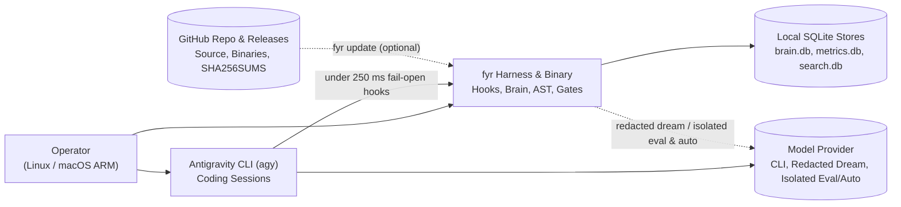
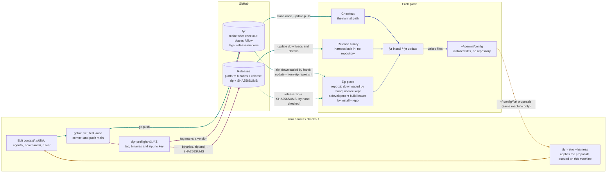

# fyr

`fyr` is an open-source coding harness, build controller, and zero-daemon SQLite/AST second brain for the Antigravity CLI (`agy`) on Linux and macOS (Apple Silicon). It ships one static Go binary (`CGO_ENABLED=0`, `modernc.org/sqlite`) with global context, skills, subagents, rules, workflows, and fail-open CLI hooks. It uses no background daemons, proxies, commit gates, CI, or hosted services ([`LICENSE`](LICENSE), [`SECURITY.md`](SECURITY.md)).

Quick links: [Quickstart](#quickstart-three-ways-in) · [First 5 Minutes](#first-5-minutes) · [Top-10 CLI](#top-10-daily-cli-commands) · [Feature Guides](#feature-guides--architecture) · [How It Works](#how-it-works) · [Workflow Guide](Workflow.md) · [Glossary](docs/glossary.md)



## Why It Exists

Antigravity sessions start stateless and truncate global rules beyond `24,000` bytes. `fyr` solves three gaps without persistent daemons:

- **Stop context drift:** `fyr install` deploys identical context, skills, subagents, rules, workflows, and `< 250 ms` hooks everywhere. `fyr status` and `fyr diff` catch drift immediately.
- **Keep session memory:** `~/.config/fyr/brain.db` stores searchable project records and memory across sessions. `.agents/scratch/search.db` builds a pure-Go AST graph that primes Turn 0.
- **Measure and verify behaviour:** `fyr metrics` and `fyr report` track session shapes without prose. `fyr eval` and `fyr auto` test and improve skills inside OS sandboxes.

## Quickstart: Three Ways In

Confirm `~/.local/bin` is on your `PATH` and `agy` is installed before choosing an install path. `SPEC-fyr-delivery` § The model defines what each path fetches.

<details>
<summary>PATH setup for non-login shells and Linux systemd user services</summary>

1. **Shells (`~/.bashrc` or `~/.config/shells/env.sh`):** Export `PATH="$HOME/.local/bin:/usr/local/go/bin:$PATH"` before any non-interactive guard.
2. **Linux `systemd --user`:** Add `PATH=$HOME/.local/bin:$PATH` to `~/.config/environment.d/10-local-bin.conf`, then reload and restart the user service.

</details>

### 1. From a source checkout

Use a checkout when you edit skills, rules, or global context (`go` 1.24.4+ and `git` required).

```bash
git clone git@github.com:kesokaj/fyr.git ~/workspace/fyr
# or HTTPS: git clone https://github.com/kesokaj/fyr.git ~/workspace/fyr
cd ~/workspace/fyr
go run ./cmd/fyr install   # builds ~/.local/bin/fyr and deploys ~/.gemini/config/
fyr status                 # ends with "drift none"
```

Run `fyr update` to pull updates on a clean checkout, or `fyr update --check` to inspect status.

### 2. From a release binary (no git or Go)

Release binaries (`fyr-linux-amd64`, `fyr-darwin-arm64`, `fyr-linux-arm64`) embed all six harness directories. Pin `V` from a trusted source and verify `SHA256SUMS` over HTTPS.

> [!NOTE]
> The cleanup step `rm -r "$D"` removes only the fresh temporary directory created by `mktemp -d`.

```bash
V=vX.Y.Z && ASSET=fyr-linux-amd64 \
&& D=$(mktemp -d) && cd "$D" \
&& curl -fsSLO "https://github.com/kesokaj/fyr/releases/download/$V/$ASSET" \
&& curl -fsSLO "https://github.com/kesokaj/fyr/releases/download/$V/SHA256SUMS" \
&& grep -qxF "# fyr $V" SHA256SUMS \
&& grep -v '^#' SHA256SUMS | sha256sum -c - --ignore-missing \
&& chmod +x "$ASSET" \
&& test "$("./$ASSET" version)" = "fyr $V" \
&& mkdir -p ~/.local/bin && mv "$ASSET" ~/.local/bin/fyr && cd ~ && rm -r "$D"
```

On macOS, use `shasum -a 256` and lift quarantine with `xattr -d com.apple.quarantine`. You can also install via `GOBIN="$HOME/.local/bin" go install github.com/kesokaj/fyr/cmd/fyr@vX.Y.Z`.

Deploy the embedded harness into `~/.gemini/config/` without touching vendor `settings.json`:

```bash
hash -r         # bash (zsh: rehash) so the shell finds ~/.local/bin/fyr
fyr version     # confirm the expected version is first on PATH
fyr install     # deploy the embedded harness
fyr status      # reports "source embedded vX.Y.Z" and "drift none"
```

Run `fyr update` later to verify and download newer releases over HTTPS.

### 3. From a zip archive (no SSH or gh)

Place `fyr-vX.Y.Z.zip` and `SHA256SUMS` in one folder, then run:

```bash
fyr update --from-zip ~/Downloads/fyr-vX.Y.Z.zip
fyr status
```

## First 5 Minutes

After `fyr status` reports `drift none`, run these steps inside any repository. Read [`docs/glossary.md`](docs/glossary.md) for store names, hook terms, and documentation tracks.

1. **Index the repository:** Run `fyr index` for zero-scaffold AST indexing, or `/fyr-init-project` to scaffold project docs.
2. **Resume every session:** Run `fyr resume` to print `AGENTS.md`, open plans, the newest handoff, `TODO.md`, and memory.
3. **Read specs from `brain.db`:** Specs (`SPEC-*`), plans, ADRs, and guides live in `~/.config/fyr/brain.db`, not as tracked repo files. Run `fyr record list --kind spec` and `fyr record get SPEC-*` to read contracts.
4. **Query the AST graph first:** Use targeted slices instead of reading whole source files.
   ```bash
   fyr search --slice "handlePreInvocation"   # tiered AST capsule and linked records
   fyr search --affected "CheckAndRecordRead" # callers, importers, and blast radius
   fyr search --skeleton internal/search/vet.go
   fyr search --map                           # God Nodes, package edges, and cycles
   fyr graph --web                            # interactive local AST graph preview
   ```
5. **Follow guided workflows:** Use `/fyr-feature`, `/fyr-bug`, `/fyr-review`, and `/fyr-handoff`. See [`Workflow.md`](Workflow.md) for the lifecycle and Definition of Done.

## Top-10 Daily CLI Commands

Use these ten commands in daily work. See [`docs/cli-reference.md`](docs/cli-reference.md) for every command and flag, or run `fyr help <command>`. Global flags (`-C`, `--dir`, `--home`, `--repo`, `--help`) work across commands.

| Command | Purpose |
|---|---|
| `fyr install` | Deploy context, skills, subagents, rules, workflows, and hooks |
| `fyr update` | Update a checkout, release binary, or `--from-zip` install |
| `fyr status` | Check version, drift, auto state, and `PATH` shadowing |
| `fyr resume` | Print the seven-step read-only resume and daily health brief |
| `fyr search <words>` | Search `brain.db` and AST graph (`--slice`, `--contracts`, `--skeleton`, `--affected`, `--map`) |
| `fyr record add` / `get` / `edit` / `list` | Manage `brain.db` records (`SPEC-*`, `PLAN-*`, `ADR-*`, `HANDOFF-*`) |
| `fyr memory add` / `show` | Save or list validity-scored `semantic`, `procedural`, and `episodic` memory |
| `fyr verify` | Run `gofmt`, `go vet ./...`, `go test -race ./...`, `fyr check`, and write `verify.stamp` |
| `fyr report` | Render scorecards, diagnostics, and `--daily-digest` in HTML, `--md`, `--json`, or `--web` |
| `fyr auto on` / `off` / `status` / `run` / `log` / `sim` | Control hourly rating, dreaming, daily reports, and eval-gated skill runs |

Run `fyr list` to view every installed skill, subagent, rule, and workflow script.

## Feature Guides & Architecture

`fyr` splits its runtime into seven subsystems around each Antigravity session. Start with [`Workflow.md`](Workflow.md) for practice, [`SDD.md`](SDD.md) for architecture (`M1`–`M26`), [`TDD.md`](TDD.md) for test pins, or a subsystem guide below.

| Feature Guide | Key Verbs | Focus |
|---|---|---|
| [Delivery, Installer & Customization](features/delivery-and-customization.md) | `install`, `update`, `status`, `adopt`, `state` | Atomic deploy, three install paths, offline bundles, budgets, and allowlists |
| [CLI Hooks, Prompt Vetting & AST Graph](features/hooks-and-ast-graph.md) | `search`, `index`, `graph` | `< 250 ms` fail-open hooks, prompt vetting, read ledger, watchdog, and AST slicing |
| [Brain Store, Trail & Memory](features/brain-and-memory.md) | `record`, `memory`, `resume` | 15 record kinds in `brain.db`, seven-step resume, `.agents/trail.jsonl`, and decay |
| [Workflows, Swarm & Build Control](features/workflows-and-build-control.md) | `verify`, `gate`, `land`, `close`, `watch`, `check`, `models` | Skills, subagents, parallel workflows, model routing, and fail-closed gates |
| [Telemetry, Trajectories & Reports](features/metrics-and-reports.md) | `metrics`, `report` | Shape-only `metrics.db`, context-knee trajectories, digests, and reports |
| [Behavioural Eval & OS Isolation](features/eval-and-isolation.md) | `eval` | Sandboxed multi-turn/ACP evals, Wilson intervals, Landlock, and Seatbelt |
| [Dream Consolidation & Auto Mode](features/dream-and-auto.md) | `dream`, `auto` | Hourly `on`/`off` runner, session ratings, SIM ledger, and `k=3` eval gate |

### Subagents

Seven native subagents handle isolated roles. Run `fyr list` for the 34-skill catalog, rules, and workflows.

| Subagent | Model | Role |
|---|---|---|
| `builder` | inherit | Implements one write-leased slice in an isolated worktree |
| `documentation` | `flash` | Updates living docs when changes exceed 30 lines |
| `dreamer` | inherit | Consolidates skills and low-validity memory for `/fyr-retro` |
| `explorer` | `flash` | Runs read-only codebase reconnaissance across 10+ files |
| `reviewer` | inherit | Ranks code, doc, and prompt defects by severity |
| `security` | inherit | Audits auth, crypto, secrets, IAM, and parsing (inherits session model) |
| `verifier` | inherit | Runs browser e2e, container smoke, and live HTTP checks |

## How it works

This map defines how the harness reaches a machine and what leaves one. See [`.agents/rules/delivery-map.md`](.agents/rules/delivery-map.md) for rules pinned by `TestHarnessMap`.

### Delivery, Release & Local Loop



### On-Machine Sessions, Dream, Eval & Auto


| Colour | Path | Meaning |
|---|---|---|
| Teal | **update** | Moves a checkout, binary, or zip place forward |
| Indigo | **install** | Writes managed harness files to `~/.gemini/config/` |
| Amber | **local loop** | Proposals stay local until `/fyr-retro --harness` or an eval-gated `fyr auto` branch commit |
| Plum | **release** | `/fyr-preflight` tags `main` and publishes binaries, zip, and `SHA256SUMS` |
| Olive | **learn** | Local `fyr dream`, `fyr eval`, and `fyr auto` under Landlock or Seatbelt; dashed lines show outbound provider or `skills.sh` calls |

A dashed line marks a manual step or single-machine gap. See [`SDD.md`](SDD.md) and `SPEC-fyr-delivery` § The model for delivery guarantees.

## Customizing for Your Stack

Global defaults target Go, TypeScript/Tailwind, and Google Cloud, while project rules always win. Override per project in `AGENTS.md`, `.agents/rules/`, and `.agents/skills/`, or edit this checkout and run `fyr install`. `internal/harness/size_test.go` keeps global rules within `19,500` bytes (inside Antigravity's `24,000`-byte block) and pinned by `GANNET` ([Delivery & Customization](features/delivery-and-customization.md)).

## Working on the Harness

Contracts live in [`PRD.md`](PRD.md) (`R0`–`R10`), [`SDD.md`](SDD.md) (`M1`–`M26`), [`TDD.md`](TDD.md) (`T1`–`T26`), and [`TODO.md`](TODO.md). Embedded harness content lives in `context/`, `rules/`, `skills/`, `agents/`, `commands/`, and `workflows/` (`embed.go`), beside `cmd/fyr`, `internal/`, `docs/`, and `features/`.

Run these checks before claiming completion (`AGENTS.md` § Setup commands):

```bash
gofmt -l cmd internal && go vet ./... && go test -race -timeout 30m ./... # auto: test
go run ./cmd/fyr install --home .agents/scratch/home
go run ./cmd/fyr list
go mod download
"$(go env GOPATH)/bin/govulncheck" ./...
```

Always pass `--home .agents/scratch/<name>` on stateful `fyr` commands during development (`cmd/fyr/realhome_guard.go`). Read [`Workflow.md`](Workflow.md), [`docs/cli-reference.md`](docs/cli-reference.md), [`docs/glossary.md`](docs/glossary.md), [`AGENTS.md`](AGENTS.md), and [`SECURITY.md`](SECURITY.md) next.
