# fyr

Your rules, skills and subagents for the **Antigravity CLI** (`agy`), kept in one repository and installed the same way on every machine you work from, plus `fyr`, a small Go binary that does the installing and keeps what a session cannot hold on its own: the searchable trail of each project, its memory, the shape of every session and a consolidation of idle projects that runs hourly while an `agy` session of yours is open. One operator, their own machines, a private repository. No hooks, no gates, no CI, no service.

## Why it exists

- **Context drifts.** A rule you add on the laptop is missing on the workstation a week later. Here every rule, skill and agent is a file in this repository; `fyr install` puts the same set on every machine, and `fyr update` moves a machine forward when you say so.
- **Sessions forget.** A CLI session ends and its lessons go with it. The harness writes them down in the project's own trail (handoffs, decisions, bugs, plans) and in a memory store the CLI reads at the start of the next session.
- **A CLI cannot measure itself.** `fyr metrics` records the shape of every session (tools, tokens, errors, never your prose), so you can see where the work goes and tune the harness from numbers instead of impressions.

## What you get

| | |
|---|---|
| One global context | `context/AGENTS.md`, in the [agents.md](https://agents.md) standard, deployed as `~/.gemini/config/rules/AGENTS.md` |
| Skills | 36 of them, each a directory with a `SKILL.md` in the [Agent Skills](https://agentskills.io) standard; the model loads one when its description matches, and you can type any of them as `/name` |
| Subagents | 8, each `agents/<name>/agent.md` in Antigravity's format, installed as written |
| Rules | always-on rules under `rules/` (today: critical thinking, one session per task or phase, and code modularity) |
| The binary | `fyr`: install, update, status, uninstall; `record`, the brain store of every project's trail records; `search` over those records and a project's files; `memory`; `metrics`; the `dream`, hourly while an `agy` session runs |

## Quick start

You need Go 1.24 or newer and git. The repository is private, so clone with your own SSH key or `gh` login.

```bash
git clone git@github.com:kesokaj/fyr.git ~/workspace/fyr
cd ~/workspace/fyr
go run ./cmd/fyr install          # builds the binary, installs it to ~/.local/bin/fyr, deploys everything
fyr status                        # ends with "drift none"
```

Put `~/.local/bin` on your `PATH` if it is not already. Then start a session in any project: the global context loads, and the `/init-project` skill scaffolds a new project's trail. The first build fetches one Go module, the pure-Go SQLite driver behind `search`, `record` and `metrics`.

Two things to know about your home directory. `install` writes only under `~/.gemini/config/` (and `~/.local/bin/fyr`) and edits no vendor setting (ADR-062). And the harness's own state lives in `~/.config/fyr/` (the brain store `brain.db` with the global feedback, proposal and retro records, the search index, the metrics store); Antigravity prompts for paths outside the workspace, so it may ask before first using that directory.

## Daily commands

| Command | What it does |
|---|---|
| `fyr status` | What is installed, from which commit, the binary's build, drift against the repository, the dream timer (and when its unit is an older fyr's, the two commands that replace it), and a note for a `PATH` shadow. Exit 1 on drift. |
| `fyr update` | At a checkout: fetch, refuse a dirty tree, fast-forward, rebuild, reinstall. At a release-binary install: download the newest release, check it against its `SHA256SUMS`, replace the binary, reinstall. `--check` only reports (exit 2 when behind). `--from-zip FILE` installs a downloaded repository zip. `--dry-run` names what would change and writes nothing. |
| `fyr install` (or `sync`) | Deploys the repository (or the harness built into a release binary) and removes files a previous install wrote that the repository no longer has, except the Claude Code files an install before fyr wrote under `~/.claude`, which it keeps and stops managing (`DEPLOY-remote` § Crossing to fyr). Idempotent; `--dry-run` prints without changing. |
| `fyr diff` | A unified diff of every drifted file. |
| `fyr uninstall` | Removes exactly what it installed, the dream timer included; the metrics store stays. `--dry-run` names what would go. |
| `fyr list` / `render` | The skill and agent inventory; the assembled context as deployed. |
| `fyr record add` / `get` / `edit` / `list` / `import` | The brain store, `~/.config/fyr/brain.db`: this project's trail records (plans, bugs, ADRs, reviews, handoffs, specs, …) and the global ones (`--global`: feedback, proposals, retros), each with an ID and a status; the body comes on stdin, and a title or body the dream's redactor would change is stored with a warning on stderr. Every write in a project also rewrites `.agents/trail.jsonl`, the committed export, and a changed export (a pull) is loaded back before the next call. `list --open` is what is still open. `import` migrates a project whose trail is still Markdown files into records, once; `import --global` takes the old logs under `~/.config/fyr`. |
| `fyr search <words>` | Prints the matching brain-store records first, then a ranked full-text search over the current project's files and trail records (bugs, decisions, plans, changes), with each record's id and status; `--refs BUG-NNN` finds everything that cites one; `--open` lists what is still open. `fyr index` maintains the index; `fyr index --register` is the operator's consent that the project is read across projects — the global search index and record hits (`--global`), `fyr dream --all`, `record import --global` and the metrics join — a marker under `.git/` sealed to this checkout's path and this home, which no clone or copy carries (ADR-068, ADR-068a). |
| `fyr memory add` / `show` | The project's memory, `memory` records in the brain store (never exported); `show` prints the index a session loads at start. |
| `fyr metrics ingest` / `show` / `report` / `export` | Reads every session's shape into `~/.config/fyr/metrics.db`, summarises it (outcome, efficiency, process adherence, reliability; `--json`), renders it as one HTML page with charts, backs it up as JSONL. Ingest runs at every checkpoint (the `handoff` skill's last call, `/retro` before its numbers, a phase end) and in each dream run, and reads Antigravity only; rows an older version stored for another CLI are kept and shown as a historical column. Never arguments, prose or tool output. |
| `fyr dream --install-timer` | An hourly job (systemd or launchd user timer) that does nothing unless an interactive `agy` session of yours runs; then it ingests metrics and, for every project registered with `fyr index --register` that has been idle for a day and changed (each tried at most once a day), sends its memory, new trail and transcripts, redacted, to `agy` headless in plan mode with no tools: in your own Antigravity home when agy's own reports show it grants no tool without review and loads no hook, and nothing but your own setup sits above the dream's empty working directory (no git checkout or other `.agents`), so each project's dream is a conversation `/resume` lists, otherwise in a private home as before; the proposals are stored as global `proposal` records for `/retro` to apply. `--remove-timer` undoes it. A timer an older fyr installed keeps its nightly schedule, at which, with the session check, it almost never dreams, until you run `fyr dream --remove-timer`, then `fyr dream --install-timer`; `fyr status` names it. |
| `fyr check` | A read-only drift check of the current checkout: every `fyr` verb, subverb and flag its Markdown and current spec, guide and deploy records name in code, and every path or `path:line` they name in an inline span, against the running binary and the tree; every current spec whose code was committed to since the spec's own last update, or that names no code; and every Must and Should item of `PRD.md` (`REQUIREMENTS.md` in a project without one) whose `enforced by:` is missing or does not resolve (a file with no `enforced by:` field at all is noted, not checked). Prints one line per finding and a summary; exit 1 on findings. Writes nothing (`SPEC-fyr-check`). `/review --docs` and the `requirements` skill run it. |
| `fyr eval --home DIR <row>...` | Runs the named rows of this checkout's suite, the `GUIDE-eval` record, against the Antigravity CLI, one at a time, each in its own sandbox under `<home>/.config/fyr/eval/` (a clone of the fixture, `--fixture DIR` or this checkout, and a throwaway HOME with the harness installed and your login linked in for the run), with its safety checks around it. Prints one line per row, writes one `testing` record, and ingests each sandbox into the metrics store under the label `eval=<row>`, so `fyr metrics show --label eval=<row>` compares runs over time. What the agent reads goes to the CLI's model, as in any session (R8). Sandboxes stay for inspection, and `fyr uninstall` leaves them. `--list` prints the rows. `--home` is required: a missing one, the real home, a home that reaches the real state through a link, and a `--home` inside a git checkout are refused with exit 2 before anything is written. Exit 1 when a row fails (`SPEC-fyr-eval`). |
| `fyr adopt <name>` | Copies a skill installed elsewhere (for example by `npx skills add -g`) into `skills/`. |
| `fyr version` | The build version. |

`fyr` and `fyr help` print the short page, one line per command; `fyr help <verb>` or `fyr <verb> --help` prints that verb's page: its synopsis, what it does, and its flags. A flag a verb does not know is a usage error, exit 2, which prints the verb's synopsis. The global flags are `--repo DIR`, the harness checkout to build and install from (by default `$FYR_REPO`, then the working directory or its parents, then the tree the last install recorded; a release binary installs the harness built into it and refuses `--repo` and `$FYR_REPO`, ADR-034; a verb that does not read it, every verb but `install`, `sync`, `status`, `diff`, `update`, `list`, `render`, `adopt` and `eval`, says on stderr that it ignored it and runs), and `--home DIR` (install somewhere other than `$HOME`, which the tests use); `--vendor` no longer exists and is a usage error. The full behaviour of each verb is in the `SPEC-fyr-*` records (`fyr record list --kind spec`, then `fyr record get`).

## How it works

This map is the contract for how the harness reaches a machine and for what leaves one: the dreamer's redacted prompt and the operator's `fyr eval` runs. The strict rules that keep it true are in `AGENTS.md` § How the harness works; `TestHarnessMap` fails when the map names a command the binary does not have.

```mermaid
flowchart LR
    subgraph checkoutLane["Your harness checkout"]
        edit["Edit context/, skills/, agents/, commands/, rules/"]
        ship["gofmt, vet, test -race<br/>commit and push main"]
        preflight["/preflight vX.Y.Z<br/>tag, binaries and zip, no key"]
        retroHarness["/retro --harness<br/>applies the proposals queued on this machine"]
    end
    subgraph githubLane["GitHub, private"]
        harnessRepo[("fyr<br/>main: what checkout places follow<br/>tags: release markers")]
        releases[("Releases<br/>platform binaries + release zip + SHA256SUMS")]
    end
    subgraph placeLane["Each place"]
        checkoutPlace["Checkout<br/>the normal path"]
        binaryPlace["Release binary<br/>harness built in, no repository"]
        zipPlace["Zip place<br/>repo zip downloaded by hand, no tree kept"]
        installer["fyr install / fyr update"]
        homeFiles["~/.gemini/config<br/>installed files, no repository"]
        sessions["Antigravity sessions<br/>feedback-log skill logs, /retro queues"]
        configDir["~/.config/fyr/<br/>brain.db, metrics.db, search.db, state.json<br/>stays on this machine"]
        dreamer["fyr dream --all<br/>hourly user timer, while agy runs<br/>a CLI with no tools"]
        evalRun["fyr eval rows<br/>typed by you, each row a sandboxed clone and HOME"]
    end
    edit --> ship
    ship -- "git push" --> harnessRepo
    ship --> preflight
    preflight -- "tag marks a version" --> harnessRepo
    preflight -- "binaries, zip and SHA256SUMS" --> releases
    harnessRepo -- "clone once, update pulls" --> checkoutPlace
    releases -- "update downloads and checks" --> binaryPlace
    harnessRepo -. "zip, downloaded by hand; update --from-zip repeats it" .-> zipPlace
    releases -. "release zip + SHA256SUMS, by hand; checked" .-> zipPlace
    checkoutPlace --> installer
    binaryPlace --> installer
    zipPlace -.-> installer
    installer -- "writes files" --> homeFiles
    homeFiles -- "read at session start" --> sessions
    sessions -- "logs" --> configDir
    configDir -. "same machine only" .-> retroHarness
    retroHarness --> edit
    sessions -- "memory, trail, transcripts" --> dreamer
    dreamer -- "proposal records, metrics.db" --> configDir
    dreamer -. "redacted prompt, no tools" .-> provider[("the CLI's model provider")]
    dreamer -. "one conversation per project, in /resume" .-> sessions
    evalRun -- "testing record, metrics.db" --> configDir
    evalRun -. "a sandbox's prompts and the files its agent reads, unredacted" .-> provider
    linkStyle 0,1,5,6,7,8 stroke:#0B7A74,stroke-width:2px
    linkStyle 2,3,4 stroke:#8A3A78,stroke-width:2px
    linkStyle 9,10,11,12,13 stroke:#3B4FB8,stroke-width:2px
    linkStyle 14,15,16 stroke:#A8660F,stroke-width:2px
    linkStyle 17,18,19,20,21,22 stroke:#5B7F1E,stroke-width:2px
```



Teal is **update**, indigo **install**, amber **the loop on this machine** (corrections and proposals stay in `~/.config/fyr/` and reach this repository only through `/retro --harness`, run by you on the machine that logged them; ADR-062), plum **release**, olive **learn** (the dreamer, hourly while an `agy` session of yours runs, and `fyr eval`: on the machine, not ways in; their two dashed lines to the CLI's model provider are the only things that leave the machine: the dreamer's redacted prompt, ADR-049, and the prompts of an eval sandbox you started and the files its agent reads, unredacted as in any session, ADR-065; the dreamer's line to the sessions, one conversation per project that `/resume` lists, is dashed because only Linux has run it end to end; the operator's macOS run turns it solid, ADR-073). A dashed line is a gap: done by hand or limited to one machine.

In words: you edit this repository and push `main`. A machine gets the harness one of three ways, a checkout it keeps current with `fyr update`, a release binary with the harness built in (§ Install without cloning), or a repository zip you downloaded by hand (§ Install from a zip). Nothing is ever pushed to a machine; what a release delivers to each kind of place is stated once, in `SPEC-fyr-delivery` § The model. Nothing comes back: experience stays on the machine that logged it (ADR-062). A release is `/preflight vX.Y.Z` from your own turn: it gates the tree, tags `main`, and publishes the tag's binaries, a zip of its tree and their `SHA256SUMS`; no signing key is involved, so any machine where you are logged in to GitHub can cut one. The dreamer is the one thing that runs on its own, hourly while an `agy` session of yours runs, and it only proposes; each project's dream is a conversation you can open with `/resume`.

## Install without cloning

A machine that only uses the harness needs no checkout: a release binary carries `context/`, `skills/`, `agents/`, `commands/` and `rules/` inside it. Each route below ends with the binary in `~/.local/bin`; each needs your own GitHub credential, because the repository is private. Set `V` to the version you expect from a source outside the download (the person who cut it, or a checkout's changelog), never from the Releases page itself: the guarantee is "the version you named, or nothing". The checksums prove the download is whole; who made the release rests on your GitHub login and HTTPS (ADR-053).

With `gh`, one chained command, so a failed check stops the move (on macOS replace `sha256sum -c -` with `shasum -a 256 -c -`):

```bash
V=vX.Y.Z \
&& D=$(mktemp -d) && cd "$D" \
&& gh release download "$V" --repo github.com/kesokaj/fyr --clobber \
     --pattern 'fyr-linux-amd64' --pattern 'SHA256SUMS' --dir "$D" \
&& grep -qxF "# fyr $V" SHA256SUMS \
&& grep -v '^#' SHA256SUMS | sha256sum -c - --ignore-missing \
&& chmod +x fyr-linux-amd64 \
&& test "$(./fyr-linux-amd64 version)" = "fyr $V" \
&& mv fyr-linux-amd64 ~/.local/bin/fyr && cd ~ && rm -r "$D"
```

A machine on v2.7.0 or earlier crosses once by `DEPLOY-remote` § Crossing to fyr, not by this block alone.

With `go install`, for v3.0.0 or newer. The module path is an https URL and the repository is private, so git is told to fetch over SSH for this one command; this route trusts your SSH connection and git's object hashes, not a checksum file, so use it where you already trust the repository:

```bash
GOPRIVATE='github.com/kesokaj/*' \
  GIT_CONFIG_COUNT=1 \
  GIT_CONFIG_KEY_0='url.git@github.com:.insteadOf' GIT_CONFIG_VALUE_0='https://github.com/' \
  go install github.com/kesokaj/fyr/cmd/fyr@v3.0.0
```

From the Releases page in a browser, shown for a Mac (on Linux use `sha256sum -c -` and drop the `xattr` line, which lifts the browser quarantine that would otherwise stop the binary from running):

```bash
V=vX.Y.Z \
&& ls ~/Downloads/fyr-darwin-arm64 ~/Downloads/SHA256SUMS >/dev/null \
&& D=$(mktemp -d) && mv ~/Downloads/fyr-darwin-arm64 ~/Downloads/SHA256SUMS "$D" && cd "$D" \
&& grep -qxF "# fyr $V" SHA256SUMS \
&& grep -v '^#' SHA256SUMS | shasum -a 256 -c - --ignore-missing \
&& chmod +x fyr-darwin-arm64 && { xattr -d com.apple.quarantine fyr-darwin-arm64 2>/dev/null || true; } \
&& test "$(./fyr-darwin-arm64 version)" = "fyr $V" \
&& mv fyr-darwin-arm64 ~/.local/bin/fyr && cd ~ && rm -r "$D"
```

Then, in this order:

```bash
fyr version     # first, unqualified: the version you just downloaded, or another fyr on PATH is winning
fyr install     # installs the harness built into the binary
fyr status      # "source embedded vX.Y.Z" and "drift none"
```

`version` comes first on purpose: an earlier `PATH` entry holding another `fyr` would run instead and report success about the wrong tree (BUG-078). `install` and `status` warn about such a shadow; if `version` names the wrong build, `hash -r` (bash) or `rehash` (zsh) first, then `which -a fyr` to find the earlier copy and point it at this binary or remove it. The assets are `fyr-linux-amd64`, `fyr-darwin-arm64` and `fyr-linux-arm64`, beside `SHA256SUMS`. To move such a machine forward later, `fyr update` there: it needs `gh` on `PATH`, accepts only a canonical `vX.Y.Z` tag newer than what is installed, checks the binary against the release's checksums, and only then replaces itself and reinstalls.

## Install from a zip (no SSH, no gh)

A machine that can neither hold your SSH key nor run `gh` still gets the harness: download a release's `fyr-vX.Y.Z.zip` and `SHA256SUMS` from the Releases page into one folder, together with its `fyr` binary (verified as above), and run:

```bash
fyr update --from-zip ~/Downloads/fyr-vX.Y.Z.zip   # SHA256SUMS beside it: the zip is checked first
fyr status                                         # "installed … from zip sha256:<hex> (verified vX.Y.Z)"
```

A zip of `main` ("Code → Download ZIP") works too, but no release lists it, so it installs marked unverified. The zip is unpacked into a temporary directory under `~/.config/fyr/`, installed, and the directory removed; nothing of the zip is kept. To move forward, download the next zip and repeat.

## Adding your own skills, agents and rules

Every customization is a file in a directory: drop it in, run `fyr install`, commit. Nothing to register.

| Put it in | What it is | Antigravity gets |
|---|---|---|
| `skills/<name>/SKILL.md` | a skill (Agent Skills standard); loaded when its description matches, typed as `/name` | `~/.gemini/config/skills/<name>/` |
| `agents/<name>/agent.md` | a subagent in Antigravity's `agent.md` format (`name`, `description`, `subagent`, `mainAgent`, `model`, `tools`) | `~/.gemini/config/agents/<name>/agent.md`, as written |
| `rules/<name>.md` | an always-on or path-scoped rule; it shares the context's 24,000-byte rules block | `~/.gemini/config/rules/<name>.md` |
| `commands/<name>.md` | a plain markdown prompt invoked as `/name` (prefer a skill) | `~/.gemini/config/workflows/<name>.md` |
| `context/<name>.md` | more global context, appended after `AGENTS.md` | part of `~/.gemini/config/rules/AGENTS.md` |

The installer refuses what would grant a permission behind your back: a skill without a `description`, a skill, command, rule or agent with a frontmatter key outside its kind's allow list (so `allowed-tools`, `hooks` or any other permission key), a command or rule whose file name is not one plain name, a frontmatter value a strict YAML parser would read as a comment, and an agent tool name Antigravity does not know (an unknown name hangs its subagent). `AGENTS.md` § Rules for working here lists each refusal and why.

Third-party skills go in verbatim and are listed in `skills/VENDORED.md`; from [skills.sh](https://skills.sh), `npx skills@<version> add <owner/repo> -s <skill>` lands in `skills/` through the `.agents/skills` symlink, then `fyr install` and commit. A skill you already installed globally comes in with `fyr adopt <name>`.

## Skills

`fyr list` prints every skill with its description. By purpose:

| Group | Skills |
|---|---|
| Work protocols | `feature` (design before code, a plan file, a cold-reader check, phases), `bug` (diagnose, failing test first, smallest fix, record), `review` (one review command with lenses `--code --security --simplify --docs --prompts --tests --all --resume`), `review-standards` (what the reviewer checks), `preflight` (the release gate), `harness-audit` (audits this repository area by area) |
| Project shape | `init-project` (scaffold or update a project's trail), `requirements`, `spec`, `testing-strategy`, `explain-project` (onboarding notes for a person), `research`, `handoff` (the session's checkpoint, ending in the Kickoff that starts the next session) |
| Learning loop | `feedback-log`, `project-memory`, `retro`, `distill`, `dream` |
| Code | `golang`, `typescript`, `frontend` (TanStack Start + Tailwind), `bash`, `json-api-style`, `docker`, `mermaid-syntax` |
| Google Cloud | `gcloud-setup`, `cloud-run-deploy`, `terraform`, `operate-gcp`, `data-gcp`, `api-auth-gcp`, `gke-basics`, `google-catalog` (routes to Google's published skills, vendored as data under its `catalog/`) |
| Vendored verbatim | `grilling`, `codebase-design`; provenance in `skills/VENDORED.md` |
| Forks | `discover-skills` (finds a published skill and adds it to `skills/`, forked from `find-skills`), and `gke-basics` above; provenance in `skills/VENDORED.md` |

## Layout

```
context/      AGENTS.md (the global context) and dev-setup.md (environment, stack, GCP rule)
agents/       one directory per subagent (agent.md, in Antigravity's format, installed as written)
skills/       one directory per skill (SKILL.md, references/, assets/)
rules/        always-on or path-scoped rules
commands/     markdown prompts invoked as /name (empty; prefer skills)
cmd/fyr       the binary; internal/ its packages, each named in AGENTS.md § Layout
embed.go      the go:embed of the five content directories, pinned to what git tracks
.agents/      this repository's own trail, trail.jsonl (records: plans, decisions, bugs, changes, handoffs, testing, specs, deploy guides; read with fyr record), and scratch/ (gitignored)
```

## Working on the harness

```bash
gofmt -l cmd internal && go vet ./... && go test -race -timeout 30m ./...   # before any completion claim; -timeout 30m for a one-CPU box
go run ./cmd/fyr install --home .agents/scratch/home                         # never against your real $HOME
```

Two tests pin the deployed context's size (`internal/harness/size_test.go`): the hand-written context under 15,000 bytes, and the whole rendered block, skill inventory included, under 22,000 bytes, inside Antigravity's 24,000-byte limit. `govulncheck` has two known, unreachable advisories (`AGENTS.md` § Setup commands).

Where to read more: `AGENTS.md` for the rules of this repository and how the harness works; `REQUIREMENTS.md` for what must never drift; the `SPEC-fyr-*` records (`fyr record list --kind spec`, then `fyr record get`) for each verb's exact behaviour and `SPEC-fyr-delivery` for what a release delivers to each kind of place; `DEPLOY-remote` for the machines, the resync loop and the release procedure (`/preflight vX.Y.Z`, no key); the `adr` records (`fyr record list --kind adr`) for every decision and why.
