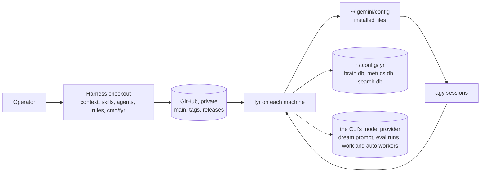
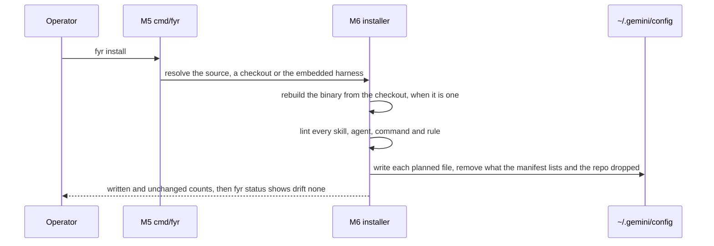
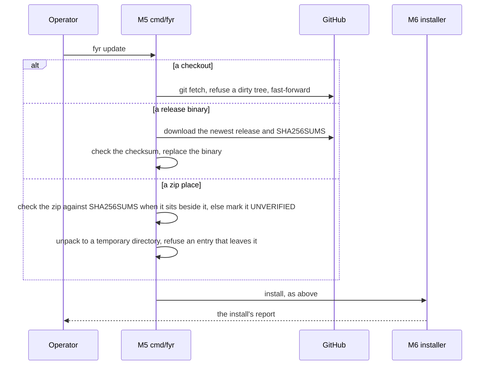
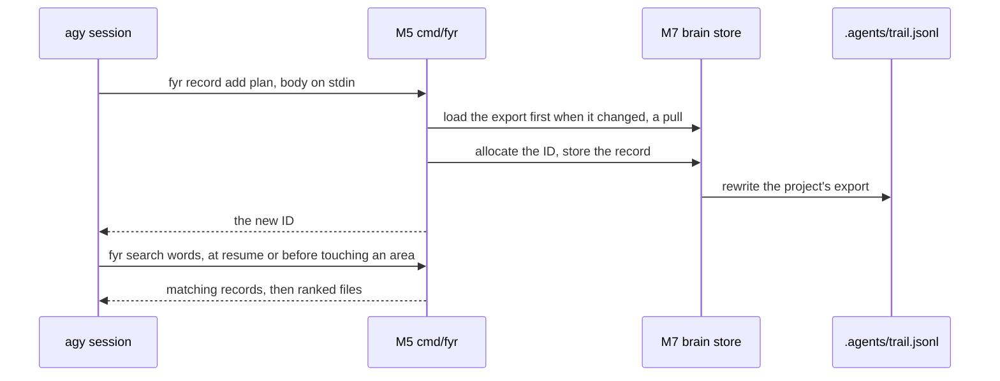
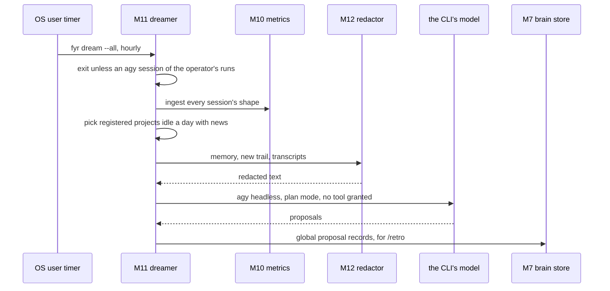

# SDD — fyr

How the harness's parts fit together: the content a session reads, the `fyr` binary that installs it and keeps the brain, and the paths between them.
Status: current · Last updated: 2026-11-01 · Requirements: [PRD.md](PRD.md) · Technical design: [TDD.md](TDD.md)

<!-- A summary a human reads in ten minutes. The detail lives in the records it links (an ADR per decision, a SPEC
     per surface: `fyr record get <ID>`), never restated here. Components are M1…; each satisfies PRD requirements by
     ID; TDD.md has one section per component. Kept current by the session that changes the design, in the same commit. -->

## Context

One operator, their own machines, one private repository. The harness is files a session reads (context, rules, skills, agents) plus `fyr`, which installs those files and keeps what a session cannot hold: each project's trail, its memory, the shape of every session, and an hourly consolidation of idle projects. Out of scope: any CLI but `agy` (R1), hooks, gates and CI (R3), and any service (R8).

## Components

The content directories (M1–M4) are what a session reads; the binary (M5–M19) is `cmd/fyr` and its packages (`AGENTS.md` § Layout). Each package's surface is a SPEC record, linked from its TDD section.

| ID | Component | Responsibility | Satisfies |
|---|---|---|---|
| M1 | `context/`, `rules/` | The global context and the always-on rules, one size-pinned block in Antigravity's rules directory | R0, R1, R2, R3 |
| M2 | `skills/`, `commands/` | Procedures loaded when a description matches, typed as `/name`; vendored skills and the Google catalog kept verbatim | R2, R5 |
| M3 | `agents/` | Subagents in Antigravity's `agent.md` format, installed as written | R1, R5 |
| M4 | `embed.go` | The five content directories built into the binary, pinned both ways to what git tracks, so a release binary carries the harness | R8, R9 |
| M5 | `cmd/fyr` | The verbs, their flags and help pages; the three update paths (checkout, release binary, zip) | R4, R6, R8, R9, R10 |
| M6 | `internal/harness` | The installer: the plan of what goes where, the lint, the render, the manifest, status and drift, uninstall, adopt, the release download | R1, R3, R4, R5, R6, R9, R10 |
| M7 | `internal/brain` | The brain store, `fyr record`: every project's trail records and the global ones, exported to `.agents/trail.jsonl` | R0, R4, R7 |
| M8 | `internal/search` | `fyr search` and `fyr index`: a derived full-text index over files; the dream's read-only reads | R0, R4 |
| M9 | `internal/memory` | `fyr memory`: the project memory every session loads | R0, R7 |
| M10 | `internal/metrics` | `fyr metrics`: the store of record of every session's shape | R0, R4 |
| M11 | `internal/dream` | `fyr dream`: the hourly dreamer, its timer, lock, state and log | R0, R3, R8 |
| M12 | `internal/redact` | The credential redactor every dream input passes before it leaves the machine | R3, R8 |
| M13 | `internal/eval` | `fyr eval`: the behavioural suite (`GUIDE-eval` or `--suite-file PATH`), its rows' setup and checks, run in M17's sandbox | R6, R8 |
| M14 | `internal/check` | `fyr check`: the read-only drift check of docs, specs, requirements and the R → M → T traces | R0 |
| M15 | `internal/trail` | The git reads every package makes into a project root, and the noindex markers | R7 |
| M16 | `internal/serve` | A local page on loopback, run in the foreground by hand: status, context, records, memory, metrics, evals, dream and the drift check, and two maintenance actions | R0, R3, R4, R7, R8, R10 |
| M17 | `internal/sandbox` | One unattended CLI session in a throwaway clone and home, and its safety checks; M13 runs its rows in it, M18 its workers, whose session can run in a hardened container instead (`Config.Docker`, Phase 7 of `PLAN-2026-10-29-workers`) | R6, R8 |
| M18 | `internal/work` | One Kickoff as a worker: M17's sandbox on a clone with no remote, on its own branch, fetched back into the lead's checkout by path, checked against the Kickoff's `Files:`, and reported as a result contract of at most 39 lines per worker; `fyr work` (M5) runs one or several Kickoff files at once, up to `--max-workers` across the machine, and ends a run with `--kill`; a Kickoff's `Model:` line picks its worker's model over `--model`, and `models.go` checks every named model against the host's `agy models` (ADR-080); with `--runner docker` only the session runs in a container (M17's `Config.Docker`), `docker.go` holds the extra refusals (`DockerPreflight`) and the run's container sweep, and the other steps stay on the host; `Options.Auto` lets M19 run a drafts-only Kickoff (`Files:` empty) and collect `auto-drafts.jsonl` (`SPEC-fyr-work`, ADR-076, ADR-090) | R8 |
| M19 | `internal/auto` | `fyr auto`, R3's second timer exception: the operator's switch (`auto.json`), its own hourly timer through M11's rendering, and a run that does nothing unless the switch is on. Built through Phase 7 of its plan, the risk rubric (`internal/auto/rubric.go`), the `auto` skill, the worker runner (`internal/auto/kickoff.go`, `internal/auto/worker.go`), the apply step (`internal/auto/apply.go`), the learning tasks and draft validator (`internal/auto/tasks.go`, `internal/auto/learning_input.go`, `internal/auto/drafts.go`), the eval re-runs (`internal/auto/eval_rerun.go`, `internal/auto/eval_exec.go`) and the eval gate (`internal/auto/eval_gate.go`) included: a run reads the gates, runs the free checks, reports in global `review` records, and past level `observe` starts at most one M18 worker or eval re-run per run (up to 4 a day, 30m each, in docker when `work.DockerPreflight` passes, else host) from a fixed-template Kickoff filtered by `AllowedFiles`, passing a learning task's conversations, memory, proposals and metric numbers through M12 first, validating and writing `auto-drafts.jsonl` lines with `provenance: derived`, and for an applied class (or a `harness-edit` at level `harness` that passes the eval gate at `k=3` on target, regression and held-out rows within 24 eval sessions) squashing its PASS branch in a temporary worktree under `auto/`, running the base tree's `# auto: test` commands and `fyr check`, and fast-forwarding the checkout only when all pass and the checkout did not move, never pushing and never installing into a real home (`install pending`) | R0, R3, R4, R8, R9, R10 |

## Flows

### Install

### Update

### Record

### Dream

## Decisions

One line each; the record holds the context, the alternatives and the operator's approval (`fyr record get ADR-NNN`).

- The harness is context, skills and subagents, with no hooks and no gates — rejected: lifecycle hooks — ADR-001, ADR-007.
- Antigravity only, with no path that sends experience back — rejected: a second CLI and a report verb — ADR-062, ADR-070.
- The deployed context is one block pinned under 22,000 bytes, pruned rather than split — ADR-035, ADR-051.
- One dependency, a pure-Go SQLite driver — rejected: cgo drivers and a second dependency — ADR-045.
- Every trail record lives in one brain store with one committed export per project — rejected: Markdown files per record — ADR-063.
- A release binary carries the harness, and releases carry checksums but no signature — ADR-033, ADR-034, ADR-053.
- A third way in, the zip place — ADR-038, ADR-041.
- The metrics store holds session shape only, never prose — ADR-055, ADR-055a.
- The hourly dreamer proposes only, and its dream is a visible conversation — ADR-047a, ADR-073.
- A project reaches the cross-project readers only by the operator's registration — ADR-068, ADR-068a.
- `fyr check` and `fyr eval` are verbs, not gates — ADR-064, ADR-065.
- A child process that reads untrusted input gets an allow-listed environment — ADR-067.
- A harness agent's frontmatter is an allow-list — ADR-056, ADR-056a.
- A session is one Task or one plan phase, or, when the feature skill runs a plan as workers, its planning and dispatch loop — ADR-058, ADR-077.
- The root documents are PRD, SDD, TDD and TODO — ADR-074.
- The local page runs in the foreground on loopback behind a per-run token — rejected: a background server, a wider bind — ADR-075.
- Idle-time self-improvement is an explicit switch with its own timer, nine gates, a risk rubric and M18 workers in docker when preflight passes or on the host — ADR-090.

## Cross-cutting

- **Security:** four things are sent by design from the machine: to the model of the CLI the machine already uses: the dreamer's redacted prompt (M12), and the runs of `fyr eval` and the workers of `fyr work` started by the operator or by `fyr auto` when turned on (M13, M18, M19), plus, for `fyr auto`'s learning tasks, the conversations, memory, proposals and metric numbers `fyr` gives a worker, through M12's redactor first; and to skills.sh and the npm registry, the search of a `fyr auto` worker looking for a missing skill, its query words unredacted (a worker's clone has no remote and its runner is docker when `work.DockerPreflight` passes and otherwise host as the operator's uid, while with either runner the worker's agent has `command(*)` and the network, and check c and `auto.json`'s watch are tripwires, not containment; R3, R8, ADR-076, ADR-090); every child process that reads untrusted input gets an allow-listed environment (ADR-067); the installer refuses any permission key in frontmatter (M6); M16 listens on `127.0.0.1` only and refuses a request without its run's token or a POST without its CSRF token, and scopes the token's cookie to a per-run path so no other local port receives it (ADR-075, ADR-075a).
- **Privacy:** memory, metrics and the global records stay in `~/.config/fyr/` on the machine that wrote them (R7); the metrics store keeps no arguments, prose or tool output (R4).
- **Observability:** `fyr status` names drift, the binary's build, the dream timer and `fyr auto`'s switch; `fyr metrics show` and `fyr metrics report` summarise every session's shape.
- **Cost:** no service and no cloud; the only model calls are the dream's, hourly while a session already runs, the evals and workers the operator starts, and `fyr auto`'s workers and eval runs (at most four 30-minute model tasks a day when turned on, an eval gate stopping at 24 eval sessions, gated on 50%/30% remaining quota).

## Deployment

The README map (`README.md` § How it works) is the deployment picture and the contract: it draws how the harness reaches a machine and what leaves one, and `AGENTS.md` § How the harness works holds the rules that keep it true. What a tag delivers to each kind of place is stated once, in `SPEC-fyr-delivery` § The model.

The dreamer is the one thing that runs on its own, hourly while an `agy` session of yours runs, and it only proposes; each project's dream is a conversation you can open with `/resume`. The procedures per place are the `DEPLOY-local` and `DEPLOY-remote` records; the requirements behind the three ways in and the three procedures are PRD R8 and R9.

## Risks

- **The rules block fills.** The context, the rules and the generated inventory share one 24,000-byte block; a skill dropped in grows the inventory. Shown by `TestRenderedContextFitsAntigravityBlock` and `TestSkillListingBudget`.
- **Antigravity changes underneath.** Paths, tool names and the block size are measured, not documented (PRD § Known limits). Shown by the real-home smoke and the `fyr eval` rows.
- **The docs drift from the binary.** Shown by `fyr check` (G3) and `/review --docs`.
- **A credential slips past the redactor.** The redactor grows by kind, with a near-miss per needle. Shown by `TestRedactShapes`.

## Trace

Every requirement of `PRD.md`, and the components that satisfy it.

| Requirement | Components |
|---|---|
| R0 | M1, M7, M8, M9, M10, M11, M14, M16, M19 |
| R1 | M1, M3, M6 |
| R2 | M1, M2 |
| R3 | M1, M6, M11, M12, M16, M19 |
| R4 | M5, M6, M7, M8, M10, M16, M19 |
| R5 | M2, M3, M6 |
| R6 | M5, M6, M13, M17 |
| R7 | M7, M9, M15, M16 |
| R8 | M4, M5, M11, M12, M13, M16, M17, M18, M19 |
| R9 | M4, M5, M6, M19 |
| R10 | M5, M6, M16, M19 |
