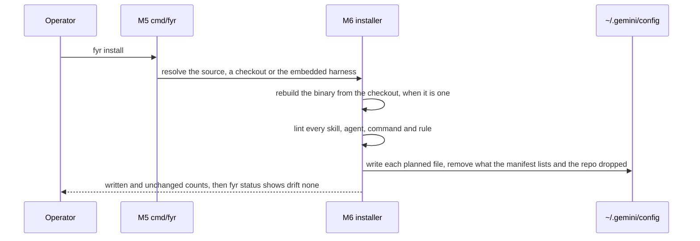
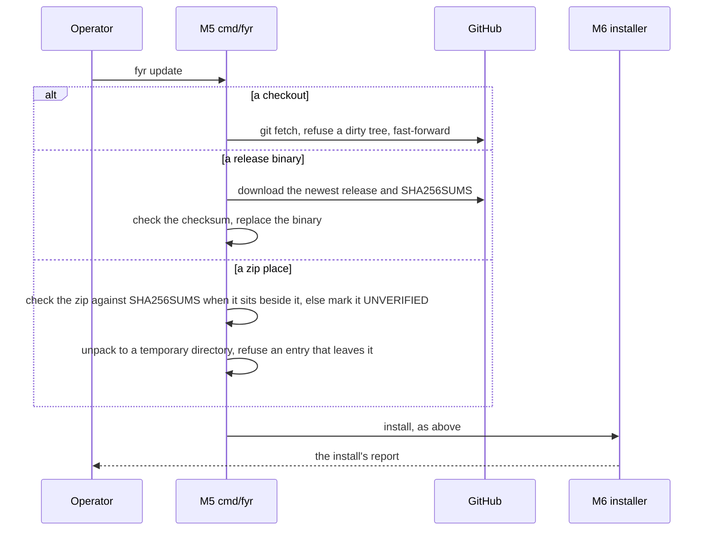
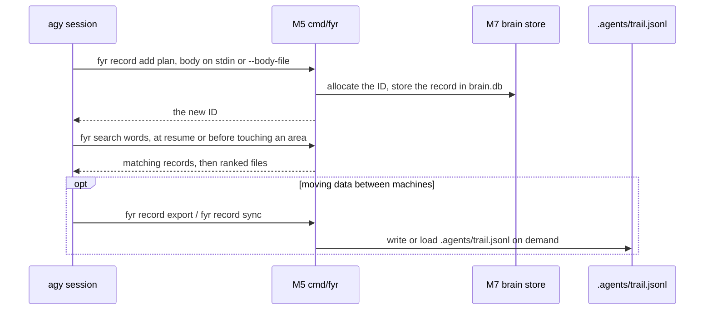
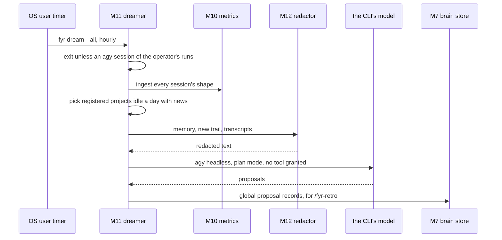

# SDD — fyr

How the harness's parts fit together: the content a session reads, the `fyr` binary that installs it and keeps the brain, and the paths between them.
Status: current · Last updated: 2026-11-11 · Requirements: [PRD.md](PRD.md) · Technical design: [TDD.md](TDD.md)

<!-- A summary a human reads in ten minutes. The detail lives in the records it links (an ADR per decision, a SPEC
     per surface: `fyr record get <ID>`), never restated here. Components are M1…; each satisfies PRD requirements by
     ID; TDD.md has one section per component. Kept current by the session that changes the design, in the same commit. -->

## Context

Open-source repository (`github.com/kesokaj/fyr`), local-first on each operator's machines (`ADR-515`). The harness is files a session reads (context, rules, skills, agents) plus `fyr`, which installs those files (and the `< 250 ms` fail-open CLI hooks in `~/.gemini/config/hooks.json`, R3, ADR-511) and keeps what a session cannot hold: each project's trail, its memory, the AST symbol and reference graph, the shape of every session, and an hourly consolidation of idle projects. Out of scope: any CLI but `agy` (R1), background daemons, commit gates and CI (R3), and any service (R8).

## Components

The content directories (M1–M4) are what a session reads; the binary (M5–M19) is `cmd/fyr` and its packages (`AGENTS.md` § Layout). Each package's surface is a SPEC record, linked from its TDD section.

| ID | Component | Responsibility | Satisfies |
|---|---|---|---|
| M1 | `context/`, `rules/` | The global context and the always-on rules (including feature routing in `rules/fyr-features.md`, ADR-518), one size-pinned block in Antigravity's rules directory | R0, R1, R2, R3 |
| M2 | `skills/`, `commands/` | Procedures loaded when a description matches, typed as `/name`; vendored skills and the Google catalog kept verbatim | R2, R5 |
| M3 | `agents/` | Subagents in Antigravity's `agent.md` format, installed as written | R1, R5 |
| M4 | `embed.go` | The five content directories and `docker/` built into the binary, pinned both ways to what git tracks, so a release binary carries the harness and the worker image files | R8, R9 |
| M5 | `cmd/fyr` | The verbs, their flags (including global `-C` / `--dir`, `--limit`, `--json` and `--json-in`), the live model catalog command (`fyr models`, `--explain`, `planner` role, `agy changelog` enrichment, fed by M10's `Store.ModelEvidence` and M18's `catalog.go`), and help pages; the three update paths (checkout, release binary, zip) | R4, R6, R8, R9, R10 |
| M6 | `internal/harness` | The installer: the plan of what goes where (including `~/.gemini/config/hooks.json`), the lint, the render, the manifest, status and drift, uninstall, adopt, the release download | R1, R3, R4, R5, R6, R9, R10 |
| M7 | `internal/brain` | The brain store, `fyr record` and `fyr resume`: every project's trail records and the global ones, with 1-call `stdin` headers (`ParseRecordStdin`, `ParseMemoryStdin`) and `--json-in` (`stdin_doc.go`), on-demand `.agents/trail.jsonl` export and sync, and the read-only seven-step session resume | R0, R4, R7 |
| M8 | `internal/search` | `fyr search` and `fyr index`: a derived full-text and pure-Go AST symbol/reference graph index over files (`schemaVersion = "5"`), tiered context slicing (`--slice`, `--skeleton`, `--path`, `--affected`, `--map`), session read-deduplication ledger (including `start_line = -4` session record/skill/nudge sentinels), passive co-activity, stateful `< 25 ms` prompt vetting (`--vet`: 9-mode intent classifier, `0..100` 6-anchor `VetScore` with prior-turn `vet_history` carry-forward, 3-turn skill deduplication, actionable `SKILL.md` body digests, omitting `[VET_IMPROVED_PROMPT]` when `Score >= 80` without conflicts/`VET_FIRST`, `< 2 ms` synthesis with advisory `route:` feature routing in `vet_route.go`, ADR-518, ADR-521, cryptographic data fence, `[FYR_TURN_CONTRACT]`), and `< 250 ms` fail-open CLI hook handlers (`--hook pre-invocation\|pre-tool-use\|stop` in `~/.gemini/config/hooks.json`: `<= 950 B` compact graph map capsule in `slice_compact.go`, single-pass memoized `turnBrainCache`, `PreInvocation` model nudge, and `PreToolUse` `overwrite` auto-upgrading guarded subagents to `"pro"` and filling omitted `swarm` `model`, ADR-520, writing `<appDataDir>/brain/<conv-id>/fyr-process.md` including active/latest `fyr work` wave telemetry); the dream's read-only reads | R0, R3, R4 |
| M9 | `internal/memory` | `fyr memory`: the project memory every session loads | R0, R7 |
| M10 | `internal/metrics` | `fyr metrics` and `fyr report`: the store of record of every session's shape (`ingest`, `show`, `report`, `evals`, `trajectory`, `export`, schema 6 `turn_vets` and `work_waves`, schema 7 `setup_s`, `agy_s` and `check_s` stage seconds on `work_waves`, multi-model orchestrator session normalization in `agy_conversation.go`, and `Store.ModelEvidence` feeding M5's `fyr models` refreshes), per-session token trajectories, subagent lineage and `KNEE_EXCEEDED` / `REDUNDANT_READ` / `RETRY_LOOP` anomalies (`trajectory.go`, ADR-513), and the six-section Economist HTML and `--md` usage reports including `Trigger coverage` (`report_md.go`, ADR-516, ADR-518) | R0, R4 |
| M11 | `internal/dream` | `fyr dream`: the hourly dreamer, its timer, lock, state and log | R0, R3, R8 |
| M12 | `internal/redact` | The credential redactor every dream input passes before it leaves the machine | R3, R8 |
| M13 | `internal/eval` | `fyr eval`: the behavioural suite (the tracked `.agents/eval/GUIDE-eval.md`, else the `GUIDE-eval` record, or `--suite-file PATH`), its rows' setup and checks, run in M17's sandbox up to `--parallel N` at once | R6, R8 |
| M14 | `internal/check` | `fyr check` and `fyr git-check`: the read-only drift check of docs, specs, requirements and the R → M → T traces, and the three post-dispatch git checks | R0 |
| M15 | `internal/trail` | The git reads every package makes into a project root, and the noindex markers | R7 |
| M17 | `internal/sandbox` | One unattended CLI session in a throwaway clone and home under `~/.config/fyr/{sandbox,eval}/<project>` (`ProjectRoot`, D9, ADR-503), over `agy -p` (with host-side `transcript.jsonl` polling in `transcript_watch.go` emitting live `ACPEvent` notifications every 500 ms, ADR-513) or warm multi-turn `agy acp --stdio --process-per-session` (`Config.ACP`, `ACPClient`, `acp.go`, `acp_prompt.go`, `acp_session.go`, writing `session.id` and `events.jsonl`), and its safety checks; M13 runs its rows in it, M18 its workers, whose session can run in a hardened container instead (`Config.Docker`, Phase 7 of `PLAN-2026-10-29-workers`; world-readable `-race` stdlib pre-installed in `$GOROOT/pkg/*_race` via `ENV GODEBUG=installgoroot=all` and `RUN go install -race std && rm -rf /root/.cache` in `docker/work.Dockerfile`, D25; macOS Keychain login synced to `~/.config/fyr/work/antigravity-oauth-token` without a second login, D7, ADR-503) | R6, R8 |
| M18 | `internal/work` | One Kickoff as a worker: M17's sandbox on a clone with no remote, on its own branch, fetched back into the lead's checkout by path, checked against the Kickoff's `Files:`, its added handoff and change records (plus modified existing records named in `Files:`, with `<ID>.kind`, ADR-519) written as files into the lead's scratch for the `/fyr-work` lead to store (ADR-501), and reported as a result contract of at most 39 lines per worker with the runner and its reason on the stamp line and each result line; `fyr work` (M5) runs one or several Kickoff files at once, up to `--max-workers` / `--workers` (default 8, 1..32; configured with `ram`, `cpu` and `disk` in `~/.config/fyr/work/config.json` via `fyr work config`, D10, ADR-503) across the machine, exports base trail records once per wave in DB-only checkouts (`wave_seed.go`, caching only on success or cancellation, D17, D25), picks the runner with `work.ChooseRunner` (`runner.go`), the one choice it shares with M19 (`--runner auto`, the default, is docker when the docker preflight passes and the host with the reason when it does not; an explicit `--runner docker` refuses instead, D5, ADR-504), checks the runner with `--check` (`work.Check`, which predicts the build of a missing or stale default image instead of running it, ADR-504a), streams live `work: [<name>]` progress lines (including `Base-Check:` and `Judge:` telemetry), persists `~/.config/fyr/work/<stamp>/status.json` (including per-worker `setup_s`, `agy_s` and `check_s` stage seconds) for `fyr work --status` (`progress.go`, `progressTracker`, `work.FormatStatusBoard`, with `--acp` enabling M17's ACP driver on the host runner), and atomically writes `--status-md <FILE>` (`progress_md.go`, `RenderWaveMarkdown`, ADR-513) with a Mermaid wave graph, progress table and per-worker carousel for the Antigravity Artifact Sidepanel, and ends a run with `--kill`; a Kickoff's `Model:` line picks its worker's model over `--model`, `Base-Check:` runs a falsifiability command that must fail on `HEAD` before `Baseline` and pass after `scope()` (`judge.go`), `Judge:` and `Judge-Model:` run an isolated post-build cross-family judge session (`catalog.go`, `model_profiles.go`, and `catalog_ranking.go` caching `~/.config/fyr/models.json` from `agy models` + `agy changelog` with per-model profiles, `planner` Argon preference, interactive-only `orchestrator` / retiring exclusions, and `ResolveRoleModel` / `Model: auto` resolution in `usage.go` + `model_profiles.go` routing builders to Gemini Carbon / Flash, planners to Argon > Carbon, and judges/verifiers/reviewers to Anthropic Opus / Sonnet with `>= 5`-run `ModelEvidence` ranking and automatic Gemini fallback when Anthropic pool quota is `< 20%` weekly or `< 30%` 5-hour remaining, ADR-519, ADR-520, writing `.agents/scratch/work/<stamp>/<name>/review-judge.md`), and `models.go` checks every named `Model:`, `Judge-Model:` and `--model` against the host's `agy models` (ADR-080) and classifies `hydrogen` low/medium as `flash`, `hydrogen-high`/`xhigh` as `pro`, and `gpt-oss` as `flash`; with `--runner docker` only the session runs in a container (M17's `Config.Docker`), `docker.go` and `image_build.go` hold the extra refusals (`DockerPreflight`), auto-build `fyr-work:local` from embedded `docker/` when the daemon is running (D7), accept `x86_64` and `arm64` `agy-linux` under Colima Rosetta (D8), clamp per-container CPU and RAM to the daemon's `NCPU` and `MemTotal` (D10), and run `Check` and the container sweep, while the other steps stay on the host; `Options.Auto` lets M19 run a drafts-only Kickoff (`Files:` empty) and collect `auto-drafts.jsonl` (`SPEC-fyr-work`, ADR-076, ADR-090, ADR-503) | R8 |
| M19 | `internal/auto` | `fyr auto`, R3's second timer exception: the operator's switch (`auto.json`), its own hourly timer through M11's rendering, and a run that does nothing unless the switch is on. Built through Phase 7 of its plan, the risk rubric (`internal/auto/rubric.go`), the `auto` skill, the worker runner (`internal/auto/kickoff.go`, `internal/auto/worker.go`), the apply step (`internal/auto/apply.go`), the learning tasks and draft validator (`internal/auto/tasks.go`, `internal/auto/learning_input.go`, `internal/auto/drafts.go`), the eval re-runs (`internal/auto/eval_rerun.go`, `internal/auto/eval_exec.go`) and the eval gate (`internal/auto/eval_gate.go`) included: a run reads the gates, runs the free checks, reports in global `review` records, and past level `observe` starts at most one M18 worker or eval re-run per run (up to 4 a day, 30m each, in docker when `work.DockerPreflight` passes, else host, through M18's `work.ChooseRunner`) from a fixed-template Kickoff filtered by `AllowedFiles`, passing a learning task's conversations, memory, proposals and metric numbers through M12 first, validating and writing `auto-drafts.jsonl` lines with `provenance: derived`, and for an applied class (or a `harness-edit` at level `harness` that passes the eval gate at `k=3` on target, regression and held-out rows within 24 eval sessions) squashing its PASS branch in a temporary worktree under `auto/`, running the base tree's `# auto: test` commands and `fyr check`, and fast-forwarding the checkout only when all pass and the checkout did not move, never pushing and never installing into a real home (`install pending`) | R0, R3, R4, R8, R9, R10 |

## Flows

### Install

### Update

### Record

### Dream

## Decisions

One line each; the record holds the context, the alternatives and the operator's approval (`fyr record get ADR-NNN`).

- The harness is context, skills and subagents, with no daemons and no commit gates (ADR-007's lifecycle-hook rejection superseded in part by ADR-511's `< 250 ms` fail-open CLI hooks in `~/.gemini/config/hooks.json`) — ADR-001, ADR-007, ADR-511.
- Antigravity only, with no path that sends experience back — rejected: a second CLI and a report verb — ADR-062, ADR-070.
- The deployed context is one block pinned under 22,000 bytes, pruned rather than split — ADR-035, ADR-051.
- One dependency, a pure-Go SQLite driver — rejected: cgo drivers and a second dependency — ADR-045.
- Every trail record lives in one brain store, exported to and synced from `.agents/trail.jsonl` only on demand — rejected: Markdown files per record, rewriting `.agents/trail.jsonl` on every record write — ADR-063, ADR-091.
- A release binary carries the harness, and releases are publicly downloadable over HTTPS with checksums and no signature — ADR-033, ADR-034, ADR-053, ADR-515.
- A third way in, the zip place — ADR-038, ADR-041.
- The metrics store holds session shape only, never prose — ADR-055, ADR-055a.
- The hourly dreamer proposes only, and its dream is a visible conversation — ADR-047a, ADR-073.
- A project reaches the cross-project readers only by the operator's registration — ADR-068, ADR-068a.
- `fyr check` and `fyr eval` are verbs, not gates — ADR-064, ADR-065.
- A child process that reads untrusted input gets an allow-listed environment — ADR-067.
- A harness agent's frontmatter is an allow-list — ADR-056, ADR-056a.
- A session is one Task or one plan phase, or, when the feature skill runs a plan as workers, its planning and dispatch loop, or one `/fyr-work` task list's dispatch loop — ADR-058, ADR-077.
- The root documents are PRD, SDD, TDD and TODO — ADR-074.
- Drop the local HTTP server (`serve`) in favour of CLI-first operator and agent ergonomics — ADR-513 (superseding ADR-075, ADR-075a, ADR-075b).
- Idle-time self-improvement is an explicit switch with its own timer, nine gates, a risk rubric and M18 workers in docker when preflight passes or on the host — ADR-090.
- Single-binary Docker setup (`embed.go` embeds `docker/`), macOS Keychain token sync to `~/.config/fyr/work/antigravity-oauth-token` without a second login, `x86_64` and `arm64` `agy-linux` under Colima Rosetta, project-scoped sandboxes under `~/.config/fyr/{sandbox,eval}/<project>`, and `fyr work config` queue/resource limits (`workers=8`, `ram=8g`, `cpu=2`, `disk=10g`) — ADR-503 (superseding ADR-502).
- A worker's runner defaults to `--runner auto`: docker when its preflight passes, else the host with the reason on the stamp line, one choice (`work.ChooseRunner`) for `fyr work` and `fyr auto`, an explicit `--runner docker` refusing instead — rejected: refusing when docker is not ready, choosing in the verb, a second docker probe in one `fyr work` run (`fyr auto` probes twice: `DockerPreflight` before `work.Run`, whose explicit `docker` runs the refusals again, so a docker change in between refuses rather than falls back) — ADR-504.
- `fyr work --check` predicts the build a run makes first: a missing or stale default image that a run builds reads as `runner docker (fyr-work:local will be built first)` when the build's own checks (the daemon's architecture, which the build passes as `--platform`, and the work directory it stages in) and every other refusal pass, and a build that would refuse there refuses `--check` in the run's words, while `DockerPreflight`, `fyr auto`'s probe, builds and predicts nothing, and the docker clients that run the image drop `DOCKER_DEFAULT_PLATFORM` (`sandbox.DockerEnv`) — rejected: building in `--check`, a `/fyr-work` task list running each wave with `--runner auto`, accepting a linux agy of any known architecture, predicting `DOCKER_DEFAULT_PLATFORM` instead of passing `--platform`, `--platform` on every `docker run` — ADR-504a.
- Without `--home`, only the home's installed `~/.local/bin/fyr` runs a store-opening verb (every verb but `install`, `sync`, `update`, `version`, `list`, `render` and `diff`, reads included); any other build refuses with exit 2 before opening or migrating a store — ADR-505.
- `fyr eval` check c skips the non-brain top-level store and dream files and watches `~/.config/fyr/brain.db` by file mode and a read-from-a-copy SHA-256 digest of the trial clone's and `--fixture`'s scopes (`brain.SnapshotScopes`), so another `agy` session's writes in `Options.Root` or another repository and the hourly dream no longer fail running trials — rejected: watching `Options.Root`, keeping `metrics.db` and `search.db` byte-watched, opening the live `brain.db` directly in SQLite — ADR-506.
- A session's seven-step resume sequence and the three post-dispatch git checks are read-only top-level verbs (`fyr resume`, `fyr git-check`) — rejected: keeping seven and three separate calls in the context, or making `fyr git-check` parse output and fail as a gate — ADR-508.
- Pipeline benchmark extensions on `fyr eval`: per-row `timeout` (`1m`..`4h`), scripted multi-turn sessions (`turns` `1`..`12` with early completion detection), and per-stage timing (`setup_seconds`, `session_seconds`, `check_seconds`) with check scripts kept out of the sandbox until scoring — ADR-509.
- `PRD.md` names `fyr dream`'s private `settings.json` under `~/.config/fyr/dream-agy-home-<pid>/`, macOS check e (`procs_darwin.go` via `lsof` and `ps -Eww`), and `/fyr-work` running `fyr work --check`, passing `--runner`, and settling host fallback in the pre-build interview or task-list go rather than stopping mid-build — ADR-510 (amending ADR-507), ADR-517.
- Pre-build interview is the sole operator wait-point; build sessions and `/fyr-work` waves run autonomously without mid-build questions, stopping only on a safety `FAIL` — ADR-517 (with feature-routing and live model-catalog decisions recorded in ADR-518 and ADR-519).
- Zero-daemon Antigravity CLI hooks in `~/.gemini/config/hooks.json` (`< 250 ms` fail-open timeout via `fyr search --hook pre-invocation|pre-tool-use|stop`), pure-Go `go/ast` symbol and reference graph in `internal/search` (`schemaVersion = "5"`, `--slice`, `--skeleton`, `--path`, `--affected`, `--map`), stateful `< 25 ms` prompt vetter (`vet_history`, `0..100` `VetScore`, `[VET_IMPROVED_PROMPT]`), skill prefetcher and cryptographic fence (`--vet`), live `<appDataDir>/brain/<conv-id>/fyr-process.md` artifact, consume-on-hit session read ledger with compaction re-priming, and salted-hash read telemetry in `internal/metrics` — rejected: background MCP daemons, CGo Tree-sitter bindings, permanent hard-blocking of repeated file reads — ADR-511 (superseding ADR-007 in part).
- Top-level local-only `fyr report` verb (`--project [DIR] | --global`, `--md` and HTML) and `metrics.db` schema 6 (`turn_vets` and `work_waves` tables ingested from per-project `.agents/scratch/search.db` and `fyr work` waves) — ADR-516.

## Cross-cutting

- **Security:** four things are sent by design from the machine: to the model of the CLI the machine already uses: the dreamer's redacted prompt (M12), and the runs of `fyr eval` and the workers of `fyr work` started by the operator or by `fyr auto` when turned on (M13, M18, M19), plus, for `fyr auto`'s learning tasks, the conversations, memory, proposals and metric numbers `fyr` gives a worker, through M12's redactor first; and to skills.sh and the npm registry, the search of a `fyr auto` worker looking for a missing skill, its query words unredacted (a worker's clone has no remote and its runner is docker when `work.DockerPreflight` passes and otherwise host as the operator's uid, while with either runner the worker's agent has `command(*)` and the network, and check c and `auto.json`'s watch are tripwires, not containment; R3, R8, ADR-076, ADR-090); every child process that reads untrusted input gets an allow-listed environment (ADR-067); the installer refuses any permission key in frontmatter (M6).
- **Privacy:** memory, metrics and the global records stay in `~/.config/fyr/` on the machine that wrote them (R7); the metrics store keeps no arguments, prose or tool output (R4).
- **Observability:** `fyr status` names drift, the binary's build, the dream timer and `fyr auto`'s switch; `fyr report`, `fyr metrics show` and `fyr metrics report` summarise every session's shape.
- **Cost:** no service and no cloud; the only model calls are the dream's, hourly while a session already runs, the evals and workers the operator starts, and `fyr auto`'s workers and eval runs (at most four 30-minute model tasks a day when turned on, an eval gate stopping at 24 eval sessions, gated on 50%/30% remaining quota).

## Deployment

The README map (`README.md` § How it works) is the deployment picture and the contract: it draws how the harness reaches a machine and what leaves one, and `AGENTS.md` § How the harness works holds the rules that keep it true. What a tag delivers to each kind of place is stated once, in `SPEC-fyr-delivery` § The model.

The dreamer is the one thing that runs on its own, hourly while an `agy` session of yours runs, and it only proposes; each project's dream is a conversation you can open with `/resume`. The procedures per place are the `DEPLOY-local` and `DEPLOY-remote` records; the requirements behind the three ways in and the three procedures are PRD R8 and R9.

## Risks

- **The rules block fills.** The context, the rules and the generated inventory share one 24,000-byte block; a skill dropped in grows the inventory. Shown by `TestRenderedContextFitsAntigravityBlock` and `TestSkillListingBudget`.
- **Antigravity changes underneath.** Paths, tool names and the block size are measured, not documented (PRD § Known limits). Shown by the real-home smoke and the `fyr eval` rows.
- **The docs drift from the binary.** Shown by `fyr check` (G3) and `/fyr-review --docs`.
- **A credential slips past the redactor.** The redactor grows by kind, with a near-miss per needle. Shown by `TestRedactShapes`.

## Trace

Every requirement of `PRD.md`, and the components that satisfy it.

| Requirement | Components |
|---|---|
| R0 | M1, M7, M8, M9, M10, M11, M14, M19 |
| R1 | M1, M3, M6 |
| R2 | M1, M2 |
| R3 | M1, M6, M8, M11, M12, M19 |
| R4 | M5, M6, M7, M8, M10, M19 |
| R5 | M2, M3, M6 |
| R6 | M5, M6, M13, M17 |
| R7 | M7, M9, M15 |
| R8 | M4, M5, M11, M12, M13, M17, M18, M19 |
| R9 | M4, M5, M6, M19 |
| R10 | M5, M6, M19 |
