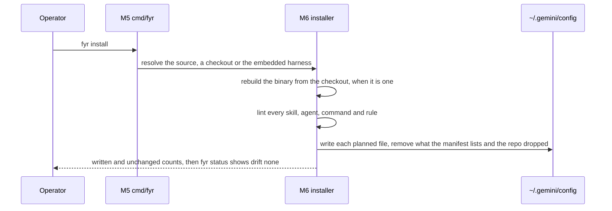
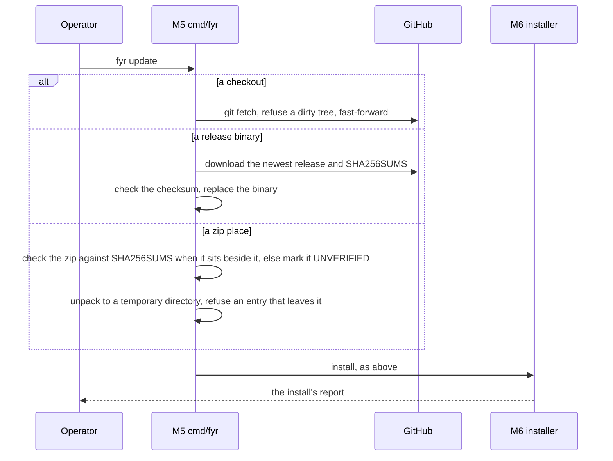
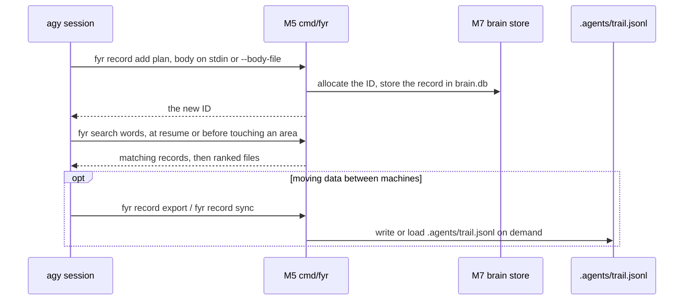
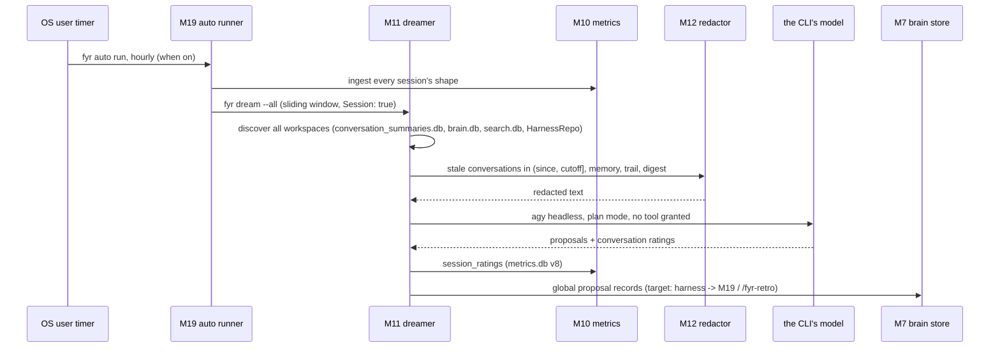

# SDD — fyr

How the harness's parts fit together: the content a session reads, the `fyr` binary that installs it and keeps the brain, and the paths between them.
Status: current · Last updated: 2026-11-23 · Requirements: [PRD.md](PRD.md) · Technical design: [TDD.md](TDD.md)

<!-- A summary a human reads in ten minutes. The detail lives in the records it links (an ADR per decision, a SPEC
     per surface: `fyr record get <ID>`), never restated here. Components are M1…; each satisfies PRD requirements by
     ID; TDD.md has one section per component. Kept current by the session that changes the design, in the same commit. -->

## Context

Open-source repository (`github.com/kesokaj/fyr`), local-first on each operator's machines (`ADR-515`). The harness is files a session reads (context, rules, skills, agents) plus `fyr`, which installs those files (and the `< 250 ms` fail-open CLI hooks in `~/.gemini/config/hooks.json`, R3, ADR-511) and keeps what a session cannot hold: each project's trail, its memory, the AST symbol and reference graph, the shape of every session, and an hourly stale-conversation rating and consolidation sweep across all workspaces. Out of scope: any CLI but `agy` (R1), background daemons, commit gates and CI (R3), and any service (R8).

## Components

The content directories (M1–M4) are what a session reads; the binary (M5–M27) is `cmd/fyr` and its packages (`AGENTS.md` § Layout; `M9` merged into `M7`, and `M16`–`M18` retired under `ADR-522`). Each package's surface is a SPEC record, linked from its TDD section.

Component inventory (M1–M27)

| ID | Component | Responsibility | Satisfies |
|---|---|---|---|
| M1 | `context/`, `rules/` | The global context (aligned with PRD R7 single-handoff close, `change` optional) and the always-on rules (including feature routing in `rules/fyr-features.md`, ADR-518), one size-pinned block in Antigravity's rules directory | R0, R1, R2, R3 |
| M2 | `skills/`, `commands/` | 35 embedded skills loaded when a description matches or typed as `/name` (incl. trimmed `skills/frontend-slate-ui/`, progressive `references/` diet across 6 core skills `<= 13 KB` plus `golang` `<= 12 KB`, frontmatter keyword dedup from 23 pairs to `<= 5`, runnable distroless/`imagetools inspect` in `docker`, two-stage bootstrap in `terraform`, R7 single-handoff close in `fyr-bug`/`fyr-handoff`/`fyr-feature`, minus dropped duplicates, 292 PNGs, and the google-catalog skill); commands directory kept empty | R2, R5 |
| M3 | `agents/` | The seven subagents (`builder`, `reviewer`, `security`, `verifier` with its Boundary Contract Checklist, `explorer`, `documentation`, `dreamer`) in Antigravity's `agent.md` format, installed as written (ADR-532) | R1, R5 |
| M4 | `embed.go` | The six content directories (`context/`, `skills/`, `agents/`, `commands/`, `rules/`, `workflows/`) built into the binary, pinned both ways to what git tracks, so a release binary carries the harness | R8, R9 |
| M5 | `cmd/fyr` | The 31 CLI verbs (30 primary commands plus the `sync` alias, all 31 supporting `--json` parity via `verb_json_helpers.go`; `state`, `graph --include-vendored`, `auto log [--lines\|--limit]`, `auto run --force`, `auto sim <list\|show\|record\|merge>`, `metrics record-run --json-in`, `report --json/--web/--listen/--include-sandboxes/--since-tag/--daily-digest/--no-ingest` auto-ingesting by default, `memory show --limit`, `search --include-docs`, `index --register` skipping ephemeral worktree/smoke/sandbox/scratch paths, `verify`, `gate`, `land`, `close` with fail-fast bounded `<= 1 MiB` stdin, `relay`, and `watch` through M20/M23–M27 included), their flags (including leading or trailing global `-C` / `--dir`, `--home`, `--repo` via `splitLeadingVerb`, `--limit`, `--json` and `--json-in`, `--judge`/`--judge-model`/`--worker-model`/`--worker-session` on `gate`/`land` persisting `JudgeVerdictRow` via M10, `--bench`/`--max`/`--model`/`--caller-family` and flag-aware `--explain [ID]` on `models`, `--model ID` on `eval`, `--out`/`--since`/`--include-memory`/`--dry-run` on `state` reporting SIM and orchestration counts, `--plan`/`--max-phases`/`--judge-model`/`--dry-run`/`--json` on `relay`, and `--check`/`--conv`/`--idle-sec` on `watch`), the live model catalog command (`fyr models`, `planner` role, 1 MiB `agy changelog` enrichment, cold-cache `EnrichCatalogPools`, `< 50 ms` warm `--pick` via `<= 10m` cached `models.json` quota TTL, role-partitioned Pareto Empirical-Bayes + conservative UCB ranking with smooth failover, fed by M10's `Store.ModelEvidence` + `dev/fyr-eval` read-only merge and M21's catalog), and help pages; the three update paths (checkout, release binary, zip) | R4, R6, R8, R9, R10 |
| M6 | `internal/harness` | The installer: the plan of what goes where (including `~/.gemini/config/hooks.json` wiring `SessionStart`, `PreInvocation`, `PreToolUse` covering `[KICKOFF_GUARD]`/`[SEARCH_NUDGE]` tools, `PostToolUse`, and `Stop`, and the 3 `workflows/*.py` scripts `phase_loop.py`, `review_parallel.py`, `preflight_gate.py` to `~/.gemini/config/workflows/`), the lint enforcing the `<= 140`-char skill description cap via `LintSkillFrontmatter` (`SkillDescriptionLimit = 140` in `internal/harness/frontmatter.go`) alongside the `1,024`-char Agent Skills / agent spec limit (`descriptionLimit`) and `<= 15,000 B` combined budget (`skills_text_test.go`), the render, the manifest, status and drift, uninstall, adopt, the release download | R1, R3, R4, R5, R6, R9, R10 |
| M7 | `internal/brain` | The brain store (`brain.db` schema v5 adding dedicated global SIM tables `sim_problems` with explicit `pid`, `sim_attempts`, `sim_aliases`, and `sim_fts` (`SPEC-fyr-sim`), atop v4 normalized `repo_id` via `NormalizeRepoID` and idempotent `ensureTurnRecordsIndex()` `records_scope_kind_status_date`), `fyr record`, `fyr memory` (`show --limit`), and `fyr resume`: every project's trail records and the global ones, `unmigratedDocsDir` checking actual file-era trail records (`PLAN-*`/`ADR-*`/`BUG-*`/`CHANGE-*`/`HANDOFF-*`) under a legacy project docs tree, single-open read-only active turn-record + FTS5 loaders (`ListTurnRecords`, `SearchTurnRecords`, `LoadTurnRecordsAndFTS` using `UNION ALL` indexed `listTurnQuery` + trivial-word FTS skip `filterTurnFTSWords` in `internal/brain/turn_records.go`), `memory` cards (`semantic`, `procedural`, `episodic` with legacy input normalization, `--global` shared cross-project memory, `--include-low` on `show`, symmetric `operator` provenance immutability guard refusing auto-retire/supersede/downgrade across `memory add`, `MemoryDraftWithOptions`, state import, and SIM problems, `<= 2` `Prior:` compaction in `memory_draft_prior.go`, `[STALE: <path> modified since <ID>]` content-hash staleness via `appendRepoFilePins` with zero mtime-only penalty, and calibrated deterministic `0.00–1.00` validity via `ComputeMemoryValidity`: `1.00` `operator` base, `0.80` `derived`/`unknown` base `+0.05` up to 2 sessions, `0.35` age-decay floor, `3x -0.25` contradiction cap, hiding cards `< 0.40`), bounded `<= 6 KiB` `RetrieveSIMSlice`, `ExportStateSIM`/`ImportStateSIM` (strictly isolated from `fyr resume`/`fyr memory show`/hooks/`.agents/trail.jsonl`), strictly read-only `IndexRecordLinks` (`internal/brain/refs_index.go`), 1-call `stdin` headers (`ParseRecordStdin`, `ParseMemoryStdin`) and `--json-in` (`stdin_doc.go`), on-demand `.agents/trail.jsonl` export and sync, and the read-only seven-step session resume (loading active project + `--global` `semantic` memories plus fail-open `writeResumeDailyDigest` brief from `~/.config/fyr/reports/latest-daily-digest.json` in `internal/brain/resume_daily.go`) | R0, R4, R7 |
| M8 | `internal/search` | `fyr search` and `fyr index`: a derived full-text and pure-Go AST symbol/Markdown-heading reference graph index over files (`schemaVersion = "12"` migrating `v11 -> v12` in place for `session_meta.{last_invocation_num, last_checkpoint_offset}` atop v11 `vet_history.{duration_ms, timed_out, injected_bytes}` while preserving all 6 behavioral tables `co_activity`, `read_ledger`, `read_ledger_stats`, `session_meta`, `vet_history`, `watchdog_ring`, plus `projects`, v10 `blobs.line_count`, v9 `chunks.tokens` / `chunks_fts`, `refs_oid`, query stop-word filtering + `findDistinctFiles`, batched `snippets()`), `< 80 ms` warm `PreInvocation` / `< 15 ms` mid-turn dedup via `git_warm_sig.go` (including Git reftable `hashGitReftable` fallback), incremental `applyDirtyPaths` (`<= 3` dirty files fast-path in `reconcile.go`), append-only `CHECKPOINT` compaction detection (`scanTranscriptCheckpoint`), parallel `buildVetSliceCtx` `<= 120 ms` inner deadline (`hook_pre_invocation_fast.go`), lightweight subagent fast path (`hook_pre_invocation_subagent.go`), timeout fallback stamp (`hook_deadline.go`), `CROSS JOIN` hop-1 scoping, covering-index symbol fallback (`sym_graph_bounded.go`, `sym_graph_bounded_sql.go`, `sym_graph_bounded_like.go`), and `MATERIALIZED` FTS5 CTE (`hook_fts_fallback.go`) preserving compact `ImprovedPrompt`, `records_fts` `brain.Search` precision, canonical repo-dir package paths (`pkg_paths.go`), Go alias/`go.mod` + TS/TSX relative import & unexported `const` suppression, default generated/doc/vendored exclusions with `Options.IncludeDocs` (`--include-docs`) and on-demand in-memory `GraphOptions.IncludeVendored` (`fyr graph --include-vendored`, keeping `0` vendored symbols in `search.db`), Tarjan SCC (`import \| call \| type_ref` only), deterministic Louvain overflow grouping in explicit-target `DecomposeSubtasks` (`extractExplicitPromptTargets`, `isDiagnosticReadOnlyPrompt`), read-only `ReadStructuralSignals` / `ReadHiddenCouplingHints` (splitting `co_edit` vs `co_read` pairs in `structural_signals_coupling.go`), and `LoadGraphSnapshot`, tiered context slicing (`--slice`, `--skeleton`, `--path`, `--affected`, `--map`), persistent hash-keyed session read-deduplication ledger with overlapping-edit invalidation, out-of-root/unindexed `PreToolUse` `read_file` bypass (`hook_pretool.go`, `hook_clamp.go`), hardened 18-pattern multi-line/pipe `ParseBashFileReads` (`read_ledger_bash.go`, `read_ledger_bash_chain.go`, `read_ledger_bash_pipe.go`, `read_ledger_bash_filter.go`, `read_ledger_bash_sed.go`) + 3-pass `[CLAMPED]` / `read_ledger` dedup across `&&`/`;`/newline chains and read-only pipes, dual-gate D7 skeleton-first clamp (`>= 400` lines OR `>= 16,384` bytes), and `-5` `[CLAMPED]` retention across edits, passive co-activity, stateful `< 25 ms` prompt vetting with FTS5 0-pivot fallback (`--vet`: 9-mode intent classifier, `0..100` 6-anchor `VetScore`, conflict-only `VET_FIRST` on `PRD.md`/`ADR-*` conflicts or ultra-vague zero-hit `<= 6`-word `FEATURE`/`BUG`, dynamic BM25F installed-catalog skill prefetcher `MatchSkills` capped at top-3 with zero phantom skills + 3-turn dedup & `SkillDigests`, `[CONTEXT_KNEE_WARNING]` & `IntentApproval` dedup via `vet_history_store.go`/`process_artifact.go`, `<= 6` disjoint `Subtasks` in `vet_decompose.go` / `vet_capsule.go`, `vet_route.go`, ADR-518, ADR-521, ADR-525, ADR-528, ADR-532, ADR-534, cryptographic data fence, `[FYR_TURN_CONTRACT]`), progressive on-demand memory injection in `PreInvocation`, hard `200 ms` fail-open CLI hook handlers + hardened `no-hooks` switch (`Lstat` regular-file check in `hooksDisabledForHome`, ignoring repo-local `.agents/scratch/no-hooks` under `FYR_RELAY=1`: `SessionStart` with fail-open `DailyAlert`, `PreInvocation`, `PreToolUse` with dual-root `run_workflow` `ScriptPath` allowlist, `S4` `resolveHookSessionModelForHome` inheritance, `neon` recognition, `hook_subagent_models.go` shared `internal/models` routing + `[CROSS_FAMILY_NOTICE]`, `[SEARCH_NUDGE]` in `hook_pretool_nudge.go`, `[KICKOFF_GUARD]` in `hook_pretool_ask.go`, `[COORDINATOR_GUARD]`, `hook_bash_guard.go` incl. `read -p` & interactive `ssh`, `hook_bash_relay.go`, `hook_watchdog.go` with aligned `SubagentBudgetCap` and `[ERROR_LOOP]`, `Stop` `verify.stamp` check, `telemetry_render.go`, `telemetry_ledger.go`, `telemetry_process.go` `fyr-process.md`), plus all-workspace dream corpus discovery (`GlobalWorkspace`, `ListAgyWorkspaces`, `AgyConversationTextInWindow`, ADR-524) | R0, R3, R4 |
| M10 | `internal/metrics` | `fyr metrics` and `fyr report`: the store of record of every session's shape (`ingest`, `show`, `report`, `evals`, `trajectory`, `export`, `record-run --json-in`, schema 6 `turn_vets` and `work_waves`, schema 7 `setup_s`, `agy_s` and `check_s`, schema 8 `session_ratings` in `ratings.go`, ADR-524, schema 9 `judge_verdicts`, schema 10 `background_runs`, schema 11 `repo_id`/`worker_model`/extended `turn_vets`, schema 12 `daily_digests`, schema 13 `trials.policy_model` + `DigestAppliedAction.PolicyModel` + `sim_models.go`/`sim_model_shift.go` + `"info"` `model_shift_audit` signal, and schema 14 adding `orchestration_runs`, `background_runs.halt_reason`, `turn_vets.suggested_skills`, and `trials.{skill,arm,tokens,defects}`), `step_type = 23` (`agyCheckpoint`) compaction ingest, eval sandbox `Options.BrainHome` trail join, calibrated `KNEE_EXCEEDED` event emission, anchored `skillPath` ignoring repo-source reads, concrete `f(3,28)->f(1,19)` model IDs, `14`-day decayed role-partitioned `ModelEvidence` with `OpenDevEvalFallbackRO` `dev/fyr-eval` read-only merge, `ExportSanitizedState` / `ImportSanitizedState` for offline `fyr state` v14 bundles, `isSandboxProjectRoot` filtering with `--include-sandboxes`, `read_ranges.go`, `sv.n == 0` standalone `Search : grep`, separated `ToolErrors`/`HookDenials` (`agy_denials.go`, `show_types.go`), `builder`/`builder-*`/`coder`/`coder-*`/`self` `120`-call budget cap (`subagentCapForRole` in `show_health.go`), `RetryLoops` reset, `show_health.go` + `inspectProjectSearchDBs`, `report_evals.go`, live v9 `trigger_coverage.go`, equal-prior `WindowDeltas` with `H.structural.*` deltas from prior `daily_digests.ast_json`, `Summary.Numbers()`, rate-normalized `DiagnosticReport` with 2-day persistence hysteresis (`applyPersistenceHysteresis`), `signal_id` dedup, health regression rules (`pre_invocation_timeouts`, `bash_read_bypass`, `structural_regression`), and `ActionScope`/`RecommendedAction` classification in `internal/metrics/diagnostics_health.go`, `DailyDigest` (`internal/metrics/daily_digest.go`, `daily_digest_io.go`, `daily_digest_recovery.go`, `daily_digest_render.go`), upgraded `fyr report` (auto-ingesting unless `--no-ingest`, `--since-tag TAG` pre/post cohort comparison in `show_cohorts.go`, `AgentRoles`, `OrchestrationSummary`, `SIM`, and `Skill & Rule Telemetry` sections in `report_sections.go`/`show_waves.go`, `PreInvocation` KPIs, `TopBashVerbs` & `BashReadSkips` in `show_columns.go`, `--daily-digest`, top `"Daily Direction & Actions"` banner, `0. Scorecard`, `Background Autonomy`, `--json`, `--web`, daily HTML `WriteDailyReport`), and per-session token trajectories (`KNEE_EXCEEDED` vs calibrated `[40%..60%]` effective context knees, `DreamTrajectoryDigest`) | R0, R4 |
| M11 | `internal/dream` | `fyr dream`: the registration-free plan-mode dreamer and stale-conversation rater (discovering all workspaces incl. non-git dirs and `GlobalWorkspace` while filtering refused/ephemeral roots via `IsEphemeralPath`/`IsRefusedWorkspace` in `internal/dream/ephemeral.go`; sliding-window `(since, cutoff]` evaluation; `remote-control serve` active-session detection in `agy_process.go`; sibling/`~/.local/bin` binary lookup via `ResolveBinary` in `agy_home.go`; oversized transcript chunking & `kindSIM` fitter `trimSIMBlock` in `collect_fit.go`; injecting `DiagnosticReport`, `DailyDigest` via `internal/dream/metrics.go`, project-local redacted hidden-coupling hints, and bounded fenced `<= 6 KiB` `kindSIM` prompt slices via `collect_sim.go`; unlocking `applied:*` skills on 7d cooldown, `still_regressing`/`reverted`, or policy-generation shift via `proposals_dedupe.go`/`proposals_dedupe_sim.go`; writing `session_ratings`, `RecordBackgroundRun` with `halt_reason`, and queueing `target: harness` proposals with optional `signal_id`/`report_date`/`action_scope`/`recommended_action` in `proposals_format.go`/`proposals_write.go`; ADR-524, ADR-528, ADR-530, ADR-533, ADR-534), lock, state, log, and legacy dream-unit cleanup + shared timer renderer | R0, R3, R8 |
| M12 | `internal/redact` | The credential redactor every dream input passes before it leaves the machine | R3, R8 |
| M13 | `internal/eval` | `fyr eval`: the behavioural suite (the tracked `.agents/eval/GUIDE-eval.md` with pinned regex hygiene in `suite_outcomes*_test.go`, else the `GUIDE-eval` record, or `--suite-file PATH`, including the `sim-avoid-repeat` behavioral row), its rows' setup and checks, run in M22's isolated sandbox (`--runner isolate`) with optional `eval.Options.Model` -> `isolate.Config.Model` plumbing and sandbox `BrainHome` ingest join up to `--parallel N` at once | R6, R8 |
| M14 | `internal/check` | `fyr check` and `fyr git-check`: the read-only 8/8 drift check of docs, specs, requirements (skipping local-only record IDs on fresh clones without trail/store per `F-009`), R → M → T traces, undocumented CLI flags (`drift-M4` `flag-undoc`), AST-deleted flags (`drift-M5b`), context/rules budgets (`drift-M7` `budget`), skill frontmatter (`drift-M8` `frontmatter` via `LintSkillFrontmatter`), and adjacent `Test*` <-> `*_test.go` attribution (`F-017` `test-ref`), plus the three post-dispatch git checks | R0 |
| M15 | `internal/trail` | The git reads every package makes into a project root, and the noindex markers | R7 |
| M19 | `internal/auto` | `fyr auto`, R3's single background timer: binary `on \| off` global switch (`auto.json` storing `enabled` and `conversation_idle` default `1h`, migrating legacy configs while retiring `--level` tiers and `CheckHarness`, ADR-524; hourly timer with `4h` model-run cooldown bypassed by `fyr auto run --force`, `fyr auto log [--lines\|--limit\|--all]` in `log_read.go`, `installPendingBanner` in `status.go`, metrics ingest first, zero-tool `DraftsOnly` classes (`memory-consolidation`, `retro-lite`, `memory-candidates`, `missing-skill`) over shared `SessionDigest` (`session_digest.go`, self-log filtering, `collect_fit.go` chunking) running on dirty/non-git/`__global__` roots with `G8` scoped to git-mutating tasks, priority proposal queue drain + stale `"rejected"` expiry via `eval_proposals.go`, in-place `still_regressing` proposal dedup/consolidation & 14d TTL retirement (`proposal_dedupe.go`, `proposal_consolidate.go`, zero row deletion), `.agents/eval/holdout-starter.md` auto-seed under `o.Home`, always-refreshing `DailyDigest` (`refreshDailyDigest` in `cmd/fyr/verb_auto.go`) alongside write-once daily HTML report, shared ephemeral/refused-root 0d pruning (`auto.IsEphemeralPath` delegating to `dream.IsRefusedWorkspace`) plus `> 7d` / bounded `<= 20` `skipped: gone` pruning in `runs.json` (`Project.GoneSince` in `internal/auto/run_sweep.go`), `RecordBackgroundRun` with `halt_reason`, and `G1`–`G3`/per-pool `G9` gates (`gateBudgetForModel` in `usage.go`)). With `rubric.go`, `kickoff.go`, `worker.go`, `worker_drafts.go`, `apply.go`, `tasks.go`, `diagnostics.go` (7d rolling window), `digest_integration.go`, `learning_input.go`/`learning_input_sections.go` (`simReserve = 6 KiB` bounded SIM learning input), `drafts.go`, `sim_manifest.go` (pre-eval `sim_manifest` in `auto-drafts.jsonl`), `eval_plan.go` (deterministic `selectGateRows` + pre-dispatch `hasMatchingEvalRows`), `eval_exec.go`, `eval_gate.go`, `sim_gate.go` (Stage A `eval_gate` SIM outcome & model provenance), `sim_sync.go` (Stage B `SyncSIMFieldOutcomes` over `DailyDigest`, per-model stratified `field_models`, and `git revert` via `>=7`-hex prefix), and `usage.go`, reserves the 4th daily run slot for eligible high-severity `auto_skill` `harness-edit` tasks, propagates `signal_id`/`report_date`/`action_scope`/`recommended_action` across drafts, commits, and `REVIEW-*` records, starts at most one M22 dreaming worker (`isolate.RunWorker`, explicit `--model`, up to 4 a day, 30m each, failing closed via `isolate.ChooseRunner` when OS isolation is unavailable) from a fixed-template Kickoff filtered by `AllowedFiles`, passes redacted inputs through M12 first, validates and writes `auto-drafts.jsonl` (`operator` provenance guard, `<= 2` `Prior:` cap), stages `skills.sh` asks, and for harness eval-gated branches passing target/regression/held-out rows within 24 eval sessions squash-verifies and fast-forwards cleanly without pushing or installing (`ADR-530`, `ADR-533`, `ADR-534`) | R0, R3, R4, R8, R9, R10 |
| M20 | `internal/gate` | Deterministic mechanical gates (`fyr verify`, `fyr gate`, `fyr land`, `fyr close` with fail-fast bounded `<= 1 MiB` stdin) plus optional post-gate cross-family judging (`EvaluateJudge` in `judge.go` with `RealHome` auth/model staging and `--worker-model`/`--worker-session` attribution): runs `# auto: test` commands + `fyr check` to write `.agents/scratch/verify.stamp`, checks branch scope (`Files:`) and base checks, executes isolated M22/M21 `--judge` verdicts logged via callback (`RecordVerdict`, with `fyr land --judge` running `applyGateJudge` in `internal/gate/land.go` after `verifyInScratchWorktree` produces a fresh stamp per `BUG-560`), squash-merges clean worker branches, and validates phase/task close | R0, R3, R4, R7 |
| M21 | `internal/models` | Live `agy models` + 1 MiB (`MaxChangelogOut`) `agy changelog` catalog (`~/.config/fyr/models.json`, `0600`), zero-codename capability inference + role-partitioned hierarchical Empirical-Bayes (`m=4.0`, `BuilderEvidence` vs `JudgeEvidence`) / conservative UCB (`UCBExploreCoeff = 0.04`, cap `0.06`, dampened `n < 5`) / Pareto `EfficiencyBonus` (`<= 0.08`) - convex `HeadroomPenalty` ranking (`scoring.go`), smooth failover at `FamilyFailoverHeadroomPct = 5` (`catalog_ranking.go`), `--caller-family` cross-family selection (`NormalizeCallerFamily`), `fyr models --bench` 0-run sanity probes (`bench.go`, `BenchTimeout = 45s`), calibrated `[40%..60%]` effective context knees (`CalibratedContextKnee` capped at `180k`/`300k` empirical degradation onset in `context_budget.go`), `agy -p "/usage"` pool quota parsing + `<= 10m` TTL (`DefaultPoolQuotaTTL`) cached `models.json` pool quotas (`usage_cache.go`), cold-cache `EnrichCatalogPools`, isolated `probeWorkDir()` probes, and cross-family / scope-aware role picking shared by M5, M8, M19, M20, M22, and M27 (ADR-519, ADR-520, ADR-526, ADR-529, ADR-532, ADR-534) | R4, R8, R10 |
| M22 | `internal/isolate` | OS-native process isolation (Linux Landlock ABI v3–v5 with `/dev/pts` PTY rw+ioctl, macOS Seatbelt `sandbox-exec` with `pseudo-tty`), `WorkerOptions.DraftsOnly` zero-tool read-only workspace mode, confined `Network: true` cross-family judge execution (`worker_judge.go` `RunJudgePrint` with `RealHome` staging, fail-fast `ErrNoAuthToken` before spawning `agy -p`, `StageModelsCatalog` `0400` `models.json` + read-only `agy` binary bundle staging in `models_stage.go`, `worker_judge_parse.go` `ParseJudgeVerdict`), transcript idle/error-loop early abort (`transcript_watch.go`), post-run credential/process checks, and sandboxed worker execution shared by M13 (`fyr eval`), M19 (`fyr auto`), and M20 (`fyr gate --judge`), failing closed when OS isolation is unavailable (D6, ADR-522, ADR-526, ADR-534) | R4, R6, R8, R10 |
| M23 | `internal/watch` | Out-of-band `< 25 ms` read-only hang, interactive-stdin (including OpenSSH `(yes/no)?` / `(yes/no/[fingerprint])?`), stale-artifact, and subagent-budget inspector (`watch.Check` / `fyr watch --check`, opening `.agents/scratch/search.db` directly read-only via `openReadOnlySQLite` `mode=ro` + `query_only(ON)` with `OpenCopy` fallback on lock/recovery, discovering targets via `conversation_summaries.db`, filtering ended sessions via cross-platform `procTableLiveness` + `metricsEndedLookup`, and inspecting Linux `/proc` + macOS `ps` for `INTERACTIVE_WAIT`, `STUCK_NO_PROGRESS`, and `BUDGET_NEAR_LIMIT`) | R0, R3, R10 |
| M24 | `internal/webpreview` | Foreground-only, read-only, in-memory HTTP preview server (`127.0.0.1:0` default, 128-bit `crypto/rand` `/<token>/...` verified in constant time, `--listen ADDR` non-loopback warning, `404`/`405`, strict offline CSP; stdlib-only, zero disk reads, cookies, sessions, or CSRF; shared by `fyr graph --web` and `fyr report --web`, ADR-528) | R0, R3, R4, R10 |
| M25 | `internal/graph` | Pure-Go, stdlib-only (zero SQLite) repository AST and behavioral telemetry constellation (`fyr graph`: offline `<canvas>` HTML, JSON, DOT, Markdown, `--web` via M24, `Agent Read Churn`, `Hidden Co-Activity` with split `HiddenCouplingEditPairs`/`HiddenCouplingReadPairs` `Meta`, and read-only `brain.db` record links via M7, ADR-528) | R0, R4, R7, R10 |
| M26 | `internal/state` | Pure-stdlib `archive/zip` offline state bundle exporter and importer (`fyr state export\|import`: atomic `0600` bundles with `manifest.json` SHA-256 verification and `MaxBrainSchema = 5`, `MaxMetricsSchema = 14` in `internal/state/manifest.go` including `orchestration_runs`, zip-slip/symlink/size/schema guards, project trail + sanitized metrics by default, opt-in `--include-memory` including optional SHA-256-verified `sim_ledger.ndjson` via `sim_bundle.go`, `--dry-run`, backwards compatibility with v4/v12–v13 bundles, and `operator` provenance immutability; ADR-531, ADR-533, ADR-534) | R4, R7, R8, R9 |
| M27 | `internal/relay` | Opt-in hands-off fresh-session phase runner (`fyr relay --plan <PLAN-ID>`), stdlib + existing internal packages only, signal-aware process-group execution (`cmd.WaitDelay`, `RealHome` auth/model staging, mismatched live `--home` refusal), deterministic pre/post checks (clean tree, pool-aware cached quota floor with `<= 10m` TTL skipping disabled `-1` windows, stateless fail-closed `PreToolUse` `[RELAY_GUARD]` + `[KICKOFF_GUARD]` under `FYR_RELAY=1`, local remote-tracking/upstream ref snapshot `PUSH_DETECTED`, linear HEAD ancestry `HISTORY_REWRITE`, normalized plan-structure + non-target checkbox integrity `PLAN_TAMPERED`, zero `PRD.md` edits or new local tags, two-dot `Files:` lease when non-empty + `fyr gate`, `fyr verify`, cross-family alignment judge), `orchestration_runs` emission per run, anti-stuck governor (`ErrorTracker` normalized error-hash repeat detection with newest-first header-only handoff scan), and redacted immutable checkpoint/diagnostic `handoff` records in `brain.db` (ADR-532, ADR-534) | R0, R3, R4, R6, R7, R10 |

## Flows

Four primary runtime loops—`install`, `update`, `record`, and `dream`—govern how files move from the repository or releases onto a machine and how local sessions persist trail and rating data.

### Install

### Update

### Record

### Dream

## Decisions

One line each; the record holds the context, the alternatives and the operator's approval (`fyr record get ADR-NNN`).

- The harness is context, skills and subagents, with no daemons and no commit gates (ADR-007's lifecycle-hook rejection superseded in part by ADR-511's `< 250 ms` fail-open CLI hooks in `~/.gemini/config/hooks.json`) — ADR-001, ADR-007, ADR-511.
- Antigravity only, with no path that sends experience back — rejected: a second CLI and a report verb — ADR-062, ADR-070.
- The deployed context is one block pinned under 22,000 bytes, pruned rather than split — ADR-035, ADR-051.
- One dependency, a pure-Go SQLite driver — rejected: cgo drivers and a second dependency — ADR-045.
- Every trail record lives in one brain store, exported to and synced from `.agents/trail.jsonl` only on demand — rejected: Markdown files per record, rewriting `.agents/trail.jsonl` on every record write — ADR-063, ADR-091.
- A release binary carries the harness, and releases are publicly downloadable over HTTPS with checksums and no signature — ADR-033, ADR-034, ADR-053, ADR-515.
- A third way in, the zip place — ADR-038, ADR-041.
- The metrics store holds session shape only, never prose — ADR-055, ADR-055a.
- The hourly dreamer proposes only, and its dream is a visible conversation — ADR-047a, ADR-073.
- A project reaches the cross-project readers only by the operator's registration (`fyr search --global` and metrics trail join; superseded for `dream`/`auto` all-workspace discovery by ADR-524) — ADR-068, ADR-068a, ADR-524.
- `fyr check` and `fyr eval` are verbs, not gates — ADR-064, ADR-065.
- A child process that reads untrusted input gets an allow-listed environment — ADR-067.
- A harness agent's frontmatter is an allow-list — ADR-056, ADR-056a.
- A session is one Task or one plan phase, or, when the feature skill runs a plan in waves, its planning and coordinator loop — ADR-058, ADR-077, ADR-522.
- The root documents are PRD, SDD, TDD and TODO — ADR-074.
- Drop the local HTTP server (`serve`) in favour of CLI-first operator and agent ergonomics — ADR-513 (superseding ADR-075, ADR-075a, ADR-075b).
- Idle-time self-improvement is a global binary `on | off` switch merged with the dream timer into one hourly unit (`fyr auto`), all-workspace stale-conversation rating (`session_ratings`), `G1`–`G3`/`G8`/`G9` (`G4`–`G7` retired for dreaming), a risk rubric, and M22 OS-isolated M19 workers — ADR-090, ADR-522, ADR-523, ADR-524.
- Project-scoped eval and auto worker sandboxes under `~/.config/fyr/{sandbox,eval}/<project>` with pre-sandbox macOS Keychain OAuth extraction (`0600`) to avoid linking `~/Library/Keychains`, retiring legacy per-worker Docker images and host config — ADR-503 (superseded in part by ADR-522).
- Runner selection (`isolate.ChooseRunner`, M22) for `fyr eval` and `fyr auto` defaults to OS-native isolation (`RunnerIsolate`) and fails closed when unavailable, replacing the legacy Docker/host fallback split — ADR-504, ADR-504a (superseded in part by ADR-522).
- Without `--home`, only the home's installed `~/.local/bin/fyr` runs a store-opening verb (every verb but `install`, `sync`, `update`, `version`, `list`, `render` and `diff`, reads included); any other build refuses with exit 2 before opening or migrating a store — ADR-505.
- `fyr eval` check c skips the non-brain top-level store and dream files and watches `~/.config/fyr/brain.db` by file mode and a read-from-a-copy SHA-256 digest of the trial clone's and `--fixture`'s scopes (`brain.SnapshotScopes`), so another `agy` session's writes in `Options.Root` or another repository and the hourly dream no longer fail running trials — rejected: watching `Options.Root`, keeping `metrics.db` and `search.db` byte-watched, opening the live `brain.db` directly in SQLite — ADR-506.
- A session's seven-step resume sequence and the three post-dispatch git checks are read-only top-level verbs (`fyr resume`, `fyr git-check`) — rejected: keeping seven and three separate calls in the context, or making `fyr git-check` parse output and fail as a gate — ADR-508.
- Pipeline benchmark extensions on `fyr eval`: per-row `timeout` (`1m`..`4h`), scripted multi-turn sessions (`turns` `1`..`12` with early completion detection), and per-stage timing (`setup_seconds`, `session_seconds`, `check_seconds`) with check scripts kept out of the sandbox until scoring — ADR-509.
- `PRD.md` names `fyr dream`'s private `settings.json` under `~/.config/fyr/dream-agy-home-<pid>/`, macOS check e (`procs_darwin.go` via `lsof` and `ps -Eww`), and pre-build interviews settling open rows and model choices before build — ADR-510 (amending ADR-507), ADR-517.
- Pre-build interview is the sole operator wait-point; build phases and `/fyr-swarm` waves run autonomously without mid-build questions, stopping only on a worker gate or safety `FAIL` — ADR-517 (with feature-routing and live model-catalog decisions recorded in ADR-518 and ADR-519).
- Zero-daemon Antigravity CLI hooks in `~/.gemini/config/hooks.json` (hard `200 ms` fail-open deadline + global `~/.config/fyr/no-hooks` switch via `fyr search --hook session-start|pre-invocation|pre-tool-use|stop`), pure-Go `go/ast` symbol + Markdown ATX-heading and reference graph in `internal/search` (`schemaVersion = "9"` with `chunks.tokens` / `chunks_fts(heading, body, tokens)` sub-token indexing via `splitIdentTokens`, `refs_oid`, query stop-word filtering + `findDistinctFiles` distinct-term file reranking, batched `snippets()`, `--slice` with FTS5 0-pivot fallback, `--skeleton`, `--path`, `--affected`, `--map`), stateful `< 25 ms` prompt vetter (`vet_history`, `0..100` `VetScore`, `[VET_IMPROVED_PROMPT]`, deterministic `DecomposeSubtasks` with `COORDINATE_SUBTASKS`), skill prefetcher (`SkillDigests` deduplicated per generation) and cryptographic `Fence` boundary, single-block fenced `text` `PreInvocation` card (`telemetry_render.go`, `PreInvocationBanner` + Hop-0 `PreInvocationEnrichment`, zero trailing prose, keeping `Metadata` `nil` per `BUG-523` and emitting `{}` with zero model tokens on un-enriched `PASS_THROUGH` turns; `--vet`), `SessionStart` capsule (`<= 1,500 B`, omitting `terminationBehavior`), `run_workflow` + prefix-routed `swarm` model guards with 20%/30% quota fallback, `PreToolUse` `[FYR_WORKER_CAPSULE]` worker prompt enrichment and `[COORDINATOR_GUARD]` direct-edit protection, session-scoped pure-Go `.agents/scratch/verify.stamp` `Stop` check, live `<appDataDir>/brain/<conv-id>/fyr-process.md` artifact, persistent hash-keyed session read ledger with overlapping-edit invalidation, external-checkout session routing, D7 skeleton-first `[CLAMPED]` guard for unranged `>= 400`-line reads, compaction re-priming, and salted-hash read telemetry in `internal/metrics` — rejected: background MCP daemons, CGo Tree-sitter bindings, outer CLI daemon — ADR-511, ADR-525.
- Top-level local-only `fyr report` verb (`--project [DIR] | --global`, `--md` and HTML), `metrics.db` schema 6 (`turn_vets`, `work_waves`), schema 7 (`setup_s`, `agy_s`, `check_s`), and schema 8 (`session_ratings` stale-conversation ratings surfaced in `fyr report`) — ADR-516, ADR-524.
- Two-layer zero-daemon Watchdog (`PreToolUse`/`PostToolUse` `[INTERACTIVE_STDIN]`/`[POLL_LOOP]`/`[ERROR_LOOP]` (replacing `[TOKEN_LOOP]`)/`[SUBAGENT_BUDGET]` breakers + `search.db` `watchdog_ring`, read-only `< 25 ms` `fyr watch --check`, and `isolate` `watchTranscript` idle/error-loop cutoff), unconditional `needsGuardedProUpgrade` on `orchestrator`/fast turns + cold-cache `EnrichCatalogPools` + `probeWorkDir()`, confined `Network: true` cross-family `fyr gate --judge` / `fyr land --judge` (`metrics.db` v9 `judge_verdicts`), and `M1–M7` + `H1` `fyr report` accuracy & v9 health signals — ADR-526 (2026-11-18).
- Foreground-only, read-only, in-memory HTTP preview (`M24` `internal/webpreview` behind a 128-bit URL token on `127.0.0.1:0`, partially superseding ADR-513 for `fyr graph --web` and `fyr report --web`), `search.db` v10 in-place upgrade, canonical AST/Tarjan/Louvain/structural-signal analysis, `metrics.db` v10 `background_runs` + shape-only `DiagnosticReport` + sandbox filtering + daily reports + `fyr auto log`, and pure-Go repository constellation (`M25` `internal/graph` + `M7` `IndexRecordLinks`) — ADR-528 (2026-11-20).
- Concrete model attribution (`f(3,28)->f(1,19)`), 14-day decayed separated work/eval `ModelEvidence`, role-partitioned Empirical-Bayes (`m=4.0`) + conservative UCB (`c=0.04`, cap `0.06`) + Pareto efficiency - headroom ranking (`scoring.go`), `fyr models --bench` 0-run sanity probes, and calibrated `[40%..60%]` effective context knees (`context_budget.go`) — ADR-529 (2026-11-20).
- Lean zero-tool `DraftsOnly` dreaming over shared `SessionDigest` (`session_digest.go`, self-log filtering, `collect_fit.go` chunking) across dirty, non-git, and `__global__` roots, priority proposal draining + stale `"rejected"` expiry (`eval_proposals.go`), `.agents/eval/holdout-starter.md` auto-seeding, and `4h` `fyr auto run` cooldown with `--force` override — ADR-530 (2026-11-20).
- Offline portable `archive/zip` state export/import (`M26` `internal/state`, `fyr state export|import`, `manifest.json` SHA-256 + zip-slip/symlink/schema/size guards, `brain.db` v4 `repo_id`, `metrics.db` v11 `repo_id` / `worker_model` / extended `turn_vets`, opt-in `--include-memory`, `--dry-run`, `operator` provenance immutability, `<= 2` `Prior:` cap) — ADR-531 (2026-11-20).
- Workflow, subagent & hands-off relay hardening: `< 80 ms` parallel `PreInvocation` (`<= 120 ms` slice inner deadline, lightweight subagent fast path, timeout fallback stamp, `brain.db` composite turn index), `<= 10m` cached `models.json` pool quotas + cross-family workflow routing + `[CROSS_FAMILY_NOTICE]` + separated `ToolErrors`/`HookDenials` + `builder` `120`-call budget cap, hardened multi-line/pipe Bash read ledger + `[SEARCH_NUDGE]` + `[KICKOFF_GUARD]`, ephemeral worktree 0d pruning + in-place `still_regressing` proposal consolidation, `builder` subagent + `workflows/phase_loop.py` `DefectPacket` loop-back + `verifier` Boundary Contract Checklist, and opt-in hands-off fresh-session phase runner `M27` (`internal/relay`, `fyr relay --plan <PLAN-ID>`) — ADR-532 (2026-11-22).
- Self-Improvement Memory (SIM Option C, Stages 1–3): global optimizer ledger in `brain.db` v5 (`sim_problems`, `sim_attempts`, `sim_aliases`, `sim_fts`, `operator` provenance immutability, bounded `<= 6 KiB` `RetrieveSIMSlice`, isolated from `fyr resume`/`fyr memory show`/hooks/`.agents/trail.jsonl`), `fyr auto sim <list|show|record|merge>`, pre-eval `sim_manifest` (`auto-drafts.jsonl`), deterministic Stage A `eval_gate` and asynchronous Stage B `DailyDigest` / `git revert` / per-model stratified field-recovery sync (`sim_sync.go`), `fyr eval --model ID` + `metrics.db` v13 `trials.policy_model` + `DigestAppliedAction.PolicyModel` + informational `model_shift_audit` signal, `kindSIM` dream prompt injection & `applied:*` 7d/regression/model-shift unlock (`proposals_dedupe_sim.go`), `sim-avoid-repeat` eval row, and optional SHA-256-verified `sim_ledger.ndjson` in `--include-memory` `fyr state` bundles — ADR-533 (2026-11-22).
- Full-surface v9.10.0 mitigation & dynamic optimization: `metrics.db` schema 14 (`orchestration_runs`, `background_runs.halt_reason`, `turn_vets.suggested_skills`, `trials.{skill,arm,tokens,defects}`) + `state` v14 bundles, `search.db` v12 in-place (`last_invocation_num`, `last_checkpoint_offset`) + incremental `applyDirtyPaths` + `CHECKPOINT` compaction + `Lstat`/`FYR_RELAY` `no-hooks`, 1 MiB changelog + role-partitioned Pareto model scoring + smooth failover (`5%`) + `dev/fyr-eval` read-only merge + `--caller-family` + calibrated `[40%..60%]` context knees, per-pool G9 quota + deterministic eval-gate planner + `installPending` banner + `kindSIM` fitter & `remote-control serve` liveness, `unmigratedDocsDir` file-era check + symmetric operator guard + calibrated validity curve (`0.80` base, `0.35` floor, `3x -0.25` contra, content-hash `[STALE]`), dynamic BM25F installed-catalog skill prefetcher + conflict-only `VET_FIRST`, dual-root workflow allowlist + dual-gate clamp (`>= 400` lines or `>= 16 KiB`) + 18-pattern Bash read parser + `read -p`/`ssh` + `[ERROR_LOOP]`, `RealHome`/`ErrNoAuthToken`/`--worker-model`/`--worker-session`/`StageModelsCatalog`/`orchestration_runs` emission, `step_type = 23` compaction + eval `BrainHome` + anchored `skillPath` + rate-normalized 2-day hysteresis diagnostics + `H.structural.*` deltas + `sv.n == 0` `Search : grep` + `fyr metrics record-run` + skill/SIM/orchestration report sections, `< 25 ms` RO `watch` + cross-platform liveness + OpenSSH `(yes/no)?`, 8/8 `fyr check` drift coverage + fresh-clone R10 skip, 31/31 CLI `--json` parity + leading global flags + fail-fast `close` stdin + `report` auto-ingest/`--no-ingest`, and progressive `references/` skill diet + 23-pair keyword dedup + R7 single-handoff close — ADR-534 (2026-11-23).

## Cross-cutting

Security, privacy, observability, and cost guardrails apply uniformly across local stores, redaction pipelines, and OS-isolated workers.

- **Security:** four things are sent by design from the machine to the model of the CLI the machine already uses: the dreamer's redacted prompt (M12), and the runs of `fyr eval` and the dreaming workers of `fyr auto` when turned on (M13, M19, M22), plus, for `fyr auto`'s dreaming tasks, the conversations, memory, proposals and trajectory/metric digests (`DreamTrajectoryDigest`) `fyr` gives a worker, through M12's redactor first; and to skills.sh and the npm registry, the search of a `fyr auto` worker looking for a missing skill, its query words unredacted (`fyr eval` and `fyr auto` enforce M22 OS-native confinement — Linux Landlock inside `CLONE_NEWUSER|CLONE_NEWNS|CLONE_NEWPID` mounting private `/proc` and `/dev/pts` while clearing ambient caps before exec, and macOS Seatbelt extracting only the `0600` OAuth token prior to sandboxing without linking `~/Library/Keychains` or exposing `/dev/ttys*` or `SecurityServer`/`launchservicesd`/`pasteboard` Mach lookups — failing closed instead of running unisolated; a worker's clone has no remote, the agent retains `command(*)` and the network, and check c and `auto.json`'s watch are tripwires, not containment; R3, R8, ADR-076, ADR-090, ADR-522, ADR-523); every child process that reads untrusted input gets an allow-listed environment (ADR-067); the installer refuses any permission key in frontmatter (M6).
- **Privacy:** memory (project and `--global`), metrics and the global records stay in `~/.config/fyr/` on the machine that wrote them (R7); the metrics store keeps no arguments, prose or tool output (R4).
- **Observability:** `fyr status` names drift, the binary's build, dream status (`merged into fyr auto` or legacy unit hint), and `fyr auto`'s switch; `fyr report`, `fyr metrics show` and `fyr metrics report` summarise every session's shape and stale-conversation ratings.
- **Cost:** no service and no cloud; the only model calls are the plan-mode dream's (hourly via `fyr auto run`), the evals and workers the operator starts, and `fyr auto`'s dreaming workers and eval gates (at most four 30-minute model tasks a day when turned on, an eval gate stopping at 24 eval sessions, gated on 50%/30% remaining quota).

## Deployment

The README map (`README.md` § How it works) is the deployment picture and the contract: it draws how the harness reaches a machine and what leaves one, and `.agents/rules/delivery-map.md` holds the rules that keep it true. What a tag delivers to each kind of place is stated once, in `SPEC-fyr-delivery` § The model.

`fyr auto` runs on its own, hourly when turned on, rating stale conversations across all workspaces (regardless of other active `agy` sessions), proposing consolidations in tool-free plan mode, and landing eval-gated `skills/` edits on a clean harness checkout; each project's dream is a conversation you can open with `/resume`. The procedures per place are the `DEPLOY-local` and `DEPLOY-remote` records; the requirements behind the three ways in and the three procedures are PRD R8 and R9.

## Risks

Four primary risks threaten instruction delivery, CLI assumptions, doc parity, or redaction coverage, each backed by automated checks.

- **The rules block fills.** Hand-written context and global `rules/*.md` share Antigravity's 24,000-byte block, while the always-on slice stays within `9,000` bytes and `fyr list` prints the skill inventory separately. Shown by `TestAlwaysOnContextBudget`, `TestRenderedContextFitsAntigravityBlock`, and `TestSkillListingBudget`.
- **Antigravity changes underneath.** Paths, tool names and the block size are measured, not documented (PRD § Known limits). Shown by the real-home smoke and the `fyr eval` rows.
- **The docs drift from the binary.** Shown by `fyr check` (G3) and `/fyr-review --docs`.
- **A credential slips past the redactor.** The redactor grows by kind, with a near-miss per needle. Shown by `TestRedactShapes`.

## Trace

Every requirement of `PRD.md`, and the components that satisfy it.

| Requirement | Components |
|---|---|
| R0 | M1, M7, M8, M10, M11, M14, M19, M20, M23, M24, M25, M27 |
| R1 | M1, M3, M6 |
| R2 | M1, M2 |
| R3 | M1, M6, M8, M11, M12, M19, M20, M23, M24, M27 |
| R4 | M5, M6, M7, M8, M10, M19, M20, M21, M22, M24, M25, M26, M27 |
| R5 | M2, M3, M6 |
| R6 | M5, M6, M13, M22, M27 |
| R7 | M7, M15, M20, M25, M26, M27 |
| R8 | M4, M5, M11, M12, M13, M19, M21, M22, M26 |
| R9 | M4, M5, M6, M19, M26 |
| R10 | M5, M6, M19, M21, M22, M23, M24, M25, M27 |
