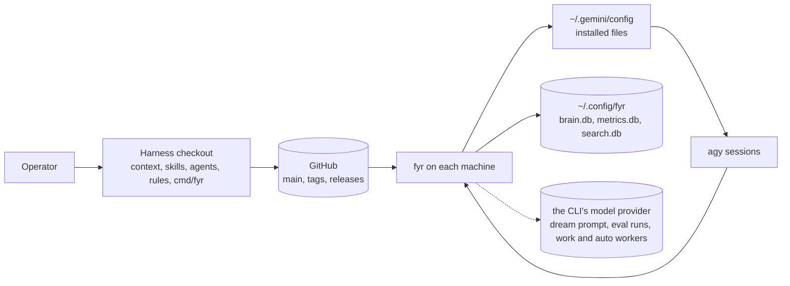
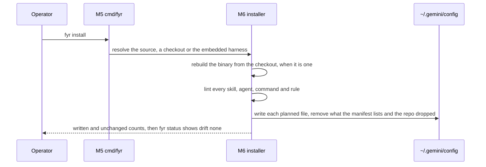
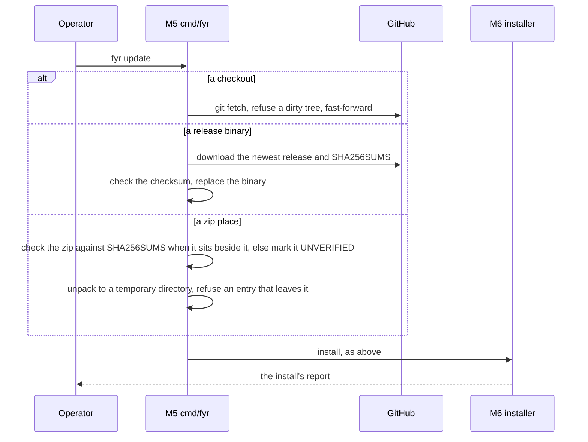
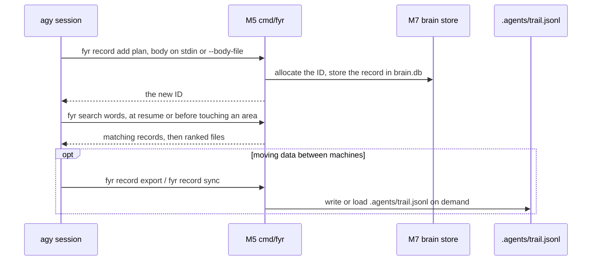
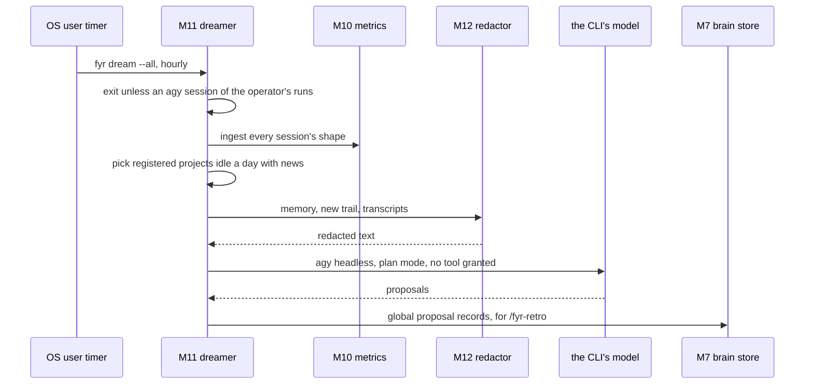

# SDD — fyr

How the harness's parts fit together: the content a session reads, the `fyr` binary that installs it and keeps the brain, and the paths between them.
Status: current · Last updated: 2026-11-15 · Requirements: [PRD.md](PRD.md) · Technical design: [TDD.md](TDD.md)

<!-- A summary a human reads in ten minutes. The detail lives in the records it links (an ADR per decision, a SPEC
     per surface: `fyr record get <ID>`), never restated here. Components are M1…; each satisfies PRD requirements by
     ID; TDD.md has one section per component. Kept current by the session that changes the design, in the same commit. -->

## Context

Open-source repository (`github.com/kesokaj/fyr`), local-first on each operator's machines (`ADR-515`). The harness is files a session reads (context, rules, skills, agents) plus `fyr`, which installs those files (and the `< 250 ms` fail-open CLI hooks in `~/.gemini/config/hooks.json`, R3, ADR-511) and keeps what a session cannot hold: each project's trail, its memory, the AST symbol and reference graph, the shape of every session, and an hourly consolidation of idle projects. Out of scope: any CLI but `agy` (R1), background daemons, commit gates and CI (R3), and any service (R8).

## Components

The content directories (M1–M4) are what a session reads; the binary (M5–M22) is `cmd/fyr` and its packages (`AGENTS.md` § Layout). Each package's surface is a SPEC record, linked from its TDD section.

| ID | Component | Responsibility | Satisfies |
|---|---|---|---|
| M1 | `context/`, `rules/` | The global context and the always-on rules (including feature routing in `rules/fyr-features.md`, ADR-518), one size-pinned block in Antigravity's rules directory | R0, R1, R2, R3 |
| M2 | `skills/`, `commands/` | Procedures loaded when a description matches, typed as `/name`; vendored skills and the Google catalog kept verbatim | R2, R5 |
| M3 | `agents/` | The six subagents (`reviewer`, `security`, `verifier`, `explorer`, `documentation`, `dreamer`) in Antigravity's `agent.md` format, installed as written | R1, R5 |
| M4 | `embed.go` | The six content directories (`context/`, `skills/`, `agents/`, `commands/`, `rules/`, `workflows/`) built into the binary, pinned both ways to what git tracks, so a release binary carries the harness | R8, R9 |
| M5 | `cmd/fyr` | The verbs (`verify`, `gate`, `land`, and `close` through M20 included), their flags (including global `-C` / `--dir`, `--limit`, `--json` and `--json-in`), the live model catalog command (`fyr models`, `--explain`, `planner` role, `agy changelog` enrichment, fed by M10's `Store.ModelEvidence` and M21's catalog), and help pages; the three update paths (checkout, release binary, zip) | R4, R6, R8, R9, R10 |
| M6 | `internal/harness` | The installer: the plan of what goes where (including `~/.gemini/config/hooks.json` and `workflows/*.py` scripts to `~/.gemini/config/workflows/`), the lint, the render, the manifest, status and drift, uninstall, adopt, the release download | R1, R3, R4, R5, R6, R9, R10 |
| M7 | `internal/brain` | The brain store, `fyr record` and `fyr resume`: every project's trail records and the global ones, with 1-call `stdin` headers (`ParseRecordStdin`, `ParseMemoryStdin`) and `--json-in` (`stdin_doc.go`), on-demand `.agents/trail.jsonl` export and sync, and the read-only seven-step session resume | R0, R4, R7 |
| M8 | `internal/search` | `fyr search` and `fyr index`: a derived full-text and pure-Go AST symbol/Markdown-heading reference graph index over files (`schemaVersion = "6"`), tiered context slicing (`--slice`, `--skeleton`, `--path`, `--affected`, `--map`), persistent hash-keyed session read-deduplication ledger with overlapping-edit invalidation and D7 skeleton-first clamp (`start_line = -4` session sentinels, `-5` unranged-clamp sentinel, emitting `[UNCHANGED]`/`[MODIFIED]`/`[CLAMPED]` + 2-space `LedgerNotice` JSON), passive co-activity, stateful `< 25 ms` prompt vetting with FTS5 0-pivot fallback (`hook_fts_fallback.go`, `--vet`: 9-mode intent classifier, `0..100` 6-anchor `VetScore` with prior-turn `vet_history` carry-forward, 3-turn skill deduplication, actionable `SKILL.md` body digests, omitting `[VET_IMPROVED_PROMPT]` when `Score >= 80` without conflicts/`VET_FIRST`, `< 2 ms` synthesis with advisory `route:` feature routing in `vet_route.go`, ADR-518, ADR-521, cryptographic data fence, `[FYR_TURN_CONTRACT]` with compact 2-space JSON `status_line`), and hard `200 ms` fail-open CLI hook handlers + `~/.config/fyr/no-hooks` switch (`--hook session-start\|pre-invocation\|pre-tool-use\|stop` in `~/.gemini/config/hooks.json`: `<= 1,500 B` `SessionStart` capsule in `hook_session_start.go`, `<= 950 B` Hop-0 compact graph map capsule in `slice_compact.go`, single-pass memoized `turnBrainCache`, `PreInvocation` emoji-free `PreInvocationBanner` JSON keeping `Metadata` `nil` per `BUG-523` and emitting `{}` with zero model tokens on un-enriched `PASS_THROUGH` turns + exact `model`/`thinking` via `telemetry_model.go`, `PreToolUse` `overwrite` guarding `invoke_subagent`, `run_workflow` (`hook_workflow.go`), and prefix-routed `swarm` with 20%/30% quota fallback, session-scoped pure-Go `verify.stamp` `Stop` check (`hook_git_index.go`, `hook_stop_stamp.go`), ADR-520, and `telemetry_process.go` writing `<appDataDir>/brain/<conv-id>/fyr-process.md` Hybrid Example A `ProcessTelemetry` JSON); the dream's read-only reads | R0, R3, R4 |
| M9 | `internal/memory` | `fyr memory`: the project memory every session loads | R0, R7 |
| M10 | `internal/metrics` | `fyr metrics` and `fyr report`: the store of record of every session's shape (`ingest`, `show`, `report`, `evals`, `trajectory`, `export`, schema 6 `turn_vets` and `work_waves`, schema 7 `setup_s`, `agy_s` and `check_s` stage seconds on `work_waves`, multi-model orchestrator session normalization in `agy_conversation.go`, and `Store.ModelEvidence` feeding M5's `fyr models` refreshes), per-session token trajectories, subagent lineage and `KNEE_EXCEEDED` / `REDUNDANT_READ` / `RETRY_LOOP` anomalies (`trajectory.go`, ADR-513), and the six-section Economist HTML and `--md` usage reports including `Trigger coverage` (`report_md.go`, ADR-516, ADR-518) | R0, R4 |
| M11 | `internal/dream` | `fyr dream`: the plan-mode dreamer (run hourly inside `fyr auto` or via CLI), lock, state, log, and legacy dream-unit cleanup + shared timer renderer | R0, R3, R8 |
| M12 | `internal/redact` | The credential redactor every dream input passes before it leaves the machine | R3, R8 |
| M13 | `internal/eval` | `fyr eval`: the behavioural suite (the tracked `.agents/eval/GUIDE-eval.md`, else the `GUIDE-eval` record, or `--suite-file PATH`), its rows' setup and checks, run in M22's isolated sandbox (`--runner isolate`) up to `--parallel N` at once | R6, R8 |
| M14 | `internal/check` | `fyr check` and `fyr git-check`: the read-only drift check of docs, specs, requirements and the R → M → T traces, and the three post-dispatch git checks | R0 |
| M15 | `internal/trail` | The git reads every package makes into a project root, and the noindex markers | R7 |
| M19 | `internal/auto` | `fyr auto`, R3's single background timer: the operator's switch (`auto.json`), its hourly timer through M11's rendering (retiring any legacy `fyr-dream` unit on `on`/`off`, with `--dry-run` on `on`/`off`/bare `auto`), and a run that ingests metrics first, runs plan-mode no-tool `dream`, re-reads `auto.json`, and sweeps idle repos unless the switch is off. Built through Phase 7 of its plan, the risk rubric (`internal/auto/rubric.go`), the `auto` skill, the worker runner (`internal/auto/kickoff.go`, `internal/auto/worker.go`), the apply step (`internal/auto/apply.go`), the learning tasks and draft validator (`internal/auto/tasks.go`, `internal/auto/learning_input.go`, `internal/auto/drafts.go`), the eval re-runs (`internal/auto/eval_rerun.go`, `internal/auto/eval_exec.go`) and the eval gate (`internal/auto/eval_gate.go`) included, with `usage.go` delegating `/usage` parsing to M21 (`models.ParseUsage`): a run reads the gates, ingests metrics, dreams (plan mode, no tool), runs the free checks, reports in global `review` records, and past level `observe` starts at most one M22 worker (`isolate.RunWorker`) or M13 eval re-run per run (up to 4 a day, 30m each, failing closed through M22's `isolate.ChooseRunner` when OS isolation is unavailable) from a fixed-template Kickoff filtered by `AllowedFiles`, passing a learning task's conversations, memory, proposals and metric numbers through M12 first, validating and writing `auto-drafts.jsonl` lines with `provenance: derived`, and for an applied class (or a `harness-edit` at level `harness` that passes the eval gate at `k=3` on target, regression and held-out rows within 24 eval sessions) squashing its PASS branch in a temporary worktree under `auto/`, running the base tree's `# auto: test` commands and `fyr check`, and fast-forwarding the checkout only when all pass and the checkout did not move, never pushing and never installing into a real home (`install pending`) | R0, R3, R4, R8, R9, R10 |
| M20 | `internal/gate` | Deterministic mechanical gates (`fyr verify`, `fyr gate`, `fyr land`, `fyr close`): runs `# auto: test` commands + `fyr check` to write `.agents/scratch/verify.stamp`, checks branch scope (`Files:`) and base checks, squash-merges clean worker branches, and validates phase/task close | R0, R3, R4, R7 |
| M21 | `internal/models` | Live `agy models` + `agy changelog` catalog (`~/.config/fyr/models.json`, `0600`), empirical `ModelEvidence` ranking, `agy -p "/usage"` pool quota parsing, and cross-family / scope-aware role picking shared by M5, M19, and M22 (ADR-519, ADR-520) | R4, R8, R10 |
| M22 | `internal/isolate` | OS-native process isolation (Linux Landlock ABI v3–v5 with `/dev/pts` PTY rw+ioctl, macOS Seatbelt `sandbox-exec` with `pseudo-tty`), post-run credential/process checks, and sandboxed worker execution shared by M13 (`fyr eval`) and M19 (`fyr auto`), failing closed when OS isolation is unavailable (D6, ADR-522) | R4, R6, R8, R10 |

## Flows

### Install

### Update

### Record

### Dream

## Decisions

One line each; the record holds the context, the alternatives and the operator's approval (`fyr record get ADR-NNN`).

- The harness is context, skills and subagents, with no daemons and no commit gates (ADR-007's lifecycle-hook rejection superseded in part by ADR-511's `< 250 ms` fail-open CLI hooks in `~/.gemini/config/hooks.json`) — ADR-001, ADR-007, ADR-511.
- Antigravity only, with no path that sends experience back — rejected: a second CLI and a report verb — ADR-062, ADR-070.
- The deployed context is one block pinned under 22,000 bytes, pruned rather than split — ADR-035, ADR-051.
- One dependency, a pure-Go SQLite driver — rejected: cgo drivers and a second dependency — ADR-045.
- Every trail record lives in one brain store, exported to and synced from `.agents/trail.jsonl` only on demand — rejected: Markdown files per record, rewriting `.agents/trail.jsonl` on every record write — ADR-063, ADR-091.
- A release binary carries the harness, and releases are publicly downloadable over HTTPS with checksums and no signature — ADR-033, ADR-034, ADR-053, ADR-515.
- A third way in, the zip place — ADR-038, ADR-041.
- The metrics store holds session shape only, never prose — ADR-055, ADR-055a.
- The hourly dreamer proposes only, and its dream is a visible conversation — ADR-047a, ADR-073.
- A project reaches the cross-project readers only by the operator's registration — ADR-068, ADR-068a.
- `fyr check` and `fyr eval` are verbs, not gates — ADR-064, ADR-065.
- A child process that reads untrusted input gets an allow-listed environment — ADR-067.
- A harness agent's frontmatter is an allow-list — ADR-056, ADR-056a.
- A session is one Task or one plan phase, or, when the feature skill runs a plan in waves, its planning and coordinator loop — ADR-058, ADR-077, ADR-522.
- The root documents are PRD, SDD, TDD and TODO — ADR-074.
- Drop the local HTTP server (`serve`) in favour of CLI-first operator and agent ergonomics — ADR-513 (superseding ADR-075, ADR-075a, ADR-075b).
- Idle-time self-improvement is an explicit switch merged with the dream timer into one hourly unit (`fyr auto`), nine gates, a risk rubric, and M22 OS-isolated M19 workers — ADR-090, ADR-522.
- Project-scoped eval and auto worker sandboxes under `~/.config/fyr/{sandbox,eval}/<project>` with pre-sandbox macOS Keychain OAuth extraction (`0600`) to avoid linking `~/Library/Keychains`, retiring legacy per-worker Docker images and host config — ADR-503 (superseded in part by ADR-522).
- Runner selection (`isolate.ChooseRunner`, M22) for `fyr eval` and `fyr auto` defaults to OS-native isolation (`RunnerIsolate`) and fails closed when unavailable, replacing the legacy Docker/host fallback split — ADR-504, ADR-504a (superseded in part by ADR-522).
- Without `--home`, only the home's installed `~/.local/bin/fyr` runs a store-opening verb (every verb but `install`, `sync`, `update`, `version`, `list`, `render` and `diff`, reads included); any other build refuses with exit 2 before opening or migrating a store — ADR-505.
- `fyr eval` check c skips the non-brain top-level store and dream files and watches `~/.config/fyr/brain.db` by file mode and a read-from-a-copy SHA-256 digest of the trial clone's and `--fixture`'s scopes (`brain.SnapshotScopes`), so another `agy` session's writes in `Options.Root` or another repository and the hourly dream no longer fail running trials — rejected: watching `Options.Root`, keeping `metrics.db` and `search.db` byte-watched, opening the live `brain.db` directly in SQLite — ADR-506.
- A session's seven-step resume sequence and the three post-dispatch git checks are read-only top-level verbs (`fyr resume`, `fyr git-check`) — rejected: keeping seven and three separate calls in the context, or making `fyr git-check` parse output and fail as a gate — ADR-508.
- Pipeline benchmark extensions on `fyr eval`: per-row `timeout` (`1m`..`4h`), scripted multi-turn sessions (`turns` `1`..`12` with early completion detection), and per-stage timing (`setup_seconds`, `session_seconds`, `check_seconds`) with check scripts kept out of the sandbox until scoring — ADR-509.
- `PRD.md` names `fyr dream`'s private `settings.json` under `~/.config/fyr/dream-agy-home-<pid>/`, macOS check e (`procs_darwin.go` via `lsof` and `ps -Eww`), and pre-build interviews settling open rows and model choices before build — ADR-510 (amending ADR-507), ADR-517.
- Pre-build interview is the sole operator wait-point; build phases and `/fyr-swarm` waves run autonomously without mid-build questions, stopping only on a worker gate or safety `FAIL` — ADR-517 (with feature-routing and live model-catalog decisions recorded in ADR-518 and ADR-519).
- Zero-daemon Antigravity CLI hooks in `~/.gemini/config/hooks.json` (hard `200 ms` fail-open deadline + global `~/.config/fyr/no-hooks` switch via `fyr search --hook session-start|pre-invocation|pre-tool-use|stop`), pure-Go `go/ast` symbol + Markdown ATX-heading and reference graph in `internal/search` (`schemaVersion = "6"`, `--slice` with FTS5 0-pivot fallback, `--skeleton`, `--path`, `--affected`, `--map`), stateful `< 25 ms` prompt vetter (`vet_history`, `0..100` `VetScore`, delta-only `[VET_IMPROVED_PROMPT]`), skill prefetcher and cryptographic `Fence` boundary, single-block 2-space pretty-printed JSON `PreInvocation` envelope (`PreInvocationBanner` + delta-only Hop-0 `PreInvocationEnrichment`, zero trailing prose, keeping `Metadata` `nil` per `BUG-523` and emitting `{}` with zero model tokens on un-enriched `PASS_THROUGH` turns; `--vet`), `SessionStart` capsule (`<= 1,500 B`, omitting `terminationBehavior`), `run_workflow` + prefix-routed `swarm` model guards with 20%/30% quota fallback, session-scoped pure-Go `.agents/scratch/verify.stamp` `Stop` check, live `<appDataDir>/brain/<conv-id>/fyr-process.md` artifact, persistent hash-keyed session read ledger with overlapping-edit invalidation, external-checkout session routing, D7 skeleton-first `[CLAMPED]` guard for unranged `>= 400`-line reads, compaction re-priming, and salted-hash read telemetry in `internal/metrics` — rejected: background MCP daemons, CGo Tree-sitter bindings — ADR-511 (superseding ADR-007 in part; amended by Phases 2a–2b).
- Top-level local-only `fyr report` verb (`--project [DIR] | --global`, `--md` and HTML) and `metrics.db` schema 6 (`turn_vets` and `work_waves` tables ingested from per-project `.agents/scratch/search.db` and wave runs) — ADR-516.

## Cross-cutting

- **Security:** four things are sent by design from the machine to the model of the CLI the machine already uses: the dreamer's redacted prompt (M12), and the runs of `fyr eval` and the workers of `fyr auto` when turned on (M13, M19, M22), plus, for `fyr auto`'s learning tasks, the conversations, memory, proposals and metric numbers `fyr` gives a worker, through M12's redactor first; and to skills.sh and the npm registry, the search of a `fyr auto` worker looking for a missing skill, its query words unredacted (`fyr eval` and `fyr auto` enforce M22 OS-native confinement — Linux Landlock inside `CLONE_NEWUSER|CLONE_NEWNS|CLONE_NEWPID` mounting private `/proc` and `/dev/pts` while clearing ambient caps before exec, and macOS Seatbelt extracting only the `0600` OAuth token prior to sandboxing without linking `~/Library/Keychains` or exposing `/dev/ttys*` or `SecurityServer`/`launchservicesd`/`pasteboard` Mach lookups — failing closed instead of running unisolated; a worker's clone has no remote, the agent retains `command(*)` and the network, and check c and `auto.json`'s watch are tripwires, not containment; R3, R8, ADR-076, ADR-090, ADR-522); every child process that reads untrusted input gets an allow-listed environment (ADR-067); the installer refuses any permission key in frontmatter (M6).
- **Privacy:** memory, metrics and the global records stay in `~/.config/fyr/` on the machine that wrote them (R7); the metrics store keeps no arguments, prose or tool output (R4).
- **Observability:** `fyr status` names drift, the binary's build, dream status (`merged into fyr auto` or legacy unit hint), and `fyr auto`'s switch; `fyr report`, `fyr metrics show` and `fyr metrics report` summarise every session's shape.
- **Cost:** no service and no cloud; the only model calls are the plan-mode dream's (hourly via `fyr auto run`), the evals and workers the operator starts, and `fyr auto`'s workers and eval runs (at most four 30-minute model tasks a day when turned on, an eval gate stopping at 24 eval sessions, gated on 50%/30% remaining quota).

## Deployment

The README map (`README.md` § How it works) is the deployment picture and the contract: it draws how the harness reaches a machine and what leaves one, and `AGENTS.md` § How the harness works holds the rules that keep it true. What a tag delivers to each kind of place is stated once, in `SPEC-fyr-delivery` § The model.

The dreamer is the one thing that runs on its own, hourly while an `agy` session of yours runs, and it only proposes; each project's dream is a conversation you can open with `/resume`. The procedures per place are the `DEPLOY-local` and `DEPLOY-remote` records; the requirements behind the three ways in and the three procedures are PRD R8 and R9.

## Risks

- **The rules block fills.** Hand-written context and global `rules/*.md` share Antigravity's 24,000-byte block, while the always-on slice stays within `9,000` bytes and `fyr list` prints the skill inventory separately. Shown by `TestAlwaysOnContextBudget`, `TestRenderedContextFitsAntigravityBlock`, and `TestSkillListingBudget`.
- **Antigravity changes underneath.** Paths, tool names and the block size are measured, not documented (PRD § Known limits). Shown by the real-home smoke and the `fyr eval` rows.
- **The docs drift from the binary.** Shown by `fyr check` (G3) and `/fyr-review --docs`.
- **A credential slips past the redactor.** The redactor grows by kind, with a near-miss per needle. Shown by `TestRedactShapes`.

## Trace

Every requirement of `PRD.md`, and the components that satisfy it.

| Requirement | Components |
|---|---|
| R0 | M1, M7, M8, M9, M10, M11, M14, M19, M20 |
| R1 | M1, M3, M6 |
| R2 | M1, M2 |
| R3 | M1, M6, M8, M11, M12, M19, M20 |
| R4 | M5, M6, M7, M8, M10, M19, M20, M21, M22 |
| R5 | M2, M3, M6 |
| R6 | M5, M6, M13, M22 |
| R7 | M7, M9, M15, M20 |
| R8 | M4, M5, M11, M12, M13, M19, M21, M22 |
| R9 | M4, M5, M6, M19 |
| R10 | M5, M6, M19, M21, M22 |
