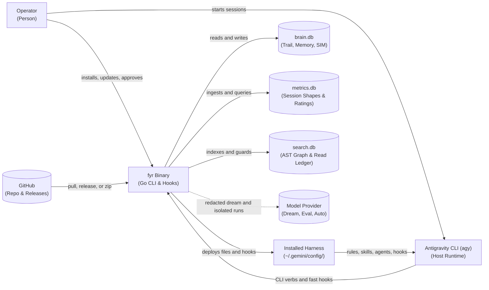
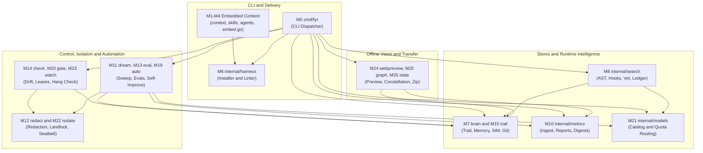
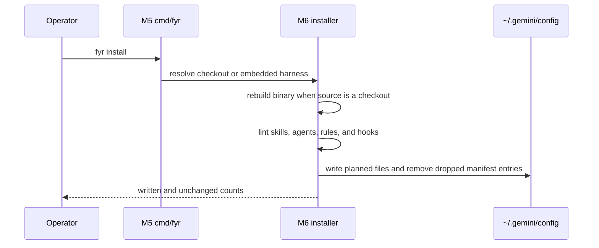
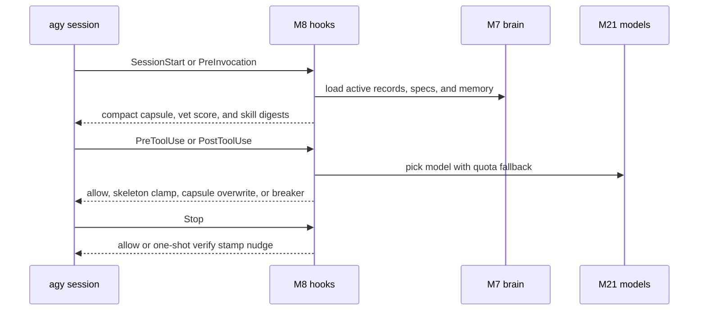
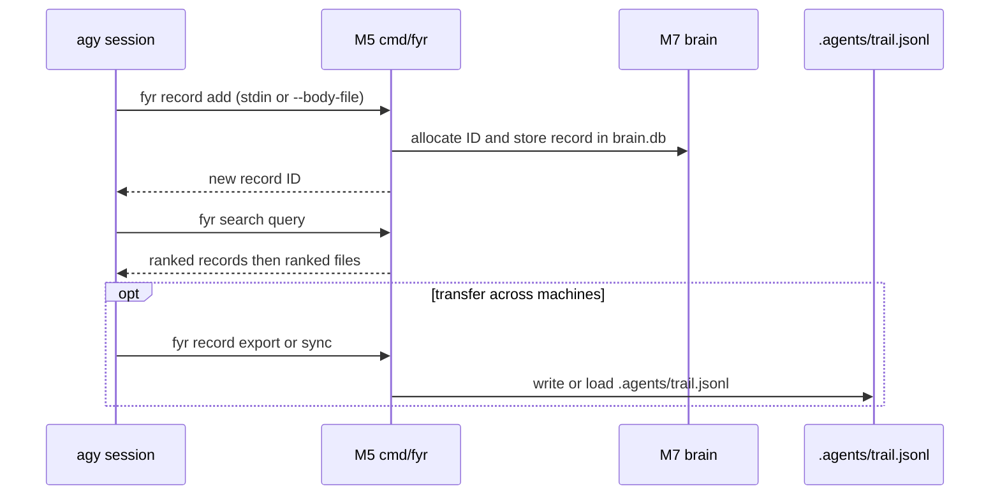
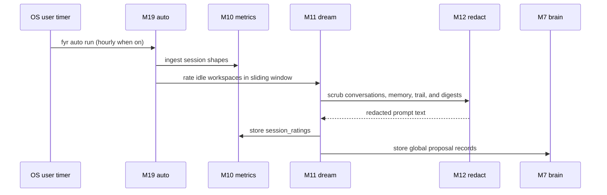

# SDD — fyr

How the harness parts fit together: session content, the `fyr` binary, local stores, and isolation boundaries.
Status: current · Last updated: 2026-11-28 · Requirements: [PRD.md](PRD.md) · Technical design: [TDD.md](TDD.md)

<!-- Present-tense rational architecture readable in ten minutes. Detailed surface contracts live in SPEC-* records (`fyr record get <ID>`), and rationale lives in ADR-* records (`fyr record list --kind adr`). Components are M1–M26; each maps to PRD requirements and to TDD sections. -->

## Context

`fyr` is a local-first harness and build controller for the Antigravity CLI (`agy`). It deploys static customization files and enforces session memory, code intelligence, verification, and bounded self-improvement without background daemons.

- **In scope:** Antigravity customization files, one-shot `< 250 ms` hooks, local SQLite stores, OS-confined workers, and offline views.
- **Out of scope:** Other CLIs (R1), background daemons, commit gates, CI pipelines (R3), and cloud services (R8).
- **Audience split:** Git human docs follow ASD-STE100, agent files stay concise, and SQLite stores are 100% agent-only (`SPEC-fyr-docs-harness`).

### Container view (C4 Level 2)

The diagram shows runtime containers on an operator machine and the two external boundaries (`GitHub` and the model provider).

### Architectural invariants

Executable fitness tests (`TestPackageLayeringAndSQLiteConfinement`) lock five structural boundaries across every Go package.

- **Single external dependency:** `modernc.org/sqlite` is the only direct third-party dependency in `go.mod`, confined to `internal/sqliteutil` (R4).
- **Zero-outbound leaves:** `.`, `internal/trail`, `internal/redact`, `internal/graph`, and `internal/webpreview` import zero internal packages.
- **Installer isolation:** `internal/harness` imports only root package `.` and never links SQLite (R4).
- **One-way orchestration:** Domain packages never import orchestrators (`internal/auto`, `internal/dream`, `internal/gate`).
- **Permanent vs derived stores:** `brain.db` and `metrics.db` migrate forward permanently; `search.db` is a rebuildable cache (R4).
- **CLI decomposition (`ADR-537` D1):** `fyr search` splits into `search`, `hook`, `ast`, and `vet` (`v9.x` shims).

## Components

Content directories (`M1`–`M4`) hold files that sessions read, while the binary (`M5`–`M26`) deploys them and runs local tools. Shared SQLite helpers live in `internal/sqliteutil`. Retired component IDs (`M9` merged into `M7`, `M16`–`M18`, and `M27` relay) stay unallocated so trace history stays stable.

### Component view (C4 Level 3)

The binary layers CLI dispatch over isolated stores, runtime intelligence, control gates, OS sandboxes, and offline views.

Component inventory (M1–M26)

| ID | Component | Responsibility | Satisfies |
|---|---|---|---|
| M1 | `context/`, `rules/` | Global context and always-on rules deployed as one size-pinned block under Antigravity's rules budget. | R0, R1, R2, R3 |
| M2 | `skills/`, `commands/` | 34 embedded Agent Skills (`SKILL.md` plus `references/`) and the empty `commands/` operator drop-in directory. | R2, R5 |
| M3 | `agents/` | Seven native Antigravity subagents (`builder`, `reviewer`, `security`, `verifier`, `explorer`, `documentation`, `dreamer`). | R1, R5 |
| M4 | `embed.go` | Embeds `context/`, `skills/`, `agents/`, `commands/`, `rules/`, and `workflows/` into the release binary. | R8, R9 |
| M5 | `cmd/fyr` | Dispatches 34 CLI commands (33 action verbs plus `help`) with `--json` output across action verbs (excluding write/transfer subcommands: `memory add`, `record add`/`edit`/`export`/`import`/`sync`, `metrics export`/`ingest`), help text, real-home guard, and three update paths. | R4, R6, R8, R9, R10 |
| M6 | `internal/harness` | Plans, lints, renders, and installs files, `hooks.json`, and `workflows/*.py`; manages manifests, drift, uninstall, adopt, and releases. | R1, R3, R4, R5, R6, R9, R10 |
| M7 | `internal/brain`, `internal/sim` | Stores project trails, validity-scored memory, global SIM ledger (`internal/sim`, `brain.db`), `.agents/trail.jsonl` sync, and `fyr resume`. | R0, R4, R7 |
| M8 | `internal/search`, `internal/readledger`, `internal/vet`, `internal/symgraph`, `internal/hooks`, `internal/hooks/guard`, `internal/hooks/telemetry` | Maintains FTS5/AST symbol graph, read-dedup ledger, prompt vetter, contract slices, and `< 250 ms` fail-open CLI hooks. | R0, R3, R4 |
| M10 | `internal/metrics`, `internal/metrics/ingest`, `internal/metrics/show`, `internal/metrics/report` | Ingests session shapes, ratings, verdicts, and orchestration runs (`metrics.db`); builds diagnostics, digests, and `fyr report`. | R0, R4 |
| M11 | `internal/dream` | Sweeps idle Antigravity workspaces, redacts inputs, and runs headless tool-free plan-mode rating and consolidation passes. | R0, R3, R8 |
| M12 | `internal/redact` | Scrubs vendor tokens, credentials, and private keys before any dream or dreaming-worker input leaves the machine. | R3, R8 |
| M13 | `internal/eval` | Executes behavioural benchmark rows (`GUIDE-eval.md`) inside M22 OS-isolated sandboxes with parallel scoring and stage timings. | R6, R8 |
| M14 | `internal/check` | Verifies docs, CLI flags, anchors, `SPEC-*` freshness/structure, `PRD`/`SDD`/`TDD` traces, STE style, budgets, and `fyr git-check`. | R0 |
| M15 | `internal/trail` | Provides safe git repository reads, worktree discovery, and no-index markers without outbound internal dependencies. | R7 |
| M19 | `internal/auto` | Runs the single hourly `fyr auto` timer: gates quota/AC, drains proposals, spawns isolated dreaming workers, and lands eval-gated `skills/` commits. | R0, R3, R4, R8, R9, R10 |
| M20 | `internal/gate` | Runs `verify`, `gate`, `land`, and `close`: mechanical checks, write-lease validation, optional cross-family judging, and squash landing. | R0, R3, R4, R7 |
| M21 | `internal/models` | Caches live `agy` catalog and quota pools; ranks role models via Empirical-Bayes/UCB scoring, cross-family failover, and context knees. | R4, R8, R10 |
| M22 | `internal/isolate`, `internal/isolate/acp`, `internal/isolate/creds`, `internal/isolate/worker` | Confines `eval`, `auto`, and `--judge` workers via Linux Landlock/namespaces and macOS Seatbelt, failing closed when unavailable. | R4, R6, R8, R10 |
| M23 | `internal/watch` | Inspects active sessions, transcripts, and process tables read-only (`< 25 ms`) for interactive-stdin waits, hangs, and budget limits. | R0, R3, R10 |
| M24 | `internal/webpreview` | Serves foreground-only, in-memory HTTP previews on loopback behind a 128-bit URL token with strict offline CSP. | R0, R3, R4, R10 |
| M25 | `internal/graph` | Renders offline AST and co-activity repository constellations (HTML `<canvas>`, JSON, DOT, Markdown) with zero SQLite imports. | R0, R4, R7, R10 |
| M26 | `internal/state` | Exports and imports SHA-256-verified `archive/zip` offline state bundles with zip-slip/schema guards and opt-in `--include-memory`. | R4, R7, R8, R9 |

### Surface specifications

Detailed interfaces, schemas, and failure modes live in current `SPEC-*` records (`fyr record get <ID>`).

| Spec ID | Surface | Primary components |
|---|---|---|
| `SPEC-fyr-delivery` | Delivery channels, update paths, release artifacts, and outbound flows | M4, M5, M6, M19 |
| `SPEC-fyr-record` | Trail records, memory validity, provenance, and `.agents/trail.jsonl` sync | M7, M15, M26 |
| `SPEC-fyr-sim` | Self-Improvement Memory (SIM) ledger, retrieval cap, and feedback sync | M7, M10, M11, M19 |
| `SPEC-fyr-pre-hook-coordinator` | `< 250 ms` lifecycle hooks, prompt vetting, read ledger, and worker capsules | M8, M21 |
| `SPEC-fyr-metrics` | Session-shape ingest, diagnostics, daily digests, and reports | M10, M24 |
| `SPEC-fyr-eval` | Behavioural suite format, sandbox isolation, and scoring checks | M13, M22 |
| `SPEC-fyr-graph` | AST/co-activity constellation rendering and loopback web preview | M24, M25 |
| `SPEC-fyr-docs-harness` | Five-track doc split, `fyr check` style rules, and contract projection | M6, M8, M14 |

## Flows

Four primary runtime loops drive installation, session hooks, record storage, and hourly consolidation. Delivery and update procedures across checkout, binary, and zip places are specified once in `SPEC-fyr-delivery` (`fyr record get SPEC-fyr-delivery`).

### Install

`fyr install` resolves the harness source, lints every artifact, and updates `~/.gemini/config/` from a manifest.

### Hooks and session turns

Antigravity invokes `fyr` hooks as one-shot processes under a `< 250 ms` fail-open budget with no resident daemon.

### Record and search

Sessions persist trail records directly to `brain.db` and export `.agents/trail.jsonl` only when moving data across machines.

### Dream and auto sweep

The hourly `fyr auto` timer ingests metrics, rates stale conversations in tool-free plan mode, and runs isolated workers when eligible.

## Decisions

Architectural decisions, alternatives, and operator approvals live in immutable `ADR-*` records. List them with `fyr record list --kind adr`, and read any entry with `fyr record get <ID>`.

## Cross-cutting

Security, privacy, observability, and cost guardrails apply uniformly across stores, redactors, hooks, and isolated workers.

- **Outbound boundary:** Exactly four flows leave the machine: redacted dream prompts, `fyr eval` runs, `fyr auto` workers, and missing-skill queries.
- **Process confinement:** `fyr eval`, `fyr auto`, and `--judge` workers run under Linux Landlock/namespaces or macOS Seatbelt. They fail closed if unavailable.
- **Subprocess hardening:** Child processes reading untrusted input receive an allow-listed environment. `M6` refuses permission keys in frontmatter.
- **Local privacy:** Memory, SIM, metrics, and global records stay in `~/.config/fyr/`. `metrics.db` stores session shape only, never prose or arguments.
- **Observability:** `fyr status` reports drift, build info, and auto state. `fyr report` and `fyr metrics show` summarize shapes, ratings, and health regressions.
- **Bounded cost:** No cloud service runs. `fyr auto` caps workers at four 30-minute runs daily, 24 eval sessions per gate, and 50%/30% pool quota.

## Deployment

Delivery channels, update rules, and release artifacts have one canonical contract in `SPEC-fyr-delivery` (`fyr record get SPEC-fyr-delivery`) per `.agents/rules/delivery-map.md`.

`README.md` § How it works holds the visual delivery map pinned by `TestHarnessMap`. Per-machine install and timer procedures live in `DEPLOY-local` and `DEPLOY-remote`.

## Risks

Four operational risks threaten instruction delivery, CLI compatibility, doc accuracy, or credential safety. Each risk has automated detection.

- **Rules block saturation:** Global context and `rules/*.md` share Antigravity's 24,000-byte block. `TestAlwaysOnContextBudget`, `TestRenderedContextFitsAntigravityBlock`, and `TestSkillListingBudget` pin byte ceilings.
- **Antigravity runtime drift:** Paths, tool names, and block limits are measured rather than documented (`PRD.md` § Known limits). Real-home smoke checks and `fyr eval` detect changes.
- **Documentation drift:** Prose can fall behind CLI flags, specs, or trace tables. `fyr check` (G3) and `/fyr-review --docs` catch drift before release.
- **Credential redaction gaps:** New vendor token shapes can bypass existing needles. `internal/redact` grows per token class with `TestRedactShapes` and near-miss cases.

## Trace

Maps every requirement in `PRD.md` to the components that satisfy it.

| Requirement | Components |
|---|---|
| R0 | M1, M7, M8, M10, M11, M14, M19, M20, M23, M24, M25 |
| R1 | M1, M3, M6 |
| R2 | M1, M2 |
| R3 | M1, M6, M8, M11, M12, M19, M20, M23, M24 |
| R4 | M5, M6, M7, M8, M10, M19, M20, M21, M22, M24, M25, M26 |
| R5 | M2, M3, M6 |
| R6 | M5, M6, M13, M22 |
| R7 | M7, M15, M20, M25, M26 |
| R8 | M4, M5, M11, M12, M13, M19, M21, M22, M26 |
| R9 | M4, M5, M6, M19, M26 |
| R10 | M5, M6, M19, M21, M22, M23, M24, M25 |
