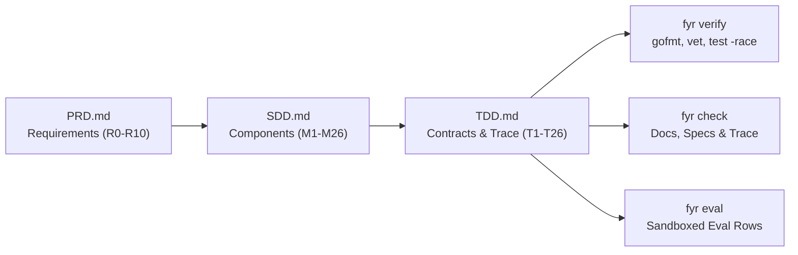

# TDD — fyr

Maps each component in [SDD.md](SDD.md) to its technical contract, data stores, and verification tests.
Status: current · Last updated: 2026-11-27 · Requirements: [PRD.md](PRD.md) · Design: [SDD.md](SDD.md) · CLI: [docs/cli-reference.md](docs/cli-reference.md) · Terms: [docs/glossary.md](docs/glossary.md)

## T1 — Global context and rules

Renders global context and rules into `~/.gemini/config/rules/` inside fixed byte budgets.

Implements: M1 · Spec: none (size pins below and ADR-035)

- **Interfaces:** `fyr render` merges `context/AGENTS.md` and `context/dev-setup.md` into `~/.gemini/config/rules/AGENTS.md`, ending with the canary word `GANNET`. `rules/*.md` deploys alongside it with allowlisted frontmatter (`description`, `trigger`, `globs`).
- **Size pins (`internal/harness/size_test.go`, `skills_text_test.go`):** Always-on context + rules `<= 9,000 B`; rendered context `<= 13,000 B` (`PRD.md` G1 `15,000 B`); repo `AGENTS.md <= 4,500 B` (`PRD.md` G2); combined context + rules + `AGENTS.md <= 15,000 B`; rendered context + all rules `<= 19,500 B` (inside Antigravity's `24,000 B` block).
- **Errors:** Budget overruns fail `go test ./internal/harness` and `fyr check`. Unlisted frontmatter keys fail install lint.

## T2 — Skills and commands

Packages `34` embedded `skills/<name>/SKILL.md` workflows and keeps `commands/` empty by design.

Implements: M2 · Spec: none (Agent Skills standard; provenance in `skills/VENDORED.md`)

- **Interfaces:** Each skill ships `skills/<name>/SKILL.md` with progressive `references/*.md` files. Skills trigger by description match or `/name`.
- **Budgets & lint:** `TestSkillListingBudget` (`internal/harness/size_test.go`) caps model-invocable skill listings at `19,500 B`. `LintSkillFrontmatter` (`internal/harness/frontmatter.go`) enforces the `140`-character `description:` cap (`SkillDescriptionLimit`) and rejects unlisted or permission keys.

## T3 — Subagents

Ships seven Antigravity-native subagents verbatim and validates every declared tool name.

Implements: M3 · Spec: none (`agent.md` format; ADR-056, ADR-062, ADR-532)

- **Interfaces:** `agents/<name>/agent.md` defines `builder`, `documentation`, `dreamer`, `explorer`, `reviewer`, `security`, and `verifier` with `subagent: true`, `mainAgent: false`, and an explicit `tools:` list.
- **Contracts & errors:** `builder` owns one write-leased slice in a worktree; `verifier` carries the Boundary Contract Checklist. Any tool outside `knownTools` (`internal/harness/inventory.go`) fails install because unknown tools hang subagents.

## T4 — The embedded harness

Embeds the six harness content directories into the root package for standalone release binaries.

Implements: M4 · Spec: `SPEC-fyr-delivery` (`fyr record get SPEC-fyr-delivery`)

- **Interfaces:** `embed.go` embeds `context/`, `skills/`, `agents/`, `commands/`, `rules/`, and `workflows/`. Release binaries deploy from embedded bytes and refuse `--repo`.
- **Errors:** Any mismatch between tracked git files and embedded files fails `go test .`.

## T5 — The CLI

Exposes all `31` commands (`30` with `--json` parity plus `help`), global flags, and help text in `cmd/fyr`. See [docs/cli-reference.md](docs/cli-reference.md) for the generated verb and flag reference.

Implements: M5 · Spec: `SPEC-fyr-delivery` and per-domain `SPEC-fyr-*` records · Guide: [Delivery & Customization](features/delivery-and-customization.md)

- **Interfaces:** Global flags (`--home DIR`, `--repo DIR`, `-C DIR` / `--dir DIR`, `--help`) work before or after the verb (`cmd/fyr/run_dispatch.go`). `fyr help <verb>` prints full usage from `cmd/fyr/help_text.go` and `cmd/fyr/help_text_eval.go`.
- **Real-home guard:** Builds outside `~/.local/bin/fyr` require `--home DIR` before opening stores (`cmd/fyr/realhome_guard.go`, ADR-505).
- **Errors & dependencies:** Usage errors exit `2`; refusals and failed checks exit `1`. Delegates to M6–M8, M10–M14, M19–M21, and M23–M26.

## T6 — The installer

Computes atomic install plans, lints customizations, and tracks `~/.config/fyr/state.json`.

Implements: M6 · Spec: `SPEC-fyr-delivery` (`fyr record get SPEC-fyr-delivery`) · Rules: `AGENTS.md` § Rules for working here

- **Install plan:** `internal/harness/plan.go` installs `~/.gemini/config/{rules,skills,agents,workflows}/` (including `phase_loop.py`, `review_parallel.py`, `preflight_gate.py`), `~/.gemini/config/hooks.json` (`SessionStart`, `PreInvocation`, `PreToolUse`, `PostToolUse`, `Stop`), and `~/.local/bin/fyr`.
- **Rebuild vs copy:** Checkout installs rebuild via `go build`. Plain copies without `.git` and release binaries copy the running binary.
- **Lint & updates:** `internal/harness/inventory.go` and `frontmatter.go` reject flat `agents/*.md`, `> 140`-char skill descriptions, `> 1,024`-char agent descriptions, invalid names, and permission keys. Release updates verify `SHA256SUMS` over HTTPS; checkout updates refuse dirty trees.

## T7 — The brain store

Stores project trails, global queues, validity-scored memory, and the isolated SIM ledger in `~/.config/fyr/brain.db` (schema `v5`).

Implements: M7 · Spec: `SPEC-fyr-record`, `SPEC-fyr-graph`, `SPEC-fyr-sim` · Guide: [Brain Store, Trail & Memory](features/brain-and-memory.md)

- **Trail & resume:** `fyr record` handles `add`, `get`, `edit`, `list`, `export`, `sync`, and `import` with single-call stdin headers, `--body-file`, or `--json-in` (`internal/brain/stdin_doc.go`). `brain.Resume` prints the read-only seven-step snapshot with `.agents/trail.jsonl` fallback and a fail-open daily health brief (`internal/brain/resume_daily.go`).
- **Read-only loaders:** `ListTurnRecordsCtx`, `SearchTurnRecordsCtx`, `LoadTurnDataCtx`, and `ListCurrentSpecsCtx` (`internal/brain/turn_records.go`, `turn_specs.go`) query active records per scope without creating `brain.db`.
- **Memory & operator guard:** `fyr memory` stores `semantic`, `procedural`, and `episodic` cards across project and `--global` scopes. `ComputeMemoryValidity` (`internal/brain/validity.go`) scores cards in `0.00–1.00` using provenance, content-hash staleness (`-0.45`), contradictions (`-0.25`, max `3`), and age decay (`0.35` floor). `operator` provenance cards (`1.00` base) reject automated overwrite, retirement, superseding, or downgrade.
- **SIM ledger (`brain.db` v5):** Tables `sim_problems`, `sim_aliases`, `sim_attempts`, and `sim_fts` stay isolated from `fyr resume`, `fyr memory show`, hooks, and `.agents/trail.jsonl`. Records carry normalized `repo_id`; unparseable trail lines abort import with line numbers.

## T8 — Search

Maintains derived SQLite FTS5 and pure-Go AST indexes (`search.db` schema `v12`) for slicing, contract projection, prompt vetting, and `< 250 ms` CLI hooks.

Implements: M8 · Spec: `SPEC-fyr-pre-hook-coordinator`, `SPEC-fyr-graph`, `SPEC-fyr-docs-harness` · Guide: [CLI Hooks, Prompt Vetting & AST Graph](features/hooks-and-ast-graph.md)

- **Query & contracts:** `fyr search` ranks records above files and supports `--slice`, `--contracts`, `--skeleton`, `--path`, `--affected`, `--map`, `--refs`, `--open`, `--global`, and `--include-docs`. `--contracts` (`internal/search/contracts.go`) projects Go/TS signatures, `SPEC-*` tables, and `ADR-*` guardrails; `<= 600 B` digests feed `--slice` and `[FYR_WORKER_CAPSULE]`.
- **AST & graph:** Extracts Go/TS symbols and references (`symbols`, `sym_refs`), canonical package paths, Tarjan SCCs (`import | call | type_ref`), Louvain communities, split hidden-coupling signals (`co_edit` vs `co_read`), and in-memory `IncludeVendored` snapshots.
- **Prompt vetter (`--vet`):** Classifies 9 intent modes, scores `VetScore` (`0..100`), raises conflict-only `VET_FIRST`, prefetches up to 3 skills via BM25F, splits multi-package edits into `<= 6` subtasks, and emits a fenced `PreInvocationBanner`.
- **CLI hooks (`--hook`):** Runs `session-start`, `pre-invocation`, `pre-tool-use`, `post-tool-use`, and `stop` under a `200 ms` fail-open deadline (`120 ms` slice cap) with `Lstat`-checked `no-hooks`.
- **PreToolUse & Stop guards:** Enforces dual-gate clamping (`>= 400` lines or `>= 16,384` bytes), read deduplication (including 18-pattern bash reads), `[COORDINATOR_GUARD]`, `[KICKOFF_GUARD]`, `[SEARCH_NUDGE]`, `[INTERACTIVE_STDIN]`, `[RELAY_GUARD]`, workflow allowlists, cross-family routing, and watchdog caps (`120` builder / `40` audit). `Stop` checks `.agents/scratch/verify.stamp` for dirty Go files.
- **Data (`search.db` v12):** Caches FTS chunks, `symbols`, `sym_refs`, `projects`, `co_activity`, `read_ledger`, `read_ledger_stats`, `session_meta`, `vet_history`, and `watchdog_ring`, rebuilding if deleted. `internal/search/dream.go` discovers git, non-git, and global workspaces.

## T9 — Retired (merged into T7 internal/brain)

Project and `--global` memory moved into [T7 — The brain store](#t7--the-brain-store) (`internal/brain/memory.go`). Both share `brain.db` and `SPEC-fyr-record`.

## T10 — Metrics

Stores shape-only session, trial, vet, work-wave, rating, digest, and orchestration telemetry in `~/.config/fyr/metrics.db` (schema `v14`).

Implements: M10 · Spec: `SPEC-fyr-metrics`, `SPEC-fyr-graph`, `SPEC-fyr-sim` · Guide: [Metrics & Reports](features/metrics-and-reports.md)

- **Ingest & privacy:** `ingestAgy` records session shapes, salted read hashes (`r:` vs `f:`), compaction checkpoints, `KNEE_EXCEEDED` events, and anchored skill reads. It never stores prompts, arguments, or tool output.
- **Reports & digests:** `fyr report` auto-ingests unless `--no-ingest` is set, rendering HTML, `--md`, `--json`, `--web` (via M24), `--daily-digest`, `--since-tag` cohorts, and write-once daily HTML reports (`0600`, `O_EXCL`). `BuildDailyDigest` writes `latest-daily-digest.json` and tracks action recovery plus `model_shift_audit`.
- **Trajectories, diagnostics & evidence:** `Store.Trajectories` compares token growth against `models.ContextKneeTokens`. `DiagnosticReport` emits rate-normalized signals with 2-day hysteresis. `Store.ModelEvidence` aggregates `14`-day decayed role evidence across `trials`, `dev/fyr-eval`, `judge_verdicts`, and `session_ratings`.
- **Data (`metrics.db` v14):** Holds `sessions`, `steps`, `trials`, `turn_vets`, `work_waves`, `session_ratings`, `judge_verdicts`, `background_runs` (with `halt_reason`), `daily_digests`, and `orchestration_runs`, keyed by `repo_id`. `ExportSanitizedState` / `ImportSanitizedState` back M26.

## T11 — The dreamer

Discovers all Antigravity workspaces, redacts stale conversations, rates sessions, and queues global proposals in zero-tool plan mode.

Implements: M11 · Spec: `SPEC-fyr-sim` · Guide: [Dream Consolidation & Auto Mode](features/dream-and-auto.md)

- **Discovery:** `internal/dream/targets.go` unions `search.db`, `brain.db`, `conversation_summaries.db`, and `HarnessRepo`. `IsEphemeralPath` and `IsRefusedWorkspace` (`internal/dream/ephemeral.go`) drop system roots, worktrees, and sandboxes.
- **Execution & outputs:** Scrubs sliding-window `(since, cutoff]` transcripts, diagnostics, daily digests, hidden-coupling hints, and bounded `<= 6 KiB` SIM slices through M12 before invoking `agy --mode plan`. Real runs write `session_ratings`, call `RecordBackgroundRun`, and queue `target: harness` proposals when scores are `<= 3` or skill actions trigger.
- **Errors & dependencies:** Ingest errors do not abort runs; any model tool call aborts without writing proposals. Depends on M10, M12, and headless `agy`.

## T12 — The redactor

Scrubs credentials, secret lines, and PEM blocks from plain text and JSONL using stdlib-only patterns.

Implements: M12 · Spec: none (internal; needles pinned by `internal/redact/needles_test.go`)

- **Contract:** Exposes plain-text and JSONL redaction functions with zero external dependencies. Raw-text patterns avoid leading `\b` because `\n` and `_` are word characters.
- **Safety invariant:** Over-redaction is preferred over leakage, and every needle carries a pinned benign near-miss in `TestRedactShapes`.

## T13 — Eval

Runs behavioural evaluation rows in OS-isolated sandboxes, grades checks, and records trial telemetry.

Implements: M13 · Spec: `SPEC-fyr-eval`, `SPEC-fyr-sim` · Guide: [Behavioural Evaluation & OS Isolation](features/eval-and-isolation.md)

- **Suite & execution:** Reads `.agents/eval/GUIDE-eval.md` at `HEAD`, falls back to the `GUIDE-eval` record, or reads external `--suite-file PATH`. Supports multi-turn rows (`<= 12` turns), timeouts (`<= 4h`), `--acp`, `--model ID`, `--runs N`, and `--parallel N` (`1–25`).
- **Isolation & data:** Calls M22 (`internal/isolate`) with `Options.BrainWatch` (`brain.SnapshotScopes`) to block host leaks and ingest sandbox `BrainHome`. `cmd/fyr` writes one `testing` record (Wilson interval + tables) and `trials` rows; `internal/eval` imports no SQLite driver.
- **Errors:** Missing/real/in-repo `--home`, interactive-only `--model`, or out-of-range `--runs`/`--parallel` exit `2` before writing.

## T14 — Drift check

Runs read-only drift, dual-track docs style, spec, requirement, trace, and post-dispatch git checks.

Implements: M14 · Spec: `SPEC-fyr-docs-harness` · Guide: [Workflows & Build Control](features/workflows-and-build-control.md)

- **Checks (`fyr check`):** Validates CLI flags against AST-scanned `cmd/fyr/*.go`, paths, `#anchor`/`§` refs, context/`AGENTS.md` budgets, skill frontmatter, `test-ref` citations, Track 1 `docs-style` and `>= 80%` STE notes, `guide`/`deploy` safety, `SPEC-*` freshness and 5 headings, `PRD.md` enforcement sites, and `PRD -> SDD -> TDD` traces.
- **Git check & errors:** `fyr git-check` runs read-only status, unpushed branch, and tag checks. `fyr check` exits `1` on findings; `fyr git-check` exits `2` outside git. Reads trails via `brain.ReadScope` and `trail.Command` without SQLite.

## T15 — Trail git reads

Centralizes clean-environment git calls and project registration markers.

Implements: M15 · Spec: none (internal helper shared by M7–M8, M10–M11, and M14)

- **Interfaces:** `trail.Command` runs git with `GIT_*` stripped and provides `Dates`, `Log`, `DocsRoot`, `Roots`, and `NoIndexMarkers`. Stdlib only; no SQLite.

## T19 — Auto

Manages the global `on | off` switch, hourly OS timer, machine gates, isolated dreaming workers, and the `k=3` harness eval gate.

Implements: M19 · Spec: `SPEC-fyr-sim` · Guide: [Dream Consolidation & Auto Mode](features/dream-and-auto.md)

- **Config & state:** `auto.json` (`0600`, `<= 4 KiB`) stores `enabled` and `conversation_idle` (`1h`, `5m–7d`). `auto/` (`0700`, `O_NOFOLLOW`) holds `auto.lock`, `auto.log` (`30d` prune), `runs.json` (`0d` ephemeral / `7d` gone prune), `kickoffs/`, `drafts/`, and `inputs/`. `internal/dream` manages `fyr-auto` / `com.fyr.auto` and removes legacy `fyr-dream`.
- **Gates (`G1`–`G9`):** Enforces `G1` switch, `G2` lock, `G3` AC power, `G8` clean git tree (git tasks only), and `G9` quota (`< 4`/day, `4h` cooldown unless `--force`, pool `>= 50%` 5h / `>= 30%` week). `G4`–`G7` are retired.
- **Workers & rubric:** `DraftsOnly` classes (`memory-consolidation`, `retro-lite`, `memory-candidates`, `missing-skill`) run on any root over `SessionDigest`; clean checkouts add `distill` and harness `harness-edit` (slot 4 reserved for high-severity `auto_skill`). Workers run via M22 `isolate.RunWorker` (`30m`, fail-closed); `rubric.go` denies edits outside `skills/` and checks `auto.json`/`runs.json` digests.
- **Drafts, SIM & eval gate:** Drafts scrub through M12 and follow per-class allowlists and the `operator` guard. Harness edits run a `k=3` eval gate (`<= 24` sessions) across target, regression, and `holdout.md` rows, squash-verifying locally without pushing or installing. Stage A and `SyncSIMFieldOutcomes` update SIM.

## T20 — Deterministic gates

Implements pre-merge verification stamps, lease scope checks, cross-family diff judging, squash landing, and handoff closing.

Implements: M20 · Spec: `SPEC-fyr-delivery`

- **Interfaces:** `gate.Verify` runs `# auto: test` plus `fyr check` and writes `.agents/scratch/verify.stamp` (`0600`). `gate.Gate` verifies `Files:` leases, file modes, secret names/lines, numstat caps, commit trailers, and optional `--judge`.
- **Landing & close:** `gate.Land` squash-merges in a scratch worktree, runs `Verify` and optional `--judge`, fast-forwards clean `main`, and deletes the branch. `gate.Close` reads `<= 1 MiB` and writes one `handoff` record embedding `## Verification Digest`.
- **Errors & dependencies:** Refusals wrap `gate.ErrRefused` (exit `2`); failures wrap `gate.ErrFailed` (exit `1`). Persists judge verdicts via callback without SQLite.

## T21 — Models catalog and quota picker

Maintains `~/.config/fyr/models.json`, cached quota pools, calibrated context knees, and cross-family role selection.

Implements: M21 · Guide: [Workflows & Build Control](features/workflows-and-build-control.md)

- **Catalog & probes:** `RefreshCatalog` runs `agy models` and `1 MiB` `agy changelog` inside `0700` isolated `probeWorkDir()` (`Setsid: true`, `ANTIGRAVITY_*` stripped). `fyr models --bench` runs `45s` sanity probes.
- **Scoring & quotas:** `scoring.go` and `catalog_ranking.go` combine role-partitioned Empirical-Bayes (`PriorStrength = 4.0`), conservative UCB (`0.04`/`0.06`), Pareto efficiency (`<= 0.08`), and convex headroom penalties with `5%` failover. `PickRoleFromCatalogForHome` serves `< 50 ms` warm picks from `<= 10m` cached quotas and supports `--caller-family`. `CalibratedContextKnee` and `ContextKneeTokensForHome` (`internal/models/context_budget.go`) cap knees at `[40%..60%]` (`180k`/`300k` onset).
- **Dependencies:** `internal/harness` only (`TestModelsPackageDeps`; no SQLite).

## T22 — OS-native isolation (`internal/isolate`)

Confines evals, cross-family judges, and autonomous workers using Linux Landlock/namespaces and macOS Seatbelt.

Implements: M22 · Spec: `SPEC-fyr-eval` · Guides: [Eval & Isolation](features/eval-and-isolation.md), [Dream & Auto](features/dream-and-auto.md)

- **Confinement:** Linux uses Landlock ABI v3–v5 with `CLONE_NEWUSER|CLONE_NEWNS|CLONE_NEWPID` (plus `CLONE_NEWNET` when `Network: false`) and private `/proc` + `/dev/pts`. macOS uses Seatbelt `sandbox-exec` with `pseudo-tty` and blocked host Mach services. Fails closed when unavailable.
- **Runners & guards:** Supports `Box`, `ACPClient`, `Command` (`Network: false`), `RunWorker` (including `DraftsOnly`), and `RunJudgePrint` (`Network: true`, read-only repo, `ErrNoAuthToken`, `0400` `StageModelsCatalog`). Enforces `OutsideCheckout`, pre-sandbox OAuth extraction (`0600`), transcript idle/error-loop aborts, and post-run credential/process checks.
- **Dependencies:** `internal/harness`, `internal/models`, and `internal/trail` (`TestIsolatePackageDeps`; stdlib and raw Linux syscalls only; no SQLite).

## T23 — Out-of-band hang inspector (`internal/watch`)

Detects stalled sessions, interactive prompts, and near-limit subagents in `< 25 ms` without invoking an LLM.

Implements: M23 · Spec: none (CLI contract in `fyr help watch`; ADR-526, ADR-534)

- **Interfaces:** `watch.Check` opens `.agents/scratch/search.db` read-only (`mode=ro`, `query_only=ON`, `OpenCopy` fallback on lock) and checks live processes via Linux `/proc` or macOS `ps`.
- **Findings & errors:** Emits `INTERACTIVE_WAIT` (including OpenSSH prompts), `STUCK_NO_PROGRESS`, and `BUDGET_NEAR_LIMIT` (`>= 80%` of `40`/`120` calls). Invalid `--conv` exits `2`; findings exit `1`; absent stores degrade cleanly. Imports no SQLite driver directly.

## T24 — Foreground in-memory web preview

Serves pre-rendered HTML, JSON, DOT, and Markdown assets over loopback HTTP behind a random URL token.

Implements: M24 · Spec: `SPEC-fyr-graph`, `SPEC-fyr-metrics` · Decision: ADR-528

- **Interfaces & security:** `webpreview.Serve` and `NewHandler` bind `127.0.0.1:0` (warning on non-loopback `--listen`), verify a 128-bit `crypto/rand` `/<token>/...` path in constant time, allow only `GET`/`HEAD` (`405`), block traversal (`404`), send strict offline CSP and `nosniff`/`DENY`/`no-store`, and perform zero disk I/O or cookies.
- **Dependencies:** Go stdlib only (`TestWebPreviewPackageDeps`).

## T25 — Repository AST and telemetry constellation

Builds pure-Go, stdlib-only AST and telemetry graphs rendered as offline HTML, JSON, DOT, or Markdown.

Implements: M25 · Spec: `SPEC-fyr-graph` · Decision: ADR-528

- **Interfaces & security:** `graph.Build`, `RenderHTML`, `RenderJSON`, `RenderDOT`, `RenderMarkdown`, and `WriteFile` (`0600`, `O_NOFOLLOW`, `--force` to overwrite). Embedded JS stays `<= 400` LOC per file with zero DOM-XSS sinks, escaped JSON (`</`, `<!--`, `-->`), and split `HiddenCouplingEditPairs`/`HiddenCouplingReadPairs`.
- **Dependencies:** Go stdlib only (`TestGraphPackageDeps`; zero SQLite).

## T26 — Offline portable state bundles (`internal/state`)

Exports and imports SHA-256-verified `.zip` bundles of project trails and sanitized telemetry.

Implements: M26 · Spec: `SPEC-fyr-delivery`, `SPEC-fyr-sim` · Decisions: ADR-531, ADR-533, ADR-534

- **Interfaces & security:** `state.Export` and `state.Import` use stdlib `archive/zip` with atomic `0600` writes for `manifest.json`, `brain_records.ndjson`, `metrics_sanitized.ndjson` (including `orchestration_runs`), and opt-in `sim_ledger.ndjson` (`--include-memory`). Pre-DB validation rejects symlinks, traversal, duplicates, `> 4 MiB` manifests, SHA-256 mismatches, and schemas `brain > 5` or `metrics > 14`, while preserving `operator` immutability and `v4`/`v12`–`v13` compatibility.
- **Dependencies:** `internal/brain`, `internal/metrics`, `internal/harness`, and `internal/trail`.

## Data model

Maps every persistent store, cache, report artifact, and transfer bundle to its governing specification.

Persistent stores, caches, reports, and transfer bundles (13 entries)

| Store | Kind | Holds | Reference |
|---|---|---|---|
| `~/.config/fyr/brain.db` | Store | Project trail (`repo_id`), memory, global queues, and SIM ledger (`v5`) | `SPEC-fyr-record`, `SPEC-fyr-sim` |
| `.agents/trail.jsonl` | Export | Project trail NDJSON snapshot (`fyr record export` / `sync`) | `SPEC-fyr-record` |
| `~/.config/fyr/metrics.db` | Store | Shape-only sessions, trials, vets, waves, ratings, verdicts, digests, orchestration (`v14`) | `SPEC-fyr-metrics`, `SPEC-fyr-sim` |
| `.agents/scratch/search.db`, `~/.config/fyr/search.db` | Cache | FTS5 chunks, AST `symbols`/`sym_refs`, `read_ledger`, `session_meta`, `vet_history`, `co_activity`, `watchdog_ring` (`v12`) | `SPEC-fyr-pre-hook-coordinator` |
| `.agents/scratch/verify.stamp` | Cache | Tree-hash stamp (`0600`) written by `fyr verify` for `Stop` and `fyr close` | `SPEC-fyr-delivery` |
| `~/.config/fyr/reports/YYYY-MM-DD-daily-metrics.html` | Report | Write-once daily HTML usage report (`0600`, `O_EXCL`) | `SPEC-fyr-metrics` |
| `~/.config/fyr/reports/latest-daily-digest.json` | Report | Latest fail-open `DailyDigest` JSON (`0600`, `<= 64 KiB`) | `SPEC-fyr-metrics` |
| `.agents/scratch/graph.html` | Report | Self-contained offline HTML AST constellation (`0600`) | `SPEC-fyr-graph` |
| `~/.config/fyr/state.json` | State | Installed file manifest for `fyr install` and `fyr uninstall` | `SPEC-fyr-delivery` |
| `~/.config/fyr/auto.json` | State | `fyr auto` switch (`enabled`) and `conversation_idle` (`1h` default) | [Dream & Auto](features/dream-and-auto.md) |
| `~/.config/fyr/auto/` | State | `runs.json`, `auto.lock`, `auto.log`, `kickoffs/`, `drafts/`, `inputs/` | [Dream & Auto](features/dream-and-auto.md) |
| `~/.config/fyr/models.json` | Cache | Live `agy models` + `changelog` catalog, `--bench`, `<= 10m` quotas (`0600`) | [Workflows & Build Control](features/workflows-and-build-control.md) |
| `<bundle>.zip` | Bundle | SHA-256-verified `manifest.json`, trail, sanitized metrics, optional SIM (`0600`) | `SPEC-fyr-delivery`, `SPEC-fyr-sim` |

## Testing strategy

Verification uses `go test -race`, size and lint pins, and three root-package contract tests:

- `TestFunctionLength` caps non-test functions at `50` lines (`rules/code-modularity.md`), excluding explicit `longFuncs` exceptions.
- `TestGitTestPackagesDropGitVariables` ensures every test package calling `git` strips `GIT_*` in `TestMain`.
- `TestAreasRunPatternsExist` verifies every `-run` pattern in `skills/fyr-harness-audit/references/areas.md` matches a real test.

Behavioural tests run as sandboxed `fyr eval` rows. See `GUIDE-testing` (`fyr record get GUIDE-testing`) and `AGENTS.md` § Setup commands.

## Build, run and deploy

Build and test commands live in `AGENTS.md` § Setup commands. Operational runbooks live in `DEPLOY-local` and `DEPLOY-remote` (`fyr record get DEPLOY-local`). Release steps live in `.agents/rules/eval-and-release.md`.

## Trace

Maps every component from `SDD.md` to its technical section and primary contract tests.

Component trace matrix (M1–M26)

| Component | Section | Verified by |
|---|---|---|
| M1 | T1 | `TestRenderedContextUnderTarget`, `TestAlwaysOnContextBudget` |
| M2 | T2 | `TestSkillListingBudget`, `TestSkillFrontmatterDescriptionsUnder140Chars` |
| M3 | T3 | `TestAgentsInstallAsWritten`, `TestKnownToolsAreTheDerivedNames` |
| M4 | T4 | `TestEmbedHoldsOnlyTrackedFiles`, `TestFilesMatchTree` |
| M5 | T5 | `TestHarnessMap`, `TestVocabularyVerbsAndFlags`, `TestCLIDocsFresh` |
| M6 | T6 | `TestInstallStatusResyncUninstall`, `TestLintPermissionKeysByKind` |
| M7 | T7 | `TestAddGetEditList`, `TestComputeMemoryValidity`, `TestSIMLedger` |
| M8 | T8 | `TestSearchRanksARecordAboveAFile`, `TestBuildContextSliceAndBudget`, `TestRunHookPreToolUseAndStop` |
| M10 | T10 | `TestAgyIngestShape`, `TestTrajectoriesLineageAndAnomalies`, `TestOrchestrationRunsCRUD` |
| M11 | T11 | `TestRunIngestsMetricsFirst`, `TestAllConversationsRatedWithoutRegistration` |
| M12 | T12 | `TestRedactShapes`, `TestEveryNeedleHasAShapeAndANearMiss` |
| M13 | T13 | `TestSuiteHarness`, `TestSuiteChecks`, `TestEvalRefusesItsHome` |
| M14 | T14 | `TestDocsRuleVerbs`, `TestTracesRule`, `TestDocsStyleAndAgentsBudget` |
| M15 | T15 | `TestCommandIgnoresRepositoryVariables`, `TestRootIsTheWorkTreeTop` |
| M19 | T19 | `TestAutoOnWritesTheConfigAndTheTimer`, `TestKickoffRubricAndAsks`, `TestEvalGate` |
| M20 | T20 | `TestVerifyHappyAndMustFail`, `TestGateChecksAndMustFail`, `TestLandAndCloseE2E` |
| M21 | T21 | `TestModelsPackageDeps`, `TestModelCatalogRefreshAndRoute`, `TestEffectiveContextBudgetAndKnee` |
| M22 | T22 | `TestIsolateLandlockDeniesOutsideWrite`, `TestSeatbeltProfileRender`, `TestRunJudgePrintConfined` |
| M23 | T23 | `TestWatchCheck`, `TestV910WatchReadOnlyLivenessAndOpenSSH` |
| M24 | T24 | `TestGenerateToken`, `TestNewHandlerRejectsPathTraversal`, `TestWebPreviewPackageDeps` |
| M25 | T25 | `TestGraphEscapingXSS`, `TestGraphDOTAndMarkdown`, `TestGraphPackageDeps` |
| M26 | T26 | `TestExportDefaultExcludesMemoryAndWritesAtomic0600Manifest`, `TestStateSIMRoundTrip` |

