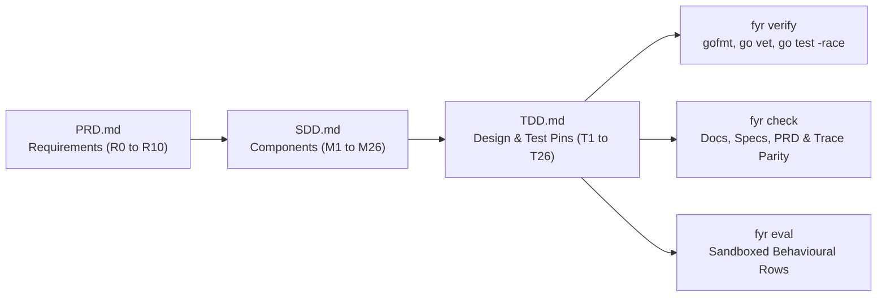

# TDD — fyr

How each part of the harness is built and tested: one section per component of SDD.md, each pointing at the record that holds its detail.
Status: current · Last updated: 2026-11-21 · Requirements: [PRD.md](PRD.md) · Design: [SDD.md](SDD.md)

<!-- One section T1… per component M… of SDD.md — its interfaces, data, errors, configuration and dependencies —
     each a summary that points at the SPEC record holding the detail (`fyr record get SPEC-…`), never a copy of it.
     TODO.md tasks name the section they build (→ T1). Kept current by the session that changes the code, in the same
     commit. -->

## T1 — Global context and rules

Assembles the global Antigravity context and rules block into `~/.gemini/config/rules/` while enforcing strict byte budgets so instructions never truncate silently.

Implements: M1 · Spec: none (the files are their own spec; the size limits below and ADR-035)

- **Interfaces:** `context/AGENTS.md`, then `context/dev-setup.md`, rendered by `fyr render` into one file (`~/.gemini/config/rules/AGENTS.md`), plus each `rules/*.md` file — `critical-thinking.md` (ADR-050), `session-sizing.md` (ADR-058, ADR-077), `agy-dispatch.md` (`PLAN.md` D15, ADR-519), `code-modularity.md` (ADR-066), `fyr-features.md` (ADR-518) — all in Antigravity's rules directory (frontmatter allows `description`, `trigger`, `globs`).
- **Errors:** a context or rules set over its size pin fails `go test ./internal/harness`; a rule with a frontmatter key outside its allow list or inconsistent `trigger`/`globs` fails the install's lint.
- **Configuration:** none; the canary word ends the rendered context (`RenderContext` omits duplicate inventory; `fyr list` prints descriptions).
- **Size pins** (`internal/harness/size_test.go`): `TestRenderedContextUnderTarget`, rendered global context pinned at 13,000 bytes inside `PRD.md` G1's 15,000-byte ceiling; `TestAlwaysOnContextBudget`, rendered global context plus always-on `rules/*.md` pinned at 9,000 bytes; `TestRepoAgentsUnderTarget`, repo `AGENTS.md` pinned at 4,500 bytes (`PRD.md` G2); `TestRenderedContextFitsAntigravityBlock`, combined rendered context plus all `rules/*.md` pinned at 19,500 bytes inside `PRD.md` § Known limits' 22,000-byte cap and Antigravity's 24,000-byte block (ADR-035). A limit is never raised.

## T2 — Skills and commands

Packages reusable `SKILL.md` workflows and empty `commands/` directories under strict frontmatter, description, and skill-listing size limits.

Implements: M2 · Spec: none (the Agent Skills `SKILL.md` standard; vendored provenance in `skills/VENDORED.md`)

- **Interfaces:** `skills/<name>/SKILL.md` with a `description`, loaded when it matches and typed as `/name`; `commands/<name>.md`, deployed to `~/.gemini/config/workflows/`, empty by design (the operator, 2026-09-30).
- **Errors:** the lint refuses a skill without `SKILL.md` or a description, a description over `1,024` characters (`internal/harness/frontmatter.go`), a key outside the allow list, and a value a YAML reader would read as a comment; `TestSkillFrontmatterDescriptionsUnder140Chars` (`internal/harness/size_test.go`) caps embedded harness skill descriptions at `140` characters.
- **Configuration:** the listing budget, `TestSkillListingBudget`: 19,500 bytes over the name and description of every skill without `disable-model-invocation: true`; past Claude Code's budget a skill is a bare name nothing triggers, so catalog entries never become global skills.

## T3 — Subagents

Ships Antigravity-native `agents/<name>/agent.md` definitions verbatim while pinning declared tools against `knownTools` so subagents never hang.

Implements: M3 · Spec: none (Antigravity's `agent.md` format; the allow-list is ADR-056)

- **Interfaces:** `agents/<name>/agent.md` with `subagent: true`, `mainAgent: false` and a `tools:` list, installed as written (ADR-062).
- **Errors:** a tool name outside `knownTools` (`internal/harness/inventory.go`) fails the install, because Antigravity hangs such a subagent.

## T4 — The embedded harness

Embeds the six tracked harness directories directly into the root Go package via `embed.go` so standalone release binaries deploy without a local checkout.

Implements: M4 · Spec: `SPEC-fyr-delivery`

- **Interfaces:** `embed.go`, package `fyr` at the root (a `go:embed` cannot reach a parent directory), embeds `context/`, `skills/`, `agents/`, `commands/`, `rules/` and `workflows/`; a release binary installs from it and refuses `--repo` (ADR-034).
- **Errors:** an embedded file git does not track, or a tracked one the embed misses, fails `go test .`.

## T5 — The CLI

Exposes all 29 `fyr` verbs, global flags, and help pages in `cmd/fyr` with consistent exit codes and real-home development guards.

Implements: M5 · Spec: `SPEC-fyr-delivery` (install and update at each kind of place), `cmd/fyr/place_matrix_test.go` (every verb on every kind of place), and each verb's `SPEC-fyr-*` record, feature guide, or `fyr help <verb>`

- **Interfaces:** the verbs below; `fyr help <verb>` prints each one's page from `cmd/fyr/help_text.go`.
- **Errors:** a usage error exits 2 and prints the verb's synopsis; a refusal exits 1 with its reason on stderr.
- **Dependencies:** M6 for install, update and status; M7–M8, M10–M14, M20, M21, and M23–M26 for their verbs.

### Verbs

One line each; `fyr help <verb>` and the linked contract or feature guide hold the verb's full behaviour.

CLI verb reference (27 rows covering 29 commands)

| Command | What it does | Spec / Guide |
|---|---|---|
| `fyr status` | What is installed and its drift; exit 1 on drift | `SPEC-fyr-delivery` |
| `fyr update` | Moves this place forward by what it is: a checkout, a release binary or a zip | `SPEC-fyr-delivery` |
| `fyr install` (or `sync`) | Deploys the harness and removes what it no longer has | `SPEC-fyr-delivery` |
| `fyr diff` | A unified diff of every drifted file | `SPEC-fyr-delivery` |
| `fyr uninstall` | Removes exactly what install wrote | `SPEC-fyr-delivery` |
| `fyr list` / `render` | The inventory; the assembled context | `SPEC-fyr-delivery` |
| `fyr record add` / `get` / `edit` / `list` / `export` / `sync` / `import` | The brain store and its on-demand `.agents/trail.jsonl` export and sync | `SPEC-fyr-record` |
| `fyr resume` | The read-only seven-step session resume (`AGENTS.md`, open records, newest handoff, `TODO.md` Now, open plans, recent changes, memory; ADR-508) | `fyr help resume`, [Brain & Memory](features/brain-and-memory.md) |
| `fyr search <words>`, `fyr index` | Records first, then ranked files; AST graph slicing and queries (`--slice`, `--skeleton`, `--path`, `--affected`, `--map`, `--include-docs`), `< 25 ms` prompt vetting (`--vet`), and `< 250 ms` CLI hooks (`--hook`); consent to be read across projects | `SPEC-fyr-pre-hook-coordinator`, [Hooks & AST Graph](features/hooks-and-ast-graph.md), `fyr help search`, `fyr help index` |
| `fyr graph [--out FILE] [--force] [--dot] [--md] [--json] [--web] [--listen ADDR] [--include-tests] [--include-docs] [--include-vendored]` | Pure-Go AST and behavioral telemetry constellation (offline `<canvas>` HTML, JSON, DOT, Markdown, or foreground `--web` preview via M24; `--include-vendored` loads vendored skill symbols in memory without persisting them in `search.db`; `ADR-528`) | `SPEC-fyr-graph`, `fyr help graph` |
| `fyr memory add` / `show` | Project and `--global` memory (`semantic`, `procedural`, `episodic`) and validity-scored index (`--include-low`) | `SPEC-fyr-record`, [Brain & Memory](features/brain-and-memory.md), `fyr help memory` |
| `fyr metrics ingest` / `show` / `report` / `evals` / `trajectory` / `export` | Session shapes, trajectories and eval trials: stored, summarised, rendered (`show`/`report` accept `--since-tag TAG`; `report` accepts `--daily-digest`) | `SPEC-fyr-metrics` |
| `fyr report [--project [DIR] \| --global] [--include-sandboxes] [--since YYYY-MM-DD \| --since-tag TAG] [--until YYYY-MM-DD] [--daily-digest] [--md \| --json \| --web [--listen ADDR]] [--out FILE]` | Project or global usage report with `Daily Direction & Actions` banner, Section `0. Scorecard`, `Background Autonomy`, `Trigger coverage`, `Agent Roles`, and optional `Tag Cohort` (`--since-tag`) or `--daily-digest` mode (Economist HTML, `--md`, `--json`, or foreground `--web`; ADR-516, ADR-518, ADR-528) | `SPEC-fyr-metrics` |
| `fyr dream --all` / `--project DIR` | One-off or `fyr auto`-driven plan-mode dream run across all discovered workspaces that rates stale conversations (`session_ratings`) and proposes consolidations and skill improvements | [Dream & Auto](features/dream-and-auto.md), `fyr help dream` |
| `fyr auto on` / `off` / `status` / `run` / `log` | Global binary `on \| off` switch of the single hourly runner (`fyr auto`: metrics ingest, plan-mode dream + stale-conversation rating, daily HTML report, and all-workspace sweep; `--conversation-idle` default `1h`; `on`/`off`/bare `--dry-run`; `run --force` overrides `4h` cooldown; `log` tail reader), and the run (§ T19) | [Dream & Auto](features/dream-and-auto.md), `fyr help auto` |
| `fyr check` | A read-only drift check of this checkout; exit 1 on findings | [Workflows & Build Control](features/workflows-and-build-control.md), `fyr help check` |
| `fyr git-check` | The three read-only post-dispatch git checks (`git status`, `git log`, `git tag`; ADR-508) | `fyr help git-check` |
| `fyr watch --check [--conv ID] [--idle-sec N] [--json]` | Out-of-band `< 30 ms` read-only hang, interactive-stdin, stale-artifact, and subagent-budget check | `fyr help watch` |
| `fyr verify` | Runs `gofmt`, `go vet ./...`, `go test -race ./...`, and `fyr check`, guards against mid-run tree mutation, and writes `.agents/scratch/verify.stamp` (`0600`) | `fyr help verify` |
| `fyr gate [--base REF] [--lease GLOB] [--lease-file FILE] [--max-files N] [--max-lines N] [--judge TEXT] [--judge-model ID] <worktree>` | Checks `Files:` lease globs, `120000`/`160000` modes, secret filenames, numstat caps/non-empty and binary adds/edits (pure deletions in lease allowed), added-line secrets, commit trailers, and optional cross-family `--judge` verdict | `fyr help gate` |
| `fyr land [--lease GLOB] [--lease-file FILE] [--message TEXT] [--max-files N] [--max-lines N] [--timeout D] [--judge TEXT] [--judge-model ID] <branch>` | Gates `<branch>` (plus optional `--judge` verdict), squash-merges and runs `fyr verify` in a detached scratch worktree, fast-forwards clean main, deletes `<branch>`, and refreshes `verify.stamp` | `fyr help land` |
| `fyr close --title TEXT [--body-file FILE]` | Writes an immutable `handoff` record embedding `## Verification Digest` from a fresh `verify.stamp`, leaving prior records untouched | `fyr help close` |
| `fyr eval --home DIR [--runs N] [--parallel N] [--acp] [--suite-file PATH] <row>...` | Behavioural rows against the Antigravity CLI, each in a sandbox | `SPEC-fyr-eval` |
| `fyr models [--json] [--pick <role>] [--explain ID] [--refresh] [--tier T] [--bench [--model ID] [--max N]]` | Live Antigravity model catalog, per-model capability profiles (`ADR-520`), Empirical-Bayes + UCB1 evidence-judged cross-family role picks (`builder`, `planner`, `judge`, `reviewer`, `verifier`, `mechanical`), `--bench` 0-run sanity probes, and cache refresh (§ T21, ADR-519, ADR-520, ADR-529) | [Workflows & Build Control](features/workflows-and-build-control.md), `fyr help models` |
| `fyr state export [--out FILE] [--repo ID|current] [--include-memory] [--since YYYY-MM-DD] [--json]` / `import FILE [--repo ID|current] [--include-memory] [--dry-run] [--json]` | Offline SHA-256-verified zip bundle export/import of project trail and sanitized metrics (plus opt-in `--include-memory`, § T26, ADR-531) | `SPEC-fyr-delivery`, `fyr help state` |
| `fyr adopt <name>` | Copies a skill installed elsewhere into `skills/` | `fyr help adopt` |
| `fyr version` | The build version | `fyr help version` |

`fyr` and `fyr help` print the short page, one line per command; `fyr help <verb>` or `fyr <verb> --help` prints that verb's page: its synopsis, what it does, and its flags. A flag a verb does not know is a usage error, exit 2, which prints the verb's synopsis.

The global flags are `--repo DIR` (the harness checkout to build and install from; a release binary installs its embedded harness and refuses `--repo` and `$FYR_REPO`, ADR-034, while verbs that do not read it warn on stderr and run), `-C DIR` / `--dir DIR` (resolve the project checkout from `DIR` instead of the working directory via `c.projectDir()`), and `--home DIR` (required in development so unflagged builds never open real stores: `cmd/fyr/realhome_guard.go`, BUG-507, ADR-505); `--vendor` no longer exists and is a usage error. Full contracts live in the `current` spec records (`SPEC-fyr-delivery`, `SPEC-fyr-record`, `SPEC-fyr-metrics`, `SPEC-fyr-eval`, `SPEC-fyr-pre-hook-coordinator`, `SPEC-fyr-graph`), the [feature guides](features/delivery-and-customization.md), and `fyr help <verb>`.

## T6 — The installer

Computes atomic install plans in `internal/harness`, lints frontmatter and paths, tracks `~/.config/fyr/state.json`, and handles checkout, release, and zip updates.

Implements: M6 · Spec: `SPEC-fyr-delivery`; the working rules are `AGENTS.md` § Rules for working here

- **Interfaces:** `internal/harness/plan.go` says what is installed where (the customization trees `~/.gemini/config/{rules,skills,agents,workflows}/`, including `workflows/*.py` script delivery, `~/.gemini/config/hooks.json` for `SessionStart`, `PreInvocation`, `PreToolUse` (with `run_workflow`), `PostToolUse` (`post-tool-use`), and `Stop`, ADR-511, ADR-526, and `~/.local/bin/fyr`); `internal/harness/inventory.go` and `inventory_load.go` hold the lint; the manifest is `~/.config/fyr/state.json`.
- **Rebuild or copy:** `fyr install` rebuilds the binary from its own git checkout with `go build` and lets that build install (BUG-006); it copies the running binary only when `go` is missing, when the tree is a plain copy with no `.git` (its binary was built from that tree, which may be read-only to the installing user, BUG-015), or when the source is the harness embedded in a release binary (ADR-033, D13).
- **Lint refusals** (`inventory.go`, each with its bug in `TestLint*` and `TestAgentDescriptionRules`): the flat `agents/<name>.md` format from before ADR-062; a skill without `SKILL.md` and its `description`; a description over 1,024 characters, or in an agent one that is not one line or names "dispatch prompt" or "harness binary"; a frontmatter value a strict YAML parser reads as a comment (BUG-004: quote it); in every kind a key outside its allow list (`agentKeys`, `skillKeys`, `commandKeys`, `ruleKeys`; IN23), a permission key (`allowed-tools`, `hooks`, `permissionMode`, `mcpServers`) above all; a command or rule whose file name fails `validName`; a frontmatter block a YAML reader could read differently from the lint's line grammar (BUG-143, BUG-153).
- **Errors:** every lint refusal names the file and the rule; a failed write keeps the manifest complete; `update` refuses a dirty checkout and an unknown status.
- **Configuration:** `--home DIR` for every development run (R6); `--repo DIR` or `$FYR_REPO` for the checkout.
- **Dependencies:** git and `go` for a checkout's rebuild; stdlib `net/http` over HTTPS against `https://github.com/kesokaj/fyr/releases/latest` (redirect, verified against `SHA256SUMS`, no `gh` CLI required) for a release binary's update.

## T7 — The brain store

Stores every project's trail records and validity-scored project or `--global` memory cards (`fyr memory add` / `show`, `internal/brain/memory.go`) in `~/.config/fyr/brain.db` with on-demand `.agents/trail.jsonl` export/sync and read-only session resume.

Implements: M7 · Spec: `SPEC-fyr-record`, `SPEC-fyr-graph` · Guide: [Brain Store, Trail & Memory](features/brain-and-memory.md)

- **Interfaces:** `fyr record add`, `get`, `edit`, `list`, `export`, `sync` and `import` (`add --title-file FILE` reads the title from a file, one trailing newline dropped, so a worker's title reaches the store through no shell, ADR-501; `add` and `edit` take `--body-file FILE`, a regular file checked with `Lstat` and `O_NOFOLLOW` under the same 1 MiB cap and redactor warning as stdin and refused with piped stdin, or `--json-in` and optional leading `Title:`/`Status:`/`ID:`/`Project:` stdin headers via `brain.ParseRecordStdin` and `brain.ParseRecordJSON`/`brain.ParseRecordEditJSON` in `internal/brain/stdin_doc.go`; `get --out FILE` writes one record's body under `.agents/scratch/` through no symlink; `list --limit N` caps returned records and `get --json` / `list --json` emit JSON via `brain.FormatRecordsJSON`); `brain.ListTurnRecords`, `brain.SearchTurnRecords`, and single-open `brain.LoadTurnRecordsAndFTS` (`internal/brain/turn_records.go`) loading only active turn-relevant records (`plan`, `memory`, `bug`, `adr`) + FTS5 hits without creating `brain.db`; `fyr resume` (`brain.Resume`, ADR-508), the read-only seven-step session resume (`AGENTS.md`, open records, newest handoff, `TODO.md` Now, open plans, recent changes, project + `--global` active `semantic` memory) that falls back to `.agents/trail.jsonl` without creating `brain.db` when absent and appends a fail-open `<= 1,500 B` `## Daily Health & Auto Actions` brief (`Direction`, `I did`, `We need to do`) from `~/.config/fyr/reports/latest-daily-digest.json` via `writeResumeDailyDigest` (`internal/brain/resume_daily.go`); `brain.IndexRecordLinks(home, root, paths)` (`internal/brain/refs_index.go`), strictly read-only matching of normalized repo-relative paths against `bug`, `adr`, and active `memory` (`validity >= 0.40`) records without creating `brain.db` when absent (`ADR-528`); `brain.MemoryDraftWithOptions` (`MemoryDraftOptions{Type, EvidenceCount, SourceSessions}`) for `fyr auto`'s validated memory drafts (`add`, `retire`, `merge`); `brain.NormalizeMemoryType` (`semantic|procedural|episodic` with legacy alias normalization), `brain.ComputeMemoryValidity` and `brain.CountMemoryContradictions` (`internal/brain/validity.go`, deterministic `0.00–1.00` validity with `MinActiveValidity = 0.40`), `brain.ReadScope`, `brain.HasRecords`, `brain.LastUpdated` and `brain.SnapshotScopes` (check c's read-from-a-copy per-scope digest, ADR-506) for read-only consumers; a project's records exported to `.agents/trail.jsonl` on demand with `fyr record export` and loaded into `brain.db` and `records_fts` on demand with `fyr record sync` (ADR-091).
- **Data:** `~/.config/fyr/brain.db`, the store of record for every project's trail records, memory (project and `--global` shared scopes) and the global records (R4, R7). Migration 2 adds `provenance` (`operator`, `derived` or `unknown` on `memory` and `feedback` records; every record stored before the migration or imported from files reads as `unknown`, never `operator`). Migration 3 adds `memory_kind`, `validity`, `verified_at`, `evidence_count`, and `source_sessions` on `records` (`ADR-523`), auto-normalizing legacy `user|project|reference` to `semantic` and `feedback` to `procedural`. Migration 4 adds canonical `repo_id` (`NormalizeRepoID`, `records_repo_id` index) on `records` and `meta` (`ADR-531`), while `operator` provenance immutability (`retire`/`supersede`/downgrade refused) and `<= 2` compacted `Prior:` bullets (`memory_draft_prior.go`) protect stored memory chains.
- **Errors:** a trail line that does not parse refuses the whole file with its line number.

## T8 — Search

Indexes project and global records and source AST graphs in SQLite caches for context slicing, symbol tracing, prompt vetting, and `< 250 ms` fail-open CLI hooks.
Implements: M8 · Spec: `SPEC-fyr-pre-hook-coordinator`, `SPEC-fyr-graph` · Guide: [CLI Hooks, Prompt Vetting & AST Graph](features/hooks-and-ast-graph.md) · CLI: `fyr help search`, `fyr help index` · Decisions: ADR-511, ADR-524, ADR-525, ADR-526, ADR-528

- **Interfaces:** `fyr search`, `fyr index`, `fyr index --register`, `--hook <event>`, `--vet <prompt>`, and pure-Go AST/graph analysis APIs power record lookup, context slicing, prompt vetting, and fail-open lifecycle hooks.
  - **Query & slice modes:** `fyr search` (records first, then files; `--include-docs` / `Options.IncludeDocs` in `search.go` and `cmd/fyr/verb_search_memory.go`), `--slice <query>` (`--hops`, `--budget`, `--session`, with UTF-8 rune-safe `compactSig` in `slice_compact.go` advertising Hop-0 targets), `--skeleton <path>` (`symbols_md.go` for Markdown ATX headings + AST declarations), `--path <from> [--to <to>]`, `--affected <target>`, `--map`, `--refs`, `--open`, and `--global`.
  - **Prompt vetting (`--vet <prompt>`):** `internal/search/vet.go`, `vet_skills.go`, `vet_route.go`, `vet_decompose.go`, `internal/search/vet_decompose_pkg.go`, `internal/search/vet_capsule.go`, `vet_history.go`, `hook_fts_fallback.go`, `telemetry_json.go`, `telemetry_model.go`, and `fence.go` classify 9 intent modes, compute `VetScore`, deduplicate skills, decompose multi-package prompts, and emit `PreInvocationBanner` JSON (`ADR-518`, `ADR-521`, `ADR-525`, `ADR-528`).
  - **CLI hooks (`--hook <event>`):** `internal/search/hook.go`, `hook_deadline.go`, `hook_coordinator.go`, `hook_worker_capsule.go`, `hook_session_start.go`, `hook_workflow.go`, `hook_git_index.go`, `hook_stop_stamp.go`, `git_warm_sig.go`, `read_ledger_bash.go`, `read_ledger_edit.go`, `process_artifact.go`, `vet_history_store.go`, `telemetry_json.go`, `telemetry_model.go`, `telemetry_model_conv.go`, `telemetry_process.go`, `hook_pretool.go`, `hook_clamp.go`, `hook_dedup.go`, `hook_guard.go`, `hook_subagent.go`, `internal/search/hook_subagent_models.go`, `internal/search/hook_bash_guard.go`, and `internal/search/hook_watchdog.go` handle `session-start`, `pre-invocation`, `pre-tool-use`, `post-tool-use`, and `stop` under a hard `200 ms` fail-open deadline (`hook_deadline.go`) and `~/.config/fyr/no-hooks` switch.
  - **Pure-Go AST/graph & signal APIs:** `internal/search/pkg_paths.go`, `sym_graph.go`, `sym_graph_bounded.go`, `sym_graph_bounded_sql.go`, `sym_graph_resolve.go`, `pkg_imports.go`, `symbols_ts.go`, `graph_tarjan.go`, `graph_louvain.go`, `structural_signals.go`, `structural_signals_coupling.go`, `graph_export.go`, and `graph_export_metrics.go` provide canonical repo-dir package keys (`canonicalPkgDir`), Go `go.mod`/alias resolution without phantom external/stdlib edges, TS/TSX relative import parsing & unexported `const` suppression, `isExcludedASTPath`/`isDocPath` exclusions (excluding vendored `skills/*/references/**` and `skills/*/assets/**` in `search.db` while supporting on-demand in-memory `GraphOptions.IncludeVendored` snapshots), `TarjanSCC`/`TarjanPackageSCCs` (`import | call | type_ref` only, excluding `iface_call`/`implements`), deterministic `LouvainCommunities`, strictly read-only `ReadStructuralSignals`/`ReadHiddenCouplingHints` (splitting `co_edit` vs `co_read` hidden-coupling pairs), `LoadGraphSnapshot`, and bounded `CROSS JOIN` + covering-index subgraph loading (`sym_graph_bounded_sql.go`).

  

  
T8 prompt vetter &amp; CLI hook event contracts

  - **`--vet <prompt>` mechanics:** 9-mode intent classifier with `IntentQuestion` never setting `SecurityRequired`, `< 40 ms` warm Turn-0 fast-path via `git_warm_sig.go` (supporting Git reftable via `hashGitReftable`) + `MATERIALIZED` FTS5 CTE (`hook_fts_fallback.go`) + `CROSS JOIN` hop-1 scoping & covering-index symbol fallback (`sym_graph_bounded.go`, `sym_graph_bounded_sql.go`) preserving compact `improvedPrompt`, `0..100` 6-anchor `VetScore` with prior-turn `vet_history` carry-forward, 3-turn skill deduplication + generation-scoped `skillDigests` stamped via `__vet_skill__:<name>` at `start_line = -4`, `[CONTEXT_KNEE_WARNING]` & `IntentApproval` dedup (`process_artifact.go`, `vet_history_store.go`), `records_fts` precision (`cmd/fyr/verb_search_hook.go`), `< 2 ms` `[VET_IMPROVED_PROMPT]` history synthesis emitted in `enrichment.improvedPrompt`, deterministic `< 25 ms` `DecomposeSubtasks` splitting multi-clause or multi-package prompts into `<= 6` disjoint `SubtaskSlice` entries with deterministic Louvain community overflow coalescing via `coalesceOverflowByCommunity` while skipping `isWorkerBriefPrompt` and emitting `COORDINATE_SUBTASKS` when `len(subtasks) >= 2`, advisory `route` routing via `RouteFeature`, cryptographic `Fence` boundary, and single-block 2-space pretty-printed JSON `PreInvocationBanner` carrying exact `agy` `model` ID + unmodified `modelDisplay` + `thinking` + `PreInvocationEnrichment` envelope carrying `"contract": "[FYR_TURN_CONTRACT]"` and delta-only context with zero trailing prose.
  - **`session-start` & `pre-invocation`:** `session-start` emits a `<= 1,500 B` capsule with `terminationBehavior` omitted and optional fail-open `DailyAlert` extracted from `~/.config/fyr/reports/latest-daily-digest.json` (`extractSessionDailyAlert` in `internal/search/hook_session_start.go`); `pre-invocation` keeps `HookSystemMessage.Metadata` `nil` per `BUG-523`, injects on-demand `procedural`/`episodic` and matching `--global`/`semantic` memory cards with `validity >= 0.40` up to 4 memories / `totalMatchedRecords` cap 6, and emits `{}` with zero model tokens on un-enriched `PASS_THROUGH` turns.
  - **`pre-tool-use`:** receives full `Options` — with `handlePreToolSubagent`, `handlePreToolWorkflow`, and `handlePreToolSwarm` resolving session models via `resolveHookSessionModelForHome` (`hook_subagent.go`/`hook_workflow.go`, recognizing `neon`) and enforcing `internal/models` routing + guarded-subagent `"pro"` upgrades (`hook_subagent_models.go`) + all-token `inferSwarmRole` with 20%/30% `models.json` quota fallback, `enrichWorkerPromptArgs` injecting fenced `<= 1,200 B` `[FYR_WORKER_CAPSULE]` context into `invoke_subagent` `Prompt` and `swarm(action="add")` `brief` via `Overwrite`, `handlePreToolWrite` / `checkCoordinatorWriteGuard` enforcing `[COORDINATOR_GUARD]` direct-edit protection on `COORDINATE_SUBTASKS` or `coordinator-only` (`Options.Home` / `.agents/scratch`) sessions while exempting `.agents/scratch/**`, `TODO.md`, linked worktrees, `!`-bypass, and `isWorkerBriefPrompt` sessions, `checkInteractiveBashGuard` blocking interactive stdin prompts with `[INTERACTIVE_STDIN]` and prepending `export GIT_TERMINAL_PROMPT=0; ` via `Overwrite` on network `git` ops, `ParseBashFileReads` (`internal/search/read_ledger_bash.go`) + 3-pass `enforceBashFileReads` (`hook_pretool.go`) enforcing `[CLAMPED]` and `read_ledger` dedup across simple `&&`/`;` bash read chains with `cd` tracking while leaving real pipes untouched, `PreToolUse` `read_file` passing out-of-root and unindexed files straight through (`hook_pretool.go`, `hook_clamp.go`), `hook_clamp.go` issuing `[CLAMPED]` skeleton-first denies on unranged `>= 400`-line reads and retaining `-5` `[CLAMPED]` rows across same-generation edits (`read_ledger_edit.go`), `hook_dedup.go` read deduplication emitting `[UNCHANGED]`/`[MODIFIED]`/`[CLAMPED]` + Hybrid Example A `LedgerNotice` JSON, and `evaluateWatchdogPre`/`finalizeWatchdogPre` enforcing `[POLL_LOOP]`, `[TOKEN_LOOP]`, and `[SUBAGENT_BUDGET]`/`[SUBAGENT_BUDGET_WARN]`.
  - **`post-tool-use` & `stop`:** `post-tool-use` calls `handlePostToolUse`/`markWatchdogPostError` to mark `watchdog_ring` failures by `HookToolCall.ID` or tool fallback and returns `{}`; `stop` runs a session-scoped pure-Go `.agents/scratch/verify.stamp` check that returns `continue` once on dirty Go files touched by that session without a matching stamp, while writing `<appDataDir>/brain/<conv-id>/fyr-process.md`.

  

- **Data:** the indexes (`.agents/scratch/search.db`, `~/.config/fyr/search.db`) are caches, rebuilt when deleted (R4), at `schemaVersion = "11"` (`ADR-511`, `ADR-525`, `ADR-526`, `ADR-528`, `ADR-531`), paired with all-workspace dream discovery in `dream.go` and `dream_workspace.go` (`ADR-524`).
  - **Cached tables:** full-text FTS, per-blob AST `symbols` and `sym_refs` (`EXTRACTED` `1.0` vs `INFERRED` `0.7` confidence), the persistent hash-keyed session `read_ledger` and `read_ledger_stats` (preserving `-5` `[CLAMPED]` sentinel rows across edits), `session_meta` (`agent_role`, `agent_name`, `tool_calls`), `vet_history` (`subtask_count`, `directive`, `duration_ms`, `timed_out`, `injected_bytes`), `co_activity`, and `watchdog_ring` (last 64 rows per conversation).
  - **Schema v11 & in-place migration:** adds `vet_history.{duration_ms, timed_out, injected_bytes}` via in-place `migrateV10ToV11Tx` in `internal/search/store_migrate.go` while preserving `projects`, `co_activity`, `read_ledger`, `read_ledger_stats`, `session_meta`, `vet_history`, and `watchdog_ring`, atop v10 `blobs.line_count` and v9 `refs_oid`/`chunks.tokens`; schemas `< "9"` still trigger `staleSchemaError` unlink and rebuild.
  - **Dream discovery (`dream.go`, `dream_workspace.go`):** `ListProjects`, `GlobalWorkspace` (`"__global__"`), `ListAgyWorkspaces` (excluding sandboxes), and `AgyConversationTextInWindow` (`maxModified` stale cutoff, supporting non-git directories and empty `workspace_uris`).

## T9 — Retired (merged into T7 internal/brain)

Project and `--global` memory moved into [T7 — The brain store](#t7--the-brain-store) (`internal/brain/memory.go`), where `fyr memory add` and `fyr memory show` share `brain.db` and `SPEC-fyr-record` directly.

## T10 — Metrics

Ingests shape-only session, eval trial, second-brain vet/ledger, work-wave, and background-run telemetry into `metrics.db` for CLI summaries, trajectories, diagnostic signals, and local HTML/Markdown/JSON/web reports.
Implements: M10 · Spec: `SPEC-fyr-metrics`, `SPEC-fyr-graph`

- **Interfaces:** `fyr metrics ingest`, `show`, `report`, `evals`, `trajectory`, `export`, and top-level `fyr report [--project [DIR] | --global] [--include-sandboxes] [--since YYYY-MM-DD | --since-tag TAG] [--until YYYY-MM-DD] [--daily-digest] [--md | --json | --web [--listen ADDR]] [--out FILE]` (`cmd/fyr/verb_report.go`, `ADR-516`, `ADR-528`) summarize session shapes, trajectories, diagnostic signals, daily digests, cohorts, and multi-format reports.
  - **Report renderers & web preview:** `internal/metrics/report_md.go` (`RenderMarkdownReport`, `WriteMarkdownReport`), `RenderJSONReport` / `WriteJSONReport` in `internal/metrics/report_json.go`, foreground `--web` preview via M24 `internal/webpreview`, daily `WriteDailyReport` in `internal/metrics/report.go` writing `<home>/.config/fyr/reports/YYYY-MM-DD-daily-metrics.html` at `0600` with `O_EXCL` and suppressing empty `Cost per day (USD)` SVG charts, `report_autonomy.go` rendering `Background Autonomy` and Section `0. Scorecard`, `show_cohorts.go` rendering `--since-tag TAG` `TagCohort` and `AgentRoles` (`AgentRoleMetrics`), `daily_digest_render.go` + `report_template.go` rendering `"Daily Direction & Actions"` banners and `--daily-digest` text/JSON views, and `Summary.TriggerCoverage` / `triggerCoverageSection` in `internal/metrics/trigger_coverage.go` reporting live v9 orchestration/gate/PreInvocation KPIs while excluding historical `claude` steps.

  

  
T10 Go telemetry, trajectory &amp; diagnostic APIs

  - **Model evidence & state transfer:** `Store.ModelEvidence(since, now)` in `internal/metrics/model_evidence.go` resolves concrete `f(3,28)->f(1,19)` model IDs and aggregates `14`-day decayed `DecayedRuns`/`DecayedSuccesses` across `trials` (plus unclaimed `eval=` sessions), `worker_model`-attributed `judge_verdicts`, and normalized `session_ratings` alongside separate legacy `work_waves` counts (`WorkRuns`, `WorkPass`, `WorkMeanSeconds`, `ADR-529`) per model for `cmd/fyr/verb_models.go` (`loadMetricsModelEvidence`), with `"models"` and `"state"` classified in `internal/metrics/verb.go`; `ExportSanitizedState` and `ImportSanitizedState` back M26 offline `fyr state` bundles.
  - **Trajectories & dream digest:** `Store.Trajectories`, `WriteTrajectoriesText`, and `WriteTrajectoriesJSON` in `internal/metrics/trajectory.go` surface parent → subagent lineage, turn-by-turn token growth vs each model's `60%` effective context knee (`models.ContextKneeWithOverrides`, default `ContextKneeTokens` `180,000`, `models.json` `context_window` override), and `KNEE_EXCEEDED` / `REDUNDANT_READ` / `RETRY_LOOP` anomalies with non-`Bash` `lastHash` resets (`ADR-513`); `Store.DreamTrajectoryDigest` in `internal/metrics/dream_digest.go` counts distinct label-free sessions exceeding their per-model `60%` knee or recording a `knee_exceeded` event.
  - **Ratings, verdicts, background runs & daily digests:** `SessionRating`, `UpsertSessionRatings`, and `SessionRatings` in `internal/metrics/ratings.go` feed `Summary.A` (`ADR-524`); `JudgeVerdictRow`, `RecordJudgeVerdict`, and `Store.JudgeVerdicts` live in `internal/metrics/judge_verdicts.go`; `BackgroundRunRow`, `RecordBackgroundRun`, `InsertBackgroundRun`, and `QueryBackgroundRuns` live in `internal/metrics/background_runs.go`; `DailyDigest`, `BuildDailyDigest`, `SaveDailyDigest`, `WriteLatestDailyDigest`, `ReadLatestDailyDigest`, `RecordDigestAppliedAction`, and `EvaluateActionRecovery` (`internal/metrics/daily_digest.go`, `daily_digest_io.go`, `daily_digest_recovery.go`) compute rolling 7d behavioral deltas + day-over-day AST & `PreInvocation` diffs, write `~/.config/fyr/reports/latest-daily-digest.json`, and track post-apply recovery (`pending_data` -> `recovered` / `still_regressing`).
  - **Diagnostics, project scoping & health signals:** `WindowDeltas` in `internal/metrics/deltas.go`, `Summary.Numbers()` in `internal/metrics/numbers.go`, `TopBashVerbs` & `BashReadSkips` in `internal/metrics/show_columns.go`, and shape-only `DiagnosticReport` with `signal_id` dedup in `internal/metrics/diagnostics.go` plus 3 regression rules (`pre_invocation_timeouts`, `bash_read_bypass`, `structural_regression`) and `ActionScope`/`RecommendedAction` assignment in `internal/metrics/diagnostics_health.go`; `project_roots.go` common-dir canonicalization + `isSandboxProjectRoot` filtering with `--include-sandboxes` opt-in, `read_ranges.go` `>= 50%` overlap interval tracking, and `denied = 1, is_error = 0` hook-denial separation (`M1–M5`); plus `ReportEvalsWithDevFallback` / `mergeDevEvalPassK` in `internal/metrics/report_evals.go`, `show_health.go` (`inspectProjectSearchDBs`, `PoolQuota`, `populateHealthAndFallbacks`), and `brain.db` `AutoFindings`/`HandoffLagDays` (`M6–M7`, `H1`) rendered in `report_md.go` and `report.go` (`ADR-526`, `ADR-528`).

  

- **Data:** `~/.config/fyr/metrics.db`, a store of record of session shape: never arguments, prose or tool output; `uninstall` leaves it. Salted-hash read prefixes (`"r:"` ranged with optional `:start-end` bounds vs `"f:"` full in `steps.cmd_hash`, D9, ADR-511, ADR-526) feed `Summary.C`'s `RedundantReads`, `RangedReadPct` and `Search : Grep` in `fyr metrics show` without a schema migration or raw paths.

  

  
T10 schema migrations (Migrations 5–12)

  - **Migration 5:** adds `started_ms`, `ended_ms` and `wait_ms` on `steps` (from Antigravity `steps.metadata` timestamps `1`, `6`, `7`, `8` and status-history field `26`) and `setup_seconds` and `check_seconds` on `trials`, feeding `Summary.B`'s `model_min`, `tool_min`, `wait_min` and `idle_min` and `show`'s `time model/tool/wait/idle m` line.
  - **Migration 6 (`internal/metrics/store.go`):** adds `turn_vets` and `work_waves`, ingested by `ingest_secondbrain.go` from `<project>/.agents/scratch/search.db` (`vet_history` and `read_ledger_stats`) and `~/.config/fyr/work/*/status.json`, with labelled dev-home `work_waves`, worker sandboxes, and `trials` ingested by `ingest_dev.go` under `--source DIR --label KEY=VALUE` without mixing into unlabelled `Show` totals, and aggregated by `show_secondbrain.go` and `trigger_coverage.go` into `Summary.E` (`SecondBrain`), `Summary.F` (`WorkSummary`), `Summary.TriggerCoverage` (`TriggerCoverage`), and `Summary.Projects` (`[]ProjectRow`, ADR-516).
  - **Migration 7 (`internal/metrics/store.go`):** appended without editing migrations `1..6`, adds `setup_s`, `agy_s` and `check_s` (`INTEGER NOT NULL DEFAULT 0`) on `work_waves`, ingested from `status.json` by `ingest_secondbrain.go` and copied across schema-7 dev stores by `ingest_dev_copy.go` (`0` on schema-6 dev stores), feeding `Store.ModelEvidence`.
  - **Migration 8 (`internal/metrics/store.go`):** adding `"session_ratings"` to `tables`, creates `session_ratings(session_id, project_root, evaluated_at, outcome_score, token_efficiency, plan_alignment, skill_action, target_skill, summary)` and `session_ratings_eval` index for stale-conversation ratings (`ADR-524`).
  - **Migration 9 (`internal/metrics/store.go`):** adding `"judge_verdicts"` to `tables`, creates `judge_verdicts(id, ts, project_root, target, model, fallback_reason, criterion_hash, verdict)` and `judge_verdicts_ts` index for cross-family gate verdicts (`ADR-526`).
  - **Migration 10 (`internal/metrics/store.go`):** adding `"background_runs"` to `tables`, creates `background_runs(id, ts, kind, outcome, duration_ms, projects_checked, proposals_written, ratings_written, worker_ran, applied)` and `background_runs_ts` index for `fyr dream`/`fyr auto` run telemetry (`ADR-528`).
  - **Migration 11 (`internal/metrics/store.go`):** adds `repo_id` across `sessions`, `judge_verdicts`, `turn_vets`, and `session_ratings` (`sessions_repo_id` index), adds `worker_model` and `worker_session_id` to `judge_verdicts`, and adds `repo_id`, `directive`, `subtask_count`, `duration_ms`, `timed_out`, `injected_bytes`, `pivots_used_count`, and `skills_loaded_count` to `turn_vets` (`ADR-529`, `ADR-531`).
  - **Migration 12 (`internal/metrics/store.go`):** creates `daily_digests(day PRIMARY KEY, verdict, kpi_json, ast_json, preinv_json, actions_json, created_at)` and `daily_digests_created` index for shape-only daily health digests and post-fix recovery checkpoints (`D7`).

  

## T11 — The dreamer

Discovers all Antigravity workspaces without registration, redacts stale conversations, diagnostic/hidden-coupling hints, and shape metrics, rates sessions into `session_ratings`, records background runs, and queues global skill and memory proposals in zero-tool plan mode.

Implements: M11 · Guide: [Dream Consolidation & Auto Mode](features/dream-and-auto.md) · CLI: `fyr help dream` · Decisions: ADR-524, ADR-528

- **Interfaces:** `fyr dream`, `--all`, `--project DIR` (accepts git checkouts, non-git directories, or `__global__`), `--dry-run` (scheduling lives in `fyr auto`, `T19`; `dream.RemoveTimer` / `dream.TimerInstalledHere` clean up legacy `fyr-dream` units); `Options` adds `ConversationIdle`, `HarnessRepo`, `Model`, `WriteRatings`, and `RecordBackgroundRun`; `targets.go` discovers all workspaces from `search.ListProjects`, `search.ListAgyWorkspaces`, `brain.Scopes`, and `HarnessRepo` without requiring `trail.Registered` (`G6`) or migrated trail records; sliding-window `(since, cutoff]` collection (`collect.go`, `collect_sources.go`, oversized transcript chunking in `collect_fit.go`, `addOptionalPlanAndHandoff`, `addHiddenCouplingHints`) injects `DiagnosticReport`, `DailyDigest` (`internal/dream/metrics.go`), and project-local redacted hidden-coupling hints from a copy of `search.db` while pairing `watermark(c, cutoff)` with `FailedAttempts` 24h cooldown when `ConversationIdle > 0`; `prompt.go`/`response.go`/`proposals_format.go`/`proposals_write.go` rate stale conversations, write `session_ratings` in `realRun` only, call `RecordBackgroundRun`, and queue `target: harness` `proposal` records (with optional `signal_id`, `report_date`, `action_scope`, `recommended_action` metadata) via `needsSkillProposal`.
- **Errors:** an ingest failure does not fail the dream; a tool call by the model ends the run with no answer.
- **Dependencies:** M10 first, then M12 on every input, then `agy` headless in plan mode.

## T12 — The redactor

Scrubs credentials, secret lines, and PEM blocks from plain text and JSONL dream inputs using stdlib-only patterns with pinned over-redaction safety tests.

Implements: M12 · Spec: none (internal; [Dream Consolidation & Auto Mode](features/dream-and-auto.md) names where it runs, and its tests pin every needle)

- **Interfaces:** one function over text, one over JSON lines; stdlib only.
- **Needles:** a needle matched against raw text has no `\b` in front: a literal `\n` or an underscore is a word character and hides the token.
- **Errors:** over-redaction is the safe direction and is pinned, never argued (`AGENTS.md` § Rules for working here).

## T13 — Eval

Runs behavioural evaluation rows against Antigravity in isolated per-trial sandboxes, grading verdicts and recording trial and session telemetry without linking SQLite inside `internal/eval`.
Implements: M13 · Spec: `SPEC-fyr-eval`; the rows are the tracked `.agents/eval/GUIDE-eval.md`, its setups run `.agents/eval/fixture.sh` (ADR-500); the `GUIDE-eval` record only where that file is absent; or `--suite-file PATH`

- **Interfaces:** `fyr eval --home DIR [--runs N] [--parallel N] [--acp] [--runner isolate] [--suite-file PATH] <row>...` and `fyr eval --list [--suite-file PATH]`; `--runs N` (1 to 25, default 1) runs each row N times, one trial per sandbox `<stamp>/<row>/<i>`, up to `--parallel N` trials at once (1 to 25, default 1; `kind: benchmark` rows stay at 1) and printed in trial order, `--runner` defaults to `isolate` (`isolate.DefaultRunner`), `--acp` (or a row whose `ID` starts with `acp-`, `Row.ACP`) sets `isolate.Config.ACP` so turns run in a warm `agy acp --stdio --process-per-session` session and expose `EVENTS=<Dir>/events.jsonl` to `checkEnv`, and each trial is `PASS`, `FAIL` or `ERROR` with a cause (`internal/eval/cause.go`; a replaced sandbox is a FAIL).
- **Suite:** `GUIDE-eval`'s one table (read by `eval.ReadTrackedSuite` from `.agents/eval/GUIDE-eval.md` at HEAD byte for byte for a run, or `readRecordSuite` from the `--home` store's `GUIDE-eval` record where `.agents/eval/GUIDE-eval.md` is absent; `TestSuiteHarness` pins its rows, `TestSuiteChecks` runs each check against a good and a bad outcome in `internal/eval/suite_outcomes_test.go`, `TestNamedRowSkillCommands` checks fenced shell blocks in `named`-grant skills against `namedGrants`, BUG-515, and `TestNamedRowSkillProhibitions` in `internal/eval/suite_named_test.go` pins prose command prohibitions in `fyr-feature` and `fyr-spec` while other `named`-grant skills' prose is not scanned, BUG-533, BUG-536) of seven columns, eleven with `version`, `kind`, `cluster` and `expect` (`internal/eval/suite.go`, `suite_columns.go`; ADR-085), or thirteen adding `timeout` (`1m`..`240m`/`1h`..`4h`, `<= 4h`; default `20m` print / `25m` kill, else `<timeout>` print / `<timeout> + 5m` kill) and `turns` (`1`..`12`, default `1`, or `2` when `prompt2` is non-empty; turns `2..turns` run `prompt2` on the same sandbox home and stop early when the previous session's output file contains `Nothing queued; start the next task in a fresh conversation.`, ADR-509), or `--suite-file PATH`'s regular file outside every git checkout (`eval.ReadSuiteFile`), and each trial stores those columns plus `setup_seconds`, `session_seconds` and `check_seconds` (`cmd/fyr/eval_trial.go`).
- **Errors:** a missing `--home`, the real home, or a home inside a git checkout is refused with exit 2 before anything is written, as is `--runs` or `--parallel` outside 1 to 25, `--list` with runner flags, or a `--suite-file` that is empty, missing, not a regular file, over 1 MiB or inside a git checkout.
- **Data:** one `testing` record per run, titled with the graded trials' p of n, its header naming k, the model, agy, the harness and the suite's Wilson interval above a per-trial and a per-row table (`cmd/fyr/eval_record.go`, `eval_body.go`); one `trials` row per trial (`metrics.RecordTrial`, before the ingest, whether or not a session ran), and metrics under the label `eval=<row>` (or `eval=holdout/<row>` when `--suite-file` is set) with the trial's `run` on its sessions; the package imports no SQLite driver: `cmd/fyr` writes the record, the trials and the metrics rows.
- **Dependencies:** M22 (`internal/isolate`) runs steps 1, 2, 4, 6–12 and 14 of `SPEC-fyr-eval` § One row; eval keeps steps 3, 5, 13 and 15 and calls M22 in the spec's order, its notes still prefixed `eval: <row>`, passing `Options.BrainWatch` (`brain.SnapshotScopes` from `cmd/fyr`) over `<Dir>/app` and a distinct `--fixture` checkout so check c watches only the trial's scopes in `brain.db` and skips the other stores (BUG-504, ADR-506).

## T14 — Drift check

Verifies documentation accuracy, active specs, requirement enforcement sites, trace coverage, and post-dispatch git workspace cleanliness without modifying state.

Implements: M14 · Guide: [Workflows, Swarm & Build Control](features/workflows-and-build-control.md) · CLI: `fyr help check`, `fyr help git-check`

- **Interfaces:** `fyr check`, read-only: rule (a) docs, (b) specs, (c) requirements, (d) traces (`PRD.md` → `SDD.md` → `TDD.md`); `fyr git-check` (`check.GitCheck`, ADR-508), read-only: the three post-dispatch git checks (`git status --short --untracked-files=all`, `git log --branches --not --remotes --oneline`, `git tag`).
- **Errors:** exit 1 with findings (`check`) or exit 2 outside a git checkout (`git-check`); a trail that does not parse is a refusal, never a partial run.
- **Dependencies:** the trail through `brain.ReadScope` (with `brain.ReadTrail` fallback) and `trail.Command`; it imports no SQLite driver of its own.

## T15 — Trail git reads

Isolates git metadata and worktree root discovery so storage, search, and verification packages never invoke git with inherited repo environment variables or import one another.

Implements: M15 · Spec: none (internal; shared by M7–M8, M10–M11, and M14 so that none imports another)

- **Interfaces:** `trail.Command`, which runs git with the repository variables dropped, with `Dates`, `Log` and `DocsRoot`; `NoIndexMarkers`; the registration marker that `fyr index --register` writes. No SQLite.

## T19 — Auto

Manages the global binary `on | off` switch (`ADR-524`), log reader, daily metrics report hook, and timer-driven dreaming-only self-improvement (`ADR-523`, `ADR-528`), gating free-checkout capacity, diagnostic triggers, risk scoring, isolated worker execution, and draft/eval validation.

Implements: M19 · Guide: [Dream Consolidation & Auto Mode](features/dream-and-auto.md) · CLI: `fyr help auto` · Decisions: ADR-523, ADR-524, ADR-528, ADR-530

Core coverage spans the switch, the files, `fyr auto log`, the timer, the gates (`G1`–`G3`, `G8`–`G9` with `4h` cooldown bypassed by `fyr auto run --force`; `G4`–`G7` retired for dreaming), free checkout checks, zero-tool `DraftsOnly` (`worker_drafts.go`) over shared `SessionDigest` (`session_digest.go`, self-log filtering, `collect_fit.go` chunking) across dirty/non-git/`__global__` roots (`G8` skipped for `DraftsOnly`), `.agents/eval/holdout-starter.md` auto-seeding, priority proposal draining + stale `"rejected"` expiry (`eval_proposals.go`), the risk rubric, the worker runner, the apply step, the dreaming tasks' triggers (including `DiagnosticReport`) and redacted inputs, the drafts validator and writer (`operator` provenance guard, `<= 2` `Prior:` cap), and the harness self-edit/distill eval gate.

- **Interfaces:** `auto.On(Options, Request)`, `auto.Off(Options)`, `auto.Status(Options)`, `auto.Run(Options, dryRun)`, `auto.Log(Options, lines, all)` (`internal/auto/log_read.go`, tailing `auto.log` through `O_NOFOLLOW` or printing `no auto log yet`), and `auto.StatusLine(Options)`; `Options` carries the home, the writer and the `Now`, `GOOS`, `Path`, `RealHome`, `Self`, `Repo`, `Work`, `IsolateAvailable`, `Apply`, `TestRunner`, `Eval`, `EvalHome`, `EvalFixture`, `HoldoutFile`, `AgyVersion`, `Report` (`refreshDailyDigest` in `cmd/fyr/verb_auto.go` always refreshes `daily_digests` + `~/.config/fyr/reports/latest-daily-digest.json` while keeping daily HTML `YYYY-MM-DD-daily-metrics.html` write-once via `O_EXCL`, zero `hooks.json` changes), and `RecordBackgroundRun` seams, and `Request{ConversationIdle string}` replaces the retired `Level`, `ProjectIdle`, `UserIdle`, and `CheckHarness` fields (with `--level`, `--project-idle`, and `--user-idle` accepted as deprecated no-op flags with a warning in `cmd/fyr/verb_auto.go`). A verb's failure is an `*auto.ExitError`, its text on stdout.
- **Config (`config.go`):** `Load` fails closed: one object read key by key, so a repeated key, a key in another case and anything after the value are refused, `"enabled"` required, omitted `"conversation_idle"` defaulted to `"1h"`, legacy `"level"` / `"project_idle"` / `"user_idle"` keys decoded as `*string` and ignored on migration, unknown keys refused, `ValidConversationIdle` (`5m` to `7d`) validated as the flags are, read through no link, 4 KiB at most, regular files only. `save` writes `{enabled, conversation_idle}` via `harness.WriteAtomic` at 0600, whose rename replaces a link instead of following it; that is how `off` takes one out, and why `On` refuses one first. `On` writes `enabled: true` last.
- **State (`files.go`):** `auto/` is 0700 and refused as a link, and `auto.lock`, `auto.log` and `runs.json` are opened with `O_NOFOLLOW` and `O_NONBLOCK` and must be regular files. `auto.lock` is a `flock` taken without waiting. A corrupt `runs.json`, which includes a null, an unknown key and a date that is no date or is over a day ahead of the clock, stops the run and is kept, because its model count is the budget. `pruneLog` drops dated lines over 30 days old, under the lock; `pruneGoneProjects` (`internal/auto/run_sweep.go`) prunes `skipped: gone` `Project` entries in `runs.json` older than `7d` (`Project.GoneSince`) and caps retained gone entries at `<= 20`.
- **Timer (`timer.go`):** a `dream.Timer` value; `internal/dream` renders and manages `unit` (`fyr-auto` / `com.fyr.auto`), naming `fyr auto on` and `fyr auto off`, and retires any legacy `fyr-dream` unit on disk when `auto on`, `auto off` or `uninstall` runs (or prints a `--dry-run` preview); a unit path that cannot be read as a regular file is kept and refused, for the legacy dream unit too. `StrictStop` makes a failed manager stop an error, after the files go; every manager call in a removal has a 30 s limit. `UnitFor`, `RemoveTimer`, `TimerInstalled`, `TimerInstalledHere`, and `OtherSystemTimerFiles` stay on `dreamTimer` for legacy unit detection, status reporting, and cleanup.
- **Gates (`env.go`, `gates.go`, `usage.go`, `project.go`):** every machine reading goes through the `Env` interface, whose real one is `machine`, so each gate is tested in both states. `machineStop` runs `G3` (`gatePower`, failing closed) while retiring `G4` (presence) and `G5` (session) (`ADR-524`, removed from `gates.go`). `readProject` drops `G7` (idle, removed from `project.go`) and `G8` (`gateClean`) blockers during sweep so non-git directories and `search.GlobalWorkspace` pass safely while readable git checkouts still run `projectFindings`; `G8` (`gateClean`) stays enforced inside `workerCheckoutStop` (`runModelTask`) and `applyBranch`. `parseUsage` delegates to `models.ParseUsage` (`internal/models/usage.go`), refusing anything but `/usage`'s four tab-separated fields, every pool with both windows; `disabled` reads as under the floors. `agy` runs in `auto/`, with `HOME` the run's home.
- **Run, checks, tasks, drafts, worker, apply and eval gate (`run.go`, `run_sweep.go`, `checks.go`, `report.go`, `rubric.go`, `kickoff.go`, `tasks.go`, `diagnostics.go`, `digest_integration.go`, `learning_input.go`, `learning_input_sections.go`, `drafts.go`, `worker.go`, `apply.go`, `eval_exec.go`, `eval_gate.go`):** `sweep` gates on `G1`/`G3`, discovers workspaces via `env.Targets(home)` (`dream.Targets`), runs free checks, prunes gone entries, and dispatches `runModelTask` via `selectModelTask` to reserve the 4th daily run slot for high-severity `auto_skill` `harness-edit` tasks or pick one due dreaming class per clean git checkout inside OS-isolated workers (`OutcomeApplied` via `applyBranch`, `OutcomeEvalGate` via `evalGateBranch`, or `OutcomeProposal`), propagating `signal_id`/`report_date`/`action_scope`/`recommended_action` across drafts, commits, and `REVIEW-*` records (`RecordDigestAppliedAction`).
  - **Sweep & free checks:** `sweep` checks `G3`, discovers all workspaces via `env.Targets(home)` (`dream.Targets`), reads `readProject` (free checks on readable git checkouts, catalog 1, 4 and 5) and `health`, with `G1` and `G3` re-checked before every workspace after the first. Catalog 2, 3 and the queued proposals run once a run, only for a real run in which a workspace passed `readProject`, plus catalog 7 (`agy /usage`) before `runModelTask` (BUG-530).
  - **Task selection & reporting:** `pickProjectTask` / `rotatedClasses` rotate across the six dreaming classes (`memory-consolidation`, `retro-lite`, `memory-candidates`, `distill`, `missing-skill`, and harness-checkout `harness-edit`), with `unaddressedDiagnosticSignals` using a 7d rolling `projectSummary` window (`internal/auto/diagnostics.go`) to trigger `ClassRetroLite` on unaddressed high/medium `DiagnosticReport` signals. `Mark` holds the hash of the last reported findings so unchanged sets write no record, `cmd/fyr/verb_auto_checks.go` answers what needs the binary, and `withRunner` / `capBeforeBranch` preserve branch names at `lineLimit` (`BUG-506`).

  

  
T19 worker isolation, draft validation, applyBranch &amp; evalGateBranch details

  - **Sweep, `DraftsOnly` & redacted Kickoff input:** `DraftsOnly` classes (`memory-consolidation`, `retro-lite`, `memory-candidates`, `missing-skill`) run zero-tool over shared `SessionDigest` summaries (`session_digest.go`, self-log filtering, `collect_fit.go` oversized transcript chunking) even on dirty checkouts, non-git directories, and `__global__` roots (`G8` skipped via `workerCheckoutStop`), pass an explicit `--model`, and drain queued proposals by priority while expiring stale `"rejected"` entries (`eval_proposals.go`); `4h` model-run cooldown is enforced unless `fyr auto run --force` is passed. On clean git checkouts, code/branch tasks pick at most one due dreaming class (`selectModelTask` reserves slot 4 for high-severity `auto_skill` `harness-edit`; `rotatedClasses` / `unaddressedDiagnosticSignals` triggers `ClassRetroLite` + `redactedDiagnosticSection`; `rubric.go` moves `agents/` into `deniedRoots`), filter `AllowedFiles`, increment `ModelRuns`, hash `runs.json` before `isolate.RunWorker`, and pass redacted inputs (including `redactedDailyDigest` and shared `FormatLeftOutHeader`) via `writeLearningInput`.
  - **Isolated worker & draft collection:** `runModelTask` requires OS-native `RunnerIsolate` confinement through M22's `isolate.ChooseRunner` (failing closed when unavailable), runs `isolate.RunWorker` (`Timeout: 30m`, `Auto: true`, `DraftsOnly` read-only workspace mode in `worker_drafts.go`), records `BackgroundRunRow`, verifies `auto/` directories and `auto.json`/`runs.json` integrity, and validates/writes `auto-drafts.jsonl` (`memory_type`, `scope`, `sessions`, `signal_id`, `report_date`, `action_scope`, `recommended_action`, `operator` provenance guard refusing auto-retire/supersede/downgrade, `<= 2` compacted `Prior:` bullets in `memory_draft_prior.go`, `provenance: derived`), cleaning `.agents/scratch/`.
  - **Apply branch (`apply.go`):** For an `OutcomeApplied` class it runs `applyBranch`: re-reads `G1` and `G3`, verifies the checkout snapshot, runs `# auto: test` commands confined via `isolate.Command` and `fyr check`, records `signal_id`/`report_date` trigger provenance in commits and `REVIEW-*` records (`report.go`), fast-forwards clean `main` without pushing, and cleans `work/<name>`.
  - **Eval gate (`eval_gate.go`) & holdout seeding:** For `ClassHarnessEdit` or harness-checkout `ClassDistill` (`OutcomeEvalGate`, targeting `skills/auto-distilled-<slug>/`) when `isHarnessCheckout(root)`, `evalGateBranch` auto-seeds missing `holdout.md` under `o.Home` from `.agents/eval/holdout-starter.md`, collects matching `GUIDE-eval`, `kind: regression`, and held-out rows (`--runs 3`, max 24 eval sessions), and keeps candidates via `applyBranch` only when no row regresses (marking `install pending`, calling `RecordDigestAppliedAction`, and never pushing/installing); `capBeforeBranch` and `withRunner` preserve branch names at `lineLimit` (`BUG-506`).

  

- **Check c:** `auto` is in `sandboxDirs`, which match a directory by its whole top-level name, so `auto.json` stays watched (`TestFingerprintWatchesAutoConfig`).
- **Dependencies:** `internal/dream`, `internal/harness`, `internal/brain`, `internal/check`, `internal/metrics`, `internal/search`, `internal/trail`, `internal/eval`, `internal/isolate`, `internal/models` and `internal/redact`; no SQLite driver of its own, though `brain`, `metrics`, and `search` import one.

## T20 — Deterministic gates

Implements deterministic pre-merge and close gates—tree-hash verification stamps, lease scope verification, optional cross-family diff judging, branch landing, and task closing—so parallel agent work merges safely.

Implements: M20 · Spec: `SPEC-fyr-delivery`

- **Interfaces:** `gate.Verify(ctx, VerifyOptions) (VerifyReport, error)`, `gate.ReadStamp(root)` / `gate.WriteStamp(root, Stamp)` (`.agents/scratch/verify.stamp`, `0600`), `gate.ParseLease(text)`, `gate.Gate(ctx, GateOptions) (GateReport, error)`, `gate.EvaluateJudge(ctx, GateOptions, gateTarget) (JudgeResult, error)` (`internal/gate/judge.go`, with `JudgeVerdictRecord`, `JudgeRequest`, `JudgeResult`, `GateOptions.{Judge, JudgeModel, JudgeRunner, RecordVerdict}`), `gate.Land(ctx, LandOptions) (LandReport, error)` (`internal/gate/land.go`, running `applyGateJudge` inside `verifyInScratchWorktree` after scratch `Verify` refreshes `verify.stamp` for `landCommit` per `BUG-560`; `LandOptions.{Judge, JudgeModel, JudgeRunner, RecordVerdict}`), and `gate.Close(ctx, CloseOptions) (CloseReport, error)`.
- **Errors:** usage or invariant refusals wrap `*gate.Refusal` / `gate.ErrRefused` (CLI exit 2); failed verification, gate findings, judge `FAIL`, or close errors wrap `*gate.Failure` / `gate.ErrFailed` (CLI exit 1); added-line secret findings use `redact.Redact` / PEM detection without echoing matched secret text.
- **Dependencies:** `internal/brain`, `internal/check`, `internal/isolate`, `internal/models`, `internal/redact`, `internal/search`, `internal/trail` (`TestGatePackageDeps`; no SQLite driver of its own, persisting judge verdicts via `RecordVerdict` callback).

## T21 — Models catalog and quota picker

Maintains the live model catalog, quota pools, changelog lifecycle profiles, and cross-family role routing so subagents and dreaming workers select healthy models automatically.

Implements: M21 · Guide: [Workflows, Swarm & Build Control](features/workflows-and-build-control.md) · CLI: `fyr help models`

- **Interfaces:** `models.ListModels`, `RunAgyModels`, `ParseModelsOutput`, `ClassifyModel`, `RootEnv`, `Capped`, `LastLine`, and `probeWorkDir()` (`models.go`, detaching `/dev/tty` via `Setsid: true`, stripping `ANTIGRAVITY_*`, `BUG-546`, and isolating `RunAgyModels`, `RunUsage`, and `RunAgyChangelog` under per-invocation 0700 `<home>/.config/fyr/sandbox/fyr-agy-probes-*` rather than `/`); `Catalog`, `CatalogEntry`, `ModelEvidence`, `RolePick`, `CatalogPath`, `CatalogExists`, `CheckHomeDir`, `LoadCatalog`, `SaveCatalog`, `RefreshCatalog`, `EnrichCatalogPools`, `PersistCatalogPoolsBestEffort`, `BuildCatalog`, `NormalizeRoleTier`, `PickFromEntries` (`catalog.go`, `catalog_ranking.go`), `AggregateWorkEvidence` and `BuildListedCatalogEntries` (`catalog_evidence.go`, ADR-519), zero-codename capability inference + Empirical-Bayes (`m=4.0`) / UCB1 (`c=0.15`) / quota-headroom ranking (`scoring.go`, `ADR-529`), `fyr models --bench` 0-run sanity probes (`bench.go`, `BenchTimeout = 45s`, `SelectBenchTargets`), per-model `60%` effective context knees (`context_budget.go`: `ContextKneeWithOverrides`); `ApplyModelProfile`, `RunAgyChangelog`, `EnrichCatalogChangelog`, `UnjudgedActiveModels`, `ResolveScopeRoleAndTier`, `IsInteractiveOnlyID`, `PickAutoModelForScope`, and `PickFromListedIDs` (`profiles.go`, ADR-520); and `Pool`, `ParseUsage`, `RunUsage`, `ResolveRoleModel`, `ResolveRoleModelForHome`, and `PickRoleFromCatalogWithPools` (`usage.go`).
- **Dependencies:** `internal/harness` only (`TestModelsPackageDeps`; no SQLite).

## T22 — OS-native isolation (`internal/isolate`)

Sandboxes evals, cross-family gate judges, and autonomous workers using OS-native confinement (Linux Landlock plus user/mount/PID namespaces, macOS Seatbelt) and isolated ACP client runners.

Implements: M22 · Spec: `SPEC-fyr-eval` · Guide: [Behavioural Evaluation & OS Isolation](features/eval-and-isolation.md), [Dream Consolidation & Auto Mode](features/dream-and-auto.md)

- **Interfaces:** `Policy`, `DefaultRunner = RunnerIsolate`, `CheckEvalRunner`, `ResolveEvalRunner`, `CheckAvailable`, and `ChooseRunner` (`isolate.go`, resolving `PATH` symlinks in `appendSafePATHDirs` so `$HOME` and `TMPDIR` subtrees stay excluded and only standard system `PATH` tools outside `$HOME` are readable); `MaybeRunInit` plus Landlock ABI v3–v5 self-reexec policy and private `CLONE_NEWUSER|CLONE_NEWNS|CLONE_NEWPID` (plus `CLONE_NEWNET` with loopback `lo` brought up before clearing ambient caps when `Policy.Network` is `false`) `/proc` + `/dev/pts` mounts (`landlock_linux.go`, `mounts_linux.go`); `sandbox-exec` Seatbelt renderer with `(allow pseudo-tty)`, `/dev/ptmx` only (no `/dev/ttys*`), scoped Mach lookups denying `SecurityServer`/`launchservicesd`/`pasteboard.1`/`lsd.mapdb`, `(allow process-exec)`/`(allow process-fork)`/`(allow signal (target same-sandbox))` (`seatbelt.go`, `sandbox_darwin.go`); `Config`, `Box`, `New`, `CheckRoot`, `OutsideCheckout`, `EnsureWorkDir`, `CheckWorkDir`, `SyncWorkToken`, `CheckWorkLogin`, `ProjectName`, `ProjectRoot` (`box.go`, `keychain.go`, `open.go`, `guard.go`, `after.go`; pre-sandbox `CheckWorkLogin`/`SyncWorkToken` extract the macOS Keychain OAuth token to `0600` without linking `~/Library/Keychains`), plus `watchTranscript` idle and consecutive-error-loop cancellation (`transcript_watch.go`); `ACPClient`, `ACPCommand`, `PrepareSelf` (`acp.go`, `prepare.go`); `CommandOpts`, `Command` (`internal/isolate/command.go`, OS-confined `Network: false` child command runner with scrubbed allowlist env and hardened `GOMODCACHE`); `DefaultJudgeTimeout`, `JudgeExecOptions`, `JudgeExecOutput`, `JudgeExecFunc`, `RunJudgePrint` (`worker_judge.go`, confined `Network: true`, read-only repo mount, empty tool grants, `agy -p --output-format json`) and `ParseJudgeVerdict` (`worker_judge_parse.go`); `WorkerOptions`, `WorkerResult`, `RunWorker`, `ResolveAutoRoleAndTier` (`worker.go`, `worker_kickoff.go`, `worker_model_profiles.go`, `worker_records.go`, `worker_reflog.go`, `worker_wave_seed.go`, `worker_zone.go`); and fail-closed `unsupported.go` / `procs_*.go` stubs.
- **Dependencies:** `internal/harness`, `internal/models`, and `internal/trail` (`TestIsolatePackageDeps`; stdlib and raw Linux syscalls via `syscall` only; no SQLite).

## T23 — Out-of-band hang inspector (`internal/watch`)

Inspects Antigravity session databases, subagent scratch artifacts, and live child processes out-of-band in `< 30 ms` without opening live stores directly or invoking any LLM.

Implements: M23 · Spec: none (CLI contract in `fyr help watch`; `ADR-526`)

- **Interfaces:** `watch.Check(ctx, Options) (Report, error)` (`internal/watch/watch.go`, `inspect_db.go`, `inspect_files.go`, `inspect_proc.go`, `proc_linux.go`, `proc_darwin.go`, `proc_other.go`), returning `Report{OK, Checked, Findings}` across `[INTERACTIVE_WAIT]` (`INTERACTIVE_WAIT`), `[STUCK_NO_PROGRESS]` (`STUCK_NO_PROGRESS`), and `[BUDGET_NEAR_LIMIT]` (`BUDGET_NEAR_LIMIT` at `>= 80%` of `40`/`120` tool calls).
- **Errors:** invalid `--conv` ID or store-copy failure returns an error (CLI exit 2); findings set `Report.OK = false` (CLI exit 1); missing `conversation_summaries.db` or `search.db` degrades cleanly without failing.
- **Dependencies:** `internal/harness`, `internal/redact`, `internal/search`, and `internal/trail` (plus OS process inspection via `/proc` on Linux and `ps` on macOS, `R10`; no SQLite driver import of its own).

## T24 — Foreground in-memory web preview

Serves pre-rendered HTML, JSON, DOT, and Markdown assets over a foreground loopback HTTP listener behind a random 128-bit URL path token with strict offline headers and zero disk I/O.

Implements: M24 · Spec: `SPEC-fyr-graph`, `SPEC-fyr-metrics` · Decision: ADR-528

- **Interfaces:** `webpreview.Asset{ContentType, Body, CSP}`, `webpreview.Options{Listen, DefaultCSP, Out, Err}`, `webpreview.Serve(ctx, assets, opts)` (`internal/webpreview/serve.go`), and `webpreview.NewHandler(token, assets, fallbackCSP)` (`internal/webpreview/handler.go`, `internal/webpreview/webpreview.go`), shared by `fyr graph --web` (`cmd/fyr/verb_graph.go`) and `fyr report --web` (`cmd/fyr/verb_report.go`).
- **Security invariants:** defaults to `127.0.0.1:0`, emits a stderr warning when `--listen ADDR` resolves to a non-loopback address, generates a 128-bit `crypto/rand` token `/<token>/...` compared via SHA-256 + `subtle.ConstantTimeCompare`, rejects non-`GET`/`HEAD` requests with `405` (`Allow: GET, HEAD`), returns `404` on invalid tokens, missing asset keys, or path traversal (`..`, `\`, `%2e%2e`, `%5c`, `%00`), enforces strict offline CSP (`default-src 'none'; script-src 'unsafe-inline'; style-src 'unsafe-inline'; img-src data: blob:` default or per-asset override) plus `nosniff`, `DENY`, `no-referrer`, `no-store`, and `same-origin`, and performs zero disk reads, cookies, sessions, or CSRF tokens.
- **Dependencies:** Go stdlib only (`TestWebPreviewPackageDeps`).

## T25 — Repository AST and telemetry constellation

Builds and renders pure-Go, stdlib-only repository AST and behavioral telemetry constellations (`fyr graph`) linking packages, files, symbols, Tarjan cycles, Louvain communities, hidden co-activity, agent churn, and read-only `brain.db` records.

Implements: M25 · Spec: `SPEC-fyr-graph` · Decision: ADR-528

- **Interfaces:** `graph.Input`, `graph.Payload`, `graph.Build(in)` (`internal/graph/build.go`, `layout.go`, `types.go`), `graph.RenderHTML`, `graph.RenderJSON` (`internal/graph/html.go`), `graph.RenderDOT` (`internal/graph/dot.go`), `graph.RenderMarkdown` (`internal/graph/markdown.go`), `graph.WriteFile(path, data, force)` (`internal/graph/write.go`), and `graph.DefaultHTMLCSP`, backed by modular embedded assets `assets/graph.html`, `assets/graph.css`, `assets/graph.js`, and `assets/graph_{state,layout,render,ui}.js` (each JS asset `<= 400` LOC), with `Meta` splitting `HiddenCouplingEditPairs` and `HiddenCouplingReadPairs`.
- **Security & data invariants:** zero `innerHTML`/`outerHTML`/`insertAdjacentHTML`/`document.write`/`eval`/`new Function` DOM-XSS sinks in embedded JS, `sanitizeEmbeddedJSON` neutralizing `</`, `<!--`, and `-->` in `#graphData`, deterministic DOT/Markdown escaping, `0600` (`0700` parent dir) `O_NOFOLLOW` + `Lstat` symlink-safe writes refusing overwrites unless `--force` is passed, and zero `database/sql` or `modernc.org/sqlite` imports.
- **Dependencies:** Go stdlib only (`TestGraphPackageDeps`); `cmd/fyr/verb_graph.go` adapts `search.LoadGraphSnapshot` (M8) and `brain.IndexRecordLinks` (M7) into `graph.Input` and optionally passes rendered assets to `webpreview.Serve` (M24).

## T26 — Offline portable state bundles (`internal/state`)

Exports and imports offline SHA-256-verified `.zip` bundles (`fyr state export|import`) containing normalized project trail records and sanitized session/vet/workwave telemetry (`metrics_sanitized.ndjson`), with opt-in `--include-memory`.

Implements: M26 · Spec: `SPEC-fyr-delivery` · Decision: ADR-531

- **Interfaces:** `state.Export` (`internal/state/export.go`), `state.Import` (`internal/state/import.go`), `Manifest` (`internal/state/manifest.go`: `ManifestEntry`, `BrainRecordsEntry`, `MetricsSanitizedEntry`), and pre-DB zip validator (`internal/state/archive_validate.go`), invoked by `cmd/fyr/verb_state.go` (`fyr state export [--out FILE] [--since DATE] [--include-memory] [--json]`, `import [--dry-run] [--include-memory] [--json] <bundle.zip>`).
- **Security & data invariants:** stdlib `archive/zip` only (zero new external dependencies), atomic `0600` temp-file write on export, strict pre-DB archive validation rejecting symlinks, path-traversal/absolute/volume entries, duplicate entries, oversize `manifest.json` (`> 4 MiB`), SHA-256 entry mismatches, unsupported `brain_schema > MaxBrainSchema` (`4`) or `metrics_schema > MaxMetricsSchema` (`12`), and corrupt NDJSON before opening any store; project records + stripped metrics only by default (personal `memory`/`feedback`/`proposal` require explicit `--include-memory`); `operator` provenance immutability enforced during merge.
- **Dependencies:** `internal/brain`, `internal/metrics`, `internal/harness`, `internal/trail` (no direct SQLite driver).

## Data model

Maps every persistent store, on-demand export, search index, and runtime state or cache file used by `fyr` to its specification or feature guide.

| Store | Kind | Holds | Reference |
|---|---|---|---|
| `~/.config/fyr/brain.db` | store of record | every project's trail records (with canonical `repo_id` in v4) and the global ones (feedback, proposal, retro), memory | `SPEC-fyr-record` |
| `.agents/trail.jsonl` | on-demand export | one project's exported records, one JSON object per line (`fyr record export` / `sync`) | `SPEC-fyr-record` |
| `~/.config/fyr/metrics.db` | store of record | session shape (`schema 12` adding `daily_digests`, atop `schema 11` `repo_id`, `worker_model`/`worker_session_id`, and extended `turn_vets`, `ADR-529`, `ADR-531`) | `SPEC-fyr-metrics` |
| `.agents/scratch/search.db`, `~/.config/fyr/search.db` | cache | the full-text and AST `symbols`/`sym_refs` indexes, plus `.agents/scratch/search.db`'s session `read_ledger` (retaining `-5` `[CLAMPED]` rows), `session_meta` (`agent_role`, `agent_name`, `tool_calls`), `vet_history` (`subtask_count`, `directive`, `duration_ms`, `timed_out`, `injected_bytes`), `co_activity`, and `watchdog_ring` (`schemaVersion = "11"` adding `vet_history` latency/injection columns via in-place `v10 -> v11` upgrade, ADR-511, ADR-525, ADR-526, ADR-528, ADR-531) | `SPEC-fyr-pre-hook-coordinator`, [Hooks & AST Graph](features/hooks-and-ast-graph.md), `fyr help search` |
| `.agents/scratch/verify.stamp` | cache | tree-hash verification stamp written by `fyr verify` (`0600`) and read by the `Stop` hook and `fyr close` | `SPEC-fyr-delivery` |
| `~/.config/fyr/reports/YYYY-MM-DD-daily-metrics.html` | report artifact | daily background HTML usage report written once per UTC/local day (`0600`, `O_EXCL`) by `fyr auto run` (`ADR-528`) | `SPEC-fyr-metrics` |
| `~/.config/fyr/reports/latest-daily-digest.json` | report artifact | fail-open latest `DailyDigest` JSON (`0600`, `<= 64 KiB`) written by `fyr auto run` and `fyr report --daily-digest`, read by `fyr resume`, `SessionStart`, `fyr dream`, and `fyr auto` | `SPEC-fyr-metrics` |
| `.agents/scratch/graph.html` | report artifact | default `0600` self-contained offline HTML AST + telemetry constellation written by `fyr graph` (`ADR-528`) | `SPEC-fyr-graph` |
| `~/.config/fyr/state.json` | state | the install's manifest | `SPEC-fyr-delivery` |
| `~/.config/fyr/auto.json` | state | `fyr auto`'s binary switch (`enabled`) and `conversation_idle` threshold (`1h` default); `on` and `off` write it | [Dream Consolidation & Auto Mode](features/dream-and-auto.md), `fyr help auto` |
| `~/.config/fyr/auto/` | state | `runs.json`, whose model-run count is the budget, `auto.lock`, `auto.log`, `kickoffs/`, `drafts/`, `inputs/` | [Dream Consolidation & Auto Mode](features/dream-and-auto.md), `fyr help auto` |
| `~/.config/fyr/models.json` | cache | live `agy models` + `changelog` catalog + `--bench` probe results (`internal/models`: `active`/`new`/`gone`, `subfamily`/`interactive_only`/`retiring_on`, `context_window` overrides, Empirical-Bayes/UCB1 ranking, aggregated `ModelEvidence`; `0600`, ADR-519, ADR-520, ADR-529) | [Workflows, Swarm & Build Control](features/workflows-and-build-control.md), `fyr help models` |
| `<bundle>.zip` | offline transfer bundle | `manifest.json` (SHA-256 digests + schema versions), `brain_records.ndjson`, and `metrics_sanitized.ndjson` written atomically at `0600` (`fyr state export\|import`, ADR-531) | `SPEC-fyr-delivery` |

## Testing strategy

`go test` only: unit tests with `-race`, the size pins, the lint tests, and three pins in the root package: `TestFunctionLength` (a non-test function over 50 lines, `rules/code-modularity.md` item 1, unless `longFuncs` names it), `TestGitTestPackagesDropGitVariables` (a test package that names the git binary needs a `TestMain` dropping `GIT_*`) and `TestAreasRunPatternsExist` (every `-run` pattern in `skills/fyr-harness-audit/references/areas.md` names a test, WS53). Behavioural runs against the Antigravity CLI are `fyr eval` rows. The procedure is the `GUIDE-testing` record (`fyr record get GUIDE-testing`); the commands are `AGENTS.md` § Setup commands.

## Build, run and deploy

The commands are `AGENTS.md` § Setup commands; the procedures are the `DEPLOY-local` and `DEPLOY-remote` records, and a release is `.agents/rules/eval-and-release.md`.

## Trace

Maps every component from `SDD.md` to its technical section here and the tests that verify it.

Component trace matrix (M1–M26)

| Component | Section | Verified by |
|---|---|---|
| M1 | T1 | `TestRenderedContextUnderTarget`, `TestRenderedContextFitsAntigravityBlock`, `TestPrintModeOnlyPolling`, `TestResumeAndGitCheckAndSingleCommit`, `TestFeatureRoutingRuleAndEvalRow` |
| M2 | T2 | `TestSkillListingBudget`, `TestLintAllowListPerKind`, `TestVendoredRowsCarryAPin`, `TestPrintModeOnlyPolling`, `TestFeatureSkillEmptyRepoAndWorkersDRow`, `TestColdReaderBudget`, `TestResumeAndGitCheckAndSingleCommit`, `TestProjectIndexingLifecycleSkills`, `TestWizardWriteEnvPermissionsAndSymlink` |
| M3 | T3 | `TestAgentsInstallAsWritten`, `TestKnownToolsAreTheDerivedNames`, `TestCheckoutAgentsAreNative`, `TestColdReaderBudget` |
| M4 | T4 | `TestEmbedHoldsOnlyTrackedFiles`, `TestFilesMatchTree`, `TestEmbeddedPlanEqualsCheckout` |
| M5 | T5 | `TestHarnessMap`, `TestVocabularyVerbsAndFlags`, `TestEveryVerbSurvivesTheVerbList`, `TestHelpEvalGolden`, `TestUpdateNeverInstallsDirtyTree`, `TestUpdateFromReleaseReplacesAndInstalls`, `TestUpdateFromZipVerifiedAndTampered`, `TestVerbModelsCLI`, `TestVerbModelsReadsMetricsEvidence`, `TestCLIVerifyGateLandClose`, `TestVerbWatch`, `TestVerbGateJudge`, `TestVerbGraph`, `TestGraphIncludeVendored`, `TestVerbReportWebAndFlags`, `TestMetricsSinceTagCLI`, `TestDailyDigestCLIAndFlagRejections`, `TestAutoLogSubverb`, `TestAutoDailyReportAndDryRun` |
| M6 | T6 | `TestInstallStatusResyncUninstall`, `TestLintPermissionKeysByKind`, `TestPlainCopyNeverRebuilds`, `TestUninstallKeepsMetricsStore`, `TestPlanInstallsWorkflowScripts`, `TestHooksJSONIncludesPostToolUse` |
| M7 | T7 | `TestAddGetEditList`, `TestExportByteStable`, `TestLoadReplacesRowsFromAChangedFile`, `TestRecordSyncWarnsOnRedactable`, `TestRecordAddTitleFile`, `TestScratchFileIO`, `TestRecordBodyFileAndOut`, `TestNoRedirectedFyrInstructions`, `TestTwoProcessesAllocateDistinctIDs`, `TestProvenanceMigrationSetsUnknown`, `TestProvenanceMemoryAdd`, `TestProvenanceMemoryDraftActions`, `TestProvenanceFeedbackAndRecordAdd`, `TestMemoryPartsAndGlobalScope`, `TestComputeMemoryValidity`, `TestCountMemoryContradictions`, `TestSnapshotScopes`, `TestResumeGolden`, `TestResumeReadOnlyDoesNotCreateDB`, `TestResumeFileEraNoticeAndTrailFallback`, `TestResumeRefusesNonCheckout`, `TestResumeVerb`, `TestTurnRecordsFiltersAndDoesNotCreateStore`, `TestResumeDailyHealthDigestAndFailOpen`, `TestMemoryVerb`, `TestMemoryProvenanceFlag`, `TestMemoryGlobalAndIncludeLowFlags`, `TestMemoryAddBodyFile`, `TestStoreRunsNoProjectHook`, `TestIndexRecordLinks`, `TestMigrationThreeToFourAndReadOnlyV3`, `TestMergeMemoryBodyCompactionAndBounds`, `TestNormalizeAndResolveRepoID`, `TestNormalizeRepoIDParityAndSecrets`, `TestResolveRepoIDAndWritePopulatesRepoID` |
| M8 | T8 | `TestSearchRanksARecordAboveAFile`, `TestAgyCorpusLeaves`, `TestReconcilePopulatesSymbolsAndSymRefs`, `TestBuildContextSliceAndBudget`, `TestSliceVsGrepTokenEfficiencyAndRecall`, `TestFindSymbolPath`, `TestFindAffected`, `TestCheckAndRecordReadConsumeOnHit`, `TestReadLedgerClampsEndLineAtByteLimit`, `TestUnrangedReadOf600LineFileDeniedWithSkeletonAndRangedRetryAllowed`, `TestReadLedgerPersistenceEditAndExternalCheckout`, `TestExtractMarkdownSymbolsAndSkeleton`, `TestHookHardDeadlineFallsBackToAllow`, `TestGlobalNoHooksSwitch`, `TestNaturalLanguagePromptGetsPivotsViaFTSFallback`, `TestRunHookPreInvocationCapsuleAndPreseed`, `TestRunHookPreToolUseAndStop`, `TestRunHookPreInvocationFenceAndTurnContract`, `TestRunHookPreInvocationStoreDegradationFailOpen`, `TestRunHookPreInvocationAutoInitsUnindexedDir`, `TestFenceNewAndDataCollisionResistance`, `TestClassifyIntentAllNineModes`, `TestVetPromptGatesAndBypasses`, `TestVetRoutesIntentToFeature`, `TestVetPromptFencesRecordsAndRunsUnderLatencyBudget`, `TestVetHistoryTableAndHelpers`, `TestVetScoreAndCarryForward`, `TestSynthesizeImprovedPromptAndStatefulHookTurn`, `TestBuildVetSliceFiltersUnconfidentShellFiles`, `TestMatchSkillsBashVsGolangAndDiagnosticMentions`, `TestVetPromptClauseAndSecurityPrecision`, `TestHookFyrProcessArtifact`, `TestHookPreToolUseSubagentModelGuard`, `TestCompactHookCapsuleAndLargeFnMapOnly`, `TestPreInvocationSessionDedupAndCompactionReset`, `TestPreInvocationProgressiveMemory`, `TestPreToolUseSubagentAutoUpgradeAndSwarmModelFill`, `TestPreInvocationModelSuggestorSessionDedupAndOrchestratorQuiet`, `TestMockScenario1LedgerAPIZeroScaffoldLifecycle`, `TestPreInvocationEmitsImprovedPromptAndSkillDigests`, `TestDecomposeSubtasksClausesAndPackages`, `TestListAgyWorkspacesAndWindow`, `TestPreToolUseWorkerJITCapsuleOverwrite`, `TestPreToolWriteCoordinatorGuard`, `TestWatchdogCircuitBreaker`, `TestInteractiveBashGuard`, `TestSchemaV10InPlaceUpgrade`, `TestClampRowSurvivesEdit`, `TestCanonicalPackageNoMainCollision`, `TestGoAliasAndNoPhantomEdges`, `TestTSImportsAndConstSuppression`, `TestIncludeDocsExclusion`, `TestTarjanSCCExcludesIface`, `TestLouvainDeterminism`, `TestDecomposeSubtasksLouvain`, `TestReadStructuralSignals`, `TestPreInvocationWarmLatencyUnder40ms`, `TestVetHistoryV11TimeoutApprovalDedupAndKneeDedup`, `TestPickSwarmModelCatalogAndGenMetadataInheritance`, `TestRunHookPreInvocationPerModelKnee`, `TestRunHookPreInvocationKneeOverridesAndFallback`, `TestMatchSkillsFrontendSlateUIRouting`, `TestSearchHookRecordsFTSAndStopwords`, `TestGitWarmSigSupportsReftable`, `TestBoundedSymGraphQueryPlansUseIndexes`, `TestBoundedSymGraphHop1ScopesToPrioritySymbol`, `TestExtractFTSFallbackWordsStripsPathDirs`, `TestParseBashFileReadsChainsAndCd`, `TestParseBashFileReadsIgnoresComplexShell`, `TestSplitSimpleShellChains`, `TestRunHookPreToolBashChainClamping`, `TestRunHookPreToolBashChainDedupAndBypass`, `TestLoadGraphSnapshotIncludeVendored`, `TestHiddenCouplingSplitEditAndRead`, `TestSessionStartDailyAlertAndFailOpen` |
| M10 | T10 | `TestAgyIngestShape`, `TestShowAgyOnly`, `TestStepTimes`, `TestTrajectoriesEmpty`, `TestTrajectoriesLineageAndAnomalies`, `TestMetricsTrajectoryCLI`, `TestDreamTrajectoryDigestEmpty`, `TestDreamTrajectoryDigestLabelIsolationAndSinceFilter`, `TestDreamTrajectoryDigestMultiSessionAggregationAndNoLeak`, `TestSecondBrainAndWorkWaveIngestAndShow`, `TestMigrationThreeToCurrent`, `TestWorkWavesStageSecondsSchema7`, `TestReportTriggerCoverageKPIs`, `TestRenderMarkdownReportSections`, `TestWriteMarkdownReportRefusesOverwrite`, `TestReportVerbCLI`, `TestMockScenario3FleetOpsWorkersTrajectoryAndLearningLoop`, `TestSessionRatingsMigrationUpsertQueryAndReports`, `TestReportAccuracyFixes`, `TestMetricsReportV9Health`, `TestMetricsV10BackgroundRuns`, `TestSandboxFilterAndOptIn`, `TestDreamTrajectoryDigestKnee`, `TestSummaryNumbersV10`, `TestStructuralHealthSignals`, `TestDiagnosticReportShapeOnly`, `TestDiagnosticReportDedupAndMinSamples`, `TestReportJSONAndEmptyCost`, `TestReportScorecardAndAutonomy`, `TestMigrationTenToEleven`, `TestRepoIDWiredAcrossAllTables`, `TestAgyGensPrefersConcreteModelField328WithFallbackTo119`, `TestModelEvidenceDecayedSourcesAndWaveSeparation`, `TestDynamicVetHistoryIngestSchemas`, `TestHealthAndReportsPerModelKnee`, `TestTrajectoriesAndDigestPerModelKneeAndOverride`, `TestGateAndLandJudgeWorkerAttributionAndRepoID`, `TestExportAndImportSanitizedStateFilteringDryRunAndIdempotency`, `TestShowTagCohortAndPrePostWindow`, `TestShowAgentRolesAndTopBashVerbs`, `TestTriggerCoverageLiveV9AndPreInvocation`, `TestRenderReportCohortsAndAgentRoles`, `TestScorecardSecondBrainLatencyAndBypasses`, `TestHiddenCouplingEditVsReadDiagnostic`, `TestDailyDigestsMigrationSchema12AndExport`, `TestDailyDigestBuildSavePathAndFailOpenReads`, `TestDailyDigestTransitionsVerdictsAndRecovery`, `TestDailyBannerInHTMLMDAndJSON`, `TestDiagnosticsHealthRegressionRulesAndActionScopes` |
| M11 | T11 | `TestRunIngestsMetricsFirst`, `TestPromptCarriesMetricsNumbersOnly`, `TestInstallTimerLinux`, `TestMockScenario3FleetOpsWorkersTrajectoryAndLearningLoop`, `TestAllConversationsRatedWithoutRegistration`, `TestDreamDiagnosticsAndCoupling`, `TestFitChunksOversizedTranscriptAndDropsTinyRoom`, `TestCollectDailyDigestUnderKindMetricsDoesNotFlipChanged`, `TestValidProposalAndSectionOptionalDigestMeta`, `TestMetricsSummaryIncludesRedactedDailyDigestAndFailOpens` |
| M12 | T12 | `TestRedactShapes`, `TestEveryNeedleHasAShapeAndANearMiss` |
| M13 | T13 | `TestSuiteHarness`, `TestNamedRowSkillCommands`, `TestNamedRowSkillProhibitions`, `TestEvalRefusesItsHome`, `TestEvalSuiteFile`, `TestRunDarwinKeychainLogin`, `TestEvalVerbBrainWatch`, `TestRunParallel`, `TestEvalVerbParallel`, `TestSuiteGrammarBenchmark`, `TestRunRowTimeout`, `TestRunScriptedTurns`, `TestRunStageSecondsAndHiddenCheck`, `TestEvalVerbStageSecondsAndTurns`, `TestMockFixtureRefusesOutsideThrowawayDir`, `TestFeatureRoutingRuleAndEvalRow` |
| M14 | T14 | `TestDocsRuleVerbs`, `TestSpecRuleStaleness`, `TestRequirementsRuleReadsPRD`, `TestTracesRule`, `TestTracesRuleRejectsMissingOrRetiredSpecsInTDDAndSDD`, `TestGitCheckGolden`, `TestGitCheckRefusesNonCheckout`, `TestGitCheckVerb`, `TestMockScenario2CloudWorkerGovernanceAndSecurity` |
| M15 | T15 | `TestCommandIgnoresRepositoryVariables`, `TestRegisteredCloneIsNot`, `TestRootIsTheWorkTreeTop` |
| M19 | T19 | `TestAutoOnWritesTheConfigAndTheTimer`, `TestAutoOnFromOffStartsAtTheDefaults`, `TestAutoOffNeedsNoLock`, `TestAutoOffReplacesCorruptAndLink`, `TestAutoConfigCorrupt`, `TestAutoRunCorruptFailsClosed`, `TestAutoDryRunWritesNothing`, `TestAutoTimerSystemdText`, `TestAutoTimerPlistText`, `TestAutoVerbUsage`, `TestUninstallRemovesAutoTimerKeepsItsFiles`, `TestGuardFingerprintSkipsSandboxRoots`, `TestKickoffBuilder`, `TestKickoffRubricAndAsks`, `TestRunnerChoice`, `TestSweepLineKeepsVerdict`, `TestWithRunnerKeepsVerdict`, `TestWorkerModelRunCountAndCap`, `TestWorkerBranchCleanup`, `TestWorkerConfigTamperDisablesAuto`, `TestWorkerStateTamperRestoredAndDraftsCollected`, `TestClassRotation`, `TestApplyHappyPath`, `TestApplyMovedCheckoutKeepsBranch`, `TestApplyRedMarkedTestKeepsBranch`, `TestApplyNoMarkedTestBecomesProposal`, `TestApplyHooksAndGPGSignOff`, `TestApplyNoPushFetchOrLsRemoteInGitLog`, `TestApplyRubricDeniedPathOnBranchKeepsBranch`, `TestApplyStep1RereadsGatesAndDraftFindings`, `TestDraftsMemoryAddRetireMerge`, `TestDraftsRetireOrMergeOtherProjectRefused`, `TestDraftsTokenShapeRefused`, `TestDraftsFeedbackProposalFindingAndLimits`, `TestDraftsMemoryTypeScopeAndSessions`, `TestTasksKickoffTemplates`, `TestTasksTriggers`, `TestTasksRedactedLearningInput`, `TestDreamingOnlyClassSet`, `TestDistillRouting`, `TestEvalGate`, `TestMockScenario3FleetOpsWorkersTrajectoryAndLearningLoop`, `TestAutoOnBinarySwitchAndAllProjectsSweep`, `TestRunMarkedTestConfinedAndScrubsHostEnv`, `TestAutoDiagnosticTriggerAndInput`, `TestAutoLogSubverb`, `TestAutoDailyReportAndDryRun`, `TestRunWorkerDraftsOnlyAllowsDirtyNonGitAndGlobal`, `TestWorkerCooldownAndForceOverride`, `TestAutoRunForceAndHelp`, `TestTasksSelfReferentialLogFilterAndGlobalMemories`, `TestCommandWithModelAndPrepareAgyCatalogPick`, `TestBuildLearningInputLeftOutHeaderMatchesDream`, `TestProjectSummaryUses7dRollingWindowAndPopulatesDeltas`, `TestBuildLearningInputDailyDigestRedactionCapAndFailOpen`, `TestDraftsProposalDigestAttributionAndValidation`, `TestApplyAttributionFlowCommitAndReport`, `TestWorkerFourthSlotReservation`, `TestGoneProjectsLifecycleAndPruning` |
| M20 | T20 | `TestVerifyHappyAndMustFail`, `TestGateChecksAndMustFail`, `TestLandAndCloseE2E`, `TestGateJudgeCrossFamily`, `TestLandJudgeRunsAfterVerifyWithFreshStamp` |
| M21 | T21 | `TestModelsPackageDeps`, `TestRootEnvStripsAntigravityVars`, `TestRunAgyDetachesControllingTTY`, `TestModelCatalogRefreshAndRoute`, `TestCatalogJoinsBareEvalEvidenceOntoHighestEffort`, `TestCatalogEvalPassDoesNotMaskFailingWorkPass`, `TestCatalogEvidenceEdgeCases`, `TestLoadCatalogHydratesLegacyModelProfiles`, `TestCatalogPersistsQuotaPoolsBestEffort`, `TestResolveRoleModelForHome`, `TestResolveRoleModelPreservesFailingWorkPassUnderEvalEvidence`, `TestCheckHomeDir`, `TestModelClassification22Lineup`, `TestChangelogEnrichment`, `TestResolveScopeRoleAndTier`, `TestScoreCandidateMathAndHeadroomCurve`, `TestPhase1EvidenceMergeAndUnseenModelsCompete`, `TestEffectiveContextBudgetAndKnee`, `TestContextWindowOverridesAndPreserveOnMerge`, `TestVerifyBenchResponseAndRunBench`, `TestVerbModelsBenchAndScoreBreakdownCLI` |
| M22 | T22 | `TestIsolateLandlockDeniesOutsideWrite`, `TestIsolateLandlockOffMustFail`, `TestIsolateLandlockAllowsPTY`, `TestIsolateLandlockBlocksHostProcAndDevPts`, `TestAppendSafePATHDirsSymlink`, `TestLandlockUnavailableFailsClosed`, `TestSeatbeltProfileRender`, `TestChooseRunner`, `TestIsolatePackageDeps`, `TestBoxSession`, `TestBoxTimedOut`, `TestBoxMakeAndNote`, `TestBoxMakeTrialPath`, `TestBoxTokenLinkRefused`, `TestBoxLaterSessionNeedsIntact`, `TestAgyEnvZone`, `TestGuardRefusedRoots`, `TestGuardOutsideCheckout`, `TestGuardOutsideCheckoutFailsClosed`, `TestGuardFingerprint`, `TestGuardFingerprintSkipsSandboxRoots`, `TestOpenRegularRefusesAHardLink`, `TestCommandLandlockIsolatesNetwork`, `TestRunJudgePrintConfined`, `TestParseJudgeVerdict`, `TestTranscriptWatchAbortsIdleAndErrorLoop` |
| M23 | T23 | `TestWatchCheck` |
| M24 | T24 | `TestGenerateToken`, `TestNewHandlerGoldenAndHEAD`, `TestNewHandlerMethodNotAllowed`, `TestNewHandlerRejectsInvalidTokensAndDiskFiles`, `TestNewHandlerRejectsPathTraversal`, `TestNewHandlerCSPAndContentTypeOverrides`, `TestServeLoopbackAndCleanShutdown`, `TestServeNonLoopbackWarning`, `TestServeOptionsAndErrors`, `TestConcurrentRequestsAndPrecedence`, `TestWebPreviewPackageDeps` |
| M25 | T25 | `TestGraphEscapingXSS`, `TestGraphDOTAndMarkdown`, `TestGraphWriteFile0600`, `TestGraphPackageDeps`, `TestGraphHiddenCouplingMetaCounts` |
| M26 | T26 | `TestExportDefaultExcludesMemoryAndWritesAtomic0600Manifest`, `TestImportRejectsInvalidArchivesBeforeOpeningDB`, `TestRoundTripIncludeMemoryDryRunIdempotencyAndOperatorGuard`, `TestStateExportAndImportEndToEnd`, `TestStateCLIRoundTripMemoryOptInDryRunIdempotentAndOperatorProvenance`, `TestStateCLIRejectsCorruptZipSlipAndFutureSchema`, `TestStateRealHomeGuardRefusesWithoutHome` |

