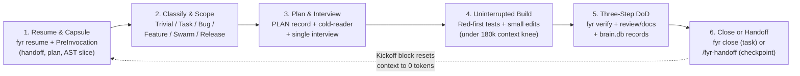
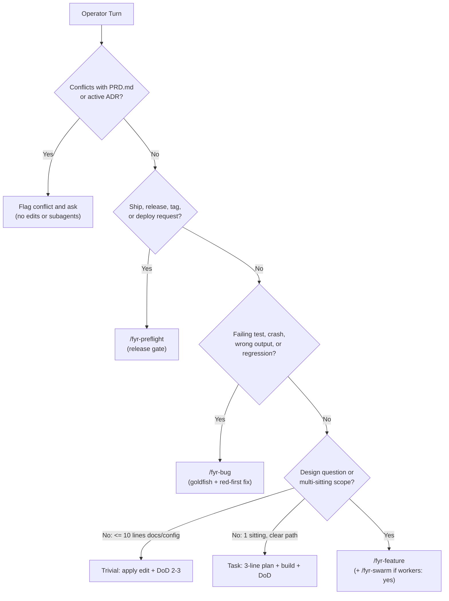
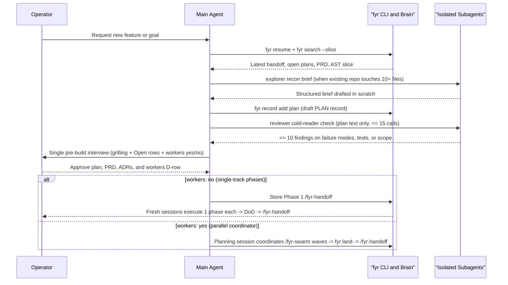
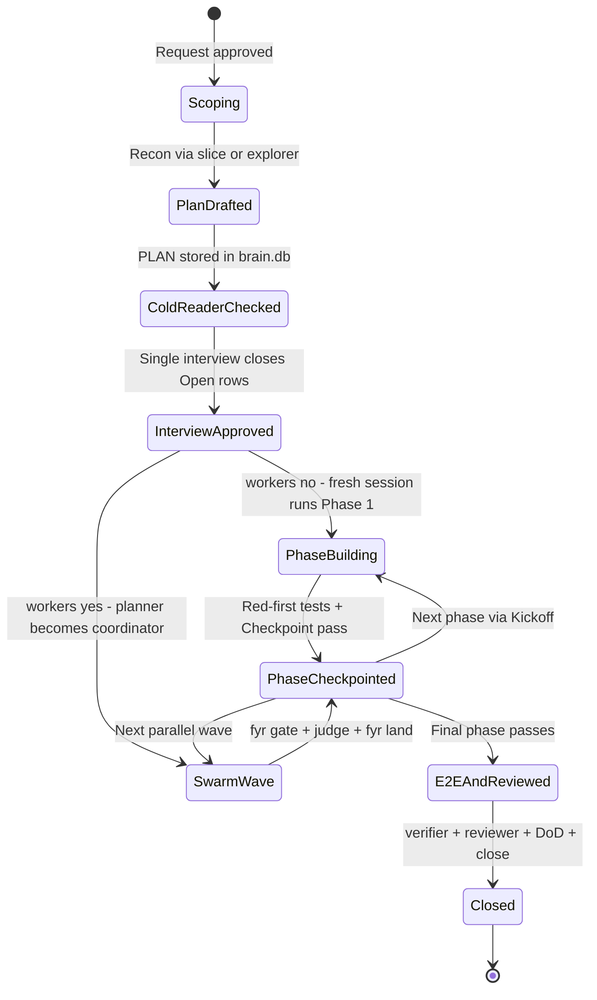
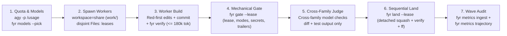
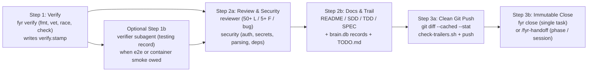

# Workflow — From Plan to Finish & Feature to Finish

`fyr` turns operator intent into verified, traceable commits across stateless Antigravity CLI sessions by separating **upfront design** from **uninterrupted execution** and closing every piece of work through deterministic verification, isolated review, and durable brain records. This guide explains the workflow's **goal**, **turn classification**, **plan-to-finish** lifecycle, **feature-to-finish** execution paths (single-track, parallel swarm, bug fixes, and releases), and step-by-step **Definition of Done (DoD)** alongside [`README.md`](README.md) and [`features/workflows-and-build-control.md`](features/workflows-and-build-control.md).

## 1. Goal & Operating Philosophy

Antigravity sessions start stateless and lose reasoning precision as prompt context expands past `180,000` input tokens (`rules/session-sizing.md`, tracked as `KNEE_EXCEEDED` by `fyr metrics trajectory`). The `fyr` workflow keeps sessions fast, repeatable, and resumable across machines by injecting compact Turn-0 context capsules, locking design decisions before edits start (`ADR-517`), isolating independent reviewers from builder intent, and enforcing completion through fail-closed CLI gates.



Five invariants govern every session in a `fyr`-managed repository:

| Invariant | Target / Rule | Why It Exists |
|---|---|---|
| **Session context ceiling** | `<= 180,000` input tokens per session (`rules/session-sizing.md`) | Prevents long-context degradation by sizing each session to `1` plan phase or `<= 3` small tasks (`<= 6` changed files, `<= 2` subagents) |
| **Decide once, build uninterrupted (`ADR-517`)** | Zero operator questions during build or handoff Kickoff execution | Resolves scope, interfaces, `PRD.md`, and `ADR` trade-offs in one pre-build interview so implementation runs autonomously |
| **Search and skeleton before reading** | `fyr search --slice` / `--affected` / `--path` / `--skeleton` / `--refs` | Cuts token waste; `PreToolUse` clamps unranged reads of `>= 400` lines and rejects duplicate reads whose SHA-256 has not changed |
| **Fail-open hooks, fail-closed gates** | `< 250 ms` hooks (`SessionStart`, `PreInvocation`, `PreToolUse`, `PostToolUse`, `Stop`) + hard CLI gates | Guides turns without stalling the CLI, while `fyr verify`, `fyr gate`, `fyr land`, `fyr close`, and `/fyr-preflight` enforce real checks |
| **Durable trail outside chat memory** | `~/.config/fyr/brain.db` (and on-demand `.agents/trail.jsonl`) + `metrics.db` | Preserves `plan`, `adr`, `bug`, `testing`, `review`, `change`, and `handoff` records across session compactions and machines |

## 2. Work Classification & Feature Routing

Every operator turn starts by classifying the request against current specs, architecture decisions, and blast radius (`context/AGENTS.md` § Work, `internal/search/vet.go`). Small copy edits ship immediately, whereas defect reports, multi-phase features, parallel work streams, and release requests each enter a tailored workflow track.



| Track | Scope & Trigger | Upfront Design | Verification & Review | Close Command |
|---|---|---|---|---|
| **Trivial** | `<= 10`-line docs, typo, dead code, formatter, or 1-line config | None | Self-check + `DoD 2-3` | `fyr record add handoff` (`fyr close` only if `fyr verify` also ran) |
| **Task** | Clear single-sitting change with no open interface/schema choice | 3-line plan in turn | `fyr verify` + `reviewer` if `50+` lines or `5+` files + `security` if sensitive | `fyr close` |
| **Bug (`/fyr-bug`)** | Any broken code behavior, regression, or non-trivial 1-line code fix | Problem note + `explorer` goldfish diagnosis | Red-first test + `fyr verify` + mandatory diff `reviewer` + `BUG-NNN` record | `fyr close` (or `/fyr-handoff` on multi-phase bug) |
| **Feature (`/fyr-feature`)** | New behavior, new surface, schema/interface decision, or `2+` phases | `PLAN-*` record + `reviewer` cold-reader check + single interview | Red-first tests per task + Checkpoint per phase + `verifier` e2e + `/fyr-review` | `/fyr-handoff` per phase; `fyr close` / `/fyr-handoff` at end |
| **Parallel Swarm (`/fyr-swarm`)** | `2+` AI-only phases (`workers: yes`) or backlog triage (`Files:` disjoint) | `PLAN-*` with unbulleted `files:`/`model:`/`base-check:`/`judge:`/`judge-model:` headers + `D-row` | Worker `fyr verify` + `fyr gate` + cross-family judge + sequential `fyr land` | Workers run worker-mode `/fyr-handoff`; coordinator runs `/fyr-handoff` |
| **Release (`/fyr-preflight`)** | Operator asks to ship, release, deploy, tag, or cut `vX.Y.Z` | Complete dirty-tree DoD first | `preflight_gate.py` (`reviewer` + `security` + `verifier`) + `fyr eval` + `VERDICT: SHIP` | Annotated tag `vX.Y.Z` + push + deploy + entry |

<details>
<summary>Complete feature routing table (rules/fyr-features.md)</summary>

| When | Use | Not |
|---|---|---|
| Code or record lookup | `fyr search --slice` / `--affected` / `--refs` / `--skeleton` | `grep`, whole-file reads |
| Session start | `fyr resume` | Reading root files one by one |
| New behaviour or design question | `/fyr-feature` | Building straight away |
| 2+ phases or independent tasks | `/fyr-swarm` | Sequential hand-execution |
| Choosing a model for any role | `fyr models --pick` (`--tier pro` / `flash`) | Hardcoded or guessed model IDs |
| Anything broken or failing | `/fyr-bug` | Patching straight away |
| Queue of issues, PRs, or Backlog | `/fyr-triage` then `/fyr-swarm` | Ad-hoc cherry-picking |
| Review or judgement needed | `reviewer` / `security` / `verifier` (`--judge` cross-family) | Unchecked self-review |
| Skill, rule, or agent changed | `fyr eval` on affected rows | Untested behavioural claims |
| Docs written or audited | `/fyr-docs` + `fyr check` | Dense prose walls |
| Phase or session end | `/fyr-handoff` | Ending silently |
| Idle consolidation or usage audit | `fyr report --md`, `fyr auto`, `fyr dream` | Leaving telemetry unread |

</details>

## 3. From Plan to Finish (The Planning & Session Lifecycle)

Non-trivial engineering work flows from `fyr resume` and AST reconnaissance through a stored `PLAN-*` record, an isolated cold-reader check, and a single pre-build interview that sets `workers: yes | no`. When `workers: no`, the planning session ends with Phase 1's Kickoff so each phase executes in a clean session; when `workers: yes` (default for `2+` AI-only phases), the planning session becomes the `/fyr-swarm` coordinator right away.



### The seven plan-to-finish stages

1. **Resume and Turn-0 capsule (`fyr resume`):** Run `fyr resume` at session start to inspect `AGENTS.md`, open records, the newest `handoff`, `TODO.md` `Now`, open plans, recent changes, and matching `semantic` memories (`validity >= 0.40`). In parallel, `PreInvocation` injects a compact Turn-0 AST slice and matches from `search.db` inside per-turn cryptographic fences (`=====<18-hex>=====`).
2. **Scope and reconnaissance:** Query `fyr search --slice`, `--affected`, `--path`, `--skeleton`, and `--refs` before opening source files. When the repository already has source files and scoping touches `10+` files across unread packages, dispatch `explorer` (`flash` model) to write `.agents/scratch/agents/<topic>-brief.md` and store it as a closed recon `plan` record (`Recon — <topic>`). Skip `explorer` on small scopes or empty repositories with no source yet.
3. **Draft the `PLAN-*` record:** Draft `.agents/scratch/plan-<slug>.md` with the required sections (`## Why`, `## Scope`, `## Surfaces touched`, `## Interfaces`, `## Failure modes`, `## Trust boundaries and data handled`, `## Verification`, `## Phases`, `## Risks`, `## Decisions`) and store it via `fyr record add plan`. Resolve worker `model:` and `judge-model:` headers via `fyr models --pick builder` and `fyr models --pick judge` (never invoke `agy models` directly here). If an interface, API, CLI, or storage contract exceeds one screen, author a `SPEC-*` record first via `/fyr-spec`.
4. **Isolated cold-reader check:** Dispatch `reviewer` once with the drafted plan text alone (never your intent or rationale), a `15`-tool-call budget, and a `<= 10`-item cap targeting missing failure modes, untestable steps (`verify:` / `expect:`), missing owners (`who:`), and scope bloat. Fold accepted fixes into `PLAN-*` with `fyr record edit <PLAN-ID>`.
5. **Single pre-build interview (`ADR-517` + `grilling`) & `workers` decision:** In one interactive interview, settle remaining `Open:` rows, approve any `PRD.md` changes (Must -> `ADR-*` -> `PRD.md` + `TODO.md`) and structural `ADR-*` records, and confirm `testing-strategy` tiers. Record the execution decision in `## Decisions` as `D<n> — <date> — workers: yes | no, <why> — by: planner`: plans with `2+` `who: AI` phases default to `workers: yes`, setting `workers: no` only with a concrete technical reason. Once approved:
   - If **`workers: no`**: write the closing `/fyr-handoff` with Phase 1's `## Kickoff` and stop so Phase 1 starts fresh under the `180,000`-token context limit.
   - If **`workers: yes`**: remain in the planning session and run Phase 1 immediately as the `/fyr-swarm` coordinator.
6. **Autonomous execution & mid-build unknowns (`D-row`s vs Closed Set):**
   - **Small implementation unknowns (`D-row`s):** When a reversible, non-structural detail surfaces mid-phase (such as test case bounds or internal helper layout), settle it without asking and append a column-0 dated `D-row` under `## Decisions` (`D<n> — YYYY-MM-DD — <decision> — by: implementer` or `by: lead`), never rewriting existing `D-row`s.
   - **Closed-set boundaries (never decided autonomously):** Items outside standing approvals are never settled via `D-row`s; instead defer them to the handoff's `Next Steps` (halting only on a critical blocker or unapproved change required right now): `who: user` tasks, unsettled `Open:` rows, unapproved `PRD.md` changes, new structural `ADR-*` records, releases (`/fyr-preflight`), production deploys (`DEPLOY-*`), real-home installs (in the `fyr` repository), and anything outside the repository.
7. **Phase checkpoint (`/fyr-handoff`):** After a phase's tasks pass, verify its `**Checkpoint:**` box (command, expected result, and observed evidence), tick `- [x]` in `PLAN-*`, record `change`, update `TODO.md`, commit and push, run `fyr metrics ingest` once, and store an immutable `HANDOFF-*` record ending with the fixed verbatim `## Kickoff` block.

<details>
<summary>PLAN-* record schema, column-0 worker headers, and verbatim Kickoff templates</summary>

### Standard `PLAN-*` record schema (`skills/fyr-feature/SKILL.md`)

```markdown
# Plan — <topic> (<YYYY-MM-DD>)

## Why
<1-3 sentences tying the work to PRD.md or user goal>

## Scope
- In scope: ...
- Non-goals: ...

## Surfaces touched
- `cmd/billing/`, `internal/billing/`

## Interfaces
<Signatures, CLI flags, schemas, or link to SPEC-<app>-<topic>>

## Failure modes
<Expected errors, timeouts, edge cases, fallback behavior>

## Trust boundaries and data handled
<Untrusted inputs, auth/authz, secret/path validation>

## Verification
<Tiers owed from GUIDE-testing / testing-strategy: unit, integration, e2e, eval>

## Phases

- [ ] Cold-reader check — <review record ID once run>

### Phase 1 — Core domain model and store (independent)
files: internal/billing/**
model: <id from fyr models --pick builder>
base-check: go test -race ./internal/billing/...
judge: Domain validation, idempotent writes, and error cases pass -race unit tests with zero relaxed assertions.
judge-model: <cross-family id from fyr models --pick judge>
- [ ] **Task 1.1:** Implement ledger validation and tests (verify: `go test -race ./internal/billing/...`, who: AI) — expect: PASS with -race
- [ ] **Checkpoint:** `go test -race ./...` — expect: exit 0 — evidence: <filled when checked>

### Phase 2 — HTTP endpoints and CLI wiring (after: Phase 1)
files: cmd/billing/**
model: <id from fyr models --pick builder>
base-check: go test -race ./cmd/billing/...
judge: Handlers enforce auth/validation and return expected HTTP status codes on valid and invalid payloads.
judge-model: <cross-family id from fyr models --pick judge>
- [ ] **Task 2.1:** Wire billing handlers and CLI subcommand (verify: `go test -race ./cmd/billing/...`, who: AI) — expect: PASS with -race
- [ ] **Checkpoint:** `fyr verify` — expect: PASS stamp written — evidence: <filled when checked>

## Risks
- ...

## Decisions
D1 — YYYY-MM-DD — workers: yes, two disjoint AI-only phases — by: planner
D2 — YYYY-MM-DD — Reject negative invoice amounts at handler boundary — by: implementer
```

### Standard `## Kickoff` block (verbatim fixed text from `skills/fyr-handoff/SKILL.md`)

```text
Project: <absolute repository path>. Run fyr resume (handoff <HANDOFF-ID>, plan <PLAN-ID>); do <phase name or task> only.
Files: <the phase's files: line, or omit when unrestricted>
Standing approvals (closed set): the phase's boxes marked who: AI and the tests they name; the checkpoint's change record, commit and push; the closing handoff. Never: a who: user box, an Open: row, a release, a deploy, a real-home install, anything outside this repository. Ask only outside the set or on a critical failure.
Done when: <exact pass check>. Then write the handoff with the next Kickoff and end the session.
```

### Worker-mode Kickoff blocks (dispatched by coordinator to parallel workers)

**With an active `PLAN-*` record:**

```text
Project: this clone, the current directory; never another checkout. Read AGENTS.md, then fyr record get <PLAN-ID>; do <phase name> of <PLAN-ID> only, as a worker.
Files: <the phase's files: line, verbatim>
Model: <the phase's model: line's value, trimmed; the line left out when the phase has none>
Standing approvals (closed set): the phase's boxes marked who: AI and the tests they name; the change record; commit on the current branch work/<short>-<phase>[-r2]; the closing handoff.
Never: push; tick the plan record or TODO.md; store a record of any kind but the change record and the closing handoff (draft it under .agents/scratch/agents/ and name the draft in the handoff); merge; touch main; a who: user box; an Open: row; a release; a deploy; a real-home install; fyr metrics ingest; anything outside the files named.
Done when: <the phase's Checkpoint expect, verbatim>. Where Done when names an item under Never, Never wins: name it in the handoff for the coordinator. Then write the handoff and end.
```

**Task wave without a `PLAN-*` record:**

```text
Project: this clone, the current directory; never another checkout. Read AGENTS.md; do this task only, as a worker, with no plan: <the task, one line>.
Files: <the task's Files: from the coordinator's table>
Model: <the task's model ID from the coordinator's table>
Standing approvals (closed set): the task and the tests Done when names; the change record; commit on the current branch work/<name>[-r2]; the closing handoff.
Never: push; tick a plan record or TODO.md; store a record of any kind but the change record and the closing handoff (draft it under .agents/scratch/agents/ and name the draft in the handoff); merge; touch main; a design question (stop and name it in the handoff); a release; a deploy; a real-home install; fyr metrics ingest; anything outside the files named.
Done when: <the task's Done when from the coordinator's table>. Where Done when names an item under Never, Never wins: name it in the handoff for the coordinator. Then write the handoff and end.
```

</details>

## 4. From Feature to Finish (Single-Track, Parallel Swarm, Bugs & Releases)

Once a `PLAN-*` record clears its cold-reader review and pre-build interview, `/fyr-feature` drives red-first code delivery through either single-track phase loops or parallel `/fyr-swarm` worker waves until end-to-end verification, multi-lens review, and DoD close the feature. Defect fixes (`/fyr-bug`) and releases (`/fyr-preflight`) run specialized variants of the same state pipeline.



### 4.1 Single-track phase execution (`/fyr-feature` Step 4)

For single-track phases (`workers: no`, `1`–`6` tightly coupled files), each fresh session executes one phase strictly in order:

1. **Write the failing test first (`review-standards` § 2, § 8):** Add a unit or integration test reproducing the target behavior (and both `must-pass` and `must-fail` inputs for validators or checks) and confirm it fails for the expected reason before editing implementation files.
2. **Implement the smallest passing change:** Write cohesive Go/TS modules obeying `rules/code-modularity.md` and `codebase-design` without speculative abstractions or unrelated refactors.
3. **Run task verification and tick `PLAN-*`:** Execute the task's `verify:` command and immediately update `- [x]` on `PLAN-*` via `fyr record edit <PLAN-ID>` so progress survives interruptions.
4. **Verify phase checkpoint:** Run the bare full test suite (`fyr verify`), verify the phase's `**Checkpoint:**` criteria (`— expect:` + `— evidence:`), store the `change` record, update `TODO.md`, and run `/fyr-handoff` if more phases remain (or proceed to E2E + multi-lens review on the final phase).

### 4.2 Multi-agent parallel swarm (`/fyr-swarm`)

When a plan has `2+` AI-only phases (`workers: yes`) or backlog triage produces disjoint work slices, the coordinator orchestrates parallel execution via `/fyr-swarm` (`rules/agy-dispatch.md`, `internal/gate`):



- **Width-based orchestration (`fyr-swarm`):** Route width `<= 2` independent slices through `invoke_subagent`; route width `>= 3` through `run_workflow` (`parallel()` / `pipeline()`) or Antigravity native `swarm` (`workspace="share"`).
- **Model selection & `PreToolUse` enforcement:** Pick builder and cross-family judge IDs once via `fyr models --pick` against `~/.config/fyr/models.json` (and `agy -p "/usage"` quota pools, falling back to equivalent-tier Gemini models when weekly quota `< 20%` or 5-hour quota `< 30%`). At dispatch time, `PreToolUse` validates prefix-named workers (`planner`, `builder`, `mechanical` vs `judge`, `reviewer`, `verifier`) and rejects weak/fast overrides on guarded roles.
- **Write leases (`Files:`):** Every worker brief declares exact writable path globs. `fyr gate` mechanically rejects diffs touching files outside the lease, forbidden `120000` (symlink) or `160000` (gitlink) modes, numstat spikes (default `50` files / `1,500` lines), secret filenames or added-line secrets (`internal/redact`), and commit trailers.
- **Cross-family judging, sequential landing & wave telemetry:** Workers commit locally on `work/<name>`, write worker-mode `change` + `handoff` drafts without pushing or editing `TODO.md`, and face an isolated cross-family judge reading only diff and test output. The coordinator then runs `fyr land --lease <glob> <branch>` one branch at a time (squashing and running `fyr verify` inside an isolated detached scratch worktree before fast-forwarding `main`, deleting the branch, and refreshing `.agents/scratch/verify.stamp`), followed by `fyr metrics ingest` and `fyr metrics trajectory` to confirm sessions stayed under the `180,000`-token knee.

### 4.3 Specialized finish paths: bugs (`/fyr-bug`) and releases (`/fyr-preflight`)

- **Bug-to-Finish (`/fyr-bug`):** Replaces upfront feature interviews with a **Problem note** -> `bug` record & AST call-graph lookup (`fyr search --slice` / `--affected` / `--path`) -> blind **goldfish diagnosis** (`explorer` receives only symptom and repro, never your hypothesis) -> **failing test first** -> **smallest fix** across every call site matching a class defect -> mandatory `reviewer` diff inspection -> `BUG-NNN` record capturing root cause, `path:start-end (Symbol)`, and a concrete **prevention rule** (`fixed`, or `graduated` once encoded in tests or rules).
- **Release-to-Finish (`/fyr-preflight`):** Triggered only by the operator's direct turn (`"ship it"`, `"release"`, `"cut vX.Y.Z"`). Completes DoD on any dirty work first, then dispatches `workflows/preflight_gate.py` (`reviewer` `--code --docs`, `security`, and `verifier` on the strongest model) plus trail/docs freshness checks and changed-row `fyr eval` suites. Writes a `PREFLIGHT-*` `review` record ending in `VERDICT: SHIP` or `VERDICT: NO-SHIP`. Only on `SHIP` does it write `RELEASE NOTES`, bump tracked versions, verify secret scans and `check-trailers.sh`, create an unsigned annotated tag (`git tag -a <tag> -m "<tag>"`), push, upload checksum-verified assets, and execute documented `DEPLOY-*` steps with rollback protection.

## 5. Definition of Done (DoD) — Step by Step

No task, bug fix, phase, or feature counts as done until it clears the three ordered Definition of Done steps in `context/AGENTS.md`: **Step 1 (Verify)**, **Step 2 (Review, Docs & Trail)**, and **Step 3 (Close)**. Execute these steps in order—fixing review findings before stamping verification and closing—so every shipped commit carries matching tests, clean docs, and an accurate trail.



### Step 1: Verify (`fyr verify` & `verifier`)

1. **Deterministic repository gate (`fyr verify`):** Run `fyr verify` with no flags after final edits. It verifies formatting (`gofmt -l`), static analysis (`go vet ./...`), race-enabled tests (`go test -race ./...`), and documentation/spec/requirement parity (`fyr check`), confirms no Go files mutated mid-run, and writes `.agents/scratch/verify.stamp` (`0600`) tied to the Go tree SHA-256. If Go files change without a fresh matching stamp, the `Stop` hook emits a `[VERIFY_STAMP]` continuation reminder.
   - *Explicit operator override:* If the operator explicitly instructs a narrower test command (such as running `go test ./...` once), run `gofmt -l .`, `go vet ./...`, and that exact test command without forcing `fyr verify` or `fyr check`.
2. **End-to-end & container verification (`verifier` subagent):** Dispatch `verifier` only when browser e2e (Playwright against the running binary), container build/smoke (`docker build`, `docker run`, `/healthz`), or live local HTTP smoke (`DEPLOY-local`) is owed per `GUIDE-testing` / `testing-strategy`. Store its output artifact via `fyr record add testing`.

### Step 2: Review, Docs & Trail Records

1. **Independent review (`reviewer` & `security`):**
   - Dispatch `reviewer` (passing the diff only, never intent) once per task when the diff reaches `50+` lines, touches `5+` files, or fixes a bug (`/fyr-bug`). Add `--docs` whenever interfaces, CLI commands, or deploy paths change; for multi-lens `/fyr-review` sweeps, run `workflows/review_parallel.py`. Smaller diffs get a documented self-review inside the `change` record.
   - Dispatch `security` regardless of diff size whenever a changed path touches authentication, cryptography, secrets, IAM, input parsing, frontmatter/tool allowlists, or dependencies.
   - Store review drafts via `fyr record add review`. Fix confirmed issues (adding failing-first tests for every security trigger, capped at `2` rounds) or document reasoned rebuttals/defers in an appended `## Outcome` section on the review record (`fyr record edit <ID>`).
2. **Living documentation (`<= 30` lines self / `> 30` lines `documentation`):** Update `README.md`, `SDD.md`, `TDD.md`, `SPEC-*`, `GUIDE-*`, or `DEPLOY-*` only when behavior, interfaces, active plans, or deploy paths change. Run `bash ~/.gemini/config/skills/fyr-review/scripts/restatement-grep.sh` on changed claims so no stale copies remain; dispatch `documentation` (passing `fyr search --refs <path>` output) for edits over `30` lines.
3. **Trail records & `TODO.md` synchronization:** Draft record bodies under `.agents/scratch/` and commit them to `brain.db`:
   - `change` (`fyr record add change`): record commit hash, modified `path:start-end (Symbol)` ranges, checks run, and agents dispatched (never rewrite existing `change` or `adr` records).
   - `adr` (`fyr record add adr`) on structural decisions; `bug` (`fyr record add bug` or `fyr record edit <ID> --status fixed|graduated`) on escaped failures.
   - `plan` (`fyr record edit <ID>`): tick completed tasks/checkpoints or mark closed when all phases finish.
   - `TODO.md`: keep `Now`, `Next` (`<= 3` items), and `Backlog` synchronized with active work.
   - Run `fyr git-check` after any write-capable subagent dispatch to confirm no unexpected dirty files, unpushed commits, or tags exist.

### Step 3: Close (`fyr close` vs `/fyr-handoff`)

1. **Stage, check secrets & trailers, commit, and push:** Inspect `git diff --numstat`, stage files explicitly by name after reviewing `git diff --cached --stat` (never `git add -A`), abort immediately if any secret file appears (`.env*`, `*.pem`, `*.key`, `*.tfvars`, `*.tfstate`), commit using local `git config` identity with zero trailers, verify `bash ~/.gemini/config/skills/fyr-handoff/scripts/check-trailers.sh` passes, and run `git push` (respecting any explicit no-commit or no-push instruction).
2. **Record the closure cleanly:**
   - **Single self-contained task -> `fyr close`:** When finishing one task with a valid `.agents/scratch/verify.stamp`, run `fyr close --id <ID> --title <title> --body-file <path>` (or `fyr record add handoff` when Trivial DoD or an explicit test override skipped `verify.stamp`). `fyr close` checks that `verify.stamp` matches the current Go source tree, appends an immutable `HANDOFF-*` record embedding `## Verification Digest`, preserves prior records, and skips `/fyr-handoff` and `fyr metrics ingest`.
   - **Phase checkpoint, context limit, or multi-session pause -> `/fyr-handoff`:** Run `/fyr-handoff` to audit trail parity first, write a `HANDOFF-*` record with the verbatim `## Kickoff` block, pass its 6-question cold-reader self-check, commit, push, and run `fyr metrics ingest` once so `metrics.db` captures the completed session shape (workers running worker-mode `/fyr-handoff` commit locally without pushing, ticking `TODO.md`, or ingesting metrics).

<details>
<summary>Definition of Done checklist & gate ownership matrix</summary>

| DoD Step | Gate / Action | Trigger Condition | Owner | Proof / Artifact |
|---|---|---|---|---|
| **1a** | `fyr verify` | Every standard task/phase/feature completion | Main agent | `.agents/scratch/verify.stamp` (`0600`) |
| **1b** | Targeted `gofmt` + `go vet` + test override | Operator explicitly specifies a test override | Main agent | Terminal pass output |
| **1c** | `verifier` subagent | Browser e2e, container smoke, or live HTTP smoke owed | `verifier` | `TESTING-*` record (`PASS`) |
| **2a** | `reviewer` (`--code` / `--docs`) | `50+` lines, `5+` files, or `/fyr-bug` fix (`--docs` if interfaces/CLI/deploy changed) | `reviewer` | `REVIEW-*` record (+ `## Outcome` if fixed) |
| **2b** | `security` subagent | Changed path touches auth, crypto, secrets, IAM, parsing, allowlists, or deps | `security` | `REVIEW-*` record (max 2 rounds) |
| **2c** | Living docs update | Behavior, interface, plan, or deploy path changed | Main (`<= 30` L) or `documentation` (`> 30` L) | Updated docs + `fyr check` `0` findings |
| **2d** | `fyr git-check` | Any write-capable subagent or workflow ran | Main agent | Clean git status, branches, and tags |
| **2e** | `brain.db` + `TODO.md` sync | Every task/phase/feature | Main agent | `CHANGE-*`, ticked `PLAN-*`, optional `ADR-*`/`BUG-*`, synced `TODO.md` |
| **3a** | Explicit stage + `check-trailers.sh` + push | Clean tracked diff ready to land | Main agent | Committed SHA on `origin/main`, zero trailers |
| **3b** | `fyr close` / `record add handoff` / `/fyr-handoff` | `fyr close` (single task with stamp); `fyr record add handoff` (no stamp); `/fyr-handoff` (checkpoints/session end) | Main agent | Immutable `HANDOFF-*` record (plus `metrics.db` ingest on standard `/fyr-handoff`) |

</details>
