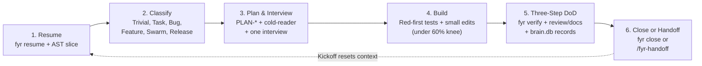
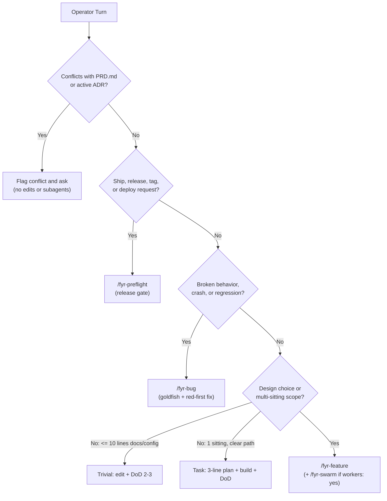
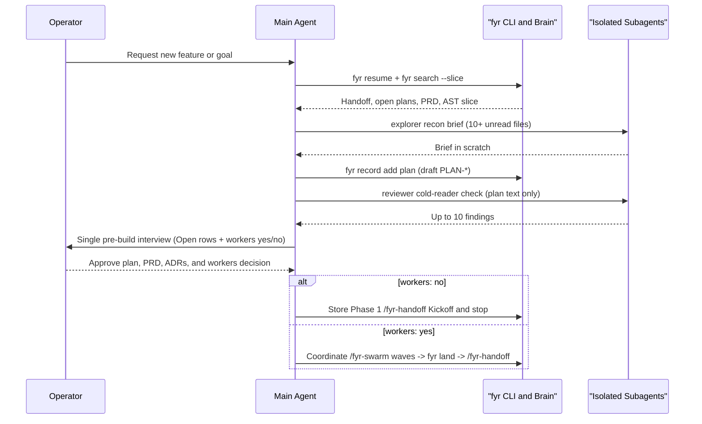
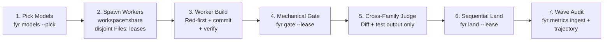
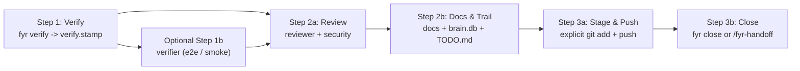

# Workflow — Plan to Finish & Feature to Finish

This guide covers the `fyr` engineering lifecycle from session start to verified close. It separates upfront design from uninterrupted execution through deterministic gates. See [`README.md`](README.md) for setup, [`docs/cli-reference.md`](docs/cli-reference.md) for flags, [`docs/glossary.md`](docs/glossary.md) for terms, and [`features/workflows-and-build-control.md`](features/workflows-and-build-control.md) for internals.

## 1. Operating Rules

Antigravity sessions start stateless and degrade past `60%` of each model's context budget (`TokenKnee`). `fyr` keeps sessions focused, repeatable, and traceable across machines.

| Rule | Target | Purpose |
|---|---|---|
| **Stay under `TokenKnee`** | `<= 60%` model context ([`rules/session-sizing.md`](rules/session-sizing.md)) | Size each session to one phase or `<= 3` small tasks |
| **Decide once, build clean** | Zero mid-build questions (`[KICKOFF_GUARD]`) | Settle scope, `PRD.md`, and `ADR-*` choices before edits |
| **Search before reading** | `fyr search --slice` / `--contracts` / `--affected` / `--skeleton` | Cut token waste; hooks clamp unranged reads over `400` lines |
| **Fail-open hooks, hard gates** | `< 250 ms` hooks + `verify` / `gate` / `land` / `close` | Guide turns without stalls while blocking bad commits |
| **Keep state outside chat** | `~/.config/fyr/brain.db` and `metrics.db` | Preserve `plan`, `adr`, `bug`, `testing`, `review`, `change`, `handoff` |

## 2. Classify the Work

Check every operator turn for `PRD.md` or `ADR-*` conflicts first, then select the matching workflow track. See [`rules/fyr-features.md`](rules/fyr-features.md) for the trigger routing table.

| Track | Trigger | Design | Checks & Review | Close |
|---|---|---|---|---|
| **Trivial** | `<= 10` lines of docs, typo, or config | None | Self-check + DoD 2–3 | `fyr record add handoff` |
| **Task** | Clear single-sitting change | 3-line plan | `fyr verify` + `reviewer` (`50+` L / `5+` F) + `security` | `fyr close` |
| **Bug** (`/fyr-bug`) | Broken behavior or regression | Problem note + `explorer` | Red-first test + `fyr verify` + `reviewer` + `BUG-*` | `fyr close` or `/fyr-handoff` |
| **Feature** (`/fyr-feature`) | New surface, schema, or `2+` phases | `PLAN-*` + cold-reader + interview | Red-first + Checkpoint + `verifier` + `/fyr-review` | `/fyr-handoff` per phase |
| **Swarm** (`/fyr-swarm`) | `2+` disjoint AI slices (`workers: yes`) | `PLAN-*` with `files:`/`judge:` | Worker verify + `fyr gate` + judge + `fyr land` | Worker + coordinator handoff |
| **Release** (`/fyr-preflight`) | Direct ship, tag, or deploy turn | Finish dirty-tree DoD first | `workflows/preflight_gate.py` + `fyr eval` + `SHIP` | Annotated tag, push, deploy |

## 3. Plan to Finish

Non-trivial work moves from `fyr resume` through a stored `PLAN-*` record, an isolated cold-reader check, and one pre-build interview. Read [`skills/fyr-feature/SKILL.md`](skills/fyr-feature/SKILL.md) for the `PLAN-*` schema and worker headers, and [`skills/fyr-handoff/SKILL.md`](skills/fyr-handoff/SKILL.md) for verbatim `## Kickoff` templates.

Follow these seven steps in order:

1. **Run `fyr resume`:** Load `AGENTS.md`, open records, the newest handoff, `TODO.md`, open plans, and memory.
2. **Search before opening files:** Query `fyr search --slice`, `--contracts`, `--affected`, and `--skeleton`. If scope spans `10+` unread files, dispatch `explorer` and save its brief as a closed recon plan.
3. **Draft `PLAN-*`:** Write the plan in `.agents/scratch/` per [`skills/fyr-feature/SKILL.md`](skills/fyr-feature/SKILL.md) and store it with `fyr record add plan`. Pick worker and judge models with `fyr models --pick`. If a surface exceeds one screen, author a `SPEC-*` record via `/fyr-spec` first.
4. **Run a cold-reader check:** Dispatch `reviewer` once with plan text only (`<= 15` tool calls, `<= 10` findings). Apply accepted fixes with `fyr record edit`.
5. **Hold one pre-build interview:** Settle `Open:` rows, approve `PRD.md` or `ADR-*` updates, confirm test tiers, and record `workers: yes | no`. Plans with `2+` AI-only phases default to `workers: yes`.
   - If `workers: no`, store Phase 1's `/fyr-handoff` with a verbatim `## Kickoff` block and stop.
   - If `workers: yes`, stay in the session and launch Wave 1 as the `/fyr-swarm` coordinator.
6. **Build autonomously within boundaries:**
   - When a minor choice arises mid-phase, decide it and append a `D-row` (`by: implementer`) under `## Decisions`.
   - Defer closed-set items to `Next Steps` (`who: user`, `Open:` rows, unapproved `PRD.md`, releases, deploys, or real-home installs).
7. **Checkpoint the phase:** Confirm the phase `**Checkpoint:**` check, tick `PLAN-*`, log `change`, update `TODO.md`, commit, push, and run `/fyr-handoff`. Copy verbatim `## Kickoff` blocks from [`skills/fyr-handoff/SKILL.md`](skills/fyr-handoff/SKILL.md).

## 4. Feature to Finish

After interview approval, run phases sequentially (`workers: no`) or in parallel swarm waves (`workers: yes`) until verification, review, and DoD close the feature.

### 4.1 Single-track phases (`workers: no`)

Use single-track execution for tightly coupled edits (`1`–`6` files), one phase per fresh session:

1. **Write a failing test first:** Reproduce the behavior, including must-pass and must-fail cases for validators or guards. Confirm it fails as expected.
2. **Make the smallest passing edit:** Follow [`rules/code-modularity.md`](rules/code-modularity.md) and skip unrelated refactors.
3. **Verify and tick progress:** Run the task's `verify:` check and tick `- [x]` in `PLAN-*` with `fyr record edit`.
4. **Close the phase:** Run `fyr verify`, record `change`, update `TODO.md`, and run `/fyr-handoff` when phases remain.

### 4.2 Parallel swarm (`workers: yes`)

Use `/fyr-swarm` ([`skills/fyr-swarm/SKILL.md`](skills/fyr-swarm/SKILL.md), [`rules/agy-dispatch.md`](rules/agy-dispatch.md)) for `2+` AI-only slices with disjoint `Files:` leases.

1. **Pick models once:** Run `fyr models --pick builder` and `fyr models --pick judge`. `PreToolUse` blocks weak overrides on guarded roles.
2. **Assign disjoint write leases:** Declare exact `Files:` globs per slice. Dispatch `builder` ([`agents/builder/agent.md`](agents/builder/agent.md)) for `<= 2` slices, or run [`workflows/phase_loop.py`](workflows/phase_loop.py) / native `swarm` for `>= 3` slices.
3. **Gate worker branches:** Workers commit on `work/<slice>`, detach `HEAD`, and never push or touch `main`. Run `fyr gate` to reject out-of-lease files, forbidden modes, numstat spikes, secrets, and trailers.
4. **Judge across families:** Give a cross-family judge only the diff and test output. Route defect packets back to the same worker for at most `2` rounds.
5. **Land sequentially and audit:** Run `fyr land` one branch at a time. Each land squash-verifies in a detached worktree, fast-forwards `main`, deletes the branch, and refreshes `verify.stamp`. Finish with `fyr metrics ingest` and `fyr metrics trajectory`.

### 4.3 Bugs and releases

- **Bug to finish (`/fyr-bug`):** Follow [`skills/fyr-bug/SKILL.md`](skills/fyr-bug/SKILL.md). Write a Problem note, query `fyr search --slice` and `--affected`, and run blind `explorer` diagnosis without sharing your hypothesis. Add a failing test, apply the smallest fix across matching call sites, run diff `reviewer`, and store a `BUG-*` record.
- **Release to finish (`/fyr-preflight`):** Follow [`skills/fyr-preflight/SKILL.md`](skills/fyr-preflight/SKILL.md) on a direct operator turn only. Complete dirty-tree DoD first, then run [`workflows/preflight_gate.py`](workflows/preflight_gate.py) and affected `fyr eval` rows. On `VERDICT: SHIP`, create an unsigned annotated tag, push, publish checksum-verified assets, and run `DEPLOY-*` steps.

## 5. Definition of Done (DoD)

Every task, bug fix, phase, or feature clears three ordered steps before closing. Fix review findings before stamping verification and pushing.

### Step 1: Verify

1. **Run `fyr verify`:** Execute `fyr verify` with no flags after final edits. It runs `gofmt`, `go vet ./...`, `go test -race ./...`, and `fyr check`, then writes `.agents/scratch/verify.stamp`.
2. **Honor explicit test overrides:** When the operator requests one narrower test command, run `gofmt -l .`, `go vet ./...`, and that command.
3. **Dispatch `verifier` only when owed:** Run `verifier` for browser e2e, container smoke, or live HTTP smoke. Store its report with `fyr record add testing`.

### Step 2: Review, Docs, and Trail

1. **Dispatch `reviewer`:** Pass the diff only when changes reach `50+` lines, touch `5+` files, or fix a bug. Add `--docs` for interface, CLI, or deploy changes, or run [`workflows/review_parallel.py`](workflows/review_parallel.py) for multi-lens sweeps.
2. **Dispatch `security`:** Run `security` on any diff touching auth, crypto, credentials, IAM, parsing, allowlists, or dependencies. Fix confirmed issues (max `2` rounds) and log outcomes on the `review` record.
3. **Update living docs:** Edit Track 1 docs (`README.md`, `SDD.md`, `TDD.md`, `Workflow.md`, `features/`) and `brain.db` specs/guides only when behavior changes. Handle `<= 30`-line edits directly; dispatch `documentation` for larger edits.
4. **Sync trail and `TODO.md`:** Record `change` and any `adr` or `bug` (never rewrite `change` or `adr`). Tick `PLAN-*`, sync `TODO.md`, and run `fyr git-check` after write subagents.

### Step 3: Close

1. **Export, stage, commit, and push:** If `.agents/trail.jsonl` is tracked, run `fyr record export` first. Inspect `git diff --numstat` and `git diff --cached --stat`, then stage files by name (never `git add -A`). Abort on credential files (`.env*`, `*.pem`, `*.key`, `*.tfvars`, `*.tfstate`), commit with zero trailers, and push.
2. **Choose the close command:**
   - **Single self-contained task:** Run `fyr close --title <title> --body-file <path>` when `.agents/scratch/verify.stamp` is fresh. If `verify.stamp` was skipped on a Trivial edit or test override, run `fyr record add handoff`.
   - **Phase checkpoint, `TokenKnee`, or pause:** Run `/fyr-handoff` to audit trail parity and write `HANDOFF-*` with a verbatim `## Kickoff`. Commit, push, and run `fyr metrics ingest` once.

### DoD Ownership Matrix

| Step | Action | Trigger | Owner | Artifact |
|---|---|---|---|---|
| **1a** | `fyr verify` | Standard task, phase, or feature | Main agent | `.agents/scratch/verify.stamp` |
| **1b** | `verifier` | Browser e2e, container, or HTTP smoke owed | `verifier` | `TESTING-*` record |
| **2a** | `reviewer` | `50+` lines, `5+` files, or `/fyr-bug` fix | `reviewer` | `REVIEW-*` record |
| **2b** | `security` | Auth, crypto, credentials, IAM, parsing, allowlists, deps | `security` | `REVIEW-*` record |
| **2c** | Living docs + `fyr check` | Behavior, interface, plan, or deploy changed | Main (`<= 30` L) / `documentation` | Updated docs (`0` findings) |
| **2d** | `fyr git-check` + trail | After write subagents and before commit | Main agent | `CHANGE-*`, `PLAN-*`, `TODO.md` |
| **3a** | Stage, check trailers, push | Clean tracked diff ready to land | Main agent | Zero-trailer remote commit |
| **3b** | `fyr close` / `/fyr-handoff` | Single task (`close`) or checkpoint (`handoff`) | Main agent | Immutable `HANDOFF-*` record |
