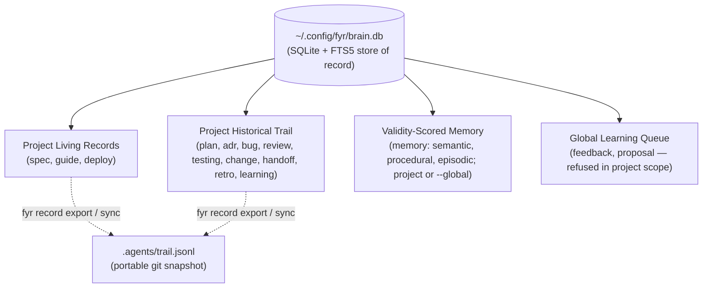
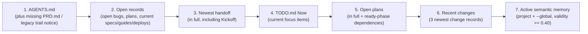
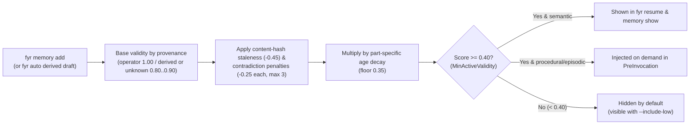

# Brain Store, Trail Records & Validity-Scored Memory

`fyr` stores every project's engineering history (`plan`, `adr`, `bug`, `change`, `handoff`, `spec`, `guide`, `deploy`, and more) and multi-part memory cards inside `~/.config/fyr/brain.db` (`internal/brain`), keeping your git working tree clean while preserving full session continuity. Records are immutable or explicitly transitioned, searchable via SQLite FTS5, and portable across machines on demand through `.agents/trail.jsonl`.

## Brain store architecture

Every record belongs either to a git repository scope (shared across all linked worktrees of that repository via `trail.Roots`) or to the `--global` scope (`internal/brain/record.go`). Records are never deleted; instead, obsolete specs retire, fixed bugs graduate into tests or rules, and stale memories expire behind validity scoring.

Five core boundaries keep the store clean and reliable:

1. **Global-only separation:** `feedback` and `proposal` records are allowed only with `--global` (`R8`) so local machine corrections and background asks never leak into project checkouts.
2. **Unexported local kinds:** `memory`, `feedback`, and `proposal` rows never reach `.agents/trail.jsonl` when you run `fyr record export` (`R4`, `R7`).
3. **One-call writes & file-era detection:** Both `fyr record add` and `fyr memory add` accept leading `Title:` / `Status:` / `ID:` / `Project:` (or `Type:` / `Name:` / `Description:` / `Provenance:`) headers on `stdin`, `--body-file FILE`, or `--json-in` (`internal/brain/stdin_doc.go`) so writes require a single command without temporary shell files, and `unmigratedDocsDir` (`internal/brain/brain_session.go`) flags a legacy project docs tree only when actual file-era trail records (`PLAN-*`, `ADR-*`, `BUG-*`, `CHANGE-*`, `HANDOFF-*`) exist without `.agents/trail.jsonl` (avoiding false refusals on ordinary `docs/` folders). Under PRD R7, single-handoff closes treat `change` records as optional.
4. **Canonical `repo_id`, portable memory & isolated SIM ledger (`brain.db` v5):** Records carry normalized `repo_id` (`NormalizeRepoID`, v4) for project scoping, migration 5 (`ADR-533`, `SPEC-fyr-sim`) adds the global optimizer SIM ledger (`sim_problems`, `sim_aliases`, `sim_attempts`, `sim_fts`, strictly isolated from `fyr resume`, `fyr memory show`, hooks, and `.agents/trail.jsonl`), and `fyr state export|import --include-memory` (`ADR-531`, `ADR-533`, `ADR-534`) optionally bundles `memory` records and `sim_ledger.ndjson` across hosts.
5. **Per-scope read-only spec reads (`ADR-536`):** `ListCurrentSpecsCtx` (`internal/brain/turn_specs.go`) reads current `SPEC-*` rows read-only per repository scope. It falls back to tracked `.agents/trail.jsonl` only when `brain.db` holds no `spec` rows for that scope.

## Seven-step session resume

`fyr resume [--json]` (`internal/brain/resume.go`) prints a deterministic, read-only snapshot of a repository's current state in one command without creating or mutating `brain.db`. When `brain.db` has no records for a freshly cloned checkout, `fyr resume` falls back automatically to `.agents/trail.jsonl`.

For multi-phase plans using `Depends on:` headings (`internal/brain/resume.go`), `fyr resume` parses checked and unchecked phase boxes (`ReadyPhasesLine`) and lists exactly which phases are unblocked and ready to run.

## Multi-part validity-scored memory

`fyr` models project and cross-project (`--global`) memory across three typed parts—`semantic` (facts, architecture, constraints), `procedural` (rules, workflows, gotchas), and `episodic` (session incidents, experiments)—and scores each card deterministically between `0.00` and `1.00` using a calibrated validity curve in `internal/brain/validity.go`.

Every `memory` record tracks `provenance` (`operator`, `derived`, or `unknown`), `memory_kind` (`semantic`, `procedural`, or `episodic`), `verified_at`, `evidence_count` (corroborating sessions adding `+0.05` each up to `2` for a `0.90` cap), and `source_sessions` (`internal/brain/record.go`):

- **Symmetric operator vs derived trust & immutability:** Direct `fyr memory add` calls default to `provenance: operator` (`1.00` base validity), which is symmetrically guarded against automatic overwrite, retirement, superseding, or downgrade across `fyr memory add` (`internal/brain/memory.go`), `MemoryDraftWithOptions` (`internal/brain/memory_draft.go`), `fyr state import`, and the SIM ledger. Automated `fyr auto` drafts store `provenance: derived` (`0.80` base validity, rising to `0.90` with `2` corroborating sessions) and cap `Prior:` chains at `<= 2` compacted bullets (`memory_draft_prior.go`).
- **Content-hash staleness (`[STALE]`) and calibrated contradictions:** `MemoryStalenessTag` (`internal/brain/resume_memory.go`) emits `[STALE: <path> modified since <ID>]` and applies `-0.45` strictly when a file's SHA-256 content no longer matches its pinned digest (`appendRepoFilePins`; mtime-only touches incur zero penalty), while `CountMemoryContradictions` detects newer `FEEDBACK-*` records matching the card's slug or keywords (`-0.25` per contradiction, capped at `3`), before applying part-specific age decay (`180d` semantic / `90d` procedural / `30d` episodic) bounded by a `0.35` floor.
- **On-demand progressive loading:** `fyr resume` prints only active `semantic` cards (`>= 0.40`), `fyr memory show --limit N` caps returned cards, and `PreInvocation` injects matching `procedural`, `episodic`, and `--global` cards only when the current prompt's query or files match them.

All 15 record kinds, valid statuses, and CLI flag reference

### The 15 record kinds

| Kind | ID Prefix | Scope | Exported in `trail.jsonl` | Valid Statuses (default first) |
|---|---|---|---|---|
| `plan` | `PLAN-` | Project | Yes | `open`, `closed` (derived from unticked `- [ ]` boxes) |
| `bug` | `BUG-NNN` | Project | Yes | `open`, `fixed`, `accepted`, `obsolete`, `graduated` |
| `adr` | `ADR-NNN[a-z]` | Project | Yes | `accepted`, `superseded:ADR-NNN` |
| `spec` | `SPEC-` | Project | Yes | `current`, `retired` |
| `guide` | `GUIDE-` | Project | Yes | `current`, `retired` |
| `deploy` | `DEPLOY-` | Project | Yes | `current`, `retired` |
| `handoff` | `HANDOFF-` | Project | Yes | `""` (empty; newest is live) |
| `change` | `CHANGE-` | Project | Yes | `closed` |
| `testing` | `TEST-` | Project | Yes | `closed` |
| `review` | `REVIEW-` | Project | Yes | `closed` |
| `retro` | `RETRO-` | Project | Yes | `closed` |
| `learning` | `LEARNING-` | Project | Yes | `closed` |
| `memory` | `MEMORY-` | Project or `--global` | No | `closed`, `retired` |
| `feedback` | `FEEDBACK-` | `--global` only | No | `closed` |
| `proposal` | `PROPOSAL-` | `--global` only | No | `queued`, `rejected`, `applied:<commit>` |

### `fyr record` and `fyr memory` commands

| Command | Flags | Purpose |
|---|---|---|
| `fyr record add <kind>` | `--title T`, `--title-file FILE`, `--status S`, `--id ID`, `--body-file FILE`, `--json-in`, `--global`, `--project ROOT` | Add a new record from `stdin`, file, or JSON |
| `fyr record get <id>...` | `--out FILE`, `--json`, `--global` | Print records or write one body under `.agents/scratch/` |
| `fyr record edit <id>` | `--status S`, `--title T`, `--body`, `--body-file FILE`, `--json-in`, `--global` | Update status, title, or body (`--body` reads `stdin`) |
| `fyr record list` | `--kind K`, `--open`, `--limit N`, `--json`, `--global`, `--project ROOT`, `--all` | List records in project, global, or all scopes |
| `fyr record export` | (global flags only) | Write exportable project records to `.agents/trail.jsonl` |
| `fyr record sync` | (global flags only) | Load `.agents/trail.jsonl` back into `brain.db` and FTS5 |
| `fyr record import` | `--dry-run`, `--global` | Migrate legacy `<project>/.agents/docs/` or global file trails into `brain.db` |
| `fyr memory add` | `--type T`, `--name SLUG`, `--description TEXT`, `--provenance P`, `--body-file FILE`, `--json-in`, `--global` | Save or update a `semantic`, `procedural`, or `episodic` memory card |
| `fyr memory show` | `--global`, `--include-low`, `--limit N`, `--json` | Show active memory cards (`>= 0.40` validity unless `--include-low`) |
| `fyr resume` | `--json` | Print the read-only seven-step session resume |

## Next steps

Review your repository's active records and memory cards or follow how stale memories consolidate across workspaces:

- Inspect your current repository state by running `fyr resume` and `fyr memory show`.
- Learn how `fyr dream` and `fyr auto` consolidate and retire stale memory cards in [Dream Consolidation & Auto Mode](dream-and-auto.md).
