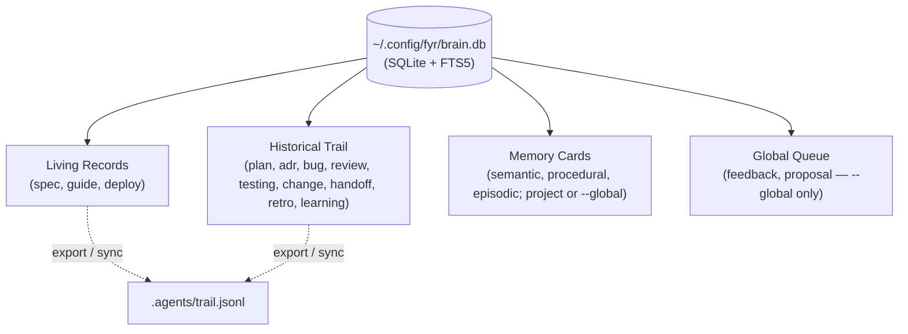
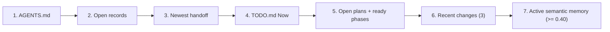
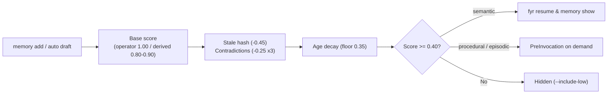

# Brain Store, Trail Records & Validity-Scored Memory

`fyr` stores project history and typed memory cards in `~/.config/fyr/brain.db` (`internal/brain`). Records stay outside git, search with FTS5, and export to `.agents/trail.jsonl` on demand. See [CLI Reference](../docs/cli-reference.md) for all `fyr record`, `fyr memory`, and `fyr resume` flags.

## Brain store architecture

Each record belongs to one git repository scope (shared across worktrees via `trail.Roots`) or to `--global`. `fyr` never deletes records. Obsolete specs retire, fixed bugs graduate, and stale memories expire behind validity scoring.

Five boundaries keep the store clean:

1. **Global-only queue:** `feedback` and `proposal` require `--global` (`R8`). Local corrections never leak into project checkouts.
2. **Unexported local kinds:** `fyr record export` skips `memory`, `feedback`, and `proposal` rows (`R4`, `R7`).
3. **One-call writes:** `fyr record add` and `fyr memory add` accept stdin headers, `--body-file`, or `--json-in` (`internal/brain/stdin_doc.go`). Legacy file-era checks fire only when real trail files (`PLAN-*`, `ADR-*`, `BUG-*`, `CHANGE-*`, `HANDOFF-*`) exist without `.agents/trail.jsonl`.
4. **Isolated SIM ledger (`brain.db` v5):** Records carry canonical `repo_id`. Global SIM tables (`sim_problems`, `sim_aliases`, `sim_attempts`, `sim_fts`) stay isolated from `fyr resume`, `fyr memory show`, hooks, and `.agents/trail.jsonl`. `fyr state export --include-memory` optionally bundles memory and SIM.
5. **Per-scope spec reads:** `ListCurrentSpecsCtx` (`internal/brain/turn_specs.go`) reads `SPEC-*` rows read-only per scope. It falls back to `.agents/trail.jsonl` only when `brain.db` has no specs for that scope.

## Seven-step session resume

`fyr resume` (`internal/brain/resume.go`) prints a read-only project snapshot without creating or mutating `brain.db`. On fresh clones without `brain.db` records, it falls back to `.agents/trail.jsonl`.

When an open plan uses `Depends on:` phase headings, `fyr resume` reads task checkboxes and prints which phases are unblocked.

## Multi-part validity-scored memory

`fyr` separates memory into `semantic` (facts), `procedural` (workflows), and `episodic` (incidents). `ComputeMemoryValidity` (`internal/brain/validity.go`) scores every card deterministically between `0.00` and `1.00`.

Each memory record tracks `provenance`, `memory_kind`, `verified_at`, `evidence_count`, and `source_sessions`:

- **Operator guard:** Direct `fyr memory add` calls store `provenance: operator` (`1.00` base). Automated drafts, imports, and SIM cannot overwrite, retire, supersede, or downgrade operator cards.
- **Derived drafts:** `fyr auto` drafts store `provenance: derived` (`0.80` base, `+0.05` per corroborating session up to `0.90`). Compaction caps `Prior:` chains at `<= 2` bullets.
- **Content-hash staleness:** `MemoryStalenessTag` (`internal/brain/resume_memory.go`) adds `[STALE]` and `-0.45` only when a pinned file's SHA-256 changes. Timestamp touches add zero penalty.
- **Contradictions and decay:** Newer matching `FEEDBACK-*` records subtract `-0.25` each (max `3`). Age decay uses `180d` semantic, `90d` procedural, and `30d` episodic windows with a `0.35` floor.
- **Progressive loading:** `fyr resume` shows active `semantic` cards (`>= 0.40`). `PreInvocation` injects matching `procedural`, `episodic`, and `--global` cards only on matching prompts or files.

All 15 record kinds and valid statuses

| Kind | Prefix | Scope | Exported | Valid Statuses (default first) |
|---|---|---|---|---|
| `plan` | `PLAN-` | Project | Yes | `open`, `closed` |
| `bug` | `BUG-NNN` | Project | Yes | `open`, `fixed`, `accepted`, `obsolete`, `graduated` |
| `adr` | `ADR-NNN[a-z]` | Project | Yes | `accepted`, `superseded:ADR-NNN` |
| `spec` | `SPEC-` | Project | Yes | `current`, `retired` |
| `guide` | `GUIDE-` | Project | Yes | `current`, `retired` |
| `deploy` | `DEPLOY-` | Project | Yes | `current`, `retired` |
| `handoff` | `HANDOFF-` | Project | Yes | `""` (newest is live) |
| `change` | `CHANGE-` | Project | Yes | `closed` |
| `testing` | `TEST-` | Project | Yes | `closed` |
| `review` | `REVIEW-` | Project | Yes | `closed` |
| `retro` | `RETRO-` | Project | Yes | `closed` |
| `learning` | `LEARNING-` | Project | Yes | `closed` |
| `memory` | `MEMORY-` | Project / `--global` | No | `closed`, `retired` |
| `feedback` | `FEEDBACK-` | `--global` | No | `closed` |
| `proposal` | `PROPOSAL-` | `--global` | No | `queued`, `rejected`, `applied:<commit>` |

## Next steps

Inspect live project memory, explore store flags, or review automated memory consolidation:

- Run `fyr resume` and `fyr memory show` to inspect active records and scores.
- Browse all command flags in [CLI Reference](../docs/cli-reference.md).
- Read [Dream Consolidation & Auto Mode](dream-and-auto.md) to see how stale memories consolidate.
