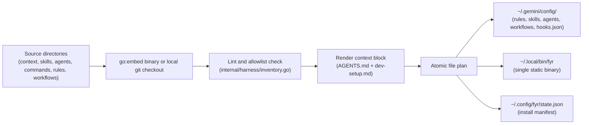
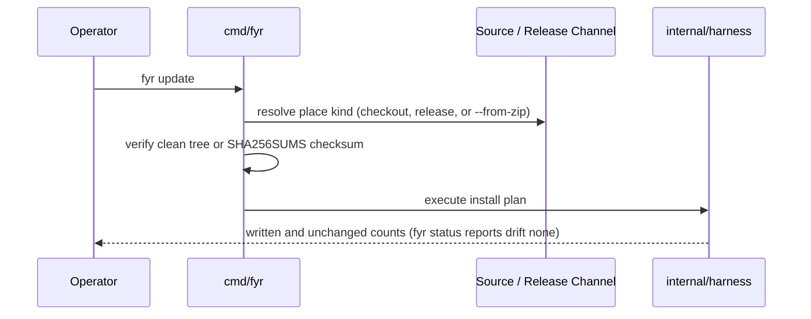

# Delivery, Installer & Stack Customization

`fyr` packages global context, skills, subagents, rules, workflow scripts, and zero-daemon CLI hooks into `~/.gemini/config/` and `~/.local/bin/fyr` without background services or symlink fragility. You can keep any number of Linux and macOS machines synchronized through three delivery channels and override the default stack per repository or globally.

## Delivery and installer pipeline

The installer (`internal/harness`) reads the six harness directories either from your local git checkout or from the bytes compiled into a release binary via `embed.go`, validates every customization, and writes files atomically into your home directory. What each kind of machine fetches when moving forward is defined once in `SPEC-fyr-delivery` § The model.

Every `fyr install` (or its alias `fyr sync`) computes a complete target manifest before touching disk. It updates only drifted files, refuses symbolic links in managed source trees, and deletes files listed in `~/.config/fyr/state.json` that the repository no longer ships.

> [!NOTE]
> `fyr install` never modifies vendor settings such as `~/.gemini/antigravity-cli/settings.json` (`PRD.md` Non-goals). Only isolated `fyr eval` sandboxes and `fyr auto` / `fyr dream` temporary homes generate per-run settings files.

## Keeping a machine current

You synchronize machines across checkouts, release binaries, or manually downloaded zip archives using `fyr install`, `fyr update`, `fyr status`, `fyr diff`, and `fyr uninstall`. Running `fyr status` checks every managed path against your source and exits `1` whenever drift exists; see `SPEC-fyr-delivery` § The model for what each release delivers per place kind.

Three strict guardrails protect machines during updates and checks:

1. **Dirty checkout refusal:** `fyr update` refuses any git checkout with uncommitted changes across tracked or untracked paths so remote pulls never overwrite local work (`fyr install` stays the explicit way to deploy an edited tree).
2. **Read-only update checks:** `fyr update --check` reports whether your install is behind and exits `2` when updates are available without replacing the binary or writing files.
3. **Clean uninstall:** `fyr uninstall` removes only the paths tracked in `~/.config/fyr/state.json` plus any `fyr auto` or legacy dream timer, leaving `~/.config/fyr/brain.db`, `~/.config/fyr/metrics.db`, `~/.config/fyr/auto.json`, and `~/.config/fyr/auto/` intact.

## Customizing for your stack

The harness defaults to Go backends, TypeScript/Tailwind frontends, and Google Cloud Run, because `context/AGENTS.md` and `context/dev-setup.md` declare those conventions globally. Project-level files always override global context, so you can switch stacks per repository or customize your own harness fork globally.

| Customization Scope | Where You Edit | How It Deploys | Best For |
|---|---|---|---|
| **Per-project override** | `<project>/AGENTS.md`, `.agents/rules/<name>.md`, `.agents/skills/<name>/SKILL.md` | Read directly by `agy` in that checkout | Adopting Rust, Python, Next.js, or AWS without forking `fyr` |
| **Global checkout edit** | `context/*.md`, `rules/*.md`, `skills/<name>/SKILL.md`, `agents/<name>/agent.md`, `workflows/<name>.py` | Deployed to `~/.gemini/config/` via `fyr install` | Personalizing workflows across every repository |
| **Third-party skill import** | `skills/<name>/` via `npx skills add` or `fyr adopt <name>` | Copied into `skills/` and deployed via `fyr install` | Installing community Agent Skills (`SKILL.md` standard) |

Every customization is a file drop with zero manifest registration code, and every `fyr` command accepts global flags (`--home`, `--repo`, `-C`/`--dir`) either before or after the verb (`cmd/fyr/run_dispatch.go`) as well as `--json` across all 31 CLI verbs (`cmd/fyr/verb_json_helpers.go`). When running in development inside the `fyr` checkout itself, always pass `--home .agents/scratch/<name>` so test installs never overwrite your real `$HOME` (`cmd/fyr/realhome_guard.go`).

## Context budget and installer lint

Antigravity CLI builds a single `<user_rules>` block from `~/.gemini/config/rules/*.md` and truncates content silently past `24,000` bytes (`PRD.md` Known limits). To guarantee your instructions never truncate silently across `35` embedded skills (`<= 140`-char `description:` cap enforced by `LintSkillFrontmatter` / `SkillDescriptionLimit = 140` in `internal/harness/frontmatter.go` alongside the `1,024`-char Agent Skills / agent limit, and pinned by `TestSkillFrontmatterDescriptionsUnder140Chars` in `skills_text_test.go` and `TestLintSkillFrontmatterAnd140CharCap` in `internal/harness/frontmatter_test.go`), `fyr` enforces strict byte budgets in `internal/harness/size_test.go` plus `TestCombinedContextRulesAndRepoAgentsUnder15KB` (`skills_text_test.go`, `15,000` bytes combined) and ends the rendered context with the canary word `GANNET`. Progressive `references/` diets keep the six largest core skills `<= 13 KB` each (`>= 25%` combined reduction) and `skills/golang/SKILL.md` `<= 12 KB` while frontmatter keyword deduplication holds shared-keyword skill pairs to `<= 5` (`TestV910SkillDietBudget` in `skills_text_test.go`), `docker`/`terraform` templates ship runnable distroless and two-stage bootstrap patterns, and R7 single-handoff close (`change` optional) is aligned across `context/AGENTS.md` and closing skills (`TestV910SkillTemplatesAndR7Alignment` in `skills_text_test.go`). Offline state and sanitized telemetry (schema v5 / v14, including `orchestration_runs`) transfer across hosts via `fyr state export|import`.

| Pin Test | Target Ceiling | Measured Scope |
|---|---|---|
| `TestAlwaysOnContextBudget` | `9,000` bytes | Rendered `context/*.md` plus `always_on` rules |
| `TestRenderedContextUnderTarget` | `13,000` bytes | Hand-written `context/*.md` (`PRD.md` G1 `15,000` ceiling) |
| `TestRepoAgentsUnderTarget` | `4,500` bytes | Repository root `AGENTS.md` (`PRD.md` G2) |
| `TestCombinedContextRulesAndRepoAgentsUnder15KB` | `15,000` bytes | Combined `context/*.md`, `rules/*.md`, and root `AGENTS.md` (`skills_text_test.go`) |
| `TestRenderedContextFitsAntigravityBlock` | `19,500` bytes | Combined context plus all `rules/*.md` (inside Antigravity's `24,000` cap) |
| `TestSkillListingBudget` | `19,500` bytes | Names and descriptions of model-invocable skills |

Before deploying a single file, the installer lint (`internal/harness/inventory.go`, `internal/harness/frontmatter.go`, and `fyr check`'s `budget`/`frontmatter` rules in `internal/check/harness_lint.go`) fails fast on structural errors, over-budget context/rules, `> 140`-char skill descriptions, or unapproved frontmatter permission keys that could hang subagents or bypass operator permissions.

Installer frontmatter allowlists, known tools, and CLI verb reference

### Allowed frontmatter keys per surface

| Surface | Path Pattern | Allowed Keys | Forbidden Permission Keys |
|---|---|---|---|
| **Skills** | `skills/<name>/SKILL.md` | `name`, `description`, `license`, `metadata`, `argument-hint`, `disable-model-invocation` | `allowed-tools`, `disallowedTools`, `hooks`, `permissionMode`, `mcpServers` |
| **Subagents** | `agents/<name>/agent.md` | `name`, `description`, `subagent`, `mainAgent`, `model`, `tools` | `maxTurns`, `effort`, `skills`, `color`, `disallowedTools`, `hooks` |
| **Rules** | `rules/<name>.md` | `description`, `trigger`, `globs` | Any unlisted key |
| **Commands** | `commands/<name>.md` | `description` | Any unlisted key |

### Agent tool allowlist (`knownTools`)

An unrecognized tool name in `agents/<name>/agent.md` causes Antigravity CLI to hang the subagent, so `fyr install` accepts only `view_file`, `grep_search`, `find_by_name`, `run_command`, `write_to_file`, and `replace_file_content`.

### Delivery CLI verbs

| Command | Flags | Purpose |
|---|---|---|
| `fyr install` | `--dry-run`, `--json`, `--repo DIR`, `--home DIR` | Deploy harness files to `~/.gemini/config/` and `~/.local/bin/fyr` |
| `fyr update` | `--check`, `--dry-run`, `--from-zip FILE`, `--json` | Update a checkout, release binary, or zip place |
| `fyr status` | `--json` | Report installed commit/version, drift, auto/dream state, and PATH shadowing |
| `fyr diff` | `--json`, `--repo DIR`, `--home DIR` | Print a unified diff of drifted installed files |
| `fyr uninstall` | `--dry-run`, `--json` | Remove installed files and background timers while keeping stores |
| `fyr list` | `--json`, `--repo DIR` | Print every skill, subagent, rule, and workflow script |
| `fyr render` | `--json`, `--repo DIR` | Print the assembled `AGENTS.md` context block |
| `fyr adopt` | `--force`, `--json` | Copy an externally installed skill into `skills/` |
| `fyr version` | `--json` | Print the binary build version |

## Next steps

Follow how deployed hooks enrich sessions or inspect the normative release delivery specification:

- Review [CLI Hooks, Prompt Vetting & AST Graph](hooks-and-ast-graph.md) to see how installed hooks enrich sessions in under `250 ms`.
- Inspect `SPEC-fyr-delivery` with `fyr record get SPEC-fyr-delivery` for the normative release and place matrix contract.
