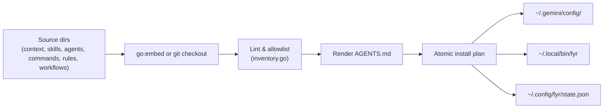

# Delivery, Installer & Stack Customization

`fyr` installs global context, skills, subagents, rules, workflows, and hooks into `~/.gemini/config/` and `~/.local/bin/fyr` without daemons or symlinks. Override the stack per project or customize a global fork. See [CLI Reference](../docs/cli-reference.md) for all delivery verbs and flags.

## Delivery and installer pipeline

The installer (`internal/harness`) reads the six harness directories from a git checkout or embedded release bytes (`embed.go`). It lints every file and writes targets atomically.

Every `fyr install` (or `fyr sync`) builds a full target manifest before writing. It updates only drifted files, refuses symlinks in managed trees, and deletes files listed in `state.json` that the repo removed.

> [!NOTE]
> `fyr install` never edits vendor settings such as `~/.gemini/antigravity-cli/settings.json` (`PRD.md` Non-goals). Only isolated `fyr eval`, `fyr auto`, and `fyr dream` sandboxes create temporary settings files.

## Keeping a machine current

How each machine kind fetches updates is defined once in `SPEC-fyr-delivery` (`fyr record get SPEC-fyr-delivery`); see [CLI Reference](../docs/cli-reference.md) for update flags.

Three local guardrails protect updates and removals:

1. **Dirty checkout refusal:** `fyr update` refuses git checkouts with uncommitted tracked or untracked changes. Run `fyr install` to deploy local edits.
2. **Read-only update check:** `fyr update --check` exits `2` when behind without writing files or binaries.
3. **Store-preserving uninstall:** `fyr uninstall` removes only manifest-tracked files and background timers. It keeps `brain.db`, `metrics.db`, `auto.json`, and `auto/`.

## Customizing for your stack

Global context defaults to Go backends, TypeScript/Tailwind frontends, and Google Cloud Run (`context/AGENTS.md`, `context/dev-setup.md`). Project files override global context so you can switch stacks without forking `fyr`.

| Scope | Where You Edit | How It Deploys | Best For |
|---|---|---|---|
| **Per-project** | `<project>/AGENTS.md`, `.agents/rules/*.md`, `.agents/skills/*/SKILL.md` | Read by `agy` in that checkout | Rust, Python, Next.js, or AWS without forking |
| **Global checkout** | `context/*.md`, `rules/*.md`, `skills/*/SKILL.md`, `agents/*/agent.md`, `workflows/*.py` | Deployed via `fyr install` | Personal workflows across every repo |
| **Third-party skill** | `skills/<name>/` via `npx skills add` or `fyr adopt <name>` | Copied and deployed via `fyr install` | Community Agent Skills (`SKILL.md`) |

Every customization is a file drop with zero manifest code. Global flags (`--home`, `--repo`, `-C`/`--dir`) work before or after any verb (`cmd/fyr/run_dispatch.go`). Inside the `fyr` repo, always pass `--home .agents/scratch/<name>` (`cmd/fyr/realhome_guard.go`).

## Context budget and installer lint

Antigravity merges `~/.gemini/config/rules/*.md` into one `<user_rules>` block and truncates past `24,000` bytes (`PRD.md` Known limits). `fyr` guards all `34` embedded skills with hard size pins (`internal/harness/size_test.go`, `skills_text_test.go`) and ends rendered context with `GANNET`.

- **Skill descriptions:** `LintSkillFrontmatter` (`internal/harness/frontmatter.go`) enforces the `140`-char skill cap alongside the `1,024`-char agent cap.
- **Skill diets:** Core skills move templates into `references/` so `SKILL.md` files stay compact and keyword overlaps stay `<= 5`.
- **Offline transfer:** `fyr state export` and `fyr state import` move trails and sanitized telemetry (`brain.db` v5, `metrics.db` v14) offline.

| Pin Test | Ceiling | Scope |
|---|---|---|
| `TestAlwaysOnContextBudget` | `9,000` B | Rendered `context/*.md` + `always_on` rules |
| `TestRenderedContextUnderTarget` | `13,000` B | Rendered `context/*.md` (`PRD.md` G1 `15,000` B) |
| `TestRepoAgentsUnderTarget` | `4,500` B | Repo root `AGENTS.md` (`PRD.md` G2) |
| `TestCombinedContextRulesAndRepoAgentsUnder15KB` | `15,000` B | Combined `context/*.md`, `rules/*.md`, and `AGENTS.md` |
| `TestRenderedContextFitsAntigravityBlock` | `19,500` B | Context + all `rules/*.md` (inside `24,000` B) |
| `TestSkillListingBudget` | `19,500` B | Model-invocable skill names and descriptions |

Before writing files, installer lint (`internal/harness/inventory.go`) and `fyr check` reject over-budget context, oversized descriptions, and forbidden permission keys.

Installer frontmatter allowlists and known tools

| Surface | Path | Allowed Keys | Forbidden Keys |
|---|---|---|---|
| **Skills** | `skills/<name>/SKILL.md` | `name`, `description`, `license`, `metadata`, `argument-hint`, `disable-model-invocation` | `allowed-tools`, `disallowedTools`, `hooks`, `permissionMode`, `mcpServers` |
| **Subagents** | `agents/<name>/agent.md` | `name`, `description`, `subagent`, `mainAgent`, `model`, `tools` | `maxTurns`, `effort`, `skills`, `color`, `disallowedTools`, `hooks` |
| **Rules** | `rules/<name>.md` | `description`, `trigger`, `globs` | Any unlisted key |
| **Commands** | `commands/<name>.md` | `description` | Any unlisted key |

An unknown tool in `agents/<name>/agent.md` hangs Antigravity subagents. `knownTools` allows only `view_file`, `grep_search`, `find_by_name`, `run_command`, `write_to_file`, and `replace_file_content`.

## Next steps

- Read [CLI Hooks, Prompt Vetting & AST Graph](hooks-and-ast-graph.md) to see how hooks run in under `250 ms`.
- Run `fyr record get SPEC-fyr-delivery` for the normative delivery contract.
- Check all delivery flags in [CLI Reference](../docs/cli-reference.md).
