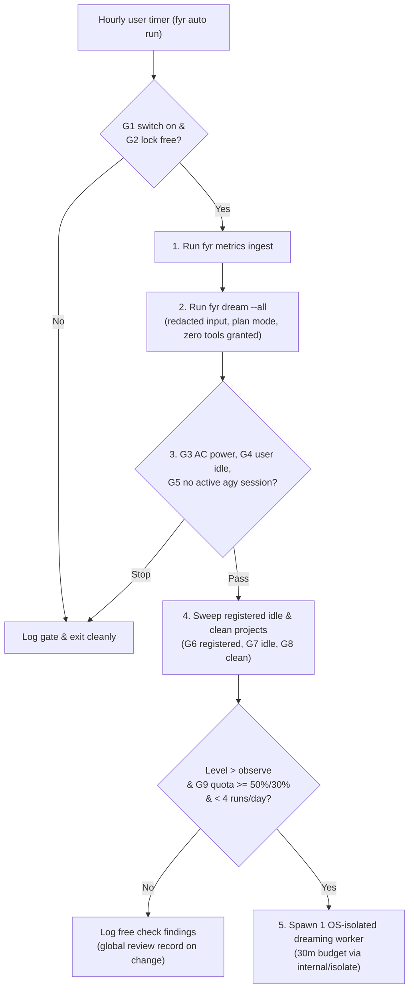
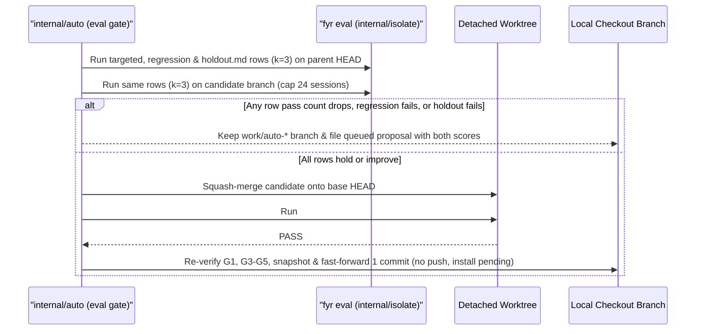

# Idle-Time Consolidation (`fyr dream`) & Self-Improvement (`fyr auto`)

`fyr dream` and `fyr auto` close the learning loop while your workstation sits idle: the single hourly OS user timer (`systemd` on Linux, `launchd` on macOS) ingests telemetry, consolidates memories in tool-free plan mode, checks project health, and runs at most one OS-isolated dreaming worker inside a strict 9-gate and risk-rubric safety cage.

## Hourly background runner (`fyr auto` and `fyr dream`)

`fyr auto on` writes `~/.config/fyr/auto.json`, installs the single hourly timer (`fyr-auto` / `com.fyr.auto`), and retires any legacy `fyr-dream` unit (`internal/auto`, `internal/dream`). Each hourly tick executes `fyr auto run`, which reads `~/.config/fyr/auto.json` first and exits immediately if disabled, missing, or corrupt.

During step 2, `fyr dream --all` iterates over projects opted in via `fyr index --register` (a `.git/fyr-registered` marker sealed to path and home) that have been idle for `24` hours with new activity since their last dream. It scrubs memories, new trail records, global `feedback`, transcripts, and numbers-only `DreamTrajectoryDigest` metrics through `internal/redact`, invokes `agy --input-format stream-json --output-format stream-json --mode plan -p ""` granting zero tools, and records results solely as global `queued` `proposal` records.

## Dreaming worker classes and risk rubric

Past level `observe` (`project` or `harness`), `fyr auto` runs at most one dreaming task per sweep (`internal/auto/kickoff.go`, `internal/auto/tasks.go`) inside an `internal/isolate` sandbox (`30`-minute timeout, maximum `4` model runs per day). Every worker writes structured proposals, findings, feedback, or memory candidates to `.agents/scratch/agents/auto-drafts.jsonl` (`provenance: derived`), validated and committed to `brain.db` by Go (`internal/auto/drafts.go`)—never by the worker directly.

| Level | Permitted Classes & Outcomes | Checkout Edits? |
|---|---|---|
| `observe` (default) | Free health checks (`fyr check`, trail hygiene, stale branches) only | None |
| `project` | `memory-consolidation`, `retro-lite`, `memory-candidates`, `missing-skill`, and project-scoped `distill` proposals | Zero consumer-repo edits (`OutcomeDrafts` / `OutcomeProposal`) |
| `harness` | All `project` classes plus harness `distill` (`skills/auto-distilled-<slug>/`) and `harness-edit` (`skills/`) | Local `work/auto-*` branch only, behind the `k=3` eval gate |

The risk rubric (`internal/auto/rubric.go`, mirrored in `skills/fyr-auto/SKILL.md`) enforces hard boundaries so automated workers can never modify their own judges, guards, or instructions outside `skills/`:

- **Always denied paths:** `PRD.md`, `AGENTS.md`, `context/`, `rules/`, `.agents/rules/`, `agents/`, `<project>/.agents/agents/`, `internal/eval/`, `internal/auto/`, `internal/isolate/`, `internal/redact/`, `cmd/fyr/`, `embed.go`, `.agents/eval/`, `skills/fyr-auto/`, `skills/VENDORED.md`, `skills/google-catalog/catalog/`, `*_test.go`, CI configs, and package manifests (`go.mod`, `package.json`, lockfiles).
- **Always an ask (`proposal` record):** Any push, release, deploy, real-home install, third-party skill install, MCP server, dependency addition, or net deletion exceeding `200` lines.
- **Tamper tripwire:** Before and after every worker execution, `fyr auto` compares `auto.json` bytes and `runs.json` SHA-256 digests; any tampering disables `fyr auto` immediately (`internal/auto/worker.go`).

## The `k=3` behavioural eval gate

When a level-`harness` `harness-edit` or harness-checkout `distill` worker commits a skill change on `work/auto-<name>`, Go runs `evalGateBranch` (`internal/auto/eval_gate.go`) before touching your local branch:

`fyr auto` never pushes commits to GitHub and never writes into your real `$HOME` (`~/.gemini/config/`). Accepted harness skill changes remain one local fast-forward commit marked `install pending` until you review, run `fyr install`, and push them yourself (`R8`, `R9`).

Gates G1–G9, dreaming task triggers, and CLI flags reference

### The nine `fyr auto` gates (`G1`–`G9`)

| Gate | Checks | Scope / Timing |
|---|---|---|
| **G1 Switch** | `~/.config/fyr/auto.json` exists, parses strictly, and `enabled: true` | Before run, after dream, and before every project |
| **G2 Lock** | Non-blocking `flock` on `~/.config/fyr/auto/auto.lock` | Real runs only (`--dry-run` skips lock) |
| **G3 Power** | Machine is on AC power (Linux `/sys/class/power_supply`, macOS `pmset`) | Before sweep and re-checked per project (fails closed) |
| **G4 Presence** | No operator GUI/PTY/HID activity within `--user-idle` (default `15m`) | Before sweep and re-checked per project (unknown reading passes, logged) |
| **G5 Session** | No interactive `agy` session running for current UID | Before sweep and re-checked per project (fails closed) |
| **G6 Registered** | Project holds valid `.git/fyr-registered` marker for this checkout & home | Per project |
| **G7 Project Idle** | No commit, reflog, file mtime, trail update, or `agy` session within `--project-idle` (default `6h`) | Per project |
| **G8 Clean Tree** | Clean working tree on a branch with upstream and `0` commits ahead | Per project |
| **G9 Quota & Budget** | `< 4` model runs today and `agy /usage` pools `>= 50%` (5h) and `>= 30%` (week) | Before running a worker (`internal/auto/usage.go`) |

### The 6 dreaming task classes

| Class | Trigger Condition | Level | Outcome |
|---|---|---|---|
| `memory-consolidation` | `>= 10` closed memory records since last consolidation | `project` | `OutcomeDrafts` (`add` / `retire` / `merge` in `auto-drafts.jsonl`) |
| `retro-lite` | New Antigravity conversations since last `retro-lite` | `project` | `OutcomeDrafts` (`feedback`, `proposal`, `memory` drafts) |
| `memory-candidates` | Pending memory candidates queued (`PendingMemoryCandidates > 0`) | `project` | `OutcomeDrafts` (`memory` promotion/refinement drafts) |
| `distill` | Verb/skill sequence repeated `>= 3` times (`distillRepeatThreshold`) | `project` / `harness` | `OutcomeProposal` (project `.agents/skills/`) or `OutcomeEvalGate` (harness `skills/auto-distilled-<slug>/`) |
| `missing-skill` | Queued `proposal` requesting a missing skill search | `project` | `OutcomeDrafts` (searches `skills.sh` and drafts quarantined `proposal`) |
| `harness-edit` | Eligible queued harness `proposal` naming editable `skills/` paths | `harness` | `OutcomeEvalGate` (`k=3` eval gate + `# auto: test` + `fyr check`) |

### `fyr dream` and `fyr auto` CLI flags

| Command | Flags | Purpose |
|---|---|---|
| `fyr dream` | `--all`, `--project DIR`, `--dry-run` | Run plan-mode no-tool dreamer over registered idle projects or one checkout |
| `fyr auto on` | `--level observe\|project\|harness`, `--project-idle D`, `--user-idle D`, `--dry-run` | Enable `auto.json` and install the hourly OS timer |
| `fyr auto off` | `--dry-run` | Disable `auto.json` and remove the hourly timer |
| `fyr auto status` | (global flags only) | Show switch state, level, last verdict, daily model runs, and open asks |
| `fyr auto run` | `--dry-run` | Execute one `fyr auto` pass immediately (or preview gates with `--dry-run`) |

## Next steps

- Check your current timer and switch status with `fyr auto status` or preview every gate safely with `fyr auto run --dry-run`.
- Register a repository for consolidation and idle checks using `fyr index --register`.
