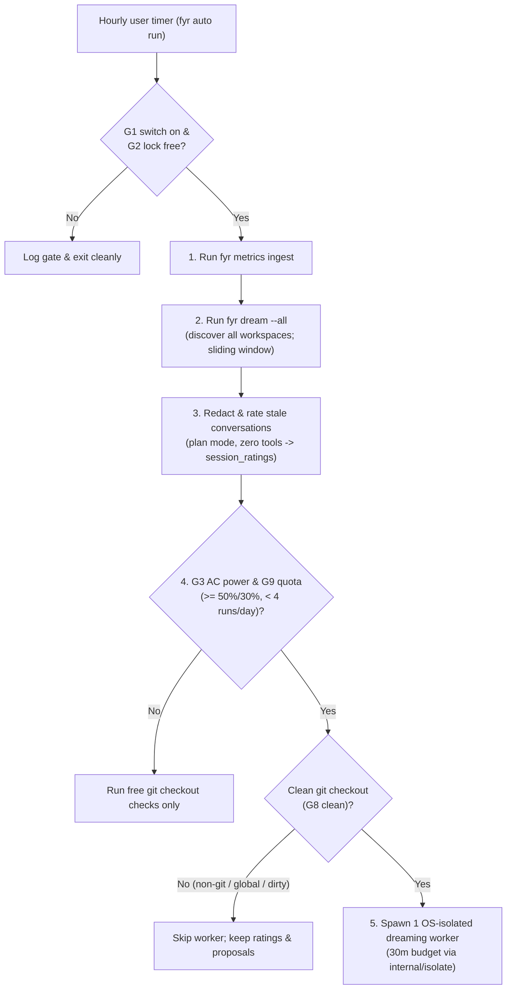
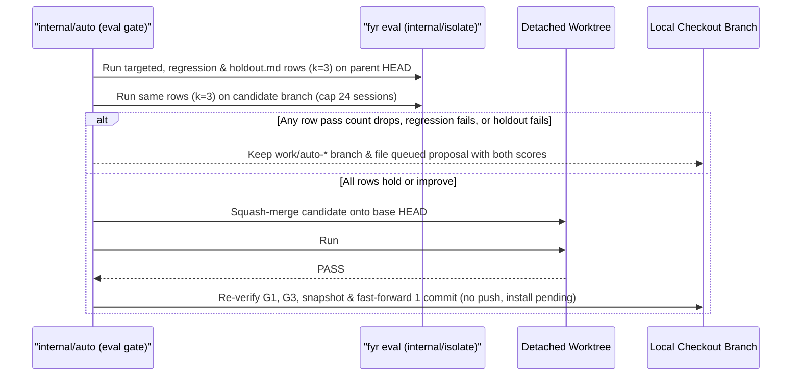

# Idle-Time Consolidation (`fyr dream`) & Self-Improvement (`fyr auto`)

`fyr dream` and `fyr auto` evaluate stale Antigravity conversations, consolidate memories in tool-free plan mode, check checkout health, and run eval-gated skill improvements across your entire `agy` setup behind a single binary `on` / `off` switch and OS-native confinement (`ADR-524`, `ADR-523`).

## Global switch and hourly sweep (`fyr auto` and `fyr dream`)

`fyr auto on` writes `~/.config/fyr/auto.json`, installs the single hourly OS user timer (`fyr-auto` / `com.fyr.auto`), and retires any legacy `fyr-dream` unit (`internal/auto/config.go`, `internal/auto/verbs.go`, `cmd/fyr/verb_auto.go`). It accepts an optional `--conversation-idle D` threshold (default `1h`, range `5m` to `7d`) and migrates legacy `level`, `project_idle`, and `user_idle` configs cleanly while treating `--level`, `--project-idle`, and `--user-idle` as deprecated no-op flags with a warning.

During step 2, `fyr dream --all` (`internal/dream/targets.go`, `internal/search/dream.go`) discovers every Antigravity workspace and conversation without requiring `fyr index --register` (`G6` retired) or pre-existing trail records:

- **Workspace sources:** Reads `~/.gemini/antigravity-cli/conversation_summaries.db` (`workspace_uris`, via `search.ListAgyWorkspaces`), `brain.db` scopes (`brain.Scopes`), `search.db` projects (`search.ListProjects`), and the resolved harness checkout (`HarnessRepo`), while excluding `{eval,sandbox,auto}/` and dream scratch sandboxes.
- **Non-git and global conversations:** Empty `workspace_uris` map to `search.GlobalWorkspace` (`"__global__"`), and non-git directories are retained as first-class workspaces alongside git checkouts (`internal/search/dream_workspace.go`).
- **Sliding-window staleness `(since, cutoff]`:** Under `fyr auto`, `dream.Options` passes `ConversationIdle` (`1h` default) and `Session: true`. `search.AgyConversationTextInWindow` evaluates every conversation modified in `(since, now - conversation_idle]` even when another `agy` session is active (`G4`, `G5`, and `G7` retired for dreaming), advancing `st.Projects[root]` only to the latest evaluated timestamp capped at `cutoff` (`watermark`) so active conversations are re-checked once stale. Failed or incomplete runs keep a `24h` retry cooldown (`FailedAttempts`).

## Stale-conversation rating and `metrics.db` v8

`fyr dream` scrubs conversations, optional `PLAN-*`/`HANDOFF-*` context (`internal/dream/collect_sources.go`), memories, trail records, global `feedback`, and numbers-only `DreamTrajectoryDigest` metrics through `internal/redact`, invokes `agy --input-format stream-json --output-format stream-json --mode plan -p ""` granting zero tools, and records structured conversation ratings alongside global `queued` `proposal` records.

- **`session_ratings` store (`metrics.db` v8, `internal/metrics/store.go`, `internal/metrics/ratings.go`):** Migration 8 adds `session_ratings` (`session_id`, `project_root`, `evaluated_at`, `outcome_score` `1–5`, `token_efficiency` `1–5`, `plan_alignment` `matched|partial|missed|no-plan`, `skill_action` `none|rewrite-skill|new-skill`, `target_skill`, `summary`) with `UpsertSessionRatings` and `SessionRatings`, written only on real runs via `dream.Options.WriteRatings`.
- **Reporting & proposal routing:** `Summary.A` (`RatingsCount`, `MeanOutcomeScore`, `MeanTokenEfficiency` in `internal/metrics/show_types.go`, `report_md.go`, `report.go`) surfaces ratings in Section 3 (`Quality & Learning Loop`) of `fyr report`. Whenever `skill_action` is `rewrite-skill` or `new-skill`, or either score is `<= 3`, `internal/dream/proposals_write.go` (`needsSkillProposal`) files a global `queued` `proposal` (`Target: harness   Kind: skill`, with `Sessions: <n>` set dynamically from the distinct rated session count) naming `target_skill` (or `skills/`) and the conversation rating evidence so `fyr auto` routes it directly into `harness-edit` or `distill` when a clean harness checkout exists.

## Dreaming worker classes and risk rubric

Whenever `fyr auto` is `on` (`internal/auto/run.go`, `internal/auto/worker.go`, `internal/auto/tasks.go`), `fyr auto run` runs at most one dreaming task per sweep inside an `internal/isolate` sandbox (`30`-minute timeout, maximum `4` model runs per day) on any clean git checkout (`workerCheckoutStop` skips non-git directories, `search.GlobalWorkspace`, and dirty trees safely without losing their `session_ratings` or queued proposals). Every worker writes structured drafts to `.agents/scratch/agents/auto-drafts.jsonl` (`provenance: derived`), validated and committed to `brain.db` by Go (`internal/auto/drafts.go`)—never by the worker directly.

| Scope | Permitted Classes & Outcomes | Checkout Edits? |
|---|---|---|
| Clean consumer git checkout | `memory-consolidation`, `retro-lite`, `memory-candidates`, `distill` (`.agents/skills/auto-distilled-<slug>/` proposal), `missing-skill` | Zero consumer-repo edits (`OutcomeDrafts` / `OutcomeProposal`) |
| Clean harness checkout (`o.Repo`) | All classes above plus `harness-edit` (`skills/`) and harness `distill` (`skills/auto-distilled-<slug>/`) | Local `work/auto-*` branch only, behind the `k=3` eval gate (`OutcomeEvalGate`) |

The risk rubric (`internal/auto/rubric.go`, mirrored in `skills/fyr-auto/SKILL.md`) enforces hard boundaries so automated workers can never modify their own judges, guards, or instructions outside `skills/`:

- **Always denied paths:** `PRD.md`, `AGENTS.md`, `context/`, `rules/`, `.agents/rules/`, `agents/`, `<project>/.agents/agents/`, `internal/eval/`, `internal/auto/`, `internal/isolate/`, `internal/redact/`, `cmd/fyr/`, `embed.go`, `.agents/eval/`, `skills/fyr-auto/`, `skills/VENDORED.md`, `skills/google-catalog/catalog/`, `*_test.go`, CI configs, and package manifests (`go.mod`, `package.json`, lockfiles).
- **Always an ask (`proposal` record):** Any push, release, deploy, real-home install, third-party skill install, MCP server, dependency addition, or net deletion exceeding `200` lines.
- **Tamper tripwire:** Before and after every worker execution, `fyr auto` compares `auto.json` bytes and `runs.json` SHA-256 digests; any tampering disables `fyr auto` immediately (`internal/auto/worker.go`).

## The `k=3` behavioural eval gate

When a `harness-edit` or harness-checkout `distill` worker commits a skill change on `work/auto-<name>` in a clean harness checkout (`isHarnessCheckout` in `internal/auto/eval_gate.go`), Go runs `evalGateBranch` before touching your local branch:

`fyr auto` never pushes commits to GitHub and never writes into your real `$HOME` (`~/.gemini/config/`). Accepted harness skill changes remain one local fast-forward commit marked `install pending` until you review, run `fyr install`, and push them yourself (`R8`, `R9`). On binary or zip places without a harness git checkout, skill-rewrite findings remain queued `target: harness` `proposal` records in `brain.db`.

Active & retired gates, dreaming task triggers, and CLI flags reference

### `fyr auto` gates (`G1`–`G9`)

| Gate | Status | Checks | Scope / Timing |
|---|---|---|---|
| **G1 Switch** | Active | `~/.config/fyr/auto.json` exists, parses strictly, and `enabled: true` (`conversation_idle` valid `5m`–`7d`) | Before run, after dream, and before every workspace |
| **G2 Lock** | Active | Non-blocking `flock` on `~/.config/fyr/auto/auto.lock` | Real runs only (`--dry-run` skips lock) |
| **G3 Power** | Active | Machine is on AC power (Linux `/sys/class/power_supply`, macOS `pmset`) | Before sweep and re-checked per workspace (fails closed) |
| **G4 Presence** | Retired | Retired for conversation rating and dreaming (`ADR-524`; replaced by per-conversation `conversation_idle`) | — |
| **G5 Session** | Retired | Retired for conversation rating and dreaming (`ADR-524`; stale conversations evaluate while sessions run) | — |
| **G6 Registered** | Retired | Retired for `dream` and `auto` (`ADR-524`; all workspaces discovered automatically) | — |
| **G7 Project Idle** | Retired | Retired for `dream` and `auto` (`ADR-524`; replaced by per-conversation `conversation_idle`, default `1h`) | — |
| **G8 Clean Tree** | Scoped | Clean git working tree on a branch with upstream and `0` commits ahead | Required only for git worker execution (`runModelTask`) and `applyBranch` |
| **G9 Quota & Budget** | Active | `< 4` model runs today and `agy /usage` pools `>= 50%` (5h) and `>= 30%` (week) | Before running a worker (`internal/auto/usage.go`) |

### The 6 dreaming task classes

| Class | Trigger Condition | Scope | Outcome |
|---|---|---|---|
| `memory-consolidation` | `>= 10` closed memory records since last consolidation | Clean git checkout | `OutcomeDrafts` (`add` / `retire` / `merge` in `auto-drafts.jsonl`) |
| `retro-lite` | Stale Antigravity conversations in `(since, cutoff]` | Clean git checkout | `OutcomeDrafts` (`feedback`, `proposal`, `memory` drafts) |
| `memory-candidates` | Pending memory candidates queued (`PendingMemoryCandidates > 0`) | Clean git checkout | `OutcomeDrafts` (`memory` promotion/refinement drafts) |
| `distill` | Verb/skill sequence repeated `>= 3` times (`distillRepeatThreshold`) | Clean git checkout / Harness | `OutcomeProposal` (`.agents/skills/`) or `OutcomeEvalGate` (harness `skills/auto-distilled-<slug>/`) |
| `missing-skill` | Queued `proposal` requesting a missing skill search | Clean git checkout | `OutcomeDrafts` (searches `skills.sh` and drafts quarantined `proposal`) |
| `harness-edit` | Eligible queued `target: harness` `proposal` (including rating-queued skill rewrites) | Clean harness checkout (`o.Repo`) | `OutcomeEvalGate` (`k=3` eval gate + `# auto: test` + `fyr check`) |

### `fyr dream` and `fyr auto` CLI flags

| Command | Flags | Purpose |
|---|---|---|
| `fyr dream` | `--all`, `--project DIR`, `--dry-run` | Run plan-mode no-tool dreamer and stale-conversation rater across all discovered workspaces (`DIR` accepts checkouts, non-git dirs, or `__global__`) |
| `fyr auto on` | `--conversation-idle D`, `--dry-run` (plus deprecated no-op `--level`, `--project-idle`, `--user-idle`) | Enable `auto.json` (`enabled: true`, `conversation_idle` default `1h`) and install the hourly OS timer |
| `fyr auto off` | `--dry-run` | Disable `auto.json` and remove the hourly timer |
| `fyr auto status` | (global flags only) | Show switch state, `stale after <conversation_idle>; scope all conversations, projects & harness`, last verdict, daily model runs, and open asks |
| `fyr auto run` | `--dry-run` | Execute one `fyr auto` pass immediately (or preview gates with `--dry-run`) |

## Next steps

Inspect your `fyr auto` state or view conversation rating averages in the usage report:

- Check your switch state, `conversation_idle` cutoff, and run history with `fyr auto status`, or preview every gate safely with `fyr auto run --dry-run`.
- Inspect stale-conversation outcome and token-efficiency averages in Section 3 (`Quality & Learning Loop`) of `fyr report --md`.
