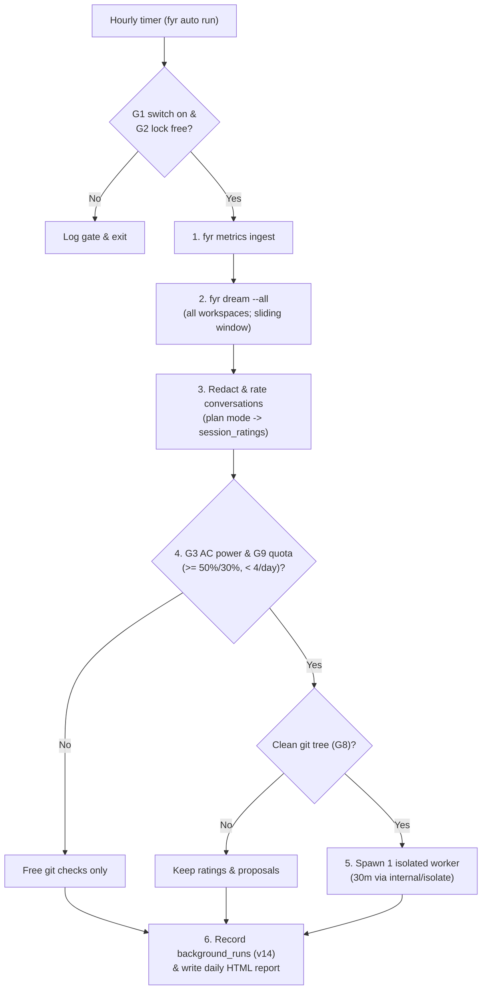
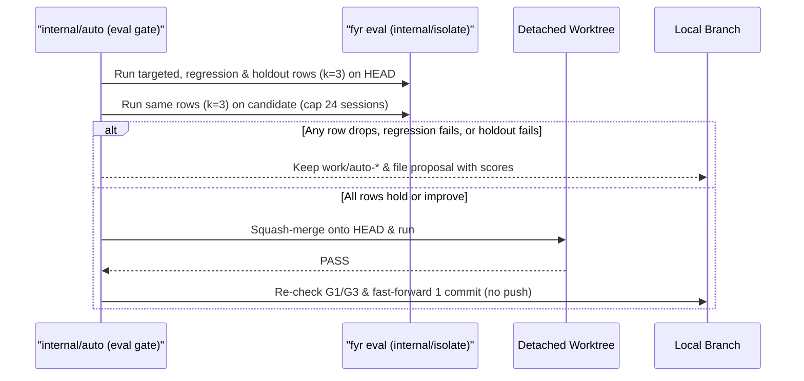

# Idle-Time Consolidation (`fyr dream`) & Self-Improvement (`fyr auto`)

`fyr dream` and `fyr auto` rate stale Antigravity conversations, consolidate memories in tool-free plan mode, and run eval-gated skill improvements behind one binary `on` / `off` switch (`ADR-523`, `ADR-524`). See [CLI Reference](../docs/cli-reference.md) for all `fyr dream` and `fyr auto` flags.

## Global switch and hourly sweep (`fyr auto` and `fyr dream`)

`fyr auto on` writes `~/.config/fyr/auto.json`, installs one hourly timer (`fyr-auto` / `com.fyr.auto`), and removes legacy `fyr-dream` units. Use `--conversation-idle D` (`1h` default, `5m–7d`) to set staleness; legacy `--level`, `--project-idle`, and `--user-idle` flags warn as no-ops. `fyr auto status` shows switch state, budget, asks, and any pending `fyr install` banner. `fyr auto log` tails `auto.log` via `O_NOFOLLOW`.

During step 2, `fyr dream --all` (`internal/dream/targets.go`) discovers every workspace without registration (`G6` retired):

- **Sources:** Unions `conversation_summaries.db`, `brain.db` scopes, `search.db` projects, and the harness checkout.
- **Refused paths:** `dream.IsEphemeralPath` and `dream.IsRefusedWorkspace` (`internal/dream/ephemeral.go`) skip system roots, worktrees, sandboxes, and `.agents/scratch`, pruning them at `0d`.
- **Non-git & global:** Empty `workspace_uris` map to `search.GlobalWorkspace` (`"__global__"`). Non-git dirs stay active, and `agy remote-control serve` counts as an active session.
- **Sliding window:** `AgyConversationTextInWindow` evaluates conversations modified in `(since, now - conversation_idle]` even while another session runs (`G4`, `G5`, `G7` retired). Watermarks advance only to the latest rated timestamp (`<= cutoff`); failures wait `24h`.

## Stale-conversation rating, diagnostics, and `metrics.db` schema 14

`fyr dream` scrubs conversations, plans, memories, feedback, bounded SIM slices, diagnostics, and hidden-coupling hints through `internal/redact`. It invokes `agy --mode plan` with zero tools to write structured ratings and global `queued` proposals.

- **Knees & diagnostics:** `DreamTrajectoryDigest.KneeExceeded` (`internal/metrics/dream_digest.go`) counts sessions reaching calibrated `[40%..60%]` knees. `unaddressedDiagnosticSignals` (`internal/auto/diagnostics.go`) triggers `retro-lite` and injects redacted diagnostics into prompts.
- **`session_ratings` & `background_runs` (`metrics.db` v14):** `session_ratings` stores outcome (`1–5`), efficiency (`1–5`), plan alignment, skill action, and target skill. `background_runs` stores run outcomes, `halt_reason`, durations, and counts.
- **Reports & proposals:** `fyr report` displays ratings and background runs; `fyr auto run` writes one daily HTML report (`0600`, `O_EXCL`). Scores `<= 3` or requested skill changes queue a global `target: harness` proposal.

## Dreaming worker classes and risk rubric

Each sweep runs at most one isolated worker via `internal/isolate` (`30m` timeout, explicit `--model`, `4` runs/day, `4h` cooldown unless `--force`). Three zero-tool `DraftsOnly` classes (`memory-consolidation`, `retro-lite`, `memory-candidates`) inspect only `SessionDigest` summaries. `missing-skill` searches `skills.sh` without browsing the repo.

All four `DraftsOnly` classes run on dirty, non-git, and `__global__` roots; code tasks require a clean tree (`G8`). Sweeps drain proposals by priority, deduplicate `still_regressing` entries in place, expire stale entries after `14d` without deletion, and auto-seed `holdout.md`.

Workers write drafts to `.agents/scratch/agents/auto-drafts.jsonl` (`provenance: derived`). Go scrubs secrets before archiving under `auto/drafts/` and checks per-class allowlists before writing `brain.db` (`internal/auto/drafts.go`). If every line in a `DraftsOnly` run is invalid, the run fails without advancing watermarks.

| Scope | Permitted Classes | Checkout Edits? |
|---|---|---|
| Clean consumer repo | `memory-consolidation`, `retro-lite`, `memory-candidates`, `distill`, `missing-skill` | None (`OutcomeDrafts` / `OutcomeProposal`) |
| Clean harness repo | All above plus `harness-edit` (`skills/`) and harness `distill` | Local `work/auto-*` branch behind `k=3` eval gate |

The risk rubric (`internal/auto/rubric.go`, mirrored in `skills/fyr-auto/SKILL.md`) blocks edits to judges, guards, or non-skill files:

- **Denied paths:** `PRD.md`, `AGENTS.md`, `context/`, `rules/`, `agents/`, `internal/eval/`, `internal/auto/`, `internal/isolate/`, `internal/redact/`, `cmd/fyr/`, `embed.go`, `.agents/eval/`, `skills/fyr-auto/`, `skills/VENDORED.md`, `*_test.go`, CI configs, and manifests.
- **Proposal-only actions:** Pushes, releases, deploys, real-home installs, third-party skills, MCP servers, new deps, or net deletions over `200` lines.
- **Tamper tripwire:** Before and after each worker run, `fyr auto` verifies `auto.json` bytes and `runs.json` SHA-256 digests. Any mismatch disables `fyr auto`.

## The `k=3` behavioural eval gate

Before landing a `harness-edit` or harness `distill` branch (`work/auto-*`), `internal/auto/eval_plan.go` verifies matching eval rows exist (`hasMatchingEvalRows`). It then runs a bounded `k=3` comparison (`<= 24` sessions) across targeted, regression, and `holdout.md` rows:

`fyr auto` never pushes commits and never writes into your real `$HOME`. Accepted skill edits stay as one local commit marked `install pending` until you review, run `fyr install`, and push (`R8`, `R9`). On binary or zip machines, skill-rewrite findings stay queued as `target: harness` proposals.

Active & retired gates and the 6 dreaming task classes

### `fyr auto` gates (`G1`–`G9`)

| Gate | Status | Checks | Timing |
|---|---|---|---|
| **G1 Switch** | Active | `auto.json` parses strictly (`enabled: true`, `conversation_idle` `5m–7d`) | Before run, after dream, per workspace |
| **G2 Lock** | Active | Non-blocking `flock` on `~/.config/fyr/auto/auto.lock` | Real runs only |
| **G3 Power** | Active | AC power (Linux `/sys/class/power_supply`, macOS `pmset`) | Before sweep and per workspace |
| **G4–G7** | Retired | Replaced by per-conversation `conversation_idle` and auto-discovery (`ADR-524`) | — |
| **G8 Clean** | Scoped | Clean branch with upstream and `0` commits ahead | Git-mutating tasks and `applyBranch` only |
| **G9 Quota** | Active | `< 4` runs/day, `>= 4h` cooldown (`--force` bypasses), pool `>= 50%` 5h / `>= 30%` week | Before starting a worker |

### The 6 dreaming task classes

| Class | Trigger | Scope | Outcome |
|---|---|---|---|
| `memory-consolidation` | `>= 10` closed memory records | Any root (`DraftsOnly`) | `OutcomeDrafts` (`memory`, `proposal`, `finding`) |
| `retro-lite` | Stale sessions or unaddressed diagnostics | Any root (`DraftsOnly`) | `OutcomeDrafts` (`proposal`, `feedback`, `finding`) |
| `memory-candidates` | Pending memory candidates | Any root (`DraftsOnly`) | `OutcomeDrafts` (`memory add`, `finding`) |
| `distill` | Repeated verb/skill sequence (`>= 3`) | Clean git / Harness | `OutcomeProposal` or `OutcomeEvalGate` |
| `missing-skill` | Queued missing-skill proposal | Any root (`DraftsOnly`) | `OutcomeDrafts` (`proposal`, `finding`) |
| `harness-edit` | Eligible `target: harness` proposal | Clean harness repo | `OutcomeEvalGate` (`k=3` gate + tests + `fyr check`) |

## Next steps

- Run `fyr auto status`, `fyr auto log`, or `fyr auto run --dry-run` to preview gates safely.
- Check all `fyr dream` and `fyr auto` flags in [CLI Reference](../docs/cli-reference.md).
- View conversation ratings and background runs in `fyr report --web` or `fyr report --md`.
