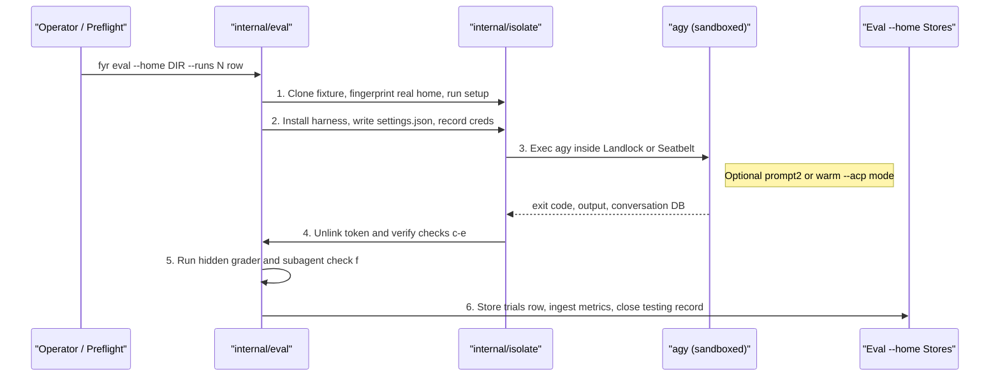
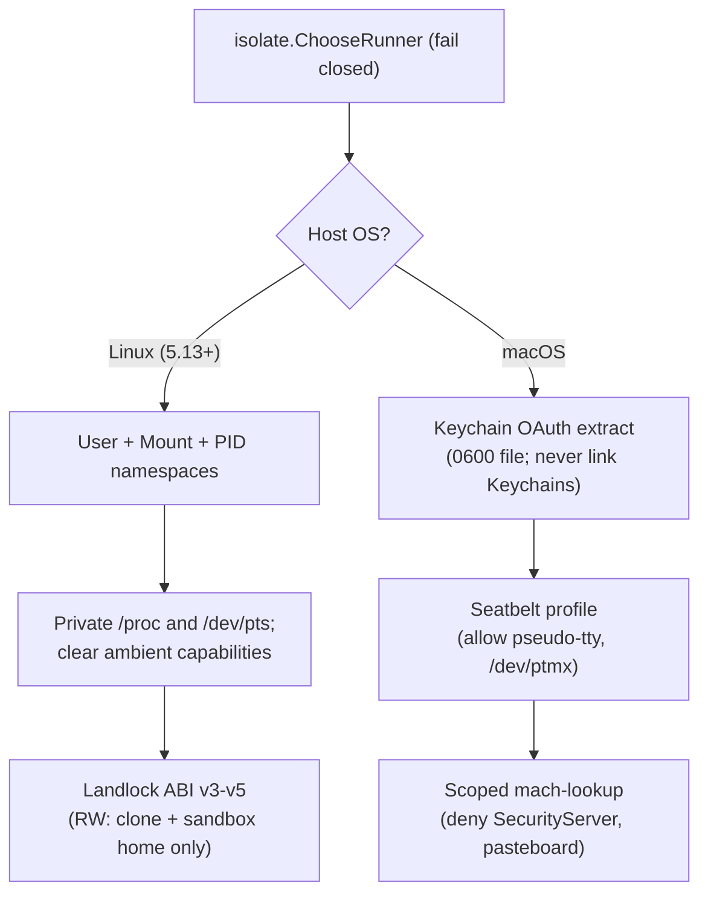

# Behavioural Evaluation (`fyr eval`) & OS-Native Isolation

`fyr eval` tests prompts, skills, hooks, and subagents against real Antigravity CLI (`agy`) sessions. Every trial runs inside an OS-native filesystem sandbox (`internal/isolate`) with a disposable clone and throwaway `--home`. Host-safety checks `a`–`e` and subagent check `f` verify confinement, and results store Wilson 95% confidence intervals.

## Sandboxed trial lifecycle

`fyr eval` loads suite rows from HEAD's `.agents/eval/GUIDE-eval.md`, a `GUIDE-eval` record, or `--suite-file`. It expands `--runs` (`1`–`25`) trials up to `--parallel` concurrent sessions (`kind: benchmark` stays serialized at `1`). Trials require a non-checkout `--home` outside every git repo and never `$HOME` (`cmd/fyr/eval_home.go`).

Every trial executes 15 deterministic steps (`SPEC-fyr-eval`). The grader's `check` script stays outside the sandbox until `agy` exits so the agent cannot inspect or game it. Post-trial ingest passes the sandbox as `BrainHome` (`cmd/fyr/eval.go`, `internal/metrics/events_join.go`) to join sandbox trail records cleanly.

With `--acp` (or an `acp-` row ID), `fyr eval` drives multi-turn sessions over a warm `agy acp --stdio --process-per-session` pipe and exposes `EVENTS=<Dir>/events.jsonl` to the grader.

## OS-native process confinement (`internal/isolate`)

`internal/isolate` confines child process trees through Go's stdlib `syscall` package with no containers, Docker daemon, or host fallback. It fails closed whenever kernel confinement is unavailable.

Confined judges and workers stage credentials, read-only `0400` `models.json`, and read-only `agy` bundles via `isolate.StageModelsCatalog` (`internal/isolate/models_stage.go`). They fail fast with `isolate.ErrNoAuthToken` (`internal/isolate/worker_judge.go`) when no regular-file OAuth token exists.

OS-native isolation closes a critical gap: `agy --sandbox` restricts shell commands only and leaves built-in file tools unconfined (`PRD.md`). Kernel rules (`internal/isolate/landlock_linux.go`, `internal/isolate/seatbelt.go`) block any write outside `<sandbox>/app` or `<sandbox>/home` with `EACCES` or `EPERM`.

## Suite schema and host-safety checks

Each `GUIDE-eval.md` row defines 14 columns across four groups, and every trial enforces six automated safety checks.

| Group | Columns | Purpose |
|---|---|---|
| **Core (7)** | `id`, `setup`, `prompt`, `prompt2`, `check`, `agent`, `grants` | ID, setup shell, turn 1–2 prompts (`{{CLONE}}`, `{{SB}}`, `{{FIXDIR}}`, `{{STAMP}}`), grader, subagent, and tool grants |
| **Metadata (4)** | `version`, `kind`, `cluster`, `expect` | Schema version, kind (`capability`, `regression`, `adversarial`, `indicator`, `benchmark`), cluster, and `m/n` threshold |
| **Benchmark (2)** | `timeout`, `turns` | Timeout (`1m`–`4h`) and scripted turns (`1`–`12`, stopping early on completion) |
| **ACP (1)** | `acp` | Explicit `true` or `false` toggle for warm ACP mode |

| Check | Verifies |
|---|---|
| **a. Refused roots** | Clone and sandbox paths are never `/`, `$HOME`, or the harness checkout (`internal/isolate/guard.go`) |
| **b. Outside checkout** | Sandbox root and clone sit outside every git repo (`isolate.OutsideCheckout`) |
| **c. Real config unchanged** | Fingerprints `~/.config/fyr` (`brain.SnapshotScopes`), `~/.gemini/config`, and vendor `settings.json` before and after |
| **d. No leaked credentials** | Scans for new credential files, links, or secrets (`internal/isolate/creds.go`); exempts `home/.cache/go-build` and verified `_pkg_.a` archives (`<= 256 MiB`) |
| **e. No stray processes** | Scans Linux `/proc` or macOS `lsof`/`ps -Eww` for leftover sandbox processes and stops them (`SIGTERM`/`SIGKILL`) |
| **f. Subagent invocation** | Confirms `"TypeName":"<agent>"` appears in the sandbox conversation SQLite DB when `agent` is set |

## Next steps

Inspect available suite rows, check full CLI flags, or review autonomous skill gating:

- See all `fyr eval` flags in the [CLI Reference](../docs/cli-reference.md#fyr-eval).
- List suite rows in this repository with `fyr eval --list`.
- Read [Dream Consolidation & Auto Mode](dream-and-auto.md) to see `k=3` eval gating in `fyr auto`.
