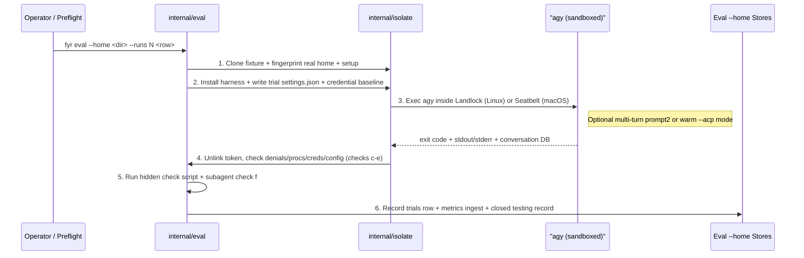
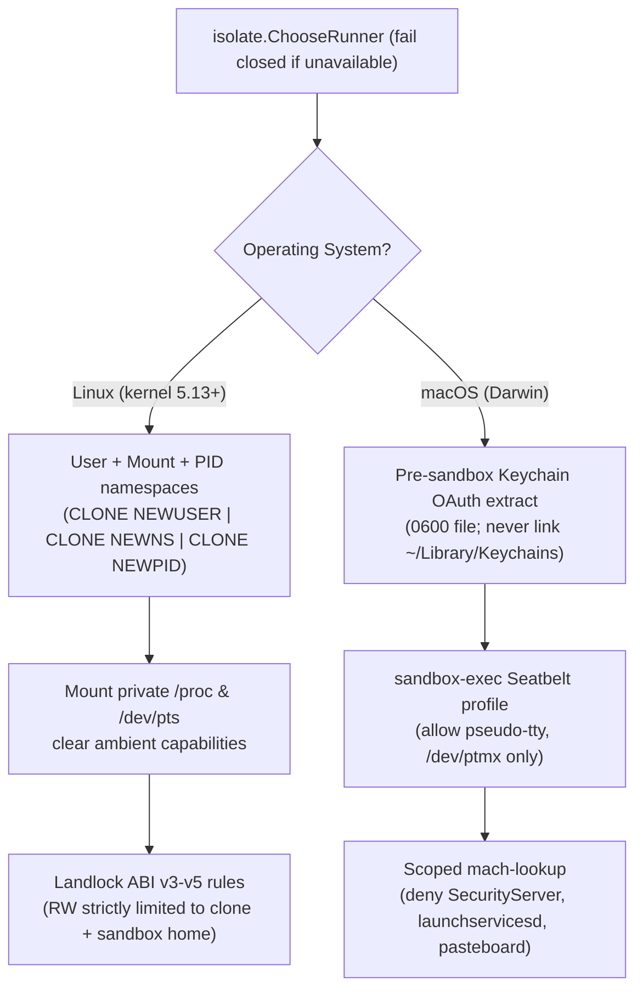

# Behavioural Evaluation (`fyr eval`) & OS-Native Isolation

`fyr eval` tests prompts, skills, hooks, and subagents against real Antigravity CLI (`agy`) sessions inside strict OS-native filesystem sandboxes (`internal/isolate`) so behavioral regressions are caught with statistical confidence before shipping. Every trial runs in a disposable clone and throwaway `--home`, verified by host-safety checks `a`–`e` plus subagent check `f`, and stored with Wilson 95% confidence intervals.

## Sandboxed trial lifecycle

`fyr eval --home DIR <row>...` reads evaluation rows from HEAD's `.agents/eval/GUIDE-eval.md` (or a `GUIDE-eval` record, or an external `--suite-file PATH`) and expands `--runs N` (`1`–`25`) trials up to `--parallel N` at once (`kind: benchmark` rows stay serialized at `1`). Because trials must never mutate your real home or checkout, `--home` is required and refused if it resolves to `$HOME`, shares state files via symlinks, or sits inside any git repository (`cmd/fyr/eval_home.go`).

Every trial executes 15 deterministic steps (`SPEC-fyr-eval` § One row), keeping the row's `check` script outside the sandbox until after `agy` exits so the agent cannot inspect or game its grading check. For long-running or interactive scenarios, `--acp` (or any row ID prefixed with `acp-`) drives turns through a warm `agy acp --stdio --process-per-session` pipe and exposes `EVENTS=<Dir>/events.jsonl` to the check script.

## OS-native process confinement (`internal/isolate`)

`internal/isolate` (`M22`, `ADR-522`) enforces process-wide filesystem isolation directly through Go's stdlib `syscall` package without containers, Docker daemons, or host fallback (`--runner isolate`, failing closed when unavailable).

Why OS-native isolation matters: `agy --sandbox` restricts shell commands only and does not confine Antigravity's built-in file tools (`PRD.md` Known limits). By confining the entire child process tree at the kernel boundary (`internal/isolate/landlock_linux.go`, `internal/isolate/mounts_linux.go`, `internal/isolate/seatbelt.go`, `internal/isolate/sandbox_darwin.go`), any built-in tool attempting to write outside `<sandbox>/app` or `<sandbox>/home` fails immediately with `EACCES` / `EPERM`.

GUIDE-eval 14-column suite schema, host-safety checks a–e, subagent check f, and CLI flags

### `GUIDE-eval.md` suite columns

| Column Group | Columns | Purpose |
|---|---|---|
| **Core 7 columns** | `id`, `setup`, `prompt`, `prompt2`, `check`, `agent`, `grants` | Trial ID, bash setup, turn 1/2 prompts (`{{CLONE}}`, `{{SB}}`, `{{FIXDIR}}`, `{{STAMP}}`), bash grader, required subagent, and tool grants (`named` or `wide: <reason>`) |
| **Extended 4 (`ADR-085`)** | `version`, `kind`, `cluster`, `expect` | Suite schema version, row kind (`capability`, `regression`, `adversarial`, `indicator`, `benchmark`), cluster grouping, and expected `m/n` pass thresholds |
| **Benchmark 2 (`ADR-509`)** | `timeout`, `turns` | Per-row session timeout (`1m`–`4h`) and scripted turn count (`1`–`12`, stopping early on completion phrase) |
| **ACP 1** | `acp` | Explicit `true`/`false` toggle for warm `agy acp --stdio --process-per-session` mode |

### Host-safety checks (`a`–`e`) and subagent check (`f`)

| Check | Verifies |
|---|---|
| **a. Refused roots** | Resolved clone and sandbox paths are never `/`, real `$HOME`, or the harness checkout (`internal/isolate/guard.go`) |
| **b. Outside checkout** | Sandbox root and clone directory sit outside every git repository (`isolate.OutsideCheckout`) |
| **c. Real config unchanged** | Fingerprints `~/.config/fyr` (watching `brain.SnapshotScopes` for the trial scope while skipping concurrent stores), `~/.gemini/config`, and vendor `settings.json` before and after (`ADR-506`) |
| **d. No leaked credentials** | Scans the sandbox directory tree for newly created credential-shaped files, links, or secrets (`internal/isolate/creds.go`) |
| **e. No stray processes** | Scans Linux `/proc` or macOS `lsof` + `ps -Eww` for leftover child processes tied to the sandbox and kills them with `SIGTERM`/`SIGKILL` |
| **f. Subagent invocation** | When `agent` is set, verifies `"TypeName":"<agent>"` appears in the sandbox conversation SQLite DB |

### `fyr eval` CLI flags

| Flag | Default | Purpose |
|---|---|---|
| `--home DIR` | (required except `--list`) | Dedicated non-checkout scratch home holding eval sandboxes, `metrics.db`, and `brain.db` |
| `--fixture DIR` | Current checkout root | Git repository cloned read-only into each trial's sandbox |
| `--suite-file PATH` | `""` | External `GUIDE-eval`-formatted file (`<= 1 MiB`) outside every checkout (labels trials `eval=holdout/<id>`) |
| `--runs N` | `1` | Trials per row (`1`–`25`) |
| `--parallel N` | `1` | Maximum concurrent trials (`1`–`25`; `kind: benchmark` forced to `1`) |
| `--acp` | `false` | Drive sessions via warm `agy acp --stdio --process-per-session` |
| `--runner R` | `isolate` | Isolation runner (`isolate` only; fails closed if OS isolation is unavailable) |
| `--list` | `false` | List suite rows and exit `0` without running `agy` |

## Next steps

Discover the repository's behavioral evaluation rows or see how `fyr auto` gates harness skill changes with `k=3` trials:

- List the available behavioral suite rows in this repository with `fyr eval --list`.
- See how `fyr auto` reuses `fyr eval` as a `k=3` behavioral gate in [Dream Consolidation & Auto Mode](dream-and-auto.md).
