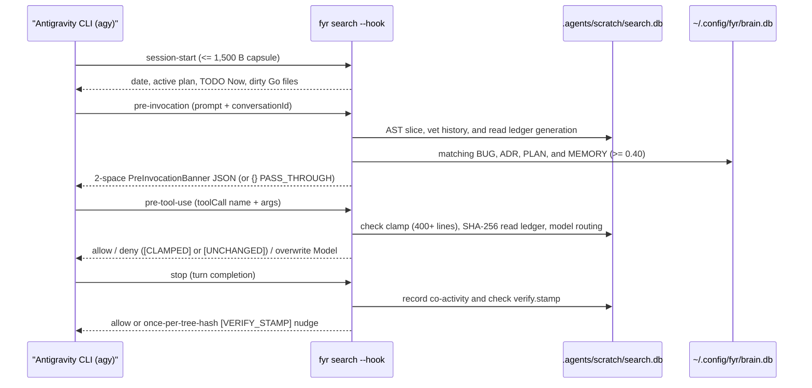
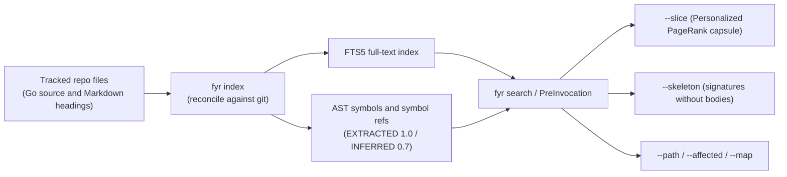
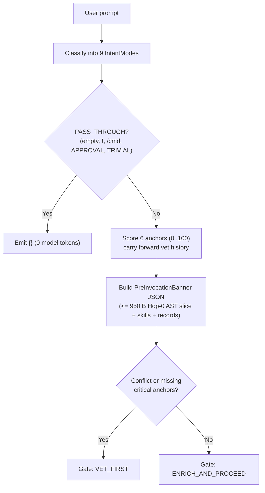
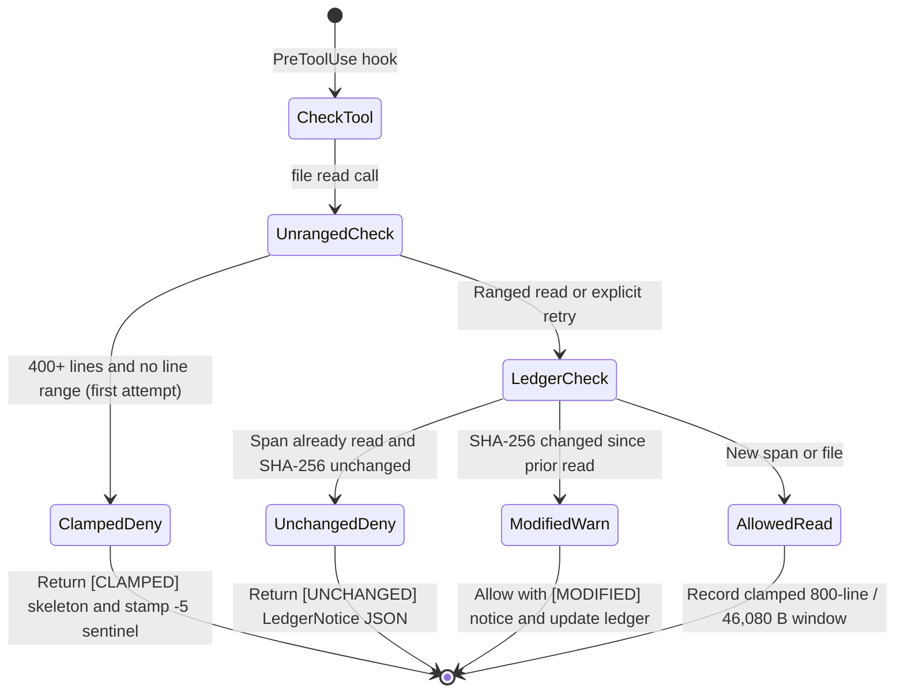

# CLI Hooks, Prompt Vetting & AST Graph

`fyr` operates as a zero-daemon second brain inside Antigravity CLI sessions through `< 250 ms` fail-open hooks (`~/.gemini/config/hooks.json`) backed by a derived SQLite FTS5 + pure-Go AST symbol graph in `.agents/scratch/search.db`. Every turn receives relevant architectural context, stale-read protection, and cryptographic prompt-injection boundaries without background servers or CGo dependencies.

## Hook lifecycle across a turn

Antigravity invokes `fyr search --hook` across four active lifecycle events (`session-start`, `pre-invocation`, `pre-tool-use`, and `stop`) with `PostToolUse` reserved under the same `< 250 ms` read-only contract (`PRD.md` R3, `internal/search/hook.go`, `internal/search/hook_deadline.go`). Every hook runs inside a hard `200 ms` internal deadline (`defaultHookDeadline`) and fails open with an `allow` decision or `{}` response if a store is locked, unavailable, or disabled via `~/.config/fyr/no-hooks` or `.agents/scratch/no-hooks`.

At `session-start`, `handleSessionStart` (`internal/search/hook_session_start.go`) skips spawning `git` binaries and walks the git index directly (`hook_git_index.go`) to deliver a `<= 1,500`-byte `SESSION_START` capsule containing the date, active plan title, `TODO.md` `Now` items, and dirty Go file count.

## Pure-Go AST and Markdown symbol graph

`fyr index` builds a derived cache in `.agents/scratch/search.db` (`schemaVersion = "6"`) using Go's stdlib `go/ast` parser and a Markdown ATX-heading extractor (`internal/search/symbols_go.go`, `internal/search/symbols_md.go`). It stores symbol definitions, file line ranges, `EXTRACTED` (`1.0` confidence) and `INFERRED` (`0.7` confidence) references, and passive file `co_activity` weights without CGo or Tree-sitter bindings.

You can query the graph directly from the terminal or inside subagent reconnaissance:

- **`fyr search --slice <query>`:** Computes a Personalized PageRank slice (`0`/`1`/`2` hops, default budget `2,000` tokens) combining Hop-0 symbol pivots, 1-hop skeleton neighbors, and linked `brain.db` records, falling back to FTS5 hits when a natural-language query has zero symbol pivots (`hook_fts_fallback.go`).
- **`fyr search --skeleton <file>`:** Returns declaration start–end line ranges and signatures (or Markdown headings) so you only read the line slice you need.
- **`fyr search --affected <target>` & `--path <from> --to <to>`:** Traces reverse-BFS blast radius (`<= 2` hops) or shortest call/import paths (`<= 6` hops) across files and packages.
- **`fyr search --map`:** Surfaces the top-10 God Nodes by PageRank, package import dependencies, and elementary dependency cycles.

## Stateful prompt vetting and progressive injection

On `pre-invocation`, `VetPrompt` (`internal/search/vet.go`) classifies every turn in under `25 ms`, evaluates prompt completeness, detects `PRD.md` / `ADR-*` conflicts, and wraps all retrieved data inside a per-turn cryptographic fence (`=====<18-hex>=====`, `internal/search/fence.go`). Untrusted file snippets or record text inside `BEGIN DATA` / `END DATA` fences can never act as model instructions.

Seven deterministic mechanics keep enriched turns concise and token-efficient:

1. **Nine intent modes:** Classifies prompts into `APPROVAL`, `CORRECTION`, `QUESTION`, `TRIVIAL`, `TASK`, `BUG`, `FEATURE`, `REVIEW`, or `RELEASE` (`IntentQuestion` never forces `SecurityRequired`).
2. **Six completeness anchors:** Evaluates `target`, `goal`, `scope`, `inputs_outputs`, `constraints`, and `verification` (`0..100` `VetScore`), carrying forward prior-turn anchors from `vet_history` across follow-up turns.
3. **Deduplication and compaction re-priming:** Tracks injected skills and record IDs per compaction generation in `read_ledger` (`start_line = -4`, `internal/search/hook_dedup.go`); when Antigravity compacts context, the generation increments and `PreInvocation` automatically re-primes active plans and rules.
4. **Progressive memory injection:** Injects matching `procedural` and `episodic` memories (`validity >= 0.40`, plus matching `semantic` and `--global` memories) up to `4` memories inside the `6`-record cap.
5. **Advisory feature routing:** Adds a `route` recommendation (`internal/search/vet_route.go`) pointing to `/fyr-feature`, `/fyr-bug`, `/fyr-review`, or `/fyr-swarm` when triggers match.
6. **Lean JSON envelope:** Emits one 2-space pretty-printed `PreInvocationBanner` JSON object (`Metadata == nil`, `internal/search/telemetry_json.go`) with exact `model` display name and `thinking` effort resolved via `internal/search/telemetry_model.go`.

## Read deduplication, clamping, and subagent routing

On `pre-tool-use`, `fyr` guards file reads, writes, and subagent/workflow dispatches (`internal/search/hook_clamp.go`, `internal/search/read_ledger_edit.go`, `internal/search/hook_subagent.go`, `internal/search/hook_workflow.go`):

- **Skeleton-first read clamping (`hook_clamp.go`):** First-time unranged reads of files `>= 400` lines receive a `[CLAMPED]` denial containing the AST skeleton (up to `60` lines) and SHA-256 digest; an immediate ranged read (or an explicit second unranged retry) succeeds without deadlock.
- **Persistent hash-keyed read ledger (`read_ledger`):** Tracks every line range read per conversation generation, modeling `read_file`'s `800`-line / `46,080`-byte window. Editing a file (`replace_file_content`, `write_to_file`) invalidates overlapping spans in the ledger and requires a prior read when modifying existing files (`hook_guard.go`).
- **Subagent, workflow, and swarm model routing:** Blocks weak/fast model overrides on guarded subagents (`reviewer`, `security`, `verifier`, `dreamer`), automatically upgrades fast execution sessions to `"pro"` via `overwrite`, inspects `run_workflow` Python scripts via AST checks (`hook_workflow.go`), and routes `swarm` `add` workers by name prefix (`judge`/`reviewer`/`verifier` vs `planner`/`builder`/`mechanical`) against `~/.config/fyr/models.json` with `20%` weekly / `30%` 5-hour quota fallback.

## Stop verification nudge and co-activity

When a turn ends normally, `handleStopHook` (`internal/search/hook_stop_stamp.go`) records passive file `co_activity` pairs to improve future `--slice` ranking and writes live session progress to `<appDataDir>/brain/<conv-id>/fyr-process.md` (`internal/search/telemetry_process.go`). If the current session modified Go source or module files (`*.go`, `go.mod`, `go.sum`) and `.agents/scratch/verify.stamp` is missing or mismatches the current Go tree SHA-256, the `Stop` hook emits a once-per-tree-hash `[VERIFY_STAMP]` continuation nudge asking the agent to run `fyr verify`—without ever invoking `go test` inside the hook itself.

Search, AST graph, index, and hook CLI flag reference

### `fyr search` flags

| Flag | Default | Purpose |
|---|---|---|
| `--limit N` | `10` | Cap printed records and ranked file hits (`1`–`50`) |
| `--kind K` | `""` | Filter hits by kind (`bug`, `adr`, `plan`, `change`, `handoff`, `review`, `testing`, `retro`, `spec`, `deploy`, `trail`, `code`, `doc`, `feedback`, `proposal`, `learning`, `guide`, `memory`) |
| `--refs REF` | `""` | Find every record naming an ID (`BUG-NNN`, `ADR-NNN`), file path, or directory (`dir/`) |
| `--open` | `false` | List open plans, open bugs, current specs/guides/deploys, and queued proposals |
| `--global` | `false` | Include global records and every project opted in with `fyr index --register` |
| `--json` | `false` | Emit structured JSON output |
| `--slice QUERY` | `""` | Build a tiered PageRank AST context capsule for `QUERY` |
| `--hops N` | `2` | Maximum graph traversal hops for `--slice` (`0`–`6`) |
| `--budget N` | `2000` | Approximate token budget (`chars / 4`) for `--slice` |
| `--session ID` | `""` | Boost files read in conversation `ID` by `50x` during `--slice` ranking |
| `--skeleton FILE` | `""` | Print declaration/heading line ranges without bodies for `FILE` |
| `--path SYM` | `""` | Shortest call, type, or interface path from `SYM` (`<= 6` hops; combine with `--to SYM`) |
| `--to SYM` | `""` | Target symbol for `--path` |
| `--affected TARGET` | `""` | Reverse-BFS blast radius (`<= 2` hops) for a file path or symbol |
| `--map` | `false` | Print top-10 God Nodes by PageRank, package import edges, and cycle check |
| `--vet PROMPT` | `""` | Run the 9-mode intent, 6-anchor vetter, and skill/record prefetcher for `PROMPT` |
| `--hook EVENT` | `""` | Execute Antigravity lifecycle hook (`session-start`, `pre-invocation`, `pre-tool-use`, `stop`; `PostToolUse` reserved under `< 250 ms` contract) |

### `fyr index` flags

| Flag | Default | Purpose |
|---|---|---|
| `--global` | `false` | Reconcile `~/.config/fyr/search.db` instead of the local checkout's `.agents/scratch/search.db` |
| `--rebuild` | `false` | Delete and rebuild the target `search.db` from scratch |
| `--register` | `false` | Write `.git/fyr-registered` consent so `fyr search --global`, `fyr dream --all`, and `fyr auto` can read this project |

## Next steps

- Check [Brain Store, Trail & Memory](brain-and-memory.md) to see how matched `brain.db` records and `validity >= 0.40` memories feed `PreInvocation` and `fyr resume`.
- Run `fyr search --map` inside any indexed checkout to inspect God Nodes and dependency cycles.
