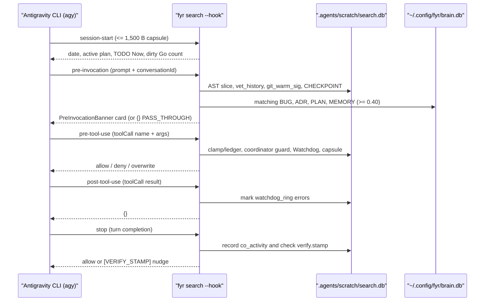
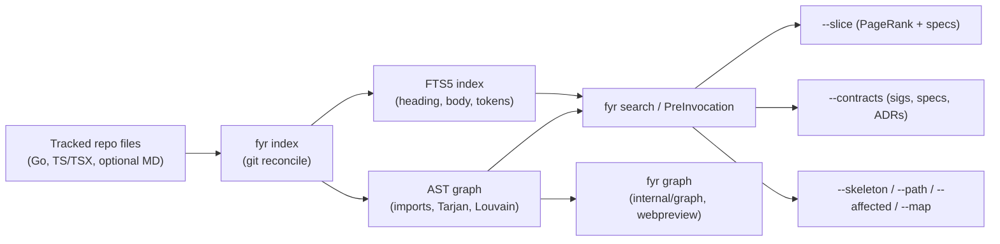
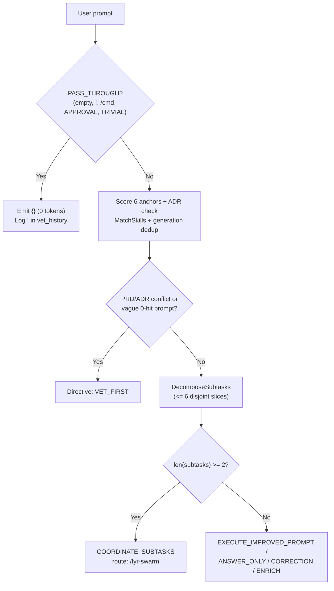
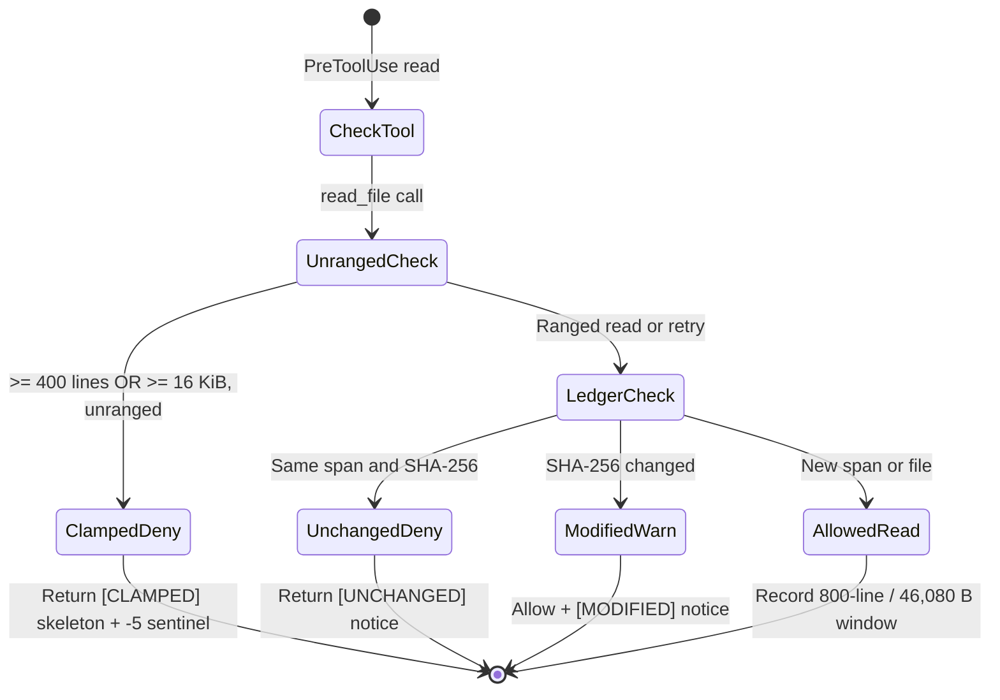
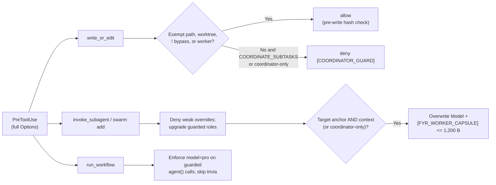
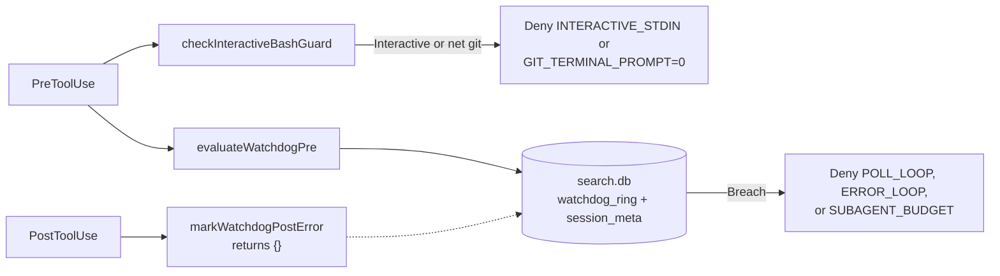
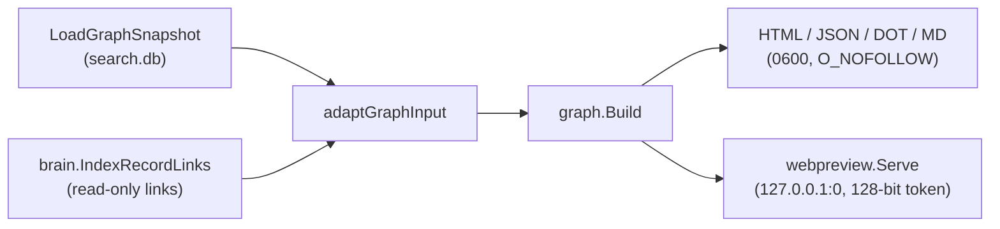

# CLI Hooks, Prompt Vetting & AST Graph

`fyr` delivers a zero-daemon second brain inside Antigravity CLI sessions via `< 250 ms` fail-open hooks (`~/.gemini/config/hooks.json`). A derived SQLite FTS5 and pure-Go AST symbol graph in `.agents/scratch/search.db` backs every query without CGo. Each turn gets architectural slices, contract digests, deduplicated skills, subtask splits, Coordinator write guards, and `[FYR_WORKER_CAPSULE]` worker context.

## Hook lifecycle across a turn

Antigravity calls `fyr search --hook` across five events (`session-start`, `pre-invocation`, `pre-tool-use`, `post-tool-use`, `stop`) under `< 250 ms` (`PRD.md` R3, `internal/hooks/hook.go`). Every hook obeys a `200 ms` deadline (`defaultHookDeadline`) and fails open if stores are locked or missing. Regular marker files at `~/.config/fyr/no-hooks` or `.agents/scratch/no-hooks` disable hooks (`os.Lstat`; `FYR_RELAY=1` ignores repo-local markers).

At `session-start`, `handleSessionStart` (`internal/hooks/hook_session_start.go`) walks the git index directly (`internal/hooks/guard/hook_git_index.go`) without spawning `git`. It emits a `<= 1,500`-byte `SESSION_START` capsule with the date, active plan, `TODO.md` `Now` items, and dirty Go count.

## Pure-Go AST and Markdown symbol graph

`fyr index` maintains a derived symbol and FTS5 cache in `.agents/scratch/search.db`. Warm `PreInvocation` stays under `80 ms` and mid-turn dedup under `15 ms` via `git_warm_sig` and incremental `applyDirtyPaths` (`internal/search/reconcile.go`). Compaction detection (`scanTranscriptCheckpoint`), parallel slice assembly (`<= 120 ms`), lightweight subagent routing, and timeout fallback stamps (`internal/hooks/hook_deadline.go`) protect latency.

Go `go/ast`, a TypeScript/TSX scanner (`internal/symgraph/symbols_ts.go`), and a Markdown heading extractor (`internal/symgraph/symbols_md.go`) populate symbols while in-place migrations preserve behavioral tables (`PRD.md` R4). The indexer resolves Go `go.mod` aliases and TS/TSX imports, normalizes package paths (`internal/symgraph/pkg_paths.go`) so multiple `package main` directories never collide, and skips generated Go files plus docs unless `--include-docs` is set. Over `import`, `call`, and `type_ref` edges, `fyr` computes PageRank, Tarjan SCCs (`internal/symgraph/graph_tarjan.go`), Louvain communities (`internal/symgraph/graph_louvain.go`), and structural signals.

Query the graph and linked contracts from the terminal or inside subagent reconnaissance:

- **`fyr search --slice`:** Builds a PageRank slice (`0`–`2` hops, default `2,000` tokens) with linked records and FTS5 fallback. CLI mode prints a clean `<= 600 B` `spec_contracts:` digest; hook mode wraps it in a `crypto/rand` `BEGIN DATA` fence.
- **`fyr search --contracts`:** Projects exported Go/TS signatures (`[CODE_SIGNATURES]`), linked `SPEC-*` contracts, and accepted `ADR-*` `[GUARDRAILS]` (`internal/search/contracts.go`). It reads per-scope `brain.db` specs (`brain.ListCurrentSpecsCtx`) with `.agents/trail.jsonl` fallback on unsynced clones.
- **`fyr search --skeleton`:** Prints declaration line ranges and signatures (or Markdown headings) so callers read only needed lines.
- **`fyr search --affected` & `--path`:** Traces reverse-BFS blast radius (`<= 2` hops) or shortest call and import paths (`<= 6` hops).
- **`fyr search --map`:** Prints top-10 God Nodes by PageRank, package import dependencies, and dependency cycles.

## Stateful prompt vetting, directives, and decomposition

On `pre-invocation`, `VetPrompt` (`internal/vet/vet.go`) classifies every turn in `< 25 ms` and scores six completeness anchors. It detects `PRD.md` or `ADR-*` conflicts, splits multi-part prompts into disjoint subtasks, and wraps untrusted data in cryptographic fences (`=====<18-hex>=====`, `internal/vet/fence.go`). The hook emits one fenced `text` `PreInvocationBanner` card (`Metadata == nil`).

Six deterministic mechanics keep enriched turns concise and Coordinator-aligned:

1. **Nine intents and conflict-only `VET_FIRST`:** Classifies `APPROVAL`, `CORRECTION`, `QUESTION`, `TRIVIAL`, `TASK`, `BUG`, `FEATURE`, `REVIEW`, and `RELEASE`. `decideVetGate` fires `VET_FIRST` only on `PRD.md`/`ADR-*` conflicts or ultra-vague zero-hit `<= 6`-word `FEATURE`/`BUG` prompts.
2. **Directive precedence (`preInvocationDirective`):** Orders `PASS_THROUGH` > `VET_FIRST` > `COORDINATE_SUBTASKS` > `ANSWER_ONLY` / `CORRECTION` > `EXECUTE_IMPROVED_PROMPT` > `ENRICH_AND_PROCEED`. Two or more subtasks route to `/fyr-swarm`.
3. **`ImprovedPrompt:` and memory:** Populates `ImprovedPrompt:` on mid-score turns (`45`–`79`), conflicts, follow-ups, or multi-subtask prompts. It skips questions and corrections, and injects up to `4` memories (`validity >= 0.40`) within `6` records.
4. **BM25F skill prefetcher (`MatchSkills`):** Scores installed skills (`minSkillBM25Score = 3.2`) and returns at most `3`. It drops skills shown in the last `3` turns unless a new surface appears, and re-primes after compaction via `generation_id` sentinels (`start_line = -4`).
5. **Subtask decomposition (`DecomposeSubtasks`):** Splits multi-clause or multi-package prompts into up to `6` disjoint `SubtaskSlice` items, coalescing overflow via Louvain communities. It skips read-only diagnostics, `PASS_THROUGH`, `!`-bypass, questions, corrections, and worker briefs.
6. **Card rendering and state:** Resolves exact `agy` `model`, display name, and `thinking` effort (`internal/hooks/telemetry/telemetry_model.go`). `vet_history` and `session_meta` persist turn stats, `!`-bypasses, `[CONTEXT_KNEE_WARNING]` dedup, and `CHECKPOINT` offsets.

## Read deduplication and file clamping

On `pre-tool-use`, dual-gate clamping and a SHA-256 read ledger prevent full-file bloat and duplicate reads (`internal/hooks/hook_clamp.go`, `internal/search/read_ledger.go`).

- **Dual-gate clamping:** First unranged reads of `>= 400` lines or `>= 16,384` bytes receive a `[CLAMPED]` denial with a `60`-line skeleton. A `-5` sentinel (`clampOnceSentinelLine`) permits ranged reads or an explicit retry.
- **Out-of-root bypass:** `PreToolUse` `read_file` passes through immediately for paths outside the workspace root or in unindexed directories.
- **SHA-256 read ledger:** Tracks `800`-line / `46,080`-byte windows per generation. `ParseBashFileReads` (`internal/search/read_ledger.go`) enforces `[CLAMPED]` and `[UNCHANGED]` across 18 Bash read patterns and read-only pipes. Edits keep `-5` sentinels, invalidate overlapping spans, and require a prior read before modifying existing files.

## Coordinator write guard and worker JIT capsules

Isolated subagents and swarm workers share zero parent conversation memory (`PRD.md` R0). `PreToolUse` blocks direct Coordinator source edits on multi-subtask turns and injects `[FYR_WORKER_CAPSULE]` context into worker briefs (`internal/hooks/guard/hook_coordinator.go`, `internal/hooks/hook_worker_capsule.go`).

- **`[COORDINATOR_GUARD]`:** Denies direct source edits when a turn records `COORDINATE_SUBTASKS`, `SubtaskCount >= 2`, or a regular `coordinator-only` marker (`PRD.md` R6). Exemptions allow `.agents/scratch/**` (no symlinks), `TODO.md`, linked git worktrees, `!`-bypasses, and worker briefs.
- **Deny-first model routing:** Denies weak model overrides on guarded roles (`reviewer`, `verifier`, `security`, `dreamer`) and `swarm` `judge` prefixes. Session resolution applies `30%` 5h and `20%` week headroom fallbacks (`internal/hooks/hook_subagent_models.go`).
- **`[FYR_WORKER_CAPSULE]` (`<= 1,200 B`):** Triggers once when a target path exists and context is non-empty (or `coordinator-only` is active). It keeps `Files:` verbatim and packs fenced blocks in priority order: files, `<= 3` records (`140 B`), top skill (`<= 400 B`), `Hop-0` slice, and `<= 600 B` `spec_contracts`.
- **`run_workflow` allowlist (`internal/hooks/guard/hook_workflow.go`):** Limits scripts to workspace files or `~/.gemini/config/workflows/*.py` (`<= 1 MiB`), rejecting `..` and symlinks. It enforces `model="pro"` on guarded Python `agent(...)` calls while skipping string literals and comments.

## Watchdog breakers, bash stdin guard, and PostToolUse

`PreToolUse` and `PostToolUse` share a two-layer Watchdog and interactive Bash guard inside the `200 ms` fail-open budget (`internal/hooks/hook_watchdog.go`, `internal/hooks/guard/hook_bash_guard.go`). `watchdog_ring` and `session_meta` in `.agents/scratch/search.db` break loops and budget overruns before burning context.

| Breaker / Hook | Implementation | Behavior |
|---|---|---|
| `[INTERACTIVE_STDIN]` | `internal/hooks/guard/hook_bash_guard.go` | Blocks interactive stdin (`read -p`, `ssh` without `-o BatchMode=yes` + command) and prepends `export GIT_TERMINAL_PROMPT=0; ` on network `git` calls |
| `[KICKOFF_GUARD]` | `internal/hooks/guard/hook_pretool_ask.go` | Denies mid-build `ask_question` calls during Kickoff or worker turns unless citing a `PRD.md`/ADR conflict, Re-plan trigger, or quota exhaustion |
| `[SEARCH_NUDGE]` | `internal/hooks/guard/hook_pretool_nudge.go` | Emits one allow-with-notice nudge per turn steering indexed symbol greps toward `fyr search --refs` or `--slice` |
| `[POLL_LOOP]` | `internal/hooks/hook_watchdog.go` | Breaks repeated polling tool-call loops tracked in `watchdog_ring` |
| `[ERROR_LOOP]` | `internal/hooks/hook_watchdog_ring.go` | Breaks `>= 3` identical failing calls or A-B-A-B repeating error loops in `watchdog_ring` |
| `[SUBAGENT_BUDGET]` | `internal/hooks/hook_watchdog.go` | Tracks per-session `tool_calls` in `session_meta`, warning then denying at `(90, 120)` for builders and `(25, 40)` for audit roles |
| `post-tool-use` | `internal/hooks/hook_watchdog.go` | Marks `watchdog_ring` failures by `HookToolCall.ID` or tool fallback and returns `{}` |

## Stop verification nudge and co-activity

When a turn ends normally, `handleStopHook` (`internal/hooks/hook_stop_stamp.go`) records passive `co_activity` pairs to improve future `--slice` ranking. It writes live progress to `<appDataDir>/brain/<conv-id>/fyr-process.md`. If Go files changed without a matching `.agents/scratch/verify.stamp`, `Stop` emits one `[VERIFY_STAMP]` nudge without running `go test`.

## Repository constellation and web preview (`fyr graph`)

`fyr graph` (`cmd/fyr/verb_graph.go`, `internal/graph/`, `internal/webpreview/`) renders the repository symbol graph with read-only `brain.db` record links (`brain.IndexRecordLinks`). It outputs an offline HTML constellation, JSON, DOT, Markdown, or a localhost preview server. Both `internal/graph` and `internal/webpreview` stay free of SQLite imports.

- **Outputs and file safety:** Writes `.agents/scratch/graph.html` (`0600`, `O_NOFOLLOW`) by default and refuses overwrites without `--force`. `--dot`, `--md`, and `--json` print to stdout or write `--out`.
- **Localhost web preview (`--web`):** Binds `127.0.0.1:0` behind a 128-bit `crypto/rand` `/<token>/...` path verified with `subtle.ConstantTimeCompare`. It allows `GET` and `HEAD` only (`404`/`405` otherwise) with offline `DefaultHTMLCSP` headers.
- **Interactive `<canvas>` constellation:** Switches granularity (`Packages`, `Files`, `Symbols`) and overlays (`Community`, `Layer`, `In-Degree Heat`, `Agent Read Churn`). Payloads embed via `sanitizeEmbeddedJSON` with zero `innerHTML` or `eval` sinks.

## Next steps

Explore full CLI flags, inspect how brain records feed `PreInvocation`, or preview your symbol graph:

- See all flags in the [CLI Reference for `fyr search`](../docs/cli-reference.md#fyr-search), [`fyr graph`](../docs/cli-reference.md#fyr-graph), and [`fyr index`](../docs/cli-reference.md#fyr-index).
- Read [Brain Store, Trail & Memory](brain-and-memory.md) to see how matched records feed `PreInvocation` and `fyr resume`.
- Run `fyr search --map`, `fyr search --contracts`, or `fyr graph --web` to inspect symbols and contracts.
