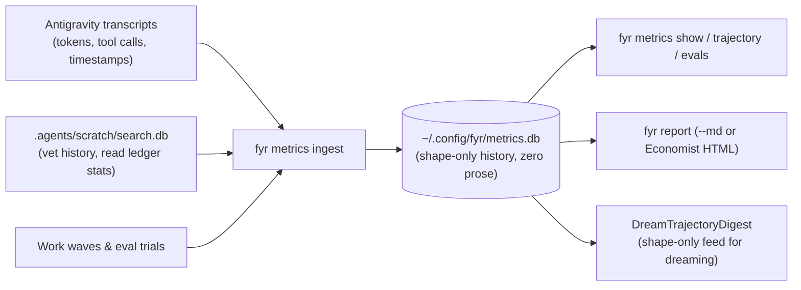
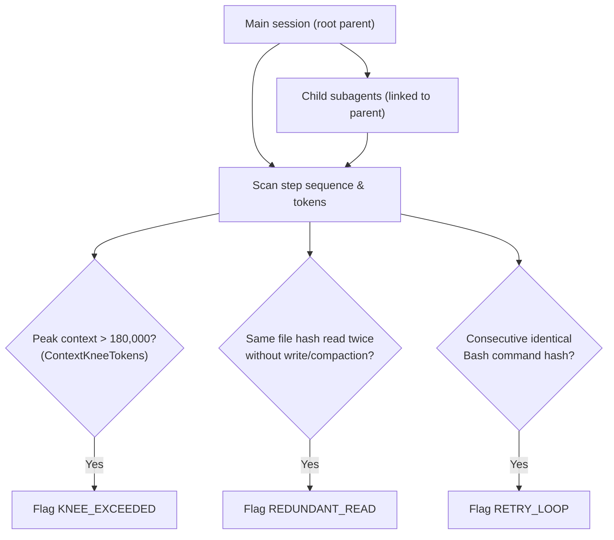

# Telemetry, Trajectories & Economist Usage Reports

`fyr metrics` and `fyr report` capture the structural shape of every Antigravity session inside `~/.config/fyr/metrics.db` (`internal/metrics`) so you can track token economics, context compaction knees, second-brain leverage, subagent anomalies, and behavioural eval pass rates—without ever storing your prompts, code, or file paths.

## Privacy-first telemetry pipeline

`fyr metrics ingest` reads Antigravity conversation databases, per-project `.agents/scratch/search.db` tables (`vet_history` and `read_ledger_stats`), wave status files (`~/.config/fyr/work/*/status.json`), and `fyr eval` trial outcomes into `~/.config/fyr/metrics.db`. Every shell verb is normalized and every file path inside `steps` is converted into a salted hash prefixed by `"r:"` (ranged read) or `"f:"` (full read) so `fyr uninstall` can leave `metrics.db` safely behind as long-term history (`R4`).

Because `metrics.db` preserves session shapes even after old Antigravity conversation transcripts expire, schema migrations (`1` through `7`) always move forward without rebuilding or truncating historical rows. You can back up the entire database (excluding the `cmd_hash` salt) as `0600` JSONL at any time using `fyr metrics export <file>`.

## Wall-time decomposition and trajectory anomaly detection

`fyr metrics show` breaks session duration into four exact buckets (`model`, `tool`, `wait`, and `idle` minutes) alongside `search : grep` ratios and ranged-read percentages. To inspect individual conversations and subagent trees, `fyr metrics trajectory` (`internal/metrics/trajectory.go`) reconstructs parent-to-child lineage and flags three performance anomalies automatically:

When `fyr dream` or `fyr auto` runs consolidation, `Store.DreamTrajectoryDigest` (`internal/metrics/dream_digest.go`) aggregates session counts, median peak tokens, anomaly counts, and model pass rates into a strictly shape-only digest so the dreamer learns from behavioral efficiency patterns without leaking raw session text.

## Six-section usage reports (`fyr report`)

`fyr report` (`cmd/fyr/verb_report.go`, `internal/metrics/report_md.go`, `internal/metrics/trigger_coverage.go`) combines `metrics.db` and `brain.db` into an Economist-styled self-contained HTML report (`~/.config/fyr/reports/<date-time>-metrics.html`, mode `0600`, never overwriting an existing file) or terminal-friendly Markdown (`--md`). Inside a git checkout, `fyr report` defaults to `--project` for that checkout; outside a checkout, it defaults to `--global`.

| Section | What It Measures |
|---|---|
| **1. Executive Pulse** | Sessions, subagents, turns, tool calls, active vs wall min, `model`/`tool`/`wait`/`idle` split, token breakdown, peak context, compactions |
| **2. Second-Brain Leverage** | `Search : grep` ratio, ranged read %, redundant reads, turn vets, mean vet score, `VET_FIRST` / bypassed turns, pivots seeded, read-ledger blocks saved |
| **3. Quality & Learning Loop** | DoD closure rate, verifier `PASS`/`FAIL`, review findings (`high`/`medium`/`low`), escaped bugs, `FEEDBACK-*` corrections, tool error rate, `pass^k` eval summary |
| **4. Autonomy & Model Routing** | Work waves/workers, worker verdicts, `Base-Check` verdicts, cross-family judge verdicts & fallbacks, top subagent tool calls |
| **5. Trigger coverage** | KPI coverage vs targets (`>= 80%` worker phases, `= 0` build-time questions, `>= 1.0` `Search : grep`, `> 0` read-ledger blocks, `fyr auto` runs/wk, `>= 80%` DoD closed) |
| **6. Per-Project / Project Breakdown** | Cross-project table in `--global` mode, or top skills and subagents in `--project` mode |

Metrics and report CLI subcommands and flags reference

### `fyr metrics` subcommands

| Subcommand | Flags | Purpose |
|---|---|---|
| `fyr metrics ingest` | `--source DIR`, `--label KEY=VALUE`, `--outcome pass\|fail\|error` | Ingest Antigravity sessions, `search.db` stats, and wave status into `metrics.db` |
| `fyr metrics show` | `--since YYYY-MM-DD`, `--until YYYY-MM-DD`, `--project DIR`, `--label KEY=VALUE`, `--all-labels`, `--context-target N`, `--json` | Print aggregated efficiency, time split, adherence, and reliability summary |
| `fyr metrics report` | `--since`, `--until`, `--project [DIR]`, `--global`, `--md`, `--label`, `--all-labels`, `--context-target N`, `--out FILE` | Render the six-section HTML or Markdown report |
| `fyr metrics evals` | `--since`, `--until`, `--harness KEY`, `--json` | Summarize `fyr eval` trial histories with Wilson 95% intervals and efficiency means |
| `fyr metrics trajectory` | `[<session-id>]`, `--project DIR`, `--limit N`, `--json` | Print turn token curves, subagent trees, and `KNEE_EXCEEDED`/`REDUNDANT_READ`/`RETRY_LOOP` flags |
| `fyr metrics export <file>` | (global flags only) | Export `metrics.db` rows (excluding `cmd_hash` salt) as `0600` JSONL |

### `fyr report` flags

| Flag | Default | Purpose |
|---|---|---|
| `--project [DIR]` | Current checkout when inside git | Scope report to one project checkout |
| `--global` | Default outside a git checkout | Aggregate metrics across all projects |
| `--md` | `false` | Output Markdown instead of Economist HTML |
| `--out FILE` | `~/.config/fyr/reports/<date-time>-metrics.html` | Write report to `FILE` (`0600`, refuses overwrite) |
| `--since YYYY-MM-DD` | 30 days ago | Window start date (inclusive) |
| `--until YYYY-MM-DD` | Now | Window end date (exclusive) |
| `--label KEY=VALUE` | `""` | Include only labelled (sandbox/eval) sessions matching `KEY=VALUE` |
| `--all-labels` | `false` | Include all labelled sessions alongside normal sessions |
| `--context-target N` | `300000` | Peak context threshold reported in `Executive Pulse` |

## Next steps

- Run `fyr report --md` in any project directory to see your second-brain leverage and trigger coverage immediately.
- Run `fyr metrics trajectory --limit 5` to inspect token growth and check for `REDUNDANT_READ` or `KNEE_EXCEEDED` sessions.
