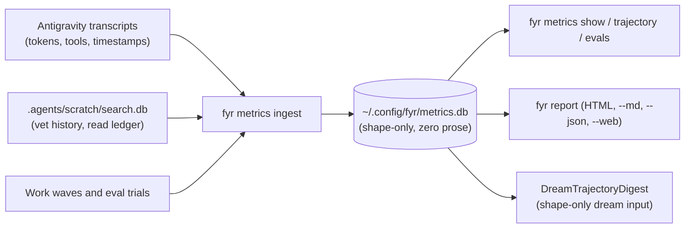
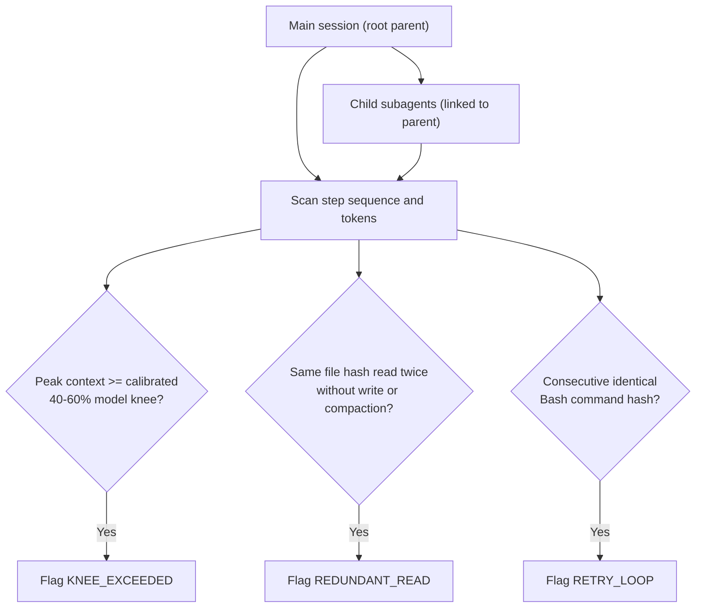

# Telemetry, Trajectories & Economist Usage Reports

`fyr metrics` and `fyr report` capture the structural shape of Antigravity sessions in `~/.config/fyr/metrics.db` (`internal/metrics`). They track token economics, context knees, second-brain leverage, subagent anomalies, and eval pass rates. Telemetry never stores prompts, source code, or raw file paths.

## Privacy-first telemetry pipeline

`fyr metrics ingest` reads Antigravity transcripts, `.agents/scratch/search.db` (`vet_history`, `read_ledger_stats`), wave status files, and `fyr eval` outcomes into `~/.config/fyr/metrics.db`. Ingest normalizes every shell verb and replaces file paths inside `steps` with salted hashes (`"r:"` ranged, `"f:"` full). Because `metrics.db` contains zero prose, `fyr uninstall` leaves it safely behind as long-term history (`PRD.md` R4).

Five mechanics keep metrics accurate, private, and portable across hosts:

- **Forward-only history:** Schema migrations preserve older rows even after Antigravity transcripts expire. `fyr metrics export` writes `0600` JSONL without the `cmd_hash` salt, and `fyr state` transfers sanitized archives offline (`internal/state`).
- **Transcript mapping and joins:** Ingest (`internal/metrics/agy.go`, `internal/metrics/events_join.go`) maps `step_type = 23` checkpoints to `"compaction"` steps and joins eval `BrainHome` records. It anchors `skillPath` to installed skill roots and merges read-only `dev/fyr-eval` trials (`OpenDevEvalFallbackRO`).
- **Normalized reliability signals:** Telemetry tracks concrete model IDs with 14-day decayed role-partitioned `ModelEvidence`. It counts standalone `grep`/`rg` calls (`sv.n == 0`) for `Search : grep` and separates `ToolErrors` from `HookDenials`. Worker subagents use a `120`-call budget cap vs `40` for audit roles (`subagentCapForRole`).
- **Deltas and hysteresis:** `Summary.Numbers()`, `WindowDeltas`, and `DiagnosticReport` (`internal/metrics/diagnostics.go`) compute period comparisons and `high`/`medium`/`low` signals. Two-day hysteresis (`applyPersistenceHysteresis`) downgrades unconfirmed first-window `"high"` signals to `"medium"`. Sandbox roots stay excluded (`isSandboxProjectRoot`) unless `--include-sandboxes` is passed.
- **Orchestration and daily digests:** `fyr metrics record-run --json-in` logs shape-only `orchestration_runs` rows from workflow scripts. `WriteDailyReport` writes one `0600` `O_EXCL` daily summary at `<home>/.config/fyr/reports/YYYY-MM-DD-daily-metrics.html`.

## Wall-time decomposition and trajectory anomaly detection

`fyr metrics show` splits session wall time into four buckets (`model`, `tool`, `wait`, `idle`) alongside `search : grep` and ranged-read rates. `fyr metrics trajectory` (`internal/metrics/trajectory.go`) rebuilds parent-to-child subagent trees and detects three performance anomalies automatically.

During consolidation, `Store.DreamTrajectoryDigest` (`internal/metrics/dream_digest.go`) feeds session counts, median peak tokens, anomaly counts, and model pass rates into `fyr dream` and `fyr auto`. Context-knee counts use calibrated `[40%..60%]` effective windows (`models.CalibratedContextKnee`, capped at `180,000` or `300,000` tokens) plus logged `KNEE_EXCEEDED` events. The digest remains strictly shape-only and leaks no session prose.

## Scorecard, diagnostics, and usage reports (`fyr report`)

`fyr report` (`cmd/fyr/verb_report.go`, `internal/metrics/report.go`) runs incremental ingest first unless `--no-ingest` is set. It combines `metrics.db` and `brain.db` into Economist HTML (`~/.config/fyr/reports/<date-time>-metrics.html`, `0600`, zero `<script>` tags), Markdown (`--md`), JSON (`--json`), or localhost `--web` preview (`internal/webpreview`). Inside a git checkout it defaults to `--project`; outside a checkout it defaults to `--global`.

| Section | What It Measures |
|---|---|
| **0. Scorecard** (`internal/metrics/report_scorecard.go`) | Four KPI blocks (`Volume & Context`, `Second-Brain`, `Reliability`, `Window Deltas`) plus `Top-5 Diagnostic Signals` (`DiagnosticReport`) |
| **1. Executive Pulse** | Sessions, subagents, turns, tool calls, `model`/`tool`/`wait`/`idle` split, token breakdown, peak context, knee hits, and compactions |
| **2. Second-Brain Leverage** | `Search : grep` ratio, ranged read %, redundant reads, bash read bypasses, `PreInvocation` p50/p95 latency, timeouts, vet scores, pivots, skills, and clamp saves |
| **3. Quality & Learning Loop** | DoD closure rate, verifier verdicts, review findings, escaped bugs, `FEEDBACK-*` corrections, `session_ratings`, tool errors, hook denials, `pass^k` evals, and SIM counts |
| **4. Autonomy & Model Routing** | Work waves, `orchestration_runs`, deterministic gates, model-family share, guarded downgrades, over-budget subagents, quota pools, `fyr auto` asks, and judge verdicts |
| **Background Autonomy** (`internal/metrics/report_autonomy.go`) | Dream runs, duration and outputs, `fyr auto` runs, applied commits, session ratings, kept `work/auto-*` branches, and `PROPOSAL-*` counts |
| **Trigger coverage** (`internal/metrics/trigger_coverage.go`) | Live KPI coverage vs targets (`>= 80%` worker phases, `0` build questions, `>= 1.0` `Search : grep`, read-ledger blocks, `fyr auto` cadence, `>= 80%` DoD closed) |
| **5. Project Breakdown** | Cross-project table in `--global` mode (`Auto findings`, `Handoff lag`, excluding sandboxes by default), or top skills and subagents in `--project` mode |
| **Conditional Breakdowns** (`internal/metrics/report_sections.go`) | `Agent Roles`, `SIM` (problems, attempts, workarounds), `Skill & Rule Telemetry`, and `Tag Cohort` (`--since-tag` pre/post window) |

## Next steps

Generate a usage report, inspect recent token curves, or review full CLI options:

- See all flags in the [CLI Reference for `fyr metrics`](../docs/cli-reference.md#fyr-metrics) and [`fyr report`](../docs/cli-reference.md#fyr-report).
- Run `fyr report --md`, `fyr report --json`, or `fyr report --web` inside any project checkout.
- Run `fyr metrics trajectory --limit 5` to inspect token growth, `REDUNDANT_READ`, and `KNEE_EXCEEDED` flags.
