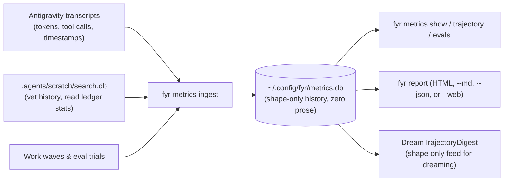
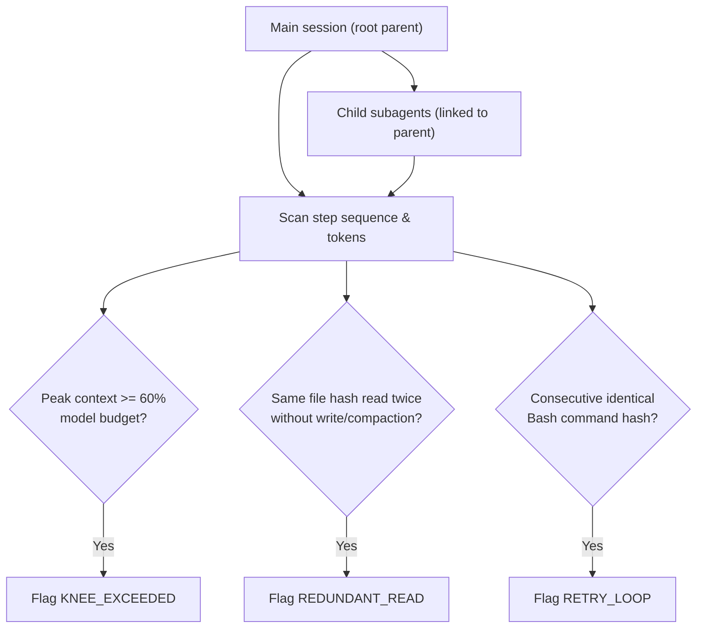

# Telemetry, Trajectories & Economist Usage Reports

`fyr metrics` and `fyr report` capture the structural shape of every Antigravity session inside `~/.config/fyr/metrics.db` (`internal/metrics`) so you can track token economics, context compaction knees, second-brain leverage, subagent anomalies, and behavioural eval pass rates—without ever storing your prompts, code, or file paths.

## Privacy-first telemetry pipeline

`fyr metrics ingest` reads Antigravity conversation databases, per-project `.agents/scratch/search.db` tables (`vet_history` and `read_ledger_stats`), wave status files (`~/.config/fyr/work/*/status.json`), and `fyr eval` trial outcomes into `~/.config/fyr/metrics.db`. Every shell verb is normalized and every file path inside `steps` is converted into a salted hash prefixed by `"r:"` (ranged read) or `"f:"` (full read) so `fyr uninstall` can leave `metrics.db` safely behind as long-term history (`R4`).

Because `metrics.db` preserves session shapes even after old Antigravity conversation transcripts expire, schema migrations (`1` through `12`, adding `session_ratings` in v8, `judge_verdicts` in v9, `background_runs` in v10, `repo_id` / `judge_verdicts.{worker_model,worker_session_id,repo_id}` / extended `turn_vets` in v11, and `daily_digests` in v12) always move forward without rebuilding or truncating historical rows. Telemetry tracks concrete catalog model IDs with `14`-day decayed `ModelEvidence`, separates `ToolErrors` from `HookDenials` (`agy_denials.go`, `show_types.go`), applies the `120`-call budget cap to `self`/`builder`/`builder-*` workers vs `40` for audit subagents (`subagentCapForRole` in `show_health.go`), and `fyr state export|import` (`internal/state`) transfers sanitized metrics archives offline. `Summary.Numbers()` (`internal/metrics/numbers.go`), `WindowDeltas` (`internal/metrics/deltas.go`), and `DiagnosticReport` (`internal/metrics/diagnostics.go`) compute period-over-period comparisons and high/medium/low diagnostic signals while filtering sandbox and scratch roots via `isSandboxProjectRoot` unless `--include-sandboxes` is passed; `WriteDailyReport` also writes a once-per-day `0600` `O_EXCL` summary at `<home>/.config/fyr/reports/YYYY-MM-DD-daily-metrics.html`, and `fyr metrics export <file>` backs up `metrics.db` (excluding the `cmd_hash` salt) as `0600` JSONL.

## Wall-time decomposition and trajectory anomaly detection

`fyr metrics show` breaks session duration into four exact buckets (`model`, `tool`, `wait`, and `idle` minutes) alongside `search : grep` ratios and ranged-read percentages. To inspect individual conversations and subagent trees, `fyr metrics trajectory` (`internal/metrics/trajectory.go`) reconstructs parent-to-child lineage and flags three performance anomalies automatically:

When `fyr dream` or `fyr auto` runs consolidation, `Store.DreamTrajectoryDigest` (`internal/metrics/dream_digest.go`) aggregates session counts, median peak tokens, anomaly counts (`DreamTrajectoryDigest.KneeExceeded` counts distinct label-free sessions reaching `>= 60%` of their model's effective context budget via `models.ContextKneeWithOverrides`, default `ContextKneeTokens` `180,000`, or recording `LOWER(events.kind) = 'knee_exceeded'`), and model pass rates into a strictly shape-only digest so the dreamer learns from behavioral efficiency patterns without leaking raw session text.

## Scorecard, diagnostics, and usage reports (`fyr report`)

`fyr report` (`cmd/fyr/verb_report.go`, `internal/metrics/report.go`, `internal/metrics/report_sections.go`) combines `metrics.db` and `brain.db` into a self-contained Economist-styled HTML report (`~/.config/fyr/reports/<date-time>-metrics.html`, mode `0600`, zero `<script>` tags, never overwriting an existing file; omitting the `Cost per day (USD)` SVG when `hasAnyCost` is false / `sum.B.CostUSD` is nil), Markdown (`--md`), structured JSON (`--json` via `RenderJSONReport` / `WriteJSONReport`), or an authenticated localhost preview (`--web [--listen HOST:PORT]` via `serveReportWeb` in `cmd/fyr/verb_report.go` using `webpreview.Serve` in `internal/webpreview` serving `/`, `/report.html`, `/report.md`, and `/report.json`). Background runs also call `WriteDailyReport` to emit `~/.config/fyr/reports/YYYY-MM-DD-daily-metrics.html` (`0600`, `O_EXCL`), returning quietly when today's file already exists. Inside a git checkout, `fyr report` defaults to `--project` for that checkout; outside a checkout, it defaults to `--global`.

| Section | What It Measures |
|---|---|
| **0. Scorecard** (`report_scorecard.go`) | 4 KPI categories (`1. Volume & Context`, `2. Second-Brain`, `3. Reliability`, `4. Window Deltas` via `WindowDeltas`) plus `Top-5 Diagnostic Signals` (`DiagnosticReport`: `Severity`, `SignalID`, `Metric`, `Current -> Previous`, `Delta`, `Summary`) |
| **1. Executive Pulse** | Sessions, subagents, turns, tool calls, active vs wall min, `model`/`tool`/`wait`/`idle` split, token breakdown, peak context, sessions `>= 60%` knee, compactions |
| **2. Second-Brain Leverage** | `Search : grep` ratio, ranged read %, redundant reads, turn vets, mean vet score, `VET_FIRST` / bypassed turns, pivots seeded, read-ledger blocks saved, `[CLAMPED]` saves |
| **3. Quality & Learning Loop** | DoD closure rate, verifier `PASS`/`FAIL`, review findings (`high`/`medium`/`low`), escaped bugs, `FEEDBACK-*` corrections, `session_ratings` (rated sessions, mean outcome & token efficiency), tool error rate, `pass^k` eval summary |
| **4. Autonomy & Model Routing** | Work waves/workers, `v9 orchestration`, `Deterministic gates`, `Model-family share`, `Guarded subagent downgrades`, `Subagents over budget`, `Live quota pools`, `fyr auto` open asks / verdict, worker/`Base-Check`/cross-family judge verdicts & fallbacks, top subagent tool calls |
| **Background Autonomy** (`report_autonomy.go`) | `Dream runs (pass / fail)`, `Dream mean duration / outputs`, `Auto runs (pass / fail)`, `Auto workers run / applied commits`, `Session ratings (outcome / token efficiency)`, `Kept work/auto-* branches`, `PROPOSAL-* records (queued / closed)` |
| **Trigger coverage** (`trigger_coverage.go`) | KPI coverage vs targets (`>= 80%` worker phases, `= 0` build-time questions, `>= 1.0` `Search : grep`, `> 0` read-ledger blocks, `fyr auto` runs/wk, `>= 80%` DoD closed) |
| **5. Per-Project / Project Breakdown** | Cross-project table in `--global` mode (filtering sandbox/probe roots via `isSandboxProjectRoot` unless `--include-sandboxes` or `--project` is passed; includes `Auto findings` and `Handoff lag (d)`), or top skills and subagents in `--project` mode |

Metrics and report CLI subcommands and flags reference

### `fyr metrics` subcommands

| Subcommand | Flags | Purpose |
|---|---|---|
| `fyr metrics ingest` | `--source DIR`, `--label KEY=VALUE`, `--outcome pass\|fail\|error` | Ingest Antigravity sessions, `search.db` stats, and wave status into `metrics.db` |
| `fyr metrics show` | `--since YYYY-MM-DD`, `--until YYYY-MM-DD`, `--project DIR`, `--include-sandboxes`, `--label KEY=VALUE`, `--all-labels`, `--context-target N`, `--json` | Print aggregated efficiency, time split, adherence, and reliability summary |
| `fyr metrics report` | `--since`, `--until`, `--project [DIR]`, `--global`, `--include-sandboxes`, `--md`, `--json`, `--web`, `--listen HOST:PORT`, `--label`, `--all-labels`, `--context-target N`, `--out FILE` | Render scorecard, diagnostics, and usage reports in HTML, Markdown, JSON, or localhost `--web` preview |
| `fyr metrics evals` | `--since`, `--until`, `--harness KEY`, `--json` | Summarize `fyr eval` trial histories with Wilson 95% intervals and efficiency means |
| `fyr metrics trajectory` | `[<session-id>]`, `--project DIR`, `--limit N`, `--json` | Print turn token curves, subagent trees, and `KNEE_EXCEEDED`/`REDUNDANT_READ`/`RETRY_LOOP` flags |
| `fyr metrics export <file>` | (global flags only) | Export `metrics.db` rows (excluding `cmd_hash` salt) as `0600` JSONL |

### `fyr report` flags

| Flag | Default | Purpose |
|---|---|---|
| `--project [DIR]` | Current checkout when inside git | Scope report to one project checkout |
| `--global` | Default outside a git checkout | Aggregate metrics across all projects |
| `--include-sandboxes` | `false` | Include sandbox/probe project roots filtered out by `isSandboxProjectRoot` |
| `--md` | `false` | Output Markdown instead of Economist HTML (mutually exclusive with `--json` and `--web`) |
| `--json` | `false` | Output structured JSON instead of HTML (mutually exclusive with `--md` and `--web`) |
| `--web` | `false` | Serve HTML, Markdown, and JSON over authenticated localhost HTTP (mutually exclusive with `--out`, `--md`, and `--json`) |
| `--listen HOST:PORT` | `127.0.0.1:0` | Listen address for `--web` (requires `--web`) |
| `--out FILE` | `~/.config/fyr/reports/<date-time>-metrics.html` (HTML) / stdout (`--md`, `--json`) | Write report to `FILE` (`0600`, refuses overwrite; mutually exclusive with `--web`) |
| `--since YYYY-MM-DD` | 30 days ago | Window start date (inclusive) |
| `--until YYYY-MM-DD` | Now | Window end date (exclusive) |
| `--label KEY=VALUE` | `""` | Include only labelled (sandbox/eval) sessions matching `KEY=VALUE` |
| `--all-labels` | `false` | Include all labelled sessions alongside normal sessions |
| `--context-target N` | `300000` | Peak context threshold reported in `Executive Pulse` |

## Next steps

Generate a project report or inspect recent session token curves from the CLI:

- Run `fyr report --md`, `fyr report --json`, or `fyr report --web` in any project directory to see your scorecard, diagnostic signals, and trigger coverage immediately.
- Run `fyr metrics trajectory --limit 5` to inspect token growth and check for `REDUNDANT_READ` or `KNEE_EXCEEDED` sessions.
