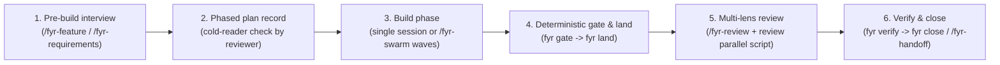
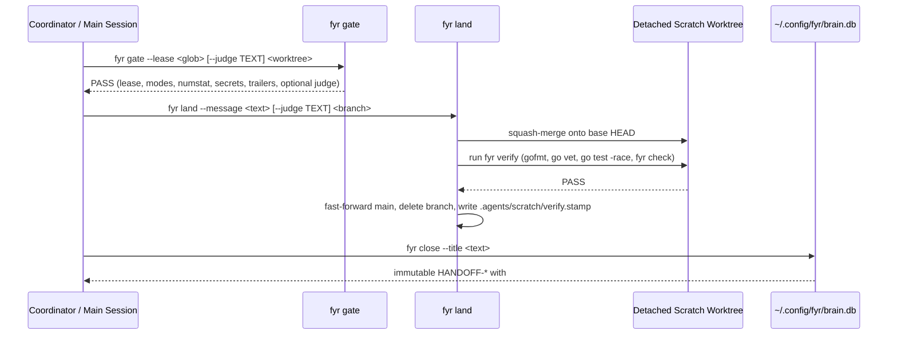
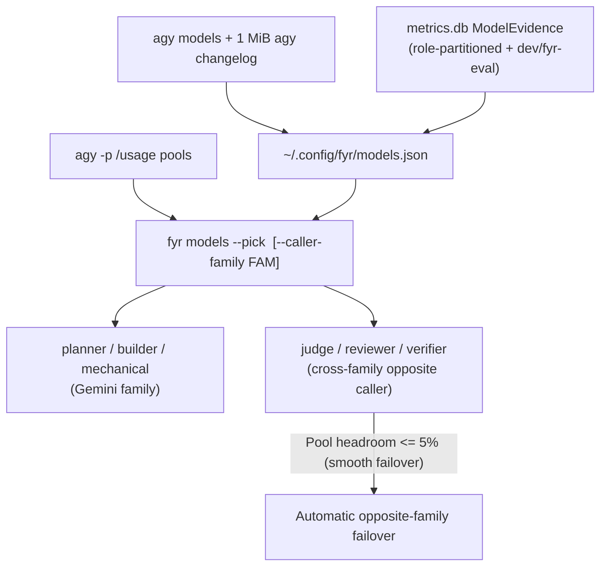

# Workflows, Subagents, Parallel Swarm & Build Control

`fyr` coordinates multi-step work by pairing Antigravity dispatchers (`invoke_subagent`, `run_workflow`, `swarm`) with 35 skills and 7 subagents. Three Python scripts (`workflows/phase_loop.py`, `workflows/review_parallel.py`, `workflows/preflight_gate.py`) run parallel waves and log `orchestration_runs` via `fyr metrics record-run --json-in`. Evidence-ranked model routing (`fyr models`) and calibrated context knees (`internal/models/context_budget.go`) guide execution across sessions. Deterministic Go gates (`fyr verify`, `fyr gate`, `fyr land`, `fyr close`, `fyr check`, `fyr watch`, `fyr state`) enforce merge safety.

## End-to-end build lifecycle

Non-trivial changes follow slash-invocable skills (`/fyr-feature`, `/fyr-bug`, `/fyr-swarm`, `/fyr-review`, `/fyr-preflight`, `/fyr-handoff`). These skills preserve architecture choices, write-lease scopes, and verification proofs across turns and sessions.

Every feature workflow settles design decisions upfront in the pre-build interview (`ADR-517`). After approval, build phases and `/fyr-swarm` waves run autonomously without mid-build questions. Execution halts only on a failing gate, check, or security blocker.

## Deterministic build control

Four Go verbs in `internal/gate` enforce scope discipline, secret hygiene, clean merges, and verified closes. Each verb checks repository state directly instead of trusting prose claims:

- **`fyr verify` (`internal/gate/verify.go`):** Runs `gofmt -l`, `go vet ./...`, `go test -race ./...`, and `fyr check`. It confirms the Go tree digest did not change mid-run. It writes `.agents/scratch/verify.stamp` (`0600`) and deletes stale stamps on failure.
- **`fyr gate` (`internal/gate/gate.go`, `internal/gate/judge.go`):** Audits a clean worktree or branch against four mechanical rules. It checks `Files:` leases, `120000`/`160000` modes, secret filenames, numstat caps (`50` files / `1,500` lines), secrets, and trailers. Optional `--judge TEXT` runs a cross-family check inside a confined `Network: true` sandbox (`internal/isolate`). It stages `0400` `models.json` from `RealHome`, fails fast on `isolate.ErrNoAuthToken`, and logs `judge_verdicts` (`ADR-526`, `ADR-534`).
- **`fyr land` (`internal/gate/land.go`):** Runs `fyr gate` (with optional `--judge`, `--judge-model`, `--worker-model`, and `--worker-session`) on a worker branch. It squash-merges and runs `fyr verify` inside an isolated detached scratch worktree. It verifies base cleanliness, fast-forwards `main`, deletes the branch, and refreshes `.agents/scratch/verify.stamp`.
- **`fyr close` (`internal/gate/close.go`, `cmd/fyr/verb_gate.go`):** Reads a bounded `<= 1 MiB` handoff body from `--body-file` or piped stdin. Empty or idle stdin exits `2` immediately. It validates `.agents/scratch/verify.stamp` against the Go tree SHA-256 and writes an immutable `handoff` with `## Verification Digest`.

## Subagents, parallel workflows, and live model routing

`fyr models` (`internal/models`) caches the live catalog from `agy models` and `agy changelog` (1 MiB `MaxChangelogOut`) at `~/.config/fyr/models.json` (`0600`). It merges role-partitioned `Store.ModelEvidence` (plus read-only `dev/fyr-eval` via `OpenDevEvalFallbackRO`) and ranks models with Empirical-Bayes, UCB, Pareto efficiency, and headroom penalties. Smooth family failover activates at `FamilyFailoverHeadroomPct = 5`, while `--caller-family FAM` picks opposite-family models and `--explain [ID]` prints score breakdowns. Cached `agy -p "/usage"` pools (`<= 10m` `DefaultPoolQuotaTTL` in `internal/models/usage_cache.go`) deliver `< 50 ms` warm `fyr models --pick` results. `CalibratedContextKnee` computes `[40%..60%]` effective context knees capped at `180k` or `300k` without hardcoding model IDs (`ADR-519`, `ADR-520`, `ADR-532`, `ADR-534`).

Three Python workflow scripts (`workflows/phase_loop.py`, `workflows/review_parallel.py`, `workflows/preflight_gate.py`) run subagents concurrently through `run_workflow`. They use `--caller-family` cross-family routing and log `orchestration_runs` via `fyr metrics record-run --json-in`. `phase_loop.py` checks disjoint `files` leases, loops back `DefectPacket` fixes for up to `2` rounds, and lands passing slices via `fyr land`. `PreToolUse` guards `invoke_subagent`, `run_workflow` (enforcing the dual-root `~/.gemini/config/workflows/*.py` allowlist), and `swarm` workers. It keeps guarded roles on capable models, emits `[CROSS_FAMILY_NOTICE]` for tier enums, and lets `security` and `builder` inherit the session model (`internal/harness/agents_test.go`).

## Drift and trace checking

`fyr check [--json]` (`internal/check`, `SPEC-fyr-docs-harness`, `ADR-535`, `ADR-536`) runs read-only drift and dual-track docs harness rules. It scans tracked Markdown files (excluding `TODO.md`, `ROADMAP.md`, `PLAN.md`, `.fyr-noindex`, and vendored directories) plus `current` `spec`, `guide`, and `deploy` records:

1. **Docs & AST CLI flag parity (`docsRule`, `drift-M4`, `drift-M5b`):** Intersects binary flags with AST-scanned `cmd/fyr/*.go` `FlagSet` calls (`effectiveVocabulary` in `internal/check/flags_ast.go`). It verifies every `fyr` command and repo-relative path, and flags undocumented CLI flags (`flag-undoc`).
2. **Track 1 style & DB safety (`docs-style`, `docs-style-note`):** Checks git human docs in `internal/check/style.go`, `internal/check/style_mermaid.go`, and `internal/check/style_advisory.go`. Five hard rules catch frontmatter, unguarded destructive blocks, `> 12` Mermaid nodes, unfolded `> 12`-row tables, and banned fluff. Agent-only `brain.db` `guide`/`deploy` records run frontmatter and destructive-command `Caution`/`Warning` checks only. Advisory `docs-style-note` hints (`< 80%` STE score, `<repo>/.agents/glossary.json`) run on git Track 1 docs only.
3. **Budgets, frontmatter & test attribution (`budget`, `frontmatter`, `test-ref`):** Enforces `context/*.md <= 15,000 B` and `context/*.md + rules/*.md <= 24,000 B` (`internal/check/harness_lint.go`). `projectAgentsBudgetRule` caps root `AGENTS.md` at `<= 4,500 B` and blocks `> 15`-line box-drawing tree dumps. It lints `skills/<name>/SKILL.md` (`SkillDescriptionLimit = 140`) and checks `Test*` <-> `*_test.go` pairs (`internal/check/test_attr.go`).
4. **Specs, structure & requirements (`specsRule`, `spec-structure`, `requirementsRule`):** Flags unlinked (`spec-unlinked`) or stale (`spec-stale`) `SPEC-*` records. `specStructureFindings` (`internal/check/specs.go`) requires five `##` headings (`Purpose`, `Interfaces`, `Data`, `Failure modes`, `Verification`) and notes missing 4-column failure tables. `requirementsRule` checks `PRD.md` enforcement sites and skips local-only record IDs on fresh clones (`F-009`).
5. **R -> M -> T trace completeness (`tracesRule`):** Maps every `PRD.md` requirement to `SDD.md` `## Trace`. It maps every `SDD.md` component to `TDD.md` `## Trace` and checks that every `Test*` exists.

Run `fyr git-check [--json]` (`ADR-508`) after any write-capable subagent dispatch. It checks `git status`, unpushed commits, and `git tag` in one read-only command.

## Out-of-band hang inspection (`fyr watch`)

`fyr watch --check` (`internal/watch/watch.go`, `inspect_ro.go`, `ADR-526`, `ADR-534`) inspects session databases, scratch artifacts, and child processes in `< 25 ms`. It runs out-of-band without invoking any LLM. It opens `.agents/scratch/search.db` read-only via `openReadOnlySQLite` and falls back to `search.OpenCopy` only on lock or recovery errors. It discovers targets in `conversation_summaries.db`, filters ended sessions via `procTableLiveness` and `metricsEndedLookup`, and inspects Linux `/proc` or macOS `ps`. It exits `0` when clear, `1` on findings, or `2` on invalid `--conv` IDs or store errors:

- **`[INTERACTIVE_WAIT]`:** Flags child processes waiting on interactive stdin or OpenSSH `(yes/no)?` prompts (`internal/watch/inspect_files.go`).
- **`[STUCK_NO_PROGRESS]`:** Flags active sessions idle past `--idle-sec` with stale scratch artifacts.
- **`[BUDGET_NEAR_LIMIT]`:** Warns when tool calls reach `>= 80%` of the `40` or `120` subagent budget.

Complete inventory of 35 skills, 7 subagents, and build-control CLI flags

### Subagents (`agents/<name>/agent.md`)

| Subagent | Default Model | Role |
|---|---|---|
| `builder` | inherit | Implements one write-leased slice in an isolated `workspace="share"` worktree: searches first, writes red-first tests, commits on `work/<slice>` with zero trailers, and detaches `HEAD` |
| `explorer` | `flash` | Read-only codebase reconnaissance (10+ files) drafted under `.agents/scratch/agents/` for a `plan` record |
| `reviewer` | inherit | Independent severity-ranked code, docs, simplify, and cold-reader review drafted under `.agents/scratch/agents/` |
| `security` | inherit | Defensive security review of diffs touching auth, crypto, secrets, IAM, parsing, frontmatter allowlists, or dependencies (inherits session model) |
| `verifier` | inherit | Live browser e2e, container smoke, and local HTTP smoke with Boundary Contract Checklist (`fyr verify` runs unit, vet, and `fyr check`) |
| `documentation` | `flash` | Living docs maintainer (`README.md`, `SDD.md`, `TDD.md`, `SPEC-*`, `GUIDE-*`, `DEPLOY-*`) enforcing the 5-track audience split for edits over 30 lines |
| `dreamer` | inherit | Consolidation judgement for `/fyr-retro`, proposing skill edits and memory consolidations |

### Skills by group (35)

| Group | Skills |
|---|---|
| **Work & release protocols (9)** | `fyr-feature`, `fyr-swarm`, `fyr-bug`, `fyr-triage`, `fyr-review`, `review-standards`, `fyr-preflight`, `fyr-harness-audit`, `fyr-auto` |
| **Project shape, specs & handoffs (7)** | `fyr-init-project`, `docs-ste100-80`, `fyr-requirements`, `fyr-spec`, `testing-strategy`, `fyr-research`, `fyr-handoff` |
| **Learning loop (4)** | `fyr-feedback-log`, `fyr-project-memory`, `fyr-retro`, `fyr-dream` |
| **Language, shell, APIs & UI (9)** | `golang`, `typescript`, `frontend-ui-modern`, `frontend-ui-economist`, `frontend-slate-ui`, `bash`, `json-api-style`, `docker`, `mermaid-syntax` |
| **Google Cloud (6)** | `gcloud-setup`, `cloud-run-deploy`, `terraform`, `operate-gcp`, `data-gcp`, `api-auth-gcp` |

### Build-control and model CLI flags

| Command | Flags | Purpose |
|---|---|---|
| `fyr verify` | `--json`, `--timeout D` | Run `gofmt`, `go vet ./...`, `go test -race ./...`, and `fyr check`, writing `.agents/scratch/verify.stamp` |
| `fyr gate <worktree>` | `--base REF`, `--lease GLOB`, `--lease-file FILE`, `--max-files N`, `--max-lines N`, `--judge TEXT`, `--judge-model ID`, `--worker-model ID`, `--worker-session ID`, `--json` | Run 4 deterministic checks plus optional confined cross-family `--judge` verdict on a worktree or branch |
| `fyr land <branch>` | `--message TEXT`, `--lease GLOB`, `--lease-file FILE`, `--max-files N`, `--max-lines N`, `--timeout D`, `--judge TEXT`, `--judge-model ID`, `--worker-model ID`, `--worker-session ID`, `--json` | Gate (with optional `--judge`), squash-verify in detached worktree, fast-forward `main`, and delete branch |
| `fyr close` | `--title TEXT`, `--id ID`, `--body-file FILE`, `--json` | Read bounded `<= 1 MiB` body (fail-fast on empty/idle stdin) and write immutable `handoff` record embedding fresh verification digest |
| `fyr check` | `--json` | Run read-only drift, `docs-style`, `AGENTS.md` `budget`, `spec-structure`, trace checks, and advisory `docs-style-note` hints; exit `1` on findings |
| `fyr git-check` | `--json` | Run post-dispatch `git status`, unpushed commits, and `git tag` check |
| `fyr watch` | `--check`, `--conv ID`, `--idle-sec N`, `--json` | Inspect session DBs (direct RO `< 25 ms`), scratch artifacts, and child processes out-of-band for stdin blocks (incl. OpenSSH `(yes/no)?`), stalls, and subagent budgets |
| `fyr models` | `--bench`, `--caller-family FAM`, `--explain [ID]`, `--json`, `--max N`, `--model ID`, `--pick ROLE`, `--refresh`, `--tier T` | Inspect `~/.config/fyr/models.json`, refresh catalog/evidence, probe models, and pick role models |
| `fyr state` | `export [--out FILE] [--repo ID\|current] [--since DATE] [--include-memory] [--json]`, `import [--repo ID\|current] [--dry-run] [--include-memory] [--json] FILE` | Export or import offline state v14 archives (including `orchestration_runs`) across hosts (`internal/state`) |

## Next steps

Review the full engineering lifecycle, inspect live model picks, or check telemetry reports:

- Read the [Workflow Guide](../Workflow.md) for the end-to-end plan, feature, and Definition of Done walkthrough.
- Inspect available models and live picks with `fyr models --refresh`.
- Read [Telemetry, Trajectories & Reports](metrics-and-reports.md) to see how wave pass rates feed model evidence.
