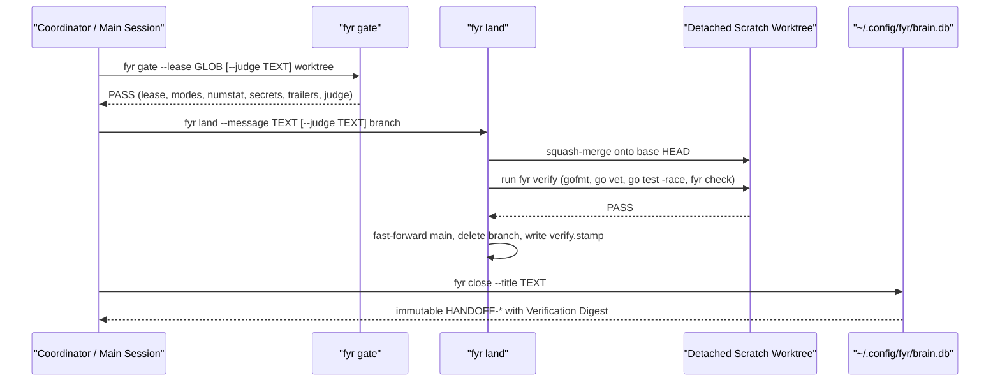
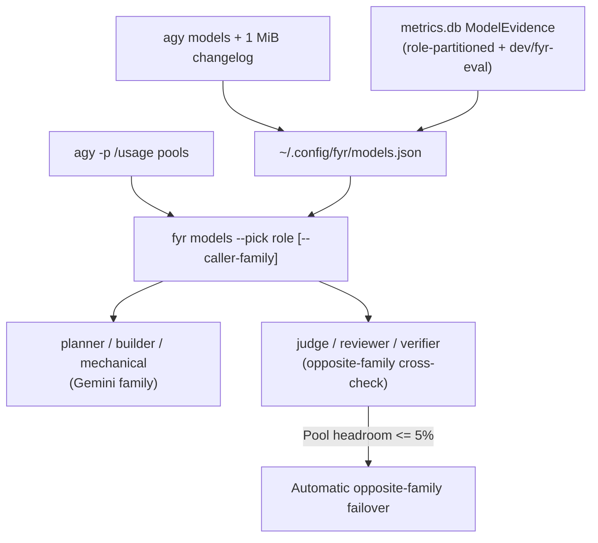

# Workflows, Subagents, Parallel Swarm & Build Control

`fyr` pairs Antigravity dispatchers (`invoke_subagent`, `run_workflow`, `swarm`) with embedded skills, subagents, and Python wave scripts. Evidence-ranked model routing (`fyr models`) and calibrated context knees (`internal/models/context_budget.go`) guide execution across stateless sessions. Deterministic Go gates (`internal/gate`, `internal/check`, `internal/watch`) enforce merge safety, doc integrity, and hang detection.

For the full interview-to-DoD lifecycle, read the [Workflow Guide](../Workflow.md). Run `fyr list` to view the live inventory of installed skills and subagents.

## Deterministic build control

Four Go verbs in `internal/gate` inspect repository state directly instead of trusting prose claims. They enforce write-lease scope, secret hygiene, clean merges, and verified handoffs.

- **`fyr verify` (`internal/gate/verify.go`):** Runs `gofmt -l`, `go vet ./...`, `go test -race ./...`, and `fyr check`. It confirms Go sources stay unchanged mid-run, writes `.agents/scratch/verify.stamp` (`0600`), and deletes stale stamps on failure.
- **`fyr gate` (`internal/gate/gate.go`, `internal/gate/judge.go`):** Audits a clean worktree or branch against four mechanical rules. It verifies `Files:` leases, `120000`/`160000` modes, secret filenames, numstat caps (`50` files / `1,500` lines), secrets, and trailers. Optional `--judge` runs a confined cross-family check (`internal/isolate`) with staged `0400` `models.json` and logs `judge_verdicts`.
- **`fyr land` (`internal/gate/land.go`):** Gates a worker branch, then squash-merges and runs `fyr verify` in an isolated detached scratch worktree. It verifies base cleanliness, fast-forwards `main`, deletes the branch, and refreshes `.agents/scratch/verify.stamp`.
- **`fyr close` (`internal/gate/close.go`):** Reads a bounded `<= 1 MiB` handoff body from `--body-file` or piped stdin, exiting `2` on empty stdin. It verifies `.agents/scratch/verify.stamp` against the Go tree SHA-256 and writes an immutable `handoff` record.

## Subagents, parallel workflows, and live model routing

`fyr models` (`internal/models`) caches the live catalog from `agy models` and `agy changelog` (`1 MiB` cap) at `~/.config/fyr/models.json` (`0600`). It merges role-partitioned `ModelEvidence` (plus read-only `dev/fyr-eval`) and ranks models using Empirical-Bayes, UCB, Pareto efficiency, and headroom penalties. Smooth opposite-family failover activates at `5%` headroom (`FamilyFailoverHeadroomPct`), and cached `/usage` pools (`<= 10m` TTL in `internal/models/usage_cache.go`) keep warm picks under `50 ms`.

`CalibratedContextKnee` computes `[40%..60%]` effective context knees capped at `180k` or `300k` tokens without hardcoding model IDs.

Three Python workflow scripts (`workflows/phase_loop.py`, `workflows/review_parallel.py`, `workflows/preflight_gate.py`) run subagents concurrently through `run_workflow`. They apply `--caller-family` cross-family routing and record `orchestration_runs` via `fyr metrics record-run --json-in`. `phase_loop.py` enforces disjoint `files` leases, loops back `DefectPacket` fixes for up to `2` rounds, and lands passing slices via `fyr land`.

`PreToolUse` guards `invoke_subagent`, `run_workflow` (enforcing the dual-root `~/.gemini/config/workflows/*.py` allowlist), and `swarm` workers. It keeps guarded roles on capable models, emits `[CROSS_FAMILY_NOTICE]` on tier enums, and lets `security` and `builder` inherit the session model.

## Drift and trace checking

`fyr check` (`internal/check`, `SPEC-fyr-docs-harness`) runs read-only drift, style, budget, and trace checks. It scans tracked Markdown files (excluding `TODO.md`, `ROADMAP.md`, `PLAN.md`, `.fyr-noindex`, and vendored directories) plus `current` `spec`, `guide`, and `deploy` records.

1. **CLI and path parity (`docsRule`):** Intersects binary flags with AST-scanned `cmd/fyr/*.go` `FlagSet` calls (`internal/check/flags_ast.go`). It verifies every `fyr` command, repo-relative path, heading anchor, and undocumented flag (`flag-undoc`).
2. **Track 1 style and DB safety (`docs-style`):** Runs five hard rules on git human docs (`internal/check/style.go`). They check frontmatter, guarded destructive blocks, `<= 12` Mermaid nodes, `
` for `> 12`-row tables, and banned fluff. Agent-only `brain.db` `guide` and `deploy` records run frontmatter and destructive-command safety checks only. Advisory `docs-style-note` hints (`< 80%` STE, `<repo>/.agents/glossary.json`) run on git Track 1 docs only.
3. **Budgets, frontmatter, and tests (`budget`, `frontmatter`, `test-ref`):** Caps `context/*.md <= 15,000 B`, `context/*.md + rules/*.md <= 24,000 B`, and root `AGENTS.md <= 4,500 B`. It blocks `> 15`-line box-drawing trees, lints `SKILL.md` descriptions (`<= 140` chars), and checks `Test*` file attribution (`internal/check/test_attr.go`).
4. **Specs and requirements (`specsRule`, `spec-structure`, `requirementsRule`):** Flags unlinked or stale `SPEC-*` records and requires five `##` headings (`Purpose`, `Interfaces`, `Data`, `Failure modes`, `Verification`). `requirementsRule` verifies `PRD.md` enforcement sites while skipping local-only record IDs on fresh clones.
5. **Trace completeness (`tracesRule`):** Maps `PRD.md` requirements to `SDD.md` components, maps components to `TDD.md` tests, and confirms each `Test*` exists.

Run `fyr git-check` after any write-capable subagent dispatch. It audits `git status`, unpushed commits, and `git tag` in one read-only call.

## Out-of-band hang inspection (`fyr watch`)

`fyr watch --check` (`internal/watch/watch.go`, `internal/watch/inspect_ro.go`) inspects session stores, scratch artifacts, and child processes in `< 25 ms` without calling an LLM. It opens `.agents/scratch/search.db` read-only, filters ended sessions, and checks Linux `/proc` or macOS `ps`. Exit codes are `0` (clear), `1` (findings), or `2` (invalid `--conv` ID or store error).

- **`[INTERACTIVE_WAIT]`:** Flags child processes waiting on interactive stdin or OpenSSH `(yes/no)?` prompts (`internal/watch/inspect_files.go`).
- **`[STUCK_NO_PROGRESS]`:** Flags active sessions idle past `--idle-sec` with stale scratch artifacts.
- **`[BUDGET_NEAR_LIMIT]`:** Warns when tool calls reach `>= 80%` of the `40` or `120` subagent budget.

## Next steps

Review the full engineering lifecycle, inspect installed skills and subagents, or check CLI flags:

- See all flags in the [CLI Reference](../docs/cli-reference.md) ([`fyr verify`](../docs/cli-reference.md#fyr-verify), [`fyr gate`](../docs/cli-reference.md#fyr-gate), [`fyr land`](../docs/cli-reference.md#fyr-land), [`fyr close`](../docs/cli-reference.md#fyr-close), [`fyr check`](../docs/cli-reference.md#fyr-check), [`fyr watch`](../docs/cli-reference.md#fyr-watch), [`fyr models`](../docs/cli-reference.md#fyr-models), [`fyr state`](../docs/cli-reference.md#fyr-state)).
- Run `fyr list` for the current skills and subagents, and `fyr models --refresh` for live role picks.
- Read the [Workflow Guide](../Workflow.md) and [Telemetry, Trajectories & Reports](metrics-and-reports.md).
