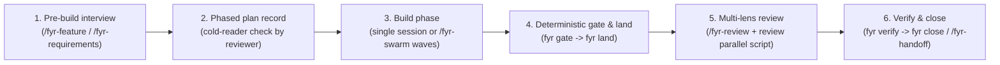
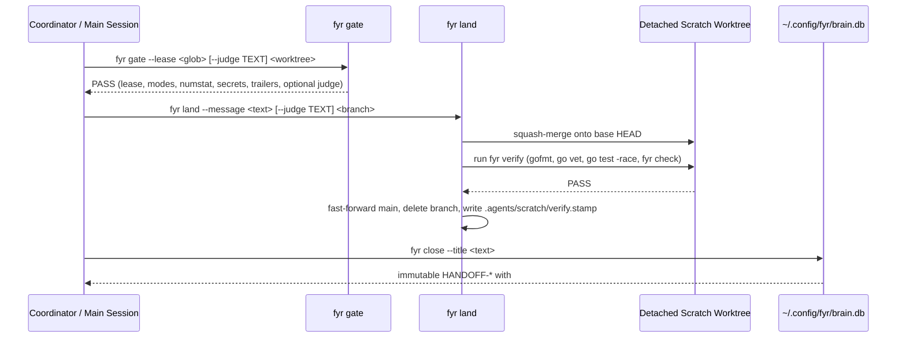
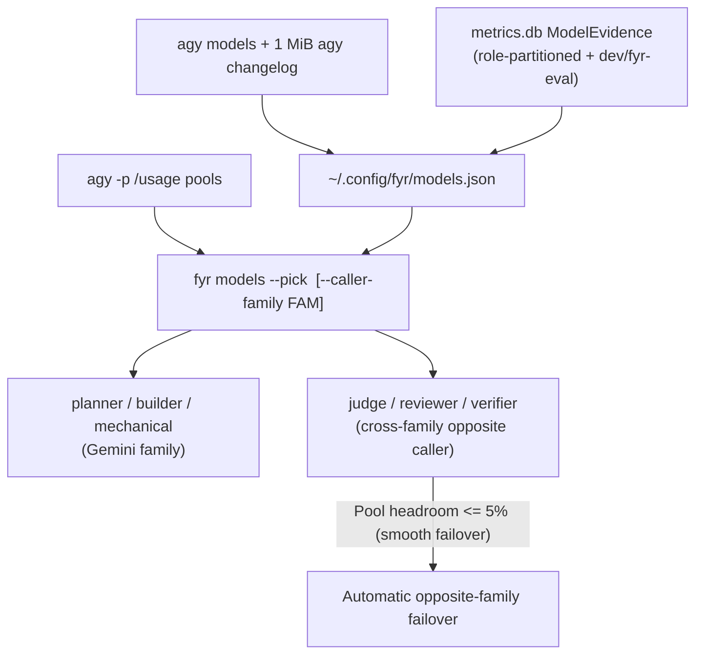

# Workflows, Subagents, Parallel Swarm & Build Control

`fyr` coordinates multi-step engineering work by pairing Antigravity's native dispatchers (`invoke_subagent`, `run_workflow`, `swarm`) with 35 reusable `SKILL.md` workflows (trimmed with progressive `references/` diets and R7 single-handoff close alignment), 7 specialized subagents (including `builder`), 3 parallel Python workflow scripts (`phase_loop.py`, `review_parallel.py`, `preflight_gate.py`, emitting `orchestration_runs` via `fyr metrics record-run --json-in`), evidence-ranked model selection (`fyr models` with 1 MiB changelog enrichment, `<= 10m` cached pool quotas for `< 50 ms` warm `--pick`, role-partitioned Pareto Empirical-Bayes + conservative UCB ranking with smooth failover, `--caller-family`, flag-aware `--explain`, and `--bench`), calibrated `[40%..60%]` effective context knees (`internal/models/context_budget.go`), opt-in hands-off phase execution (`fyr relay`), and deterministic Go build-control gates (`fyr verify`, `fyr gate`, `fyr land`, `fyr close`, `fyr check`, `fyr watch`, `fyr state`).

## End-to-end build lifecycle

Non-trivial changes follow a disciplined pipeline driven by slash-invocable skills (`/fyr-feature`, `/fyr-bug`, `/fyr-swarm`, `/fyr-review`, `/fyr-preflight`, `/fyr-handoff`) so architectural choices, write-lease scopes, and verification proofs stay intact across turns and sessions.

Every feature workflow isolates design decisions upfront during the pre-build interview (`ADR-517`): once approved, build phases and `/fyr-swarm` waves execute autonomously without mid-build questions, halting only on a failing gate, check, or security blocker.

## Deterministic build control

Four mechanical Go verbs in `internal/gate` enforce scope discipline, secret hygiene, clean merges, and verified session closes without trusting prose assertions alone:

- **`fyr verify` (`internal/gate/verify.go`):** Runs `gofmt -l`, `go vet ./...`, `go test -race ./...`, and `fyr check`, verifies the Go source tree digest did not mutate during the test run, and writes `.agents/scratch/verify.stamp` (`0600`), deleting stale stamps on failure.
- **`fyr gate` (`internal/gate/gate.go`, `internal/gate/judge.go`):** Audits a clean worktree or branch against four mechanical rules (`Files:` lease globs plus forbidden `120000`/`160000` modes and secret filenames, numstat caps of default `50` files / `1,500` lines with no binary diffs, added-line secret scanning via `internal/redact` without printing matched values, and zero forbidden commit trailers) plus an optional post-gate cross-family LLM verdict (`--judge TEXT`, `--judge-model ID`, with `--worker-model ID` and `--worker-session ID` attribution) run inside `internal/isolate`'s confined read-only `Network: true` sandbox (staging credentials and `0400` `models.json` from `RealHome` via `StageModelsCatalog` and failing fast with `isolate.ErrNoAuthToken` when auth is missing) and logged to `metrics.db` (`judge_verdicts`, `ADR-526`, `ADR-534`).
- **`fyr land` (`internal/gate/land.go`):** Runs `fyr gate` (including optional `--judge TEXT`, `--judge-model ID`, `--worker-model ID`, and `--worker-session ID`) on a worker branch, squash-merges and runs `fyr verify` inside an isolated detached scratch worktree, verifies your base branch stayed clean and unmoved, fast-forwards it, deletes the worker branch, and refreshes `.agents/scratch/verify.stamp`.
- **`fyr close` (`internal/gate/close.go`, `cmd/fyr/verb_gate.go`):** Reads a bounded `<= 1 MiB` handoff body from `--body-file` or piped stdin (failing fast with exit `2` on empty or idle stdin), validates that `.agents/scratch/verify.stamp` matches the current Go tree SHA-256, and writes an immutable `handoff` record embedding `## Verification Digest` without altering earlier records.

## Subagents, parallel workflows, and live model routing

`fyr models` (`internal/models`) maintains a cached live catalog from `agy models` and `agy changelog` (1 MiB `MaxChangelogOut` cap) at `~/.config/fyr/models.json` (`0600`), enriches each model with role-partitioned historical wave, rating, judge, and eval evidence (`Store.ModelEvidence` merged read-only with `dev/fyr-eval` via `OpenDevEvalFallbackRO`), ranks candidates via hierarchical Empirical-Bayes (`BuilderEvidence` vs `JudgeEvidence`), conservative UCB (`UCBExploreCoeff = 0.04`, cap `0.06`), Pareto `EfficiencyBonus` (`<= 0.08`), and convex `HeadroomPenalty`, applies smooth family failover at `FamilyFailoverHeadroomPct = 5`, supports `--caller-family FAM` for dynamic cross-family picking and flag-aware `--explain [ID]`, caches `agy -p "/usage"` quota pools with a `<= 10m` TTL (`DefaultPoolQuotaTTL` in `internal/models/usage_cache.go`) for `< 50 ms` warm `fyr models --pick`, and calibrates `[40%..60%]` effective context knees (`CalibratedContextKnee` capped at `180k`/`300k` degradation onset) without hardcoding model IDs (`ADR-519`, `ADR-520`, `ADR-532`, `ADR-534`).

For parallel build waves, multi-lens reviews, and release gates, three native Python workflow scripts (`workflows/phase_loop.py`, `workflows/review_parallel.py`, and `workflows/preflight_gate.py`) run `builder`, `reviewer`, `security`, `verifier`, and `explorer` concurrently through Antigravity's `run_workflow` tool with dynamic `--caller-family` cross-family routing and emit `orchestration_runs` telemetry via `fyr metrics record-run --json-in` (`phase_loop.py` enforces pairwise-disjoint `files` leases, loops back structured `DefectPacket` findings `<= 2` rounds, and lands passing slices sequentially via `fyr land`). Meanwhile, the `PreToolUse` hook automatically guards `invoke_subagent`, `run_workflow` (enforcing the dual-root workspace/installed `~/.gemini/config/workflows/*.py` allowlist), and prefix-named `swarm` workers so execution stays on capable models (`"pro"` / cross-family judges, emitting `[CROSS_FAMILY_NOTICE]` when tier enums cannot pin concrete cross-family IDs) while `security` and `builder` inherit the active session model (`internal/harness/agents_test.go`).

## Opt-in hands-off phase relay (`fyr relay`)

`fyr relay --plan <PLAN-ID> [--max-phases N] [--judge-model ID] [--dry-run] [--json]` (`internal/relay`, `M27`, `ADR-532`, `ADR-534`) advances ready phases of an approved `PLAN-*` record hands-off by running one isolated fresh `agy -p` session per phase (`--disable-slash-commands --output-format json --print-timeout`, never `--dangerously-skip-permissions`, `< 120 KiB` Kickoff prompt with top-level `RELAY OVERRIDE`, `RealHome` staging for judge runs, and `FYR_RELAY=1` enabling `PreToolUse` `[RELAY_GUARD]` and `[KICKOFF_GUARD]` while ignoring repo-local `.agents/scratch/no-hooks`). Before each phase it verifies clean git state and pool-aware cached quota floors (`20%` 5h / `15%` week, validating `<= 10m` `DefaultPoolQuotaTTL` freshness and skipping disabled `-1` windows); after each phase it enforces unchanged remote/upstream refs (`PUSH_DETECTED`), linear `HEAD` progress (`ZERO_PROGRESS`, `HISTORY_REWRITE`), clean tree (`DIRTY_TREE`), zero `PRD.md` edits (`PRD_MODIFIED`), zero new tags (`TAG_CREATED`), unchanged plan-structure hash (`PLAN_TAMPERED`), two-dot `Files:` lease + `fyr gate` (`LEASE_OR_GATE_FAIL`), `fyr verify`, and cross-family alignment judge (`gate.Gate --judge`), emits an `orchestration_runs` row into `metrics.db`, and halts immediately on any `FAIL` or repeating normalized error hash (`REPEATING_ERROR_HASH`) while recording immutable checkpoint or redacted diagnostic `handoff` records in `brain.db` without ever pushing or tagging.

## Drift and trace checking

`fyr check [--json]` (`internal/check`) runs 8/8 read-only drift consistency rules across every tracked Markdown file (excluding `TODO.md`, `ROADMAP.md`, `PLAN.md`, `.fyr-noindex` trees, and `skills/VENDORED.md` upstream directories) plus every `current` `spec`, `guide`, and `deploy` record:

1. **Docs & AST CLI flag parity (`docsRule`, `drift-M4`, `drift-M5b`):** Intersects binary vocabulary with AST-scanned `cmd/fyr/*.go` `FlagSet` calls (`effectiveVocabulary` in `internal/check/flags_ast.go`) so deleted flags fail even under an unrebuilt binary, verifies every `fyr <verb> [subverb] [--flag]` and repo-relative file path (with optional `:line`), and flags undocumented non-global CLI flags (`flag-undoc` via `undocumentedFlagsRule`).
2. **Harness budget, skill frontmatter & test attribution (`drift-M7`, `drift-M8`, `F-017`):** Enforces `context/*.md <= 15,000 B` and `context/*.md + rules/*.md <= 24,000 B` across all tracked `rules/*.md` (`contextRulesBudgetRule` `budget` in `internal/check/harness_lint.go`, matching `internal/harness/size_test.go`), lints every tracked non-vendored `skills/<name>/SKILL.md` via `harness.LintSkillFrontmatter` (`SkillDescriptionLimit = 140`, `frontmatter`), and checks adjacent `Test*` <-> `*_test.go` pairs in `TDD.md` and `features/*.md` (`testAttributionRule` `test-ref` in `internal/check/test_attr.go`).
3. **Spec freshness & requirement enforcement (`specsRule`, `requirementsRule`, `F-009`):** Flags any `current` `SPEC-*` naming no code files (`spec-unlinked`) or stale relative to git history (`spec-stale`), and verifies every active `Must`/`Should` item in `PRD.md` carries a resolving `<!-- enforced by: ... -->` site (cleanly skipping local-only record IDs on fresh clones without `.agents/trail.jsonl` or `brain.db` scope records while still failing dead tests and missing paths).
4. **R -> M -> T trace completeness (`tracesRule`):** Verifies every `PRD.md` requirement maps to a component in `SDD.md` `## Trace` and every `SDD.md` component maps to a row in `TDD.md` `## Trace`.

Beside `fyr check`, `fyr git-check [--json]` (`ADR-508`) runs `git status --short --untracked-files=all`, `git log --branches --not --remotes --oneline`, and `git tag` in a single read-only command after any write-capable subagent dispatch.

## Out-of-band hang inspection (`fyr watch`)

`fyr watch --check` (`internal/watch/watch.go`, `inspect_ro.go`, `ADR-526`, `ADR-534`) inspects Antigravity session databases, subagent scratch artifacts, and live child processes out-of-band in `< 25 ms` without invoking any LLM. It opens `.agents/scratch/search.db` directly read-only (`openReadOnlySQLite` with `mode=ro&_pragma=query_only(ON)&_pragma=busy_timeout(50)` after regular-file checks, falling back to `search.OpenCopy` only on lock or recovery errors), discovers active targets via `conversation_summaries.db`, filters out ended conversations via cross-platform active-session liveness (`procTableLiveness` + `metricsEndedLookup`), inspects Linux `/proc` or macOS `ps`, and exits `0` when clear, `1` on findings, or `2` on invalid `--conv` IDs or store errors:

- **`[INTERACTIVE_WAIT]`:** Flags child processes blocked waiting on interactive stdin or terminal prompts (including OpenSSH `(yes/no)?` / `(yes/no/[fingerprint])?` in `internal/watch/inspect_files.go`).
- **`[STUCK_NO_PROGRESS]`:** Flags active sessions idle past `--idle-sec` with stale scratch artifacts.
- **`[BUDGET_NEAR_LIMIT]`:** Warns when active subagent or session tool calls reach `>= 80%` of the aligned `40`/`120` tool-call budget.

Complete inventory of 35 skills, 7 subagents, and build-control CLI flags

### Subagents (`agents/<name>/agent.md`)

| Subagent | Default Model | Role |
|---|---|---|
| `builder` | inherit | Implements one write-leased slice in an isolated `workspace="share"` worktree: searches first, writes red-first tests, commits on `work/<slice>` with zero trailers, and detaches `HEAD` |
| `explorer` | `flash` | Read-only codebase reconnaissance (10+ files) drafted under `.agents/scratch/agents/` for a `plan` record |
| `reviewer` | inherit | Independent severity-ranked code, docs, simplify, and cold-reader review drafted under `.agents/scratch/agents/` |
| `security` | inherit | Defensive security review of diffs touching auth, crypto, secrets, IAM, parsing, frontmatter allowlists, or dependencies (inherits session model) |
| `verifier` | inherit | Live browser e2e, container smoke, and local HTTP smoke with Boundary Contract Checklist (`fyr verify` runs unit, vet, and `fyr check`) |
| `documentation` | `flash` | Living docs maintainer (`README.md`, `SDD.md`, `TDD.md`, `SPEC-*`, `GUIDE-*`, `DEPLOY-*`) for edits over 30 lines |
| `dreamer` | inherit | Consolidation judgement for `/fyr-retro`, proposing skill edits and memory consolidations |

### Skills by group (35)

| Group | Skills |
|---|---|
| **Work & release protocols (9)** | `fyr-feature`, `fyr-swarm`, `fyr-bug`, `fyr-triage`, `fyr-review`, `review-standards`, `fyr-preflight`, `fyr-harness-audit`, `fyr-auto` |
| **Project shape, specs & handoffs (7)** | `fyr-init-project`, `docs-ste100-80`, `fyr-requirements`, `fyr-spec`, `testing-strategy`, `fyr-research`, `fyr-handoff` |
| **Learning loop (4)** | `fyr-feedback-log`, `fyr-project-memory`, `fyr-retro`, `fyr-dream` |
| **Language, shell, APIs & UI (9)** | `golang`, `typescript`, `frontend-ui-modern`, `frontend-ui-economist`, `frontend-slate-ui`, `bash`, `json-api-style`, `docker`, `mermaid-syntax` |
| **Google Cloud (6)** | `gcloud-setup`, `cloud-run-deploy`, `terraform`, `operate-gcp`, `data-gcp`, `api-auth-gcp` |

### Build-control and model CLI flags

| Command | Flags | Purpose |
|---|---|---|
| `fyr verify` | `--json`, `--timeout D` | Run `gofmt`, `go vet ./...`, `go test -race ./...`, and `fyr check`, writing `.agents/scratch/verify.stamp` |
| `fyr gate <worktree>` | `--base REF`, `--lease GLOB`, `--lease-file FILE`, `--max-files N`, `--max-lines N`, `--judge TEXT`, `--judge-model ID`, `--worker-model ID`, `--worker-session ID`, `--json` | Run 4 deterministic checks plus optional confined cross-family `--judge` verdict on a worktree or branch |
| `fyr land <branch>` | `--message TEXT`, `--lease GLOB`, `--lease-file FILE`, `--max-files N`, `--max-lines N`, `--timeout D`, `--judge TEXT`, `--judge-model ID`, `--worker-model ID`, `--worker-session ID`, `--json` | Gate (with optional `--judge`), squash-verify in detached worktree, fast-forward `main`, and delete branch |
| `fyr close` | `--title TEXT`, `--id ID`, `--body-file FILE`, `--json` | Read bounded `<= 1 MiB` body (fail-fast on empty/idle stdin) and write immutable `handoff` record embedding fresh verification digest |
| `fyr relay` | `--plan PLAN-ID`, `--max-phases N`, `--judge-model ID`, `--dry-run`, `--json` | Run ready plan phases hands-off in isolated fresh `agy -p` sessions with deterministic safety, `fyr verify`, cross-family judge, `orchestration_runs` emission, and checkpoint handoffs |
| `fyr check` | `--json` | Run 8/8 read-only drift and trace checks; exit `1` on findings |
| `fyr git-check` | `--json` | Run post-dispatch `git status`, unpushed commits, and `git tag` check |
| `fyr watch` | `--check`, `--conv ID`, `--idle-sec N`, `--json` | Inspect session DBs (direct RO `< 25 ms`), scratch artifacts, and child processes out-of-band for stdin blocks (incl. OpenSSH `(yes/no)?`), stalls, and subagent budgets |
| `fyr models` | `--bench`, `--caller-family FAM`, `--explain [ID]`, `--json`, `--max N`, `--model ID`, `--pick ROLE`, `--refresh`, `--tier T` | Inspect `~/.config/fyr/models.json`, refresh catalog/evidence, probe models, and pick role models |
| `fyr state` | `export [--out FILE] [--repo ID\|current] [--since DATE] [--include-memory] [--json]`, `import [--repo ID\|current] [--dry-run] [--include-memory] [--json] FILE` | Export or import offline state v14 archives (including `orchestration_runs`) across hosts (`internal/state`) |

## Next steps

Review the full engineering lifecycle, inspect live model picks, or check telemetry reports:

- Read the [Workflow Guide](../Workflow.md) for the complete end-to-end walkthrough from plan to finish, feature to finish, goal, and step-by-step Definition of Done.
- Inspect your available models and live picks with `fyr models --refresh`.
- Read [Telemetry, Trajectories & Reports](metrics-and-reports.md) to see how wave pass rates and session shapes feed back into model evidence and usage reports.
