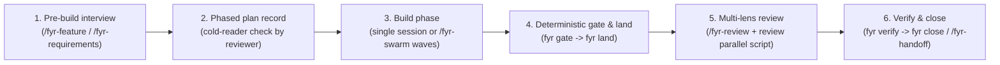
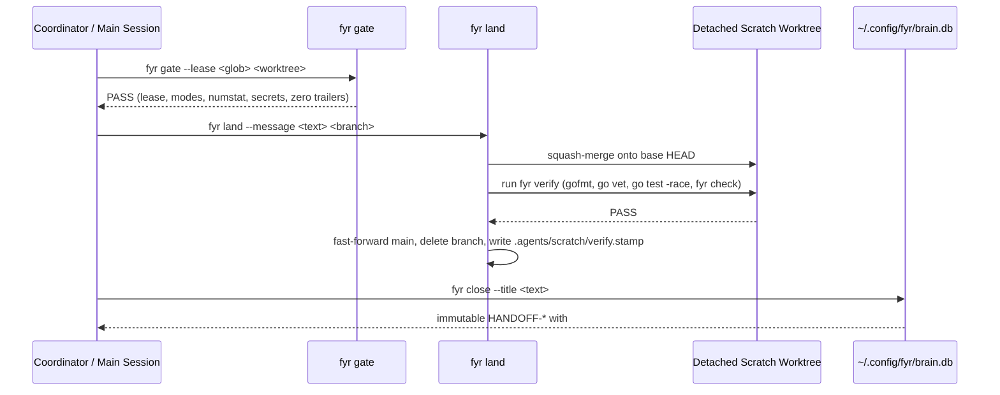
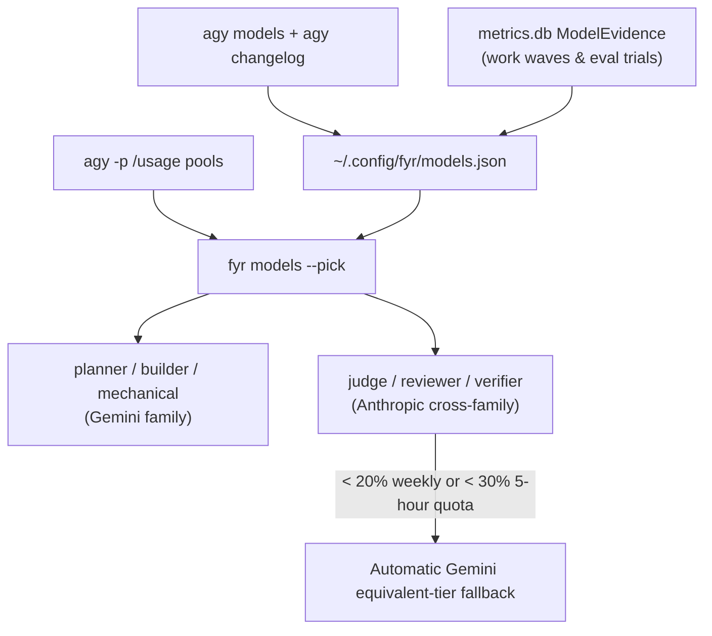

# Workflows, Subagents, Parallel Swarm & Build Control

`fyr` coordinates multi-step engineering work by pairing Antigravity's native dispatchers (`invoke_subagent`, `run_workflow`, `swarm`) with 43 reusable `SKILL.md` workflows, 6 specialized subagents, evidence-ranked model selection (`fyr models`), and deterministic Go build-control gates (`fyr verify`, `fyr gate`, `fyr land`, `fyr close`, `fyr check`).

## End-to-end build lifecycle

Non-trivial changes follow a disciplined pipeline driven by slash-invocable skills (`/fyr-feature`, `/fyr-bug`, `/fyr-swarm`, `/fyr-review`, `/fyr-preflight`, `/fyr-handoff`) so architectural choices, write-lease scopes, and verification proofs stay intact across turns and sessions.

Every feature workflow isolates design decisions upfront during the pre-build interview (`ADR-517`): once approved, build phases and `/fyr-swarm` waves execute autonomously without mid-build questions, halting only on a failing gate, check, or security blocker.

## Deterministic build control

Four mechanical Go verbs in `internal/gate` enforce scope discipline, secret hygiene, clean merges, and verified session closes without trusting prose assertions alone:

- **`fyr verify` (`internal/gate/verify.go`):** Runs `gofmt -l`, `go vet ./...`, `go test -race ./...`, and `fyr check`, verifies the Go source tree digest did not mutate during the test run, and writes `.agents/scratch/verify.stamp` (`0600`), deleting stale stamps on failure.
- **`fyr gate` (`internal/gate/gate.go`):** Audits a clean worktree or branch against four rules: `Files:` lease globs plus forbidden `120000`/`160000` modes and secret filenames, numstat caps (default `50` files, `1,500` lines, no binary diffs), added-line secret scanning via `internal/redact` (never printing matched secret values), and zero forbidden commit trailers.
- **`fyr land` (`internal/gate/land.go`):** Runs `fyr gate` on a worker branch, squash-merges and runs `fyr verify` inside an isolated detached scratch worktree, verifies your base branch stayed clean and unmoved, fast-forwards it, deletes the worker branch, and refreshes `.agents/scratch/verify.stamp`.
- **`fyr close` (`internal/gate/close.go`):** Validates that `.agents/scratch/verify.stamp` matches the current Go tree SHA-256 and writes an immutable `handoff` record embedding `## Verification Digest` without altering earlier records.

## Subagents, parallel workflows, and live model routing

`fyr models` (`internal/models`) maintains a cached live catalog from `agy models` and `agy changelog` at `~/.config/fyr/models.json` (`0600`), enriches each model with historical wave and eval pass rates (`Store.ModelEvidence`), reads live quota pools from `agy -p "/usage"`, and picks role models without hardcoding model IDs (`ADR-519`, `ADR-520`).

For multi-lens reviews and release gates, two native Python workflow scripts (`workflows/review_parallel.py` and `workflows/preflight_gate.py`) run `reviewer`, `security`, `verifier`, and `explorer` concurrently through Antigravity's `run_workflow` tool. Meanwhile, the `PreToolUse` hook automatically guards `invoke_subagent`, `run_workflow`, and prefix-named `swarm` workers so execution stays on capable models (`"pro"` / cross-family judges) while `security` always inherits the active session model (`internal/harness/agents_test.go`).

## Drift and trace checking

`fyr check` (`internal/check`) runs four read-only consistency rules across every tracked Markdown file (excluding `TODO.md`, `ROADMAP.md`, `PLAN.md`, `.fyr-noindex` trees, and `skills/VENDORED.md` upstream directories) plus every `current` `spec`, `guide`, and `deploy` record:

1. **Docs parity (rule `a`):** Verifies every `fyr <verb> [subverb] [--flag]` command in code spans/fences exists on the binary and every repo-relative file path (with optional `:line` range) exists on disk within its line count.
2. **Spec freshness (rule `b`):** Flags any `current` `SPEC-*` record that names no code files (`spec-unlinked`) or whose named code received git commits after the commit carrying the spec's current `trail.jsonl` line (`spec-stale`).
3. **Requirement enforcement (rule `c`):** Verifies every active `Must` and `Should` item in `PRD.md` carries an `<!-- enforced by: ... -->` comment whose named `Test*` functions, record IDs, or file paths exist.
4. **R -> M -> T trace completeness (rule `d`):** Verifies every `PRD.md` requirement maps to a component in `SDD.md` `## Trace` and every `SDD.md` component maps to a row in `TDD.md` `## Trace`.

Beside `fyr check`, `fyr git-check` (`ADR-508`) runs `git status --short --untracked-files=all`, `git log --branches --not --remotes --oneline`, and `git tag` in a single read-only command after any write-capable subagent dispatch.

Complete inventory of 43 skills, 6 subagents, and build-control CLI flags

### Subagents (`agents/<name>/agent.md`)

| Subagent | Default Model | Role |
|---|---|---|
| `explorer` | `flash` | Read-only codebase reconnaissance (10+ files) drafted under `.agents/scratch/agents/` for a `plan` record |
| `reviewer` | inherit | Independent severity-ranked code, docs, simplify, and cold-reader review drafted under `.agents/scratch/agents/` |
| `security` | inherit | Defensive security review of diffs touching auth, crypto, secrets, IAM, parsing, frontmatter allowlists, or dependencies (inherits session model) |
| `verifier` | inherit | Live browser e2e, container smoke, and local HTTP smoke (`fyr verify` runs unit, vet, and `fyr check`) |
| `documentation` | `flash` | Living docs maintainer (`README.md`, `SDD.md`, `TDD.md`, `SPEC-*`, `GUIDE-*`, `DEPLOY-*`) for edits over 30 lines |
| `dreamer` | inherit | Consolidation judgement for `/fyr-retro` and `/fyr-distill`, proposing skill edits and memory consolidations |

### Skills by group (43)

| Group | Skills |
|---|---|
| **Work & release protocols (9)** | `fyr-feature`, `fyr-swarm`, `fyr-bug`, `fyr-triage`, `fyr-review`, `review-standards`, `fyr-preflight`, `fyr-harness-audit`, `fyr-auto` |
| **Project shape, specs & handoffs (10)** | `fyr-init-project`, `fyr-index-project`, `fyr-refresh-project-index`, `fyr-docs`, `fyr-requirements`, `fyr-spec`, `testing-strategy`, `fyr-explain-project`, `fyr-research`, `fyr-handoff` |
| **Learning loop (5)** | `fyr-feedback-log`, `fyr-project-memory`, `fyr-retro`, `fyr-distill`, `fyr-dream` |
| **Language, shell, APIs & UI (8)** | `golang`, `typescript`, `frontend-ui-modern`, `frontend-ui-economist`, `bash`, `json-api-style`, `docker`, `mermaid-syntax` |
| **Google Cloud & catalog (8)** | `gcloud-setup`, `cloud-run-deploy`, `terraform`, `operate-gcp`, `data-gcp`, `api-auth-gcp`, `gke-basics`, `google-catalog` |
| **Design & stress-testing (3)** | `grilling`, `codebase-design`, `discover-skills` |

### Build-control and model CLI flags

| Command | Flags | Purpose |
|---|---|---|
| `fyr verify` | `--json`, `--timeout D` | Run `gofmt`, `go vet ./...`, `go test -race ./...`, and `fyr check`, writing `.agents/scratch/verify.stamp` |
| `fyr gate <worktree>` | `--base REF`, `--lease GLOB`, `--lease-file FILE`, `--max-files N`, `--max-lines N`, `--json` | Run 4 deterministic checks on a worktree or branch |
| `fyr land <branch>` | `--message TEXT`, `--lease GLOB`, `--lease-file FILE`, `--max-files N`, `--max-lines N`, `--timeout D`, `--json` | Gate, squash-verify in detached worktree, fast-forward `main`, and delete branch |
| `fyr close` | `--title TEXT`, `--id ID`, `--body-file FILE`, `--json` | Write immutable `handoff` record embedding fresh verification digest |
| `fyr check` | (global flags only) | Run read-only drift and trace checks; exit `1` on findings |
| `fyr git-check` | (global flags only) | Run post-dispatch `git status`, unpushed commits, and `git tag` check |
| `fyr models` | `--explain ID`, `--json`, `--pick ROLE`, `--refresh`, `--tier T` | Inspect `~/.config/fyr/models.json`, refresh catalog/evidence, and pick role models |

## Next steps

Review the full engineering lifecycle, inspect live model picks, or check telemetry reports:

- Read the [Workflow Guide](../Workflow.md) for the complete end-to-end walkthrough from plan to finish, feature to finish, goal, and step-by-step Definition of Done.
- Inspect your available models and live picks with `fyr models --refresh`.
- Read [Telemetry, Trajectories & Reports](metrics-and-reports.md) to see how wave pass rates and session shapes feed back into model evidence and usage reports.
