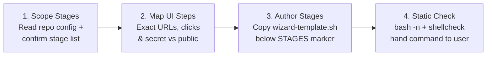

# Interactive Setup & Migration Wizards

Generate an interactive Bash wizard from [wizard-template.sh](../assets/wizard-template.sh) when a human must perform manual dashboard, browser, credential, or cutover steps that an agent cannot automate directly.

> [!NOTE]
> Adapted from `<upstream>/skills/engineering/wizard/SKILL.md` in `mattpocock/skills` at `4ae2317` (MIT; provenance in `skills/VENDORED.md` § Forks), extended for `fyr` with `.agents/scratch/` ephemeral output and GCP Secret Manager (`set_gcp_secret`).

## When to Build a Wizard

- Provisioning third-party OAuth clients, webhook signing secrets, or dashboard API keys
- Populating local `.env` (`0600`), GCP Secret Manager (`gcloud secrets versions add --data-file=-`), or GitHub Actions secrets (`gh secret set`) in one guided pass
- Walking the operator through a multi-step migration or cutover with `confirm` gates before irreversible actions
- **Never** build a wizard for commands the agent can run directly with `gcloud`, `gh`, `terraform`, or Go tests

## Output Path Rule

- **Ephemeral by default:** Write one-off setup or migration wizards to `.agents/scratch/wizard-<slug>.sh` (gitignored; never `/tmp`, never beside application source).
- **Repeatable onboarding only:** Write to `scripts/wizard-<slug>.sh` and document it in `README.md` or `DEPLOY-local` only when the operator asks for a committed team onboarding script.

## Four-Step Authoring Workflow



### 1. Scope the Procedure

Read `.env.example`, `README.md`, `docker-compose*`, Cloud Run deploy records (`DEPLOY-gcp` `--set-secrets`), and `.github/workflows/*` first so you never ask cold. Present the ordered stage list and each captured value's destination (`.env`, GCP Secret Manager, GitHub secret/var, or pure action) for confirmation before generating the script.

### 2. Map Each Stage's Journey

Write concrete instructions for each stage: exact URL (`open_url`), exact click path (`step`), variable name, and whether input is visible (`ask`) or hidden (`ask_secret`). Where third-party dashboard labels are uncertain, say so rather than guessing.

### 3. Author from `wizard-template.sh`

Copy [wizard-template.sh](../assets/wizard-template.sh) to `.agents/scratch/wizard-<slug>.sh`. Keep the library above the `STAGES` marker untouched and author only inside `run_wizard()` below the marker:

| Helper | Purpose |
|---|---|
| `banner "Title"` | Clears screen, prints `TOTAL_STAGES`, explains re-run safety |
| `stage "Name"` | Clears screen and increments `▸ Stage N/TOTAL` |
| `say` / `step` / `note` / `warn` | Airy terminal instructions and status lines |
| `open_url "https://..."` | Opens browser across Linux (`xdg-open`), macOS (`open`), and WSL (`wslview`) |
| `ask KEY "Prompt"` | Readline prompt; Enter keeps existing `$ENV_FILE` value on re-runs |
| `ask_secret KEY "Prompt"` | Hidden `read -rs` prompt for secrets; Enter keeps existing value |
| `write_env KEY "$KEY"` | Idempotent `0600` upsert into `$ENV_FILE` using sibling temp file (never `/tmp`) |
| `set_gcp_secret "name" "$VAL" ["$GCP_PROJECT_ID"]` | Pipes secret on stdin to `gcloud secrets versions add --data-file=-` (creates secret if absent; pairs with Cloud Run `--set-secrets`, never `--set-env-vars`) |
| `set_secret` / `set_var` | Sets GitHub repo secret (via stdin) or variable via `gh` |
| `pause` / `confirm "Question"` | Waits for Enter or gates irreversible actions with `[y/N]` |
| `finish` | Prints summary of written `.env` keys, stored secrets, and skipped manual items |

### 4. Verify & Hand Off

1. Run `bash -n .agents/scratch/wizard-<slug>.sh` (and `shellcheck .agents/scratch/wizard-<slug>.sh` when `shellcheck` is installed).
2. Trace statically that `TOTAL_STAGES` matches the count of `stage` calls and every secret uses `ask_secret` + stdin (`set_gcp_secret` / `set_secret`).
3. **Never execute the wizard end-to-end yourself** (it opens browsers and blocks on interactive TTY input). Give the operator the exact command:
   ```bash
   bash .agents/scratch/wizard-<slug>.sh
   ```
