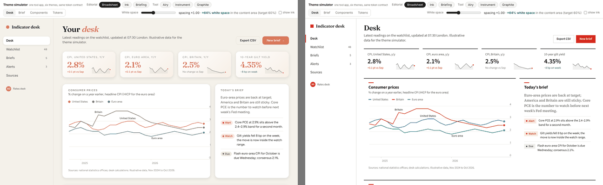

# Anti-patterns: the generic defaults

Generated UI clusters around a handful of looks that appear whatever the subject is. None of them is
wrong in itself; each is wrong as a *default*, because it was not chosen for this brief. Where a brief
asks for one of these, follow the brief. Where it leaves the axis free, do not spend that freedom here.

The left half is the same Desk page restyled with the most common generated look; the right half is
Broadsheet.

Full size: `../assets/screenshots/anti-pattern-generic-desk.png`.

What the left side does, and why each one reads as generated:

| Tell | Why it reads as a default | What the themes do instead |
|---|---|---|
| Warm cream page (≈#f4f1ea) + high-contrast serif display + terracotta accent (≈#d97757) | It is the single most common generated palette; the terracotta is also Anthropic's own interaction accent, so on a client brief it reads as the tool, not the client | Broadsheet: pure white, ink rules, a newspaper red. Briefing: cool grey and navy |
| One italic or coloured word in the headline ("Your *desk*") | A typographic flourish applied regardless of meaning | Headlines in one weight and colour; emphasis comes from the words |
| Tracked-out ALL-CAPS eyebrow labels above every heading | Template chrome; it labels things that did not need a label | Sentence-case section titles; a kicker only on an article, in the accent |
| Identical rounded cards with the same soft grey shadow, one radius for everything | The SaaS card kit: structure as decoration | Radius and elevation by role: editorial panels are rules, Airy cards are outlined, Instrument panels are hairlines |
| Gradient wash on tiles; big serif numbers in the accent colour | Decoration on data; serif numerals read as ornament | Numbers in the UI sans, in ink; colour only on the delta |
| "→" appended to button labels; "A · B · C" meta strings; "WORD — fragment" labels | Punctuation doing the job of design | Buttons say what happens ("Save changes"); meta text is a sentence |
| Near-black (#0b0b0b, #111) page with one acid-green or vermilion accent | The other generated default | Ink and Graphite use blue-black and blue-grey neutrals with three surface steps and a validated accent |
| Broadsheet-style hairlines, zero radius and dense columns *regardless of subject* | A legitimate look that became a default | Used only for editorial briefs; tool briefs get a tool theme |
| Monospace for small data labels | Reads as "technical" without being tabular | Tabular numerals in the UI sans |
| Fade-and-slide-up on every section; hover transitions on every card; numbered 01/02/03 markers on non-sequences | Motion and markers that encode nothing | One orchestrated moment at most; markers only on real sequences |

## Self-critique before shipping

Ask these in order; the first "yes" is the thing to change.

1. Would I have produced this exact palette and type for any similar brief? (If yes: it is a default,
   not a choice. Pick the theme from the subject.)
2. Is there more than one memorable element on the first screen? (Spend boldness in one place; quiet
   everything else.)
3. Does any label, eyebrow, divider or number encode nothing true about the content?
4. Is any colour doing two jobs (accent and series; semantic and brand)?
5. Is anything decorated that could be removed without losing information? (Chanel's advice: take one
   accessory off before leaving the house.)
6. Does the dark theme merely invert the light one? (Re-validate the palette against the dark surface.)
7. Does the page still work at 400px, with keyboard focus visible, with motion reduced?

## Build-time bugs that look like design mistakes

Seen during the build; they are easy to misread as taste problems.

- **"|Desk": the active mark floats inside the padding.** The nav item needs to bleed to the sidebar edge
  (`--nav-ml`) with the same amount added back as padding so text aligns with the logo mark.
  Compare `detail-broadsheet-sidebar.png` (right) against the first draft, which had the mark 12px in.
- **Sidebar text flush against the viewport edge in some themes only.** A unitless `0` in a token used
  inside `calc()`/`max()` invalidated `padding-left` silently. Always `0px`.
- **Phone width scrolls sideways.** A horizontal nav strip inside a `1fr` grid column widened the page;
  the column needs `minmax(0, 1fr)` and the strip `min-width: 0; overflow-x: auto`.
- **White text on a bright accent fails contrast on dark themes.** Split the accent into a fill and a
  text token (`--accent-text`) and give danger buttons a deeper `--bad-btn`.
- **Chart labels unreadable where they cross lines.** A 3px halo in `--surface` via `paint-order: stroke`.
