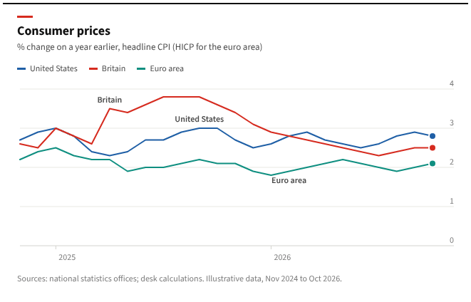
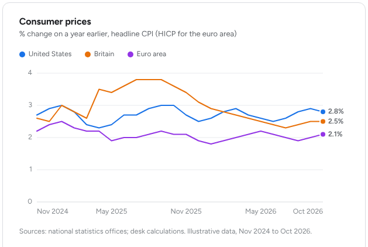

# Charts

Two styles, chosen by theme group, on top of one set of mark rules. `../assets/charts.js` implements line,
column and sparkline for both; the simulator's Desk and Brief views show them in every theme.

| | Editorial (Broadsheet, Ink, Briefing) | Tool (Airy, Instrument, Graphite) |
|---|---|---|
| Title block | short tab in `--chart-tab` (22×3px) above a bold UI-sans title, subtitle in `--ink-2` | title and subtitle, no tab |
| Y labels | on the **right**, sitting just above the gridline, text-anchor end at the panel's right edge | on the left, vertically centred on the gridline |
| Y axis line | none; the baseline (`--line`) is the only horizontal line in `--line` strength | none; baseline only |
| Gridlines | hairline, solid, `--line-2`, running the full width under the labels | hairline, solid, `--line-2`, plot width |
| X labels | period starts only (years), with a 5px tick, label anchored at the tick | evenly spaced (first, every ~quarter, last) |
| Series identity | legend row above **and** the series name set inside the plot where that series is farthest from the others (≥ 16px of room, else legend only) | legend row above with dot swatches; values at the line ends, nudged apart by 13px when they collide |
| Legend swatch | 12×3 line | 10px dot |
| Source line | "Sources: … " in `--ink-3` under the chart | optional |
| Reference | `detail-broadsheet-chart.png`, `detail-briefing-chart.png`, `detail-broadsheet-column-chart.png` | `detail-airy-chart.png`, `detail-graphite-chart.png`, `detail-airy-column-chart.png` |




## Mark rules (both styles)

These come from the data-visualisation method the palettes were validated with; they are what make a chart
look quiet and read fast, so keep them even when a brief asks for "more impact".

- Lines 2px, round joins and caps. Area fills, if any, at ~10% opacity of the series colour.
- End markers ≥ 8px (r 4) in the series colour with a 2px ring in `--surface` under them, so they stay
  legible where lines cross.
- Bars/columns ≤ 24px thick, 4px rounded data end, square at the baseline; a 2px surface gap between
  touching bars or stacked segments instead of a stroke.
- Gridlines and axes recessive: hairline, solid, never dashed.
- A legend is always present for two or more series; a single series needs none (the title names it).
- Label selectively: the endpoint, the extreme, or the series the story is about. Never a number on
  every point. Direct labels before gridlines; gridlines before a second axis; never a second axis.
- Text wears text tokens (`--ink-2` for labels, `--ink-3` for axis ticks), never the series colour.
  Identity comes from the mark beside the text (end dot, swatch), not from colouring the text.
- Chart labels get a 3px halo in `--surface` (`paint-order: stroke`) so they stay readable over lines.
- Hover layer by default: a crosshair on the nearest x index and a tooltip listing every series with its
  swatch and value; per-bar tooltips on columns. The tooltip is HTML (`.tip`) positioned inside the chart
  container, in `--surface` with a `--line` border.
- Sparklines (tiles, table cells): 12–14 points, 1.5px line in `--ink-3`, 10% area wash, end dot in
  `--accent` with a surface ring. The current period is the only coloured thing.
- One scale per chart. Two measures of different scale → two charts or an index to a common base.

## Series palettes (validated)

Each row passed: OKLCH lightness in band (light 0.43–0.77, dark 0.48–0.67), chroma ≥ 0.10, adjacent-pair
ΔE ≥ 8 under simulated protanopia and deuteranopia (Machado et al. 2009, severity 1.0, OKLab ΔE × 100),
normal-vision ΔE ≥ 15, and ≥ 3:1 contrast on the theme's `--surface`. Re-run with
`node scripts/check_theme.js assets/theme-kit.css` after any change.

| Theme | Surface | s1 | s2 | s3 | s4 | Worst adjacent pair (CVD ΔE) |
|---|---|---|---|---|---|---|
| Broadsheet | #ffffff | #1f5fa6 blue | #d62b1f red | #0f8f80 teal | #b58a1c mustard | s3↔s4 12.2 (protan) |
| Ink | #161c23 | #3f86d6 | #e34b40 | #2aa58f | #bd8526 | s2↔s3 10.7 (deutan) |
| Briefing | #ffffff | #1d5a9a navy | #d62b1f red | #4c9bd6 light blue | #b38600 | s1↔s2 18.9 (protan) |
| Airy | #ffffff | #1a73e8 blue | #e8710a orange | #9334e6 purple | #0e9aa8 teal | s3↔s4 16.6 (deutan) |
| Instrument | #ffffff | #4f46e5 indigo | #e5582a orange | #0d9488 teal | #c026d3 magenta | s2↔s3 12.7 (protan) |
| Graphite | #1c2027 | #6b7ae8 periwinkle | #1aa88c teal | #d9671c orange | #c84fab pink | s2↔s3 12.8 (deutan) |

The editorial palettes deliberately put the brand red in slot 2 so "the series the story is about" can be
the red one, the way a newspaper chart highlights one line. The tool palettes keep the accent in slot 1
so the primary series and the primary action agree.

## Using charts.js

```html
<div class="panel chart-panel">
  <div class="panel-head"><div class="tab"></div><h2>Consumer prices</h2><p class="sub">% change on a year earlier</p></div>
  <div class="legend" id="legend"></div>
  <div class="chart" id="chart" style="--chart-h:260px"></div>
  <p class="source">Sources: national statistics offices.</p>
</div>
<script src="charts.js"></script>
<script>
  Charts.line(document.getElementById('chart'), {
    labels: months,                  // [{text:'Jan 2025', tick:'2025'}, {text:'Feb 2025', tick:false}, …]
    series: [{ name: 'United States', slot: '--s1', values: [...] }, { name: 'Britain', slot: '--s2', values: [...] }],
    style: 'editorial',              // or 'tool'
    yMin: 0, yMax: 4, ticks: [0, 1, 2, 3, 4],
    format: v => v.toFixed(1) + '%', // values (tooltip, end labels)
    tickFormat: v => String(v),      // axis ticks stay plain
    legendEl: document.getElementById('legend'),
    label: 'Consumer prices, three economies'   // aria-label
  });
  Charts.column(el, { labels: ['United States', 'Japan'], values: [1.9, 0.8], slot: '--s1', valueName: '2026 forecast', style: 'tool', yMax: 2.5, ticks: [0, 1, 2], format: v => v.toFixed(1) });
  Charts.sparkline(svgEl, [2.9, 3.0, 2.7, 2.5, 2.6, 2.8]);
</script>
```

Redraw on resize (the functions measure their container) and after fonts load. The editorial `.tab`
only shows when the root has class `is-editorial`.

## Anti-patterns to check a chart against

- Dual axes; a rainbow; a hue at the midpoint of a diverging scale.
- A number on every point; labels in the series colour; a legend missing with two series.
- Saturated area blocks; dashed gridlines; a y-axis line plus gridlines.
- Series colours recycled for status ("series 2" red meaning both Britain and "alert").
- Light-theme series reused on a dark surface.
