# The six themes

Each theme fills the same token contract (`token-contract.md`). This file is the long form: what the theme is for, its signature moves, what to avoid, the full token block, and every screenshot of it. Values are copied from `../assets/theme-kit.css`; if the two ever disagree, the CSS wins.

Side by side, all six on the Desk view:

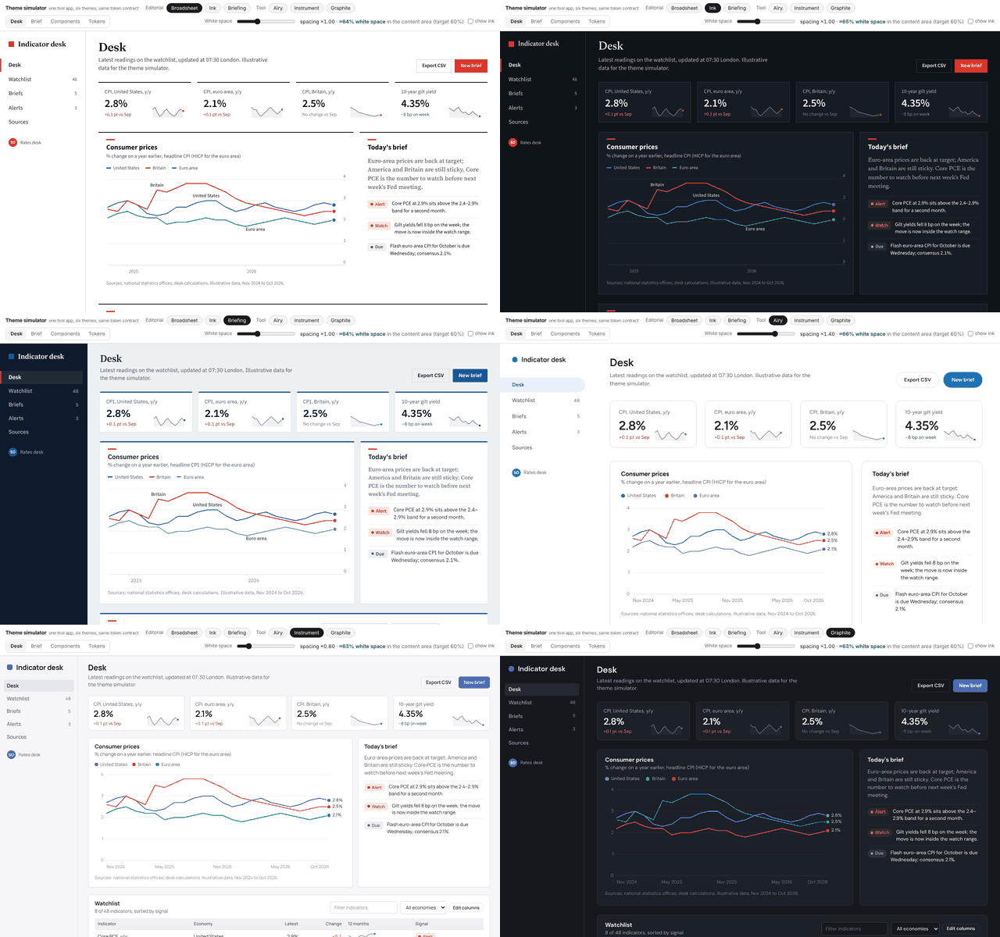

The generic look they exist to avoid, next to Broadsheet:

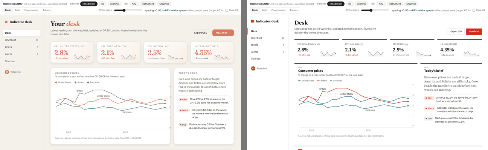

## Contents

- [Broadsheet](#broadsheet) — Editorial (light)
- [Ink](#ink) — Editorial (dark)
- [Briefing](#briefing) — Editorial (data-first, light)
- [Airy](#airy) — Tool (Google-inspired, light)
- [Instrument](#instrument) — Tool (dense, light)
- [Graphite](#graphite) — Tool (dark-first)

## broadsheet

**Broadsheet** — Editorial (light). Default spacing multiplier `--ws: 1.0`. Chart style: editorial.

Light editorial, inspired by The Economist's print and web pages. Ink rules do the structuring; red is spent on exactly one job per screen; a serif carries the personality and a sans does the work.

**Type:** Fraunces (display, 600, optical size on), Source Serif 4 (reading text), Source Sans 3 (UI and numerals).

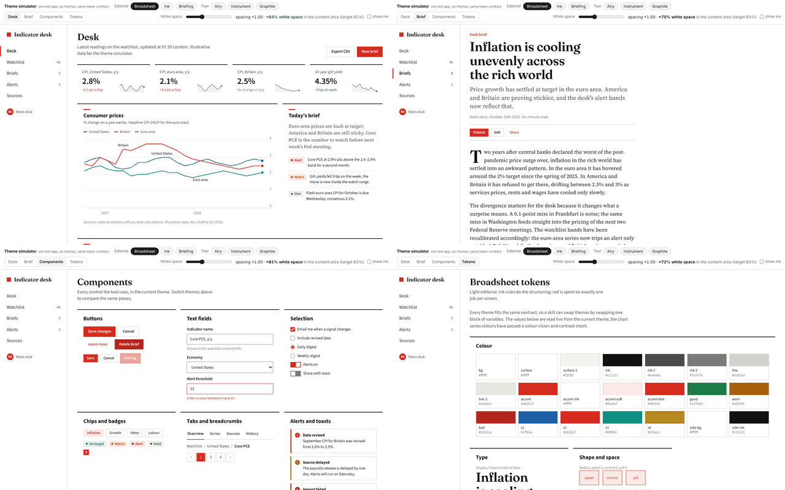

### Use for

- Reading-heavy tools and research desks
- Anything where prose is the content and the UI should recede
- Reports and briefs people print or share
- A product that wants to feel authored rather than assembled

### Signature moves

- A 2px ink rule on top of every section instead of boxes; panels have no background, border or shadow
- One red per view: the active nav mark, the chart tab, or the primary action. If two are competing, demote one to ink
- Serif display and article text; a sans for UI chrome and numerals (numbers stay in the sans even in tiles)
- Zero radius everywhere; hairlines (`--line-2`) between rows, a stronger line (`--line`) around fields
- Charts: red tab, axis labels on the right sitting on the gridline, series named inside the plot
- A drop cap on the first paragraph of an article; kicker in red above the headline

### Avoid

- Cards with shadows or tonal fills; gradient washes
- More than one red element competing for attention
- All-caps labels and tinted blacks (#111 is fine as text, not as a page)
- Serif numerals in data; a hero number in the display face
- Rounded anything

### Token block

```css
[data-theme="broadsheet"]{
  color-scheme:light;
  --bg:#ffffff; --surface:#ffffff; --surface-2:#f3f3f0;
  --ink:#111111; --ink-2:#4a4a4a; --ink-3:#7a7a7a;
  --line:#d3d3ce; --line-2:#e8e8e3;
  --accent:#d62b1f; --accent-ink:#ffffff; --accent-soft:#fbe9e7; --accent-text:#d62b1f;
  --good:#1e7b46; --warn:#a5600f; --bad:#b3261e;
  --good-bg:#e6f3ec; --warn-bg:#fbefdc; --bad-bg:#fbe7e5; --neutral-bg:#efefeb;
  --s1:#1f5fa6; --s2:#d62b1f; --s3:#0f8f80; --s4:#b58a1c; --chart-tab:var(--accent);
  --font-display:"Fraunces",Georgia,"Times New Roman",serif;
  --font-text:"Source Serif 4",Georgia,serif;
  --font-ui:"Source Sans 3","Helvetica Neue",Arial,sans-serif;
  --display-weight:600; --display-tracking:-0.01em;
  --fs-base:15px; --fs-sm:13px; --fs-xs:12px; --fs-h1:30px; --fs-h2:18px; --fs-head:42px; --fs-num:28px; --fs-prose:17px; --prose-lh:1.55;
  --radius:0; --radius-s:0; --pill-radius:0; --btn-radius:0; --input-radius:0;
  --panel-bg:transparent; --panel-border:0; --panel-top:2px solid var(--ink); --panel-shadow:none;
  --table-top:2px solid var(--ink); --table-head-bg:transparent;
  --input-bg:#ffffff; --input-border:#8a8a8a;
  --side-w:220px; --side-bg:#ffffff; --side-ink:#111111; --side-ink-2:#4a4a4a; --side-line:#d3d3ce;
  --nav-active-bg:transparent; --nav-active-ink:#111111; --nav-mark:var(--accent); --nav-mark-w:3px; --nav-radius:0; --nav-ml:calc(var(--u) * -1.5);
  --swatch-w:12px; --swatch-h:3px; --swatch-r:0;
  --ws:1;
  --dialog-shadow:0 0 0 1px var(--ink);
}
```

### Screenshots

Full views (1280×800):

- Desk: tiles, line chart, brief panel: `../assets/screenshots/broadsheet-desk.png`
- Desk, scrolled to the watchlist table: `../assets/screenshots/broadsheet-desk-table.png`
- Brief: article view, headline and prose: `../assets/screenshots/broadsheet-brief.png`
- Brief, scrolled to the inline column chart: `../assets/screenshots/broadsheet-brief-figure.png`
- Components gallery, top half: `../assets/screenshots/broadsheet-components.png`
- Components gallery, bottom half: `../assets/screenshots/broadsheet-components-2.png`
- Tokens sheet: swatches: `../assets/screenshots/broadsheet-tokens.png`
- Tokens sheet: type, shape, skill notes, CSS: `../assets/screenshots/broadsheet-tokens-2.png`

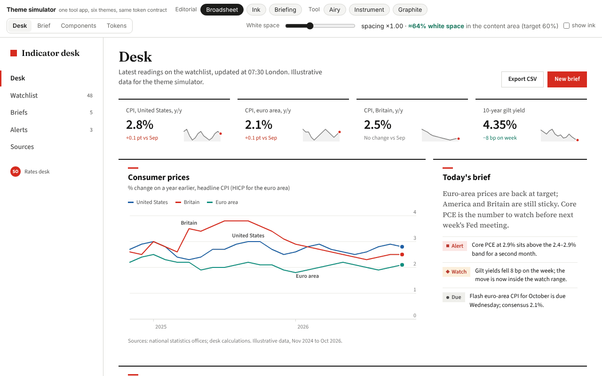

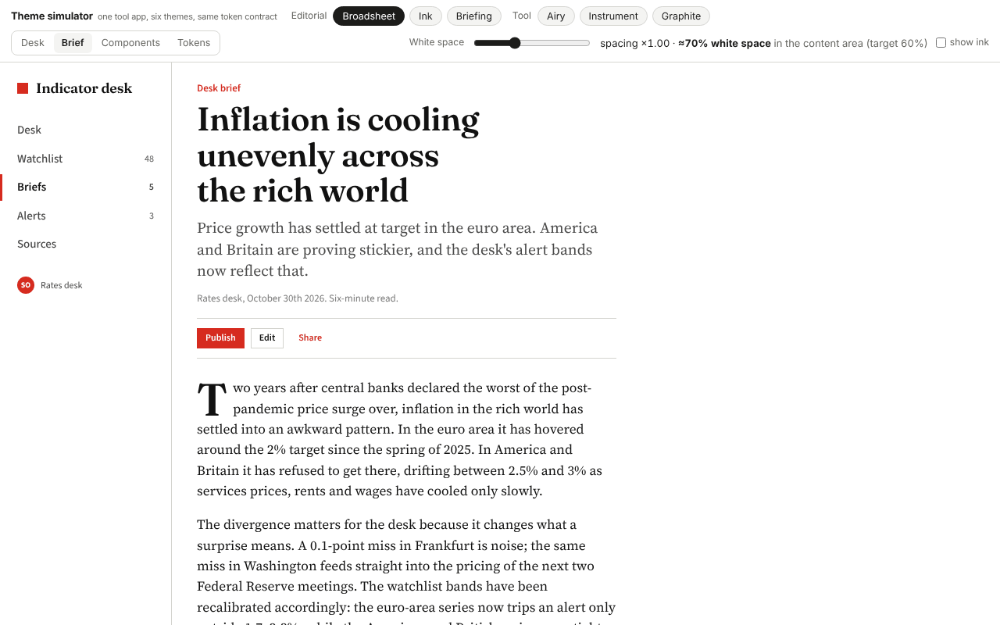

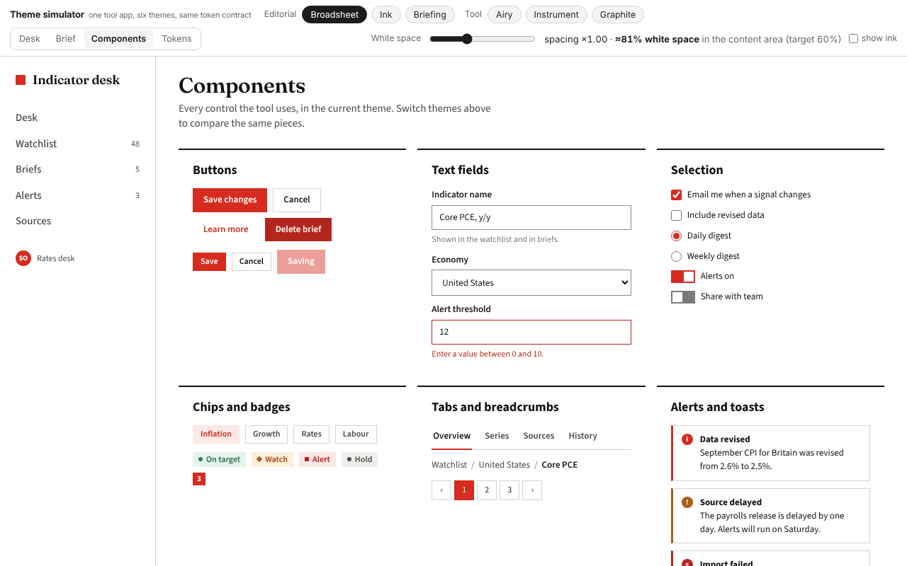

Details:

- Sidebar and active mark: `../assets/screenshots/detail-broadsheet-sidebar.png`
- Stat tiles with sparklines: `../assets/screenshots/detail-broadsheet-tiles.png`
- Line chart: `../assets/screenshots/detail-broadsheet-chart.png`
- Line chart with the hover tooltip: `../assets/screenshots/detail-broadsheet-chart-hover.png`
- Watchlist table: `../assets/screenshots/detail-broadsheet-table.png`
- Column chart (article figure): `../assets/screenshots/detail-broadsheet-column-chart.png`
- Buttons: `../assets/screenshots/detail-broadsheet-buttons.png`
- Text fields, select, error state: `../assets/screenshots/detail-broadsheet-text-fields.png`
- Checkbox, radio, switch: `../assets/screenshots/detail-broadsheet-selection.png`
- Filter chips, status pills, badge: `../assets/screenshots/detail-broadsheet-chips-badges.png`
- Tabs, breadcrumbs, pagination: `../assets/screenshots/detail-broadsheet-tabs-crumbs.png`
- Alerts and toast: `../assets/screenshots/detail-broadsheet-alerts-toasts.png`
- Menu: `../assets/screenshots/detail-broadsheet-menu.png`
- Dialog: `../assets/screenshots/detail-broadsheet-dialog.png`
- Empty state: `../assets/screenshots/detail-broadsheet-empty-state.png`

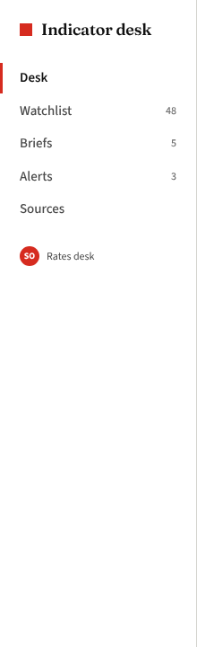

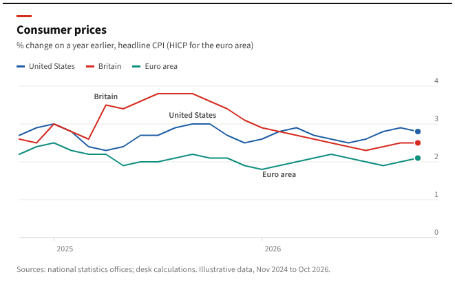

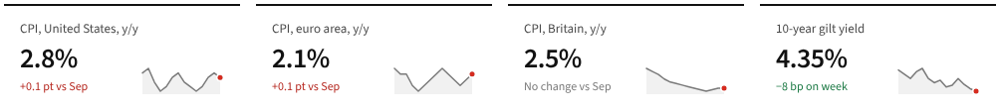

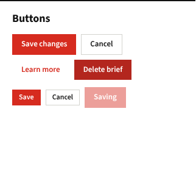

Phone width (400px): `../assets/screenshots/mobile-broadsheet-desk.png`

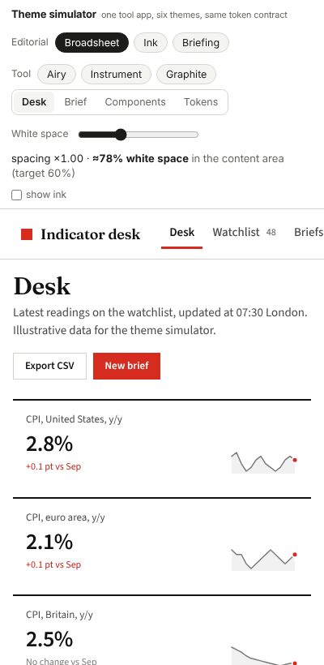

## ink

**Ink** — Editorial (dark). Default spacing multiplier `--ws: 1.0`. Chart style: editorial.

Dark editorial. Blue-black paper rather than black, warm off-white ink, the red brightened one step so it still carries, and the accent split into a fill and a text version so both pass contrast.

**Type:** Newsreader (display and reading text, optical size on), Source Sans 3 (UI).

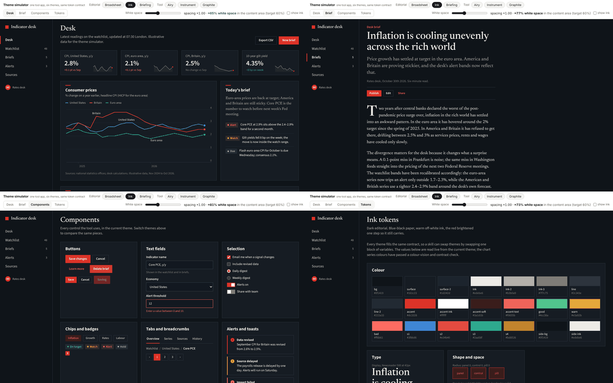

### Use for

- Low-light reading and long sessions
- A dark sibling for Broadsheet that swaps at runtime (same structure, same component CSS)
- Evening briefings and reader modes

### Signature moves

- Blue-black background (#0f1419), never pure black; three surface steps
- Warm off-white text; secondary text drops to `--ink-2`, never grey-on-grey
- Panels separate with 1px borders; no glow, no shadow
- `--accent` (#dc3328) for fills with white text, `--accent-text` (#f0655b) wherever the red is text
- Danger buttons use `--bad-btn`, a deeper red than the `--bad` used for text

### Avoid

- Pure #000 or #111 backgrounds
- Neon or saturated accents; glows
- Using the red as a background fill for anything but a button
- Reusing the light chart palette: the dark series are their own validated set

### Token block

```css
[data-theme="ink"]{
  color-scheme:dark;
  --bg:#0f1419; --surface:#161c23; --surface-2:#1d242d;
  --ink:#edebe6; --ink-2:#b3b0a9; --ink-3:#7f7c75;
  --line:#2c343e; --line-2:#222a33;
  --accent:#dc3328; --accent-ink:#ffffff; --accent-soft:#3a1d1b; --accent-text:#f0655b;
  --good:#4cc38a; --warn:#e3a92b; --bad:#ff6b61;
  --good-bg:rgba(76,195,138,.14); --warn-bg:rgba(227,169,43,.14); --bad-bg:rgba(255,107,97,.14); --neutral-bg:#232b35;
  --s1:#3f86d6; --s2:#e34b40; --s3:#2aa58f; --s4:#bd8526; --chart-tab:var(--accent);
  --font-display:"Newsreader",Georgia,serif;
  --font-text:"Newsreader",Georgia,serif;
  --font-ui:"Source Sans 3","Helvetica Neue",Arial,sans-serif;
  --display-weight:500; --display-tracking:-0.005em;
  --fs-base:15px; --fs-sm:13px; --fs-xs:12px; --fs-h1:30px; --fs-h2:18px; --fs-head:42px; --fs-num:28px; --fs-prose:17.5px; --prose-lh:1.6;
  --radius:0; --radius-s:0; --pill-radius:0; --btn-radius:0; --input-radius:0;
  --panel-bg:var(--surface); --panel-border:1px solid var(--line); --panel-top:1px solid var(--line); --panel-shadow:none;
  --table-top:1px solid var(--ink-3); --table-head-bg:transparent;
  --input-bg:#121820; --input-border:#3a434e;
  --side-w:220px; --side-bg:#0f1419; --side-ink:#edebe6; --side-ink-2:#b3b0a9; --side-line:#2c343e;
  --nav-active-bg:transparent; --nav-active-ink:#edebe6; --nav-mark:var(--accent); --nav-mark-w:3px; --nav-radius:0; --nav-ml:calc(var(--u) * -1.5);
  --swatch-w:12px; --swatch-h:3px; --swatch-r:0;
  --ws:1;
  --dialog-shadow:0 0 0 1px var(--ink-3);
  --bad-btn:#c73a2e;
}
```

### Screenshots

Full views (1280×800):

- Desk: tiles, line chart, brief panel: `../assets/screenshots/ink-desk.png`
- Desk, scrolled to the watchlist table: `../assets/screenshots/ink-desk-table.png`
- Brief: article view, headline and prose: `../assets/screenshots/ink-brief.png`
- Brief, scrolled to the inline column chart: `../assets/screenshots/ink-brief-figure.png`
- Components gallery, top half: `../assets/screenshots/ink-components.png`
- Components gallery, bottom half: `../assets/screenshots/ink-components-2.png`
- Tokens sheet: swatches: `../assets/screenshots/ink-tokens.png`
- Tokens sheet: type, shape, skill notes, CSS: `../assets/screenshots/ink-tokens-2.png`

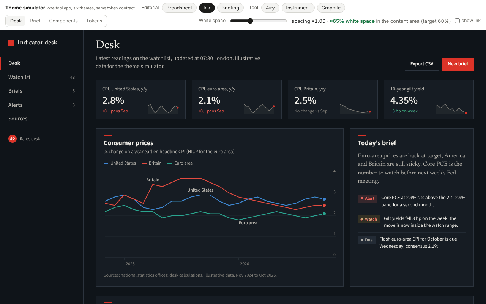

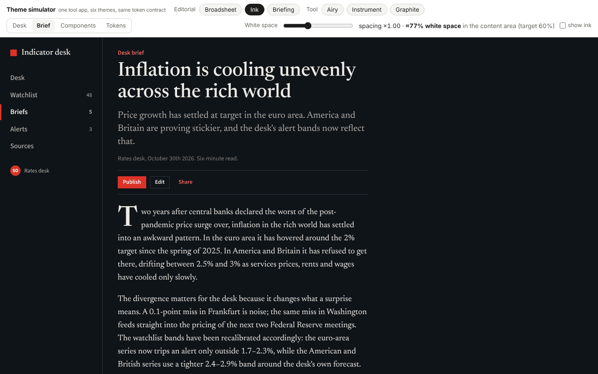

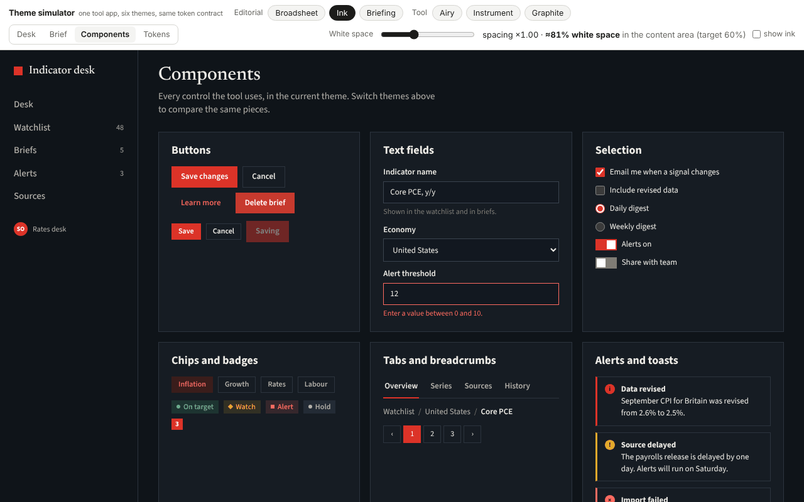

Details:

- Sidebar and active mark: `../assets/screenshots/detail-ink-sidebar.png`
- Stat tiles with sparklines: `../assets/screenshots/detail-ink-tiles.png`
- Line chart: `../assets/screenshots/detail-ink-chart.png`
- Line chart with the hover tooltip: `../assets/screenshots/detail-ink-chart-hover.png`
- Watchlist table: `../assets/screenshots/detail-ink-table.png`
- Column chart (article figure): `../assets/screenshots/detail-ink-column-chart.png`
- Buttons: `../assets/screenshots/detail-ink-buttons.png`
- Text fields, select, error state: `../assets/screenshots/detail-ink-text-fields.png`
- Checkbox, radio, switch: `../assets/screenshots/detail-ink-selection.png`
- Filter chips, status pills, badge: `../assets/screenshots/detail-ink-chips-badges.png`
- Tabs, breadcrumbs, pagination: `../assets/screenshots/detail-ink-tabs-crumbs.png`
- Alerts and toast: `../assets/screenshots/detail-ink-alerts-toasts.png`
- Menu: `../assets/screenshots/detail-ink-menu.png`
- Dialog: `../assets/screenshots/detail-ink-dialog.png`
- Empty state: `../assets/screenshots/detail-ink-empty-state.png`

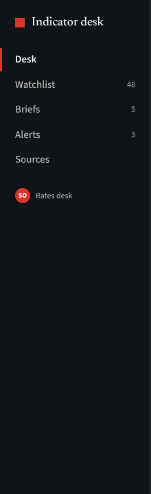

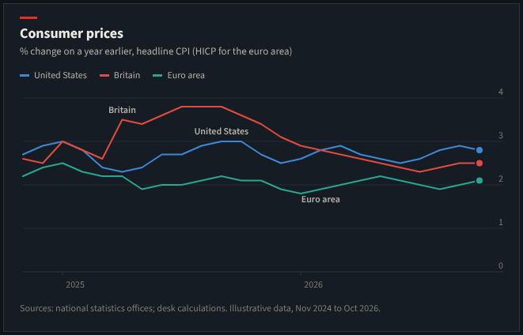

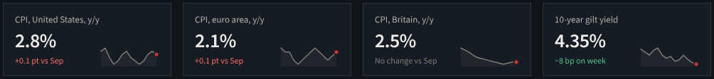

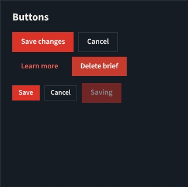

Phone width (400px): `../assets/screenshots/mobile-ink-desk.png`

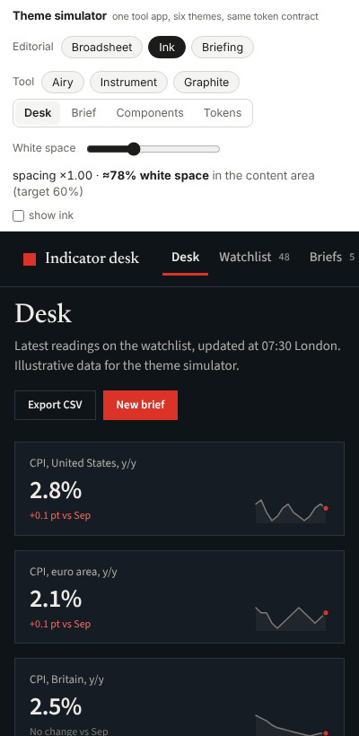

## briefing

**Briefing** — Editorial (data-first, light). Default spacing multiplier `--ws: 1.0`. Chart style: editorial.

Data-first editorial, after the "graphic detail" kind of page: a cool grey canvas, white panels with a 3px blue top bar, a navy sidebar, and red reserved for the chart tab and the one highlighted series.

**Type:** Source Serif 4 (display and reading text), IBM Plex Sans (UI, tabular numerals).

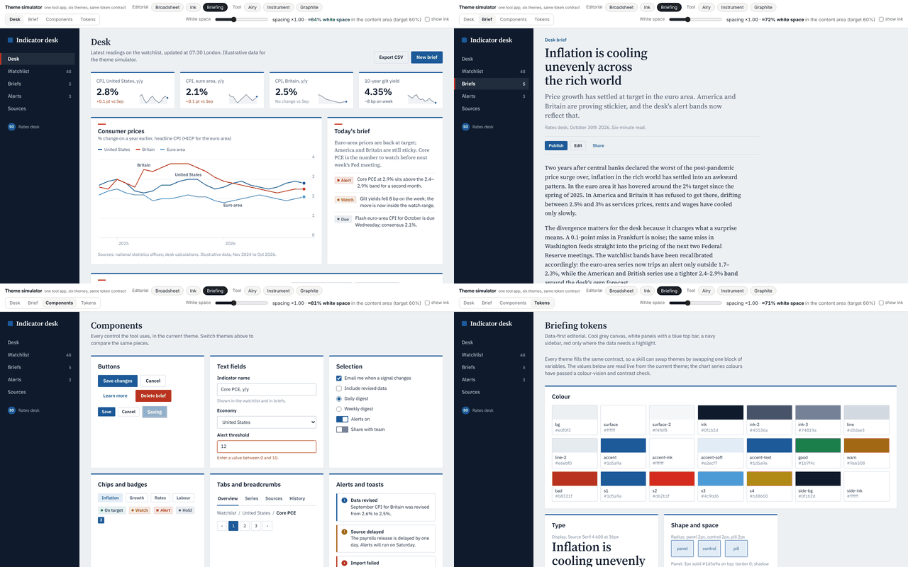

### Use for

- Chart-led dashboards and data briefings
- Analyst tools where tables and figures outnumber prose
- Teams that want editorial tone with working-tool density

### Signature moves

- 3px `--accent` (navy blue) top bar on every panel; the panel is the unit of the page
- Navy sidebar (#0f1b2d) with a red active mark against a cool grey page
- Red (`--highlight`) only as the chart tab and the one highlighted series; the accent is blue
- Serif headings over a tabular-numeral sans; `--table-head-bg` gives tables a quiet header band
- 2px radius: barely softened, still precise

### Avoid

- Radius above 2px or pill shapes
- Gradients and tonal washes
- Colouring text with series colours
- Using the blue accent as both a series colour and a button colour on the same chart panel

### Token block

```css
[data-theme="briefing"]{
  color-scheme:light;
  --bg:#edf0f3; --surface:#ffffff; --surface-2:#f4f6f8;
  --ink:#0f1b2d; --ink-2:#45536a; --ink-3:#74819a;
  --line:#d3dae3; --line-2:#e6ebf0;
  --accent:#1d5a9a; --accent-ink:#ffffff; --accent-soft:#e2ecf7; --accent-text:#1d5a9a; --highlight:#d62b1f;
  --good:#187045; --warn:#8f5d06; --bad:#b8321f;
  --good-bg:#e4f2ea; --warn-bg:#faefd9; --bad-bg:#f9e5e1; --neutral-bg:#e9edf2;
  --s1:#1d5a9a; --s2:#d62b1f; --s3:#4c9bd6; --s4:#b38600; --chart-tab:var(--highlight);
  --font-display:"Source Serif 4",Georgia,serif;
  --font-text:"Source Serif 4",Georgia,serif;
  --font-ui:"IBM Plex Sans","Helvetica Neue",Arial,sans-serif;
  --display-weight:600; --display-tracking:-0.01em;
  --fs-base:14px; --fs-sm:13px; --fs-xs:12px; --fs-h1:26px; --fs-h2:17px; --fs-head:36px; --fs-num:26px; --fs-prose:16.5px; --prose-lh:1.55;
  --radius:2px; --radius-s:2px; --pill-radius:2px; --btn-radius:2px; --input-radius:2px;
  --panel-bg:#ffffff; --panel-border:0; --panel-top:3px solid var(--accent); --panel-shadow:0 1px 2px rgba(15,27,45,.08);
  --table-top:1px solid var(--line); --table-head-bg:var(--surface-2);
  --input-bg:#ffffff; --input-border:#b7c2d0;
  --side-w:224px; --side-bg:#0f1b2d; --side-ink:#ffffff; --side-ink-2:#aab6c8; --side-line:#0f1b2d;
  --nav-active-bg:rgba(255,255,255,.08); --nav-active-ink:#ffffff; --nav-mark:var(--highlight); --nav-mark-w:3px; --nav-radius:0; --nav-ml:calc(var(--u) * -1.5);
  --swatch-w:12px; --swatch-h:3px; --swatch-r:0;
  --ws:1;
}
```

### Screenshots

Full views (1280×800):

- Desk: tiles, line chart, brief panel: `../assets/screenshots/briefing-desk.png`
- Desk, scrolled to the watchlist table: `../assets/screenshots/briefing-desk-table.png`
- Brief: article view, headline and prose: `../assets/screenshots/briefing-brief.png`
- Brief, scrolled to the inline column chart: `../assets/screenshots/briefing-brief-figure.png`
- Components gallery, top half: `../assets/screenshots/briefing-components.png`
- Components gallery, bottom half: `../assets/screenshots/briefing-components-2.png`
- Tokens sheet: swatches: `../assets/screenshots/briefing-tokens.png`
- Tokens sheet: type, shape, skill notes, CSS: `../assets/screenshots/briefing-tokens-2.png`

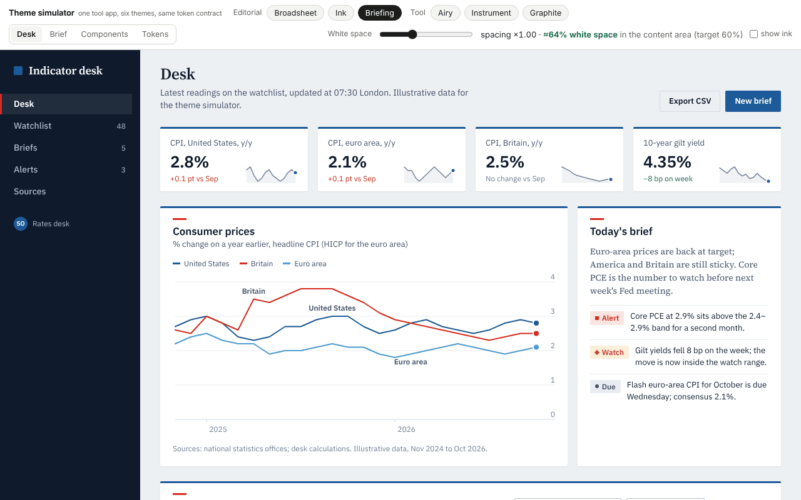

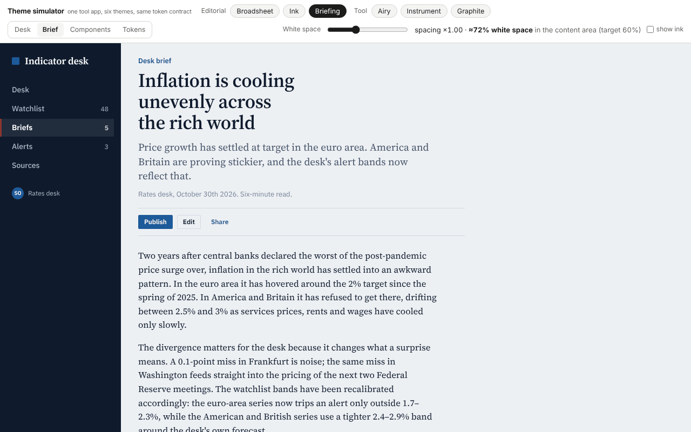

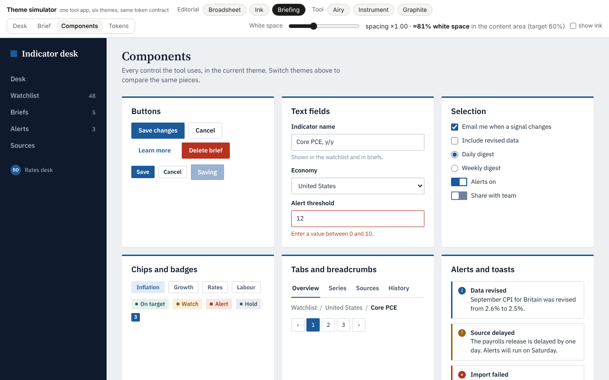

Details:

- Sidebar and active mark: `../assets/screenshots/detail-briefing-sidebar.png`
- Stat tiles with sparklines: `../assets/screenshots/detail-briefing-tiles.png`
- Line chart: `../assets/screenshots/detail-briefing-chart.png`
- Line chart with the hover tooltip: `../assets/screenshots/detail-briefing-chart-hover.png`
- Watchlist table: `../assets/screenshots/detail-briefing-table.png`
- Column chart (article figure): `../assets/screenshots/detail-briefing-column-chart.png`
- Buttons: `../assets/screenshots/detail-briefing-buttons.png`
- Text fields, select, error state: `../assets/screenshots/detail-briefing-text-fields.png`
- Checkbox, radio, switch: `../assets/screenshots/detail-briefing-selection.png`
- Filter chips, status pills, badge: `../assets/screenshots/detail-briefing-chips-badges.png`
- Tabs, breadcrumbs, pagination: `../assets/screenshots/detail-briefing-tabs-crumbs.png`
- Alerts and toast: `../assets/screenshots/detail-briefing-alerts-toasts.png`
- Menu: `../assets/screenshots/detail-briefing-menu.png`
- Dialog: `../assets/screenshots/detail-briefing-dialog.png`
- Empty state: `../assets/screenshots/detail-briefing-empty-state.png`

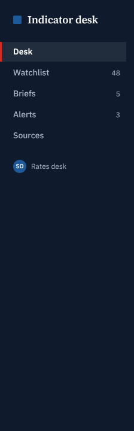

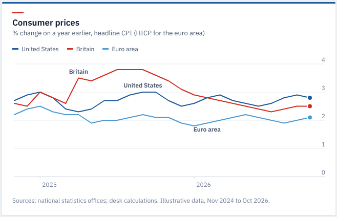

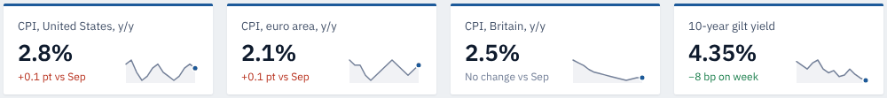

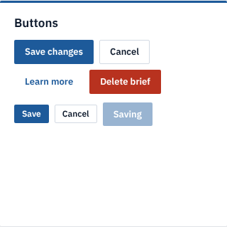

Phone width (400px): `../assets/screenshots/mobile-briefing-desk.png`

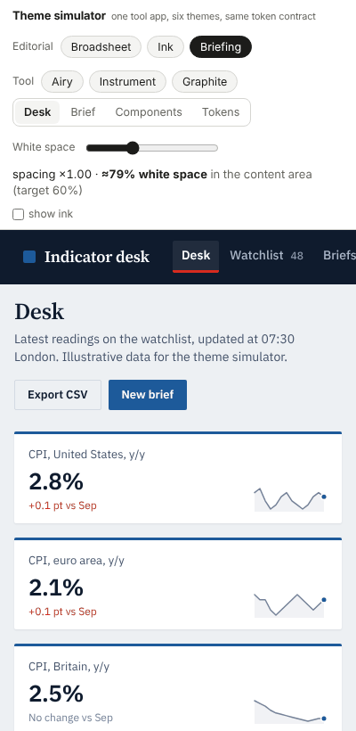

## airy

**Airy** — Tool (Google-inspired, light). Default spacing multiplier `--ws: 1.4`. Chart style: tool.

White space is the structure. One typeface, pill buttons and a pill nav that bleeds to the sidebar edge, 12px outlined cards without shadows, one blue, and a spacing scale of 1.4 that lands near the 60% white-space rule of thumb.

**Type:** Figtree for everything (display 600, UI 400/500); Roboto and system-ui as fallbacks.

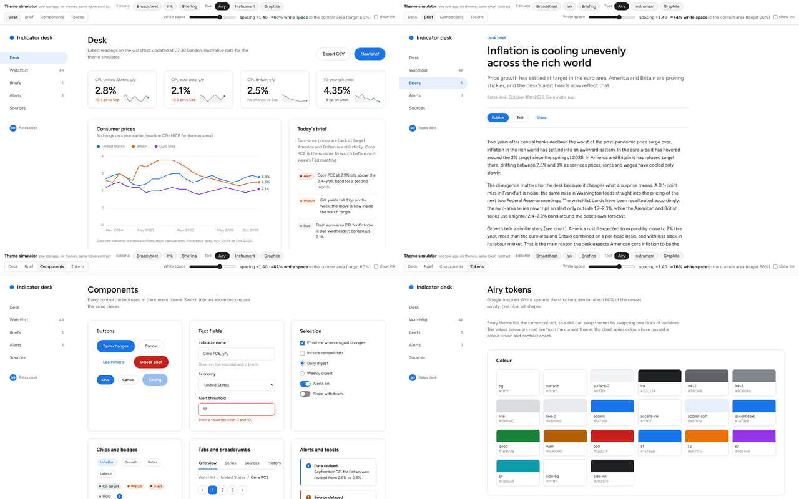

### Use for

- Consumer-grade tools, settings-heavy apps, onboarding and forms
- Anything where approachability beats density
- A product that must feel calm on first open

### Signature moves

- One family; hierarchy from size and weight only
- Pill buttons (`--btn-radius:999px`) and a pill nav with `0 999px 999px 0` radius that bleeds to the sidebar edge
- 12px outlined cards, no shadows, no tonal stacking; the page stays white
- Grey (`--surface-2`) appears only as a hover or selected state
- Spacing multiplier 1.4; tiles get a 32px value

### Avoid

- Dense tables and 13px body text
- A second accent colour
- Grey page backgrounds with white cards on top
- Borders and shadows on the same element

### Token block

```css
[data-theme="airy"]{
  color-scheme:light;
  --bg:#ffffff; --surface:#ffffff; --surface-2:#f1f3f4;
  --ink:#202124; --ink-2:#5f6368; --ink-3:#80868b;
  --line:#dadce0; --line-2:#e8eaed;
  --accent:#1a73e8; --accent-ink:#ffffff; --accent-soft:#e8f0fe; --accent-text:#1a73e8;
  --good:#188038; --warn:#b06000; --bad:#c5221f;
  --good-bg:#e6f4ea; --warn-bg:#fef7e0; --bad-bg:#fce8e6; --neutral-bg:#f1f3f4;
  --s1:#1a73e8; --s2:#e8710a; --s3:#9334e6; --s4:#0e9aa8; --chart-tab:var(--accent);
  --font-display:"Figtree",Roboto,system-ui,sans-serif;
  --font-text:"Figtree",Roboto,system-ui,sans-serif;
  --font-ui:"Figtree",Roboto,system-ui,sans-serif;
  --display-weight:600; --display-tracking:-0.01em;
  --fs-base:14px; --fs-sm:13px; --fs-xs:12px; --fs-h1:28px; --fs-h2:16px; --fs-head:36px; --fs-num:32px; --fs-prose:15px; --prose-lh:1.65;
  --radius:12px; --radius-s:8px; --pill-radius:999px; --btn-radius:999px; --input-radius:8px;
  --panel-bg:#ffffff; --panel-border:1px solid var(--line); --panel-top:1px solid var(--line); --panel-shadow:none;
  --table-top:0; --table-head-bg:transparent;
  --input-bg:#ffffff; --input-border:#dadce0;
  --side-w:236px; --side-bg:#ffffff; --side-ink:#202124; --side-ink-2:#5f6368; --side-line:#ffffff;
  --nav-active-bg:#e8f0fe; --nav-active-ink:#1967d2; --nav-mark:transparent; --nav-mark-w:0px; --nav-radius:0 999px 999px 0; --nav-ml:calc(var(--u) * -1.5);
  --swatch-w:10px; --swatch-h:10px; --swatch-r:50%;
  --ws:1.4;
}
```

### Screenshots

Full views (1280×800):

- Desk: tiles, line chart, brief panel: `../assets/screenshots/airy-desk.png`
- Desk, scrolled to the watchlist table: `../assets/screenshots/airy-desk-table.png`
- Brief: article view, headline and prose: `../assets/screenshots/airy-brief.png`
- Brief, scrolled to the inline column chart: `../assets/screenshots/airy-brief-figure.png`
- Components gallery, top half: `../assets/screenshots/airy-components.png`
- Components gallery, bottom half: `../assets/screenshots/airy-components-2.png`
- Tokens sheet: swatches: `../assets/screenshots/airy-tokens.png`
- Tokens sheet: type, shape, skill notes, CSS: `../assets/screenshots/airy-tokens-2.png`

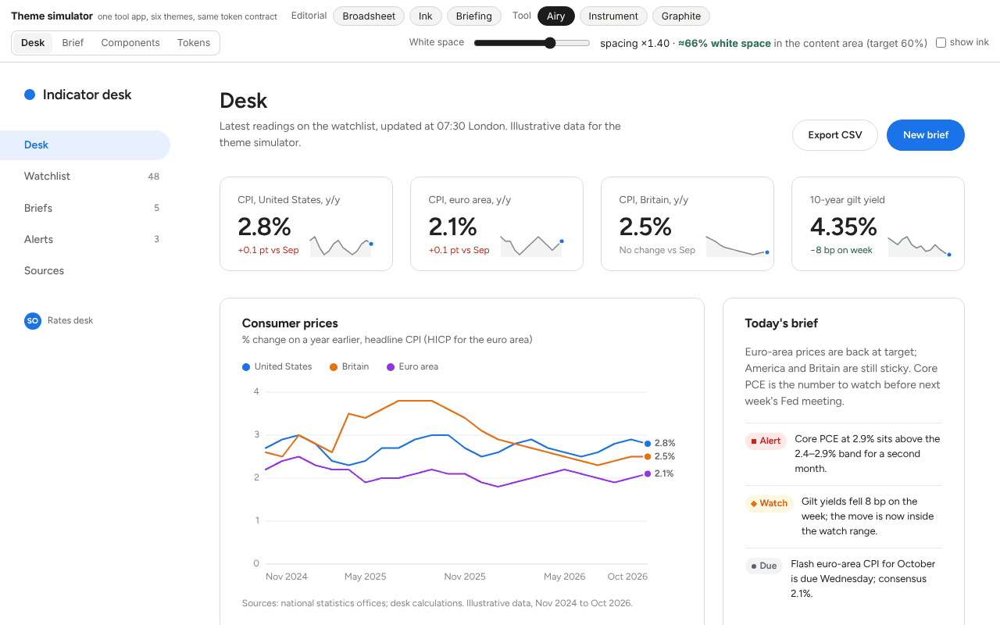

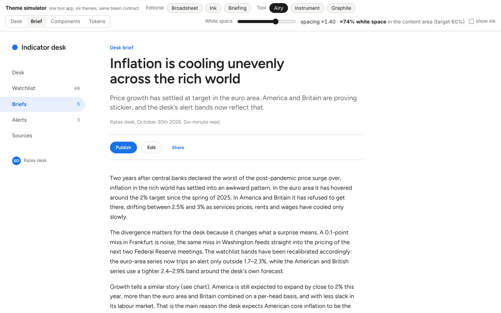

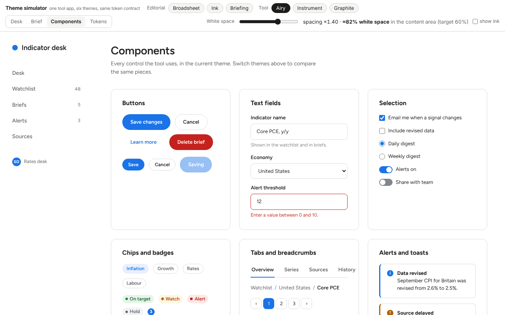

Details:

- Sidebar and active mark: `../assets/screenshots/detail-airy-sidebar.png`
- Stat tiles with sparklines: `../assets/screenshots/detail-airy-tiles.png`
- Line chart: `../assets/screenshots/detail-airy-chart.png`
- Line chart with the hover tooltip: `../assets/screenshots/detail-airy-chart-hover.png`
- Watchlist table: `../assets/screenshots/detail-airy-table.png`
- Column chart (article figure): `../assets/screenshots/detail-airy-column-chart.png`
- Buttons: `../assets/screenshots/detail-airy-buttons.png`
- Text fields, select, error state: `../assets/screenshots/detail-airy-text-fields.png`
- Checkbox, radio, switch: `../assets/screenshots/detail-airy-selection.png`
- Filter chips, status pills, badge: `../assets/screenshots/detail-airy-chips-badges.png`
- Tabs, breadcrumbs, pagination: `../assets/screenshots/detail-airy-tabs-crumbs.png`
- Alerts and toast: `../assets/screenshots/detail-airy-alerts-toasts.png`
- Menu: `../assets/screenshots/detail-airy-menu.png`
- Dialog: `../assets/screenshots/detail-airy-dialog.png`
- Empty state: `../assets/screenshots/detail-airy-empty-state.png`

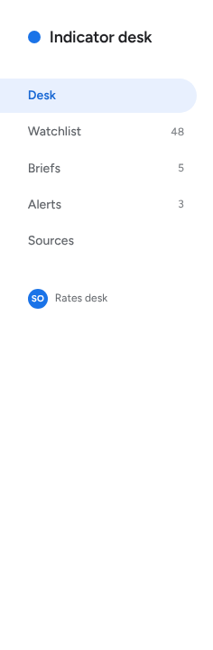

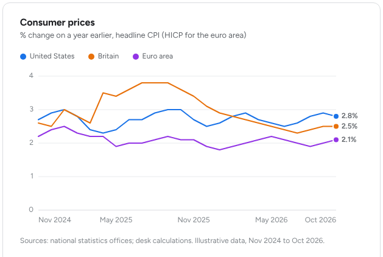

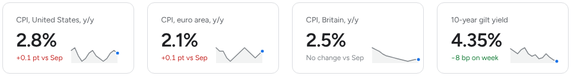

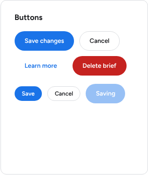

Phone width (400px): `../assets/screenshots/mobile-airy-desk.png`

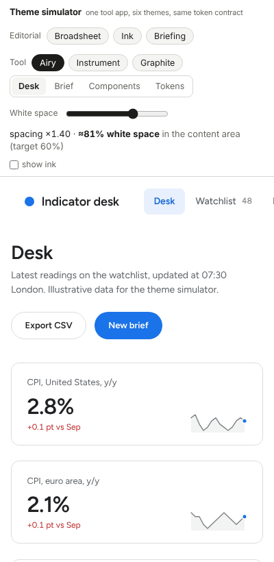

## instrument

**Instrument** — Tool (dense, light). Default spacing multiplier `--ws: 0.8`. Chart style: tool.

Dense operator tool. 13px base, tabular numerals, 6px radius, hairline panels, and colour only where it means something. Density is the feature, so spacing runs at 0.8.

**Type:** Manrope for everything (display 700, UI 500/400) with `font-variant-numeric: tabular-nums` wherever numbers align.

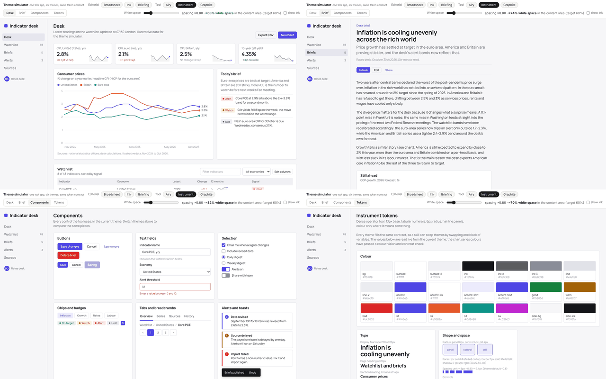

### Use for

- Operator consoles, admin and developer tools
- Screens scanned many times a day by the same people
- Tables with many rows and numeric columns

### Signature moves

- Spacing multiplier 0.8; 32px table rows; 200px sidebar
- Tabular numerals in every column; proportional figures only in tiles
- Semantic colour lives only in pills and deltas; the indigo accent is for actions and focus
- Grey page (#f6f6f8) with white panels and 1px hairlines; a 1px 4% shadow at most
- Display sizes stay small (h1 20px); no hero numbers

### Avoid

- Hero numbers and headings over 24px
- Decorative colour or gradients
- Monospace for labels (use the tabular sans)
- Large paddings that waste the density

### Token block

```css
[data-theme="instrument"]{
  color-scheme:light;
  --bg:#f6f6f8; --surface:#ffffff; --surface-2:#f0f0f4;
  --ink:#15161a; --ink-2:#5a5d68; --ink-3:#8a8d98;
  --line:#e1e2e8; --line-2:#ebecf0;
  --accent:#4f46e5; --accent-ink:#ffffff; --accent-soft:#ecebfc; --accent-text:#4f46e5;
  --good:#15803d; --warn:#a16207; --bad:#d82222;
  --good-bg:#e7f6ec; --warn-bg:#fdf3dc; --bad-bg:#fdeaea; --neutral-bg:#ededf2;
  --s1:#4f46e5; --s2:#e5582a; --s3:#0d9488; --s4:#c026d3; --chart-tab:var(--accent);
  --font-display:"Manrope",system-ui,sans-serif;
  --font-text:"Manrope",system-ui,sans-serif;
  --font-ui:"Manrope",system-ui,sans-serif;
  --display-weight:700; --display-tracking:-0.015em;
  --fs-base:13px; --fs-sm:12px; --fs-xs:11px; --fs-h1:20px; --fs-h2:14px; --fs-head:26px; --fs-num:22px; --fs-prose:14px; --prose-lh:1.6;
  --radius:6px; --radius-s:4px; --pill-radius:4px; --btn-radius:5px; --input-radius:5px;
  --panel-bg:#ffffff; --panel-border:1px solid var(--line); --panel-top:1px solid var(--line); --panel-shadow:0 1px 2px rgba(20,22,30,.04);
  --table-top:0; --table-head-bg:var(--surface-2);
  --input-bg:#ffffff; --input-border:#d6d7df;
  --side-w:200px; --side-bg:#f6f6f8; --side-ink:#15161a; --side-ink-2:#5a5d68; --side-line:#e1e2e8;
  --nav-active-bg:#e6e6ee; --nav-active-ink:#15161a; --nav-mark:transparent; --nav-mark-w:0px; --nav-radius:4px; --nav-ml:0px;
  --swatch-w:8px; --swatch-h:8px; --swatch-r:2px;
  --ws:0.8;
}
```

### Screenshots

Full views (1280×800):

- Desk: tiles, line chart, brief panel: `../assets/screenshots/instrument-desk.png`
- Desk, scrolled to the watchlist table: `../assets/screenshots/instrument-desk-table.png`
- Brief: article view, headline and prose: `../assets/screenshots/instrument-brief.png`
- Brief, scrolled to the inline column chart: `../assets/screenshots/instrument-brief-figure.png`
- Components gallery, top half: `../assets/screenshots/instrument-components.png`
- Components gallery, bottom half: `../assets/screenshots/instrument-components-2.png`
- Tokens sheet: swatches: `../assets/screenshots/instrument-tokens.png`
- Tokens sheet: type, shape, skill notes, CSS: `../assets/screenshots/instrument-tokens-2.png`

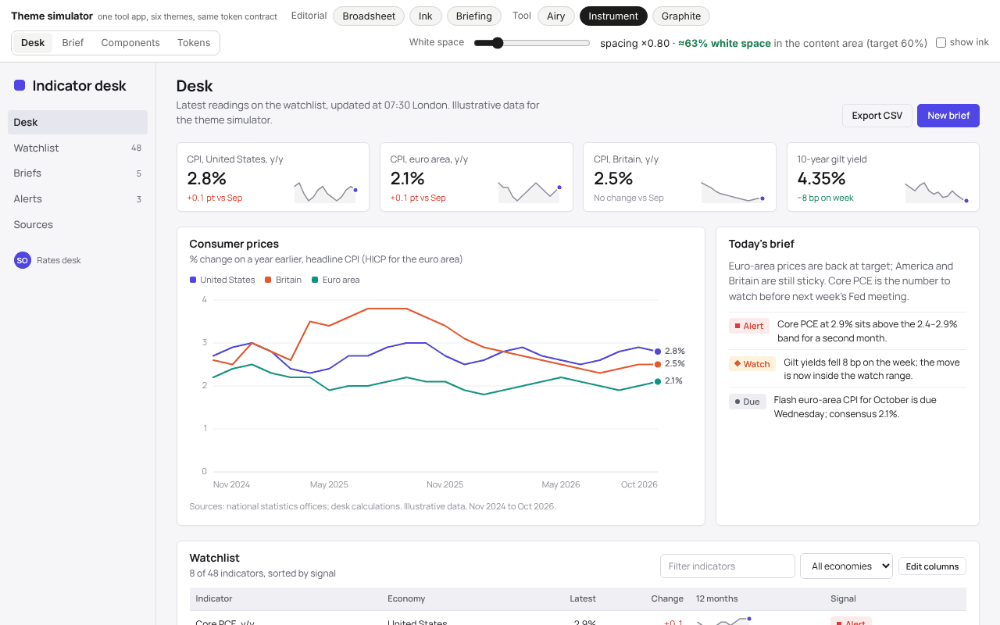

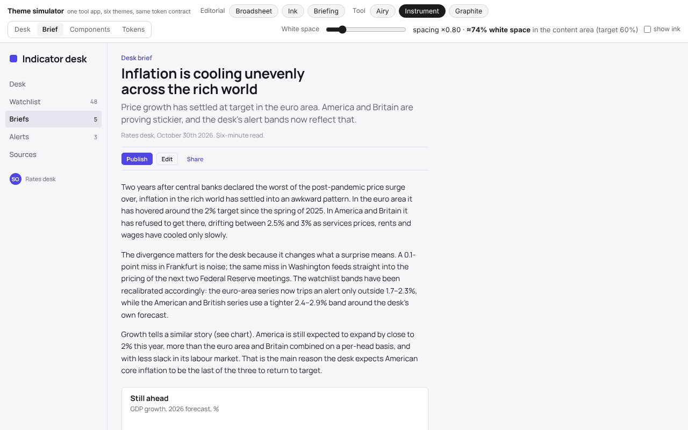

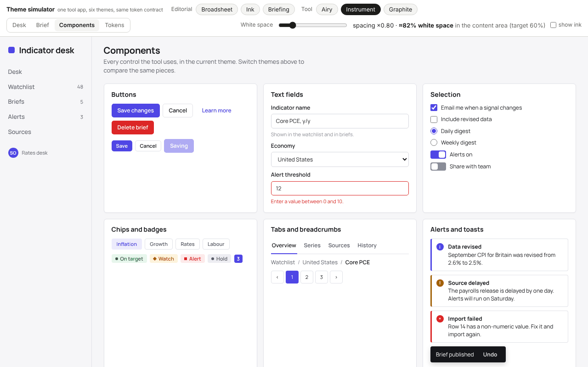

Details:

- Sidebar and active mark: `../assets/screenshots/detail-instrument-sidebar.png`
- Stat tiles with sparklines: `../assets/screenshots/detail-instrument-tiles.png`
- Line chart: `../assets/screenshots/detail-instrument-chart.png`
- Line chart with the hover tooltip: `../assets/screenshots/detail-instrument-chart-hover.png`
- Watchlist table: `../assets/screenshots/detail-instrument-table.png`
- Column chart (article figure): `../assets/screenshots/detail-instrument-column-chart.png`
- Buttons: `../assets/screenshots/detail-instrument-buttons.png`
- Text fields, select, error state: `../assets/screenshots/detail-instrument-text-fields.png`
- Checkbox, radio, switch: `../assets/screenshots/detail-instrument-selection.png`
- Filter chips, status pills, badge: `../assets/screenshots/detail-instrument-chips-badges.png`
- Tabs, breadcrumbs, pagination: `../assets/screenshots/detail-instrument-tabs-crumbs.png`
- Alerts and toast: `../assets/screenshots/detail-instrument-alerts-toasts.png`
- Menu: `../assets/screenshots/detail-instrument-menu.png`
- Dialog: `../assets/screenshots/detail-instrument-dialog.png`
- Empty state: `../assets/screenshots/detail-instrument-empty-state.png`

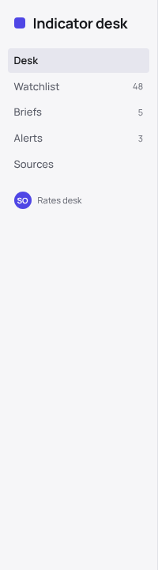

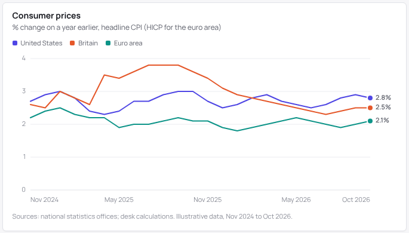

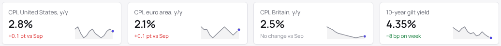

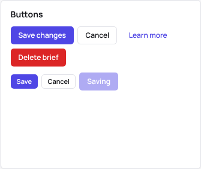

Phone width (400px): `../assets/screenshots/mobile-instrument-desk.png`

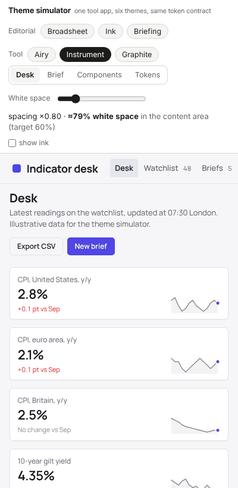

## graphite

**Graphite** — Tool (dark-first). Default spacing multiplier `--ws: 1.0`. Chart style: tool.

Dark-first modern tool. Blue-grey neutrals with three surface steps, a periwinkle accent that keeps white text readable (and a brighter `--accent-text` for links), 8px radius, and elevation by one border step rather than shadows.

**Type:** DM Sans for everything (display 600, optical size on).

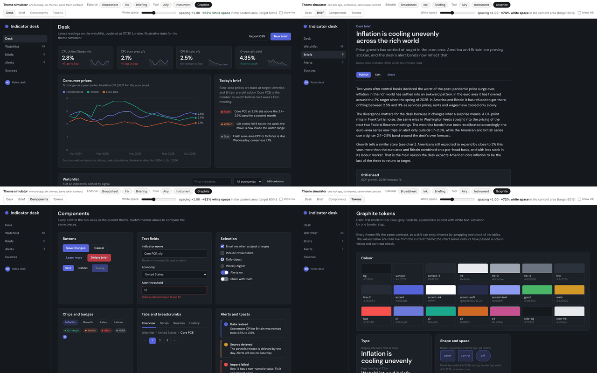

### Use for

- Dark-mode-first tools
- Long sessions on screens, monitoring and ops
- Developer-facing products

### Signature moves

- Blue-grey neutrals (#15181d / #1c2027 / #242931), never pure black
- `--accent` #5563d8 for fills (white text passes), `--accent-text` #8b9bff for text
- 8px radius, 1px borders as the only elevation
- Chart palette validated against the dark surface, not inverted from the light one
- Semantic colours brightened for dark; `--bad-btn` deeper for buttons

### Avoid

- Pure black, acid green, glows and blurs
- Transparency stacks that muddy the surfaces
- Light-mode series colours reused on dark
- More than three surface steps

### Token block

```css
[data-theme="graphite"]{
  color-scheme:dark;
  --bg:#15181d; --surface:#1c2027; --surface-2:#242931;
  --ink:#e7e9ec; --ink-2:#9ba3ae; --ink-3:#6b7380;
  --line:#2c323b; --line-2:#262c34;
  --accent:#5563d8; --accent-ink:#ffffff; --accent-soft:rgba(85,99,216,.2); --accent-text:#8b9bff;
  --good:#3fb950; --warn:#d29922; --bad:#f85149;
  --good-bg:rgba(63,185,80,.15); --warn-bg:rgba(210,153,34,.15); --bad-bg:rgba(248,81,73,.15); --neutral-bg:#2a3039;
  --s1:#6b7ae8; --s2:#1aa88c; --s3:#d9671c; --s4:#c84fab; --chart-tab:var(--accent);
  --font-display:"DM Sans",system-ui,sans-serif;
  --font-text:"DM Sans",system-ui,sans-serif;
  --font-ui:"DM Sans",system-ui,sans-serif;
  --display-weight:600; --display-tracking:-0.01em;
  --fs-base:13.5px; --fs-sm:12.5px; --fs-xs:11.5px; --fs-h1:22px; --fs-h2:15px; --fs-head:28px; --fs-num:24px; --fs-prose:14.5px; --prose-lh:1.6;
  --radius:8px; --radius-s:6px; --pill-radius:999px; --btn-radius:6px; --input-radius:6px;
  --panel-bg:var(--surface); --panel-border:1px solid var(--line); --panel-top:1px solid var(--line); --panel-shadow:none;
  --table-top:0; --table-head-bg:transparent;
  --input-bg:#15181d; --input-border:#3a414c;
  --side-w:216px; --side-bg:#15181d; --side-ink:#e7e9ec; --side-ink-2:#9ba3ae; --side-line:#2c323b;
  --nav-active-bg:#242931; --nav-active-ink:#e7e9ec; --nav-mark:transparent; --nav-mark-w:0px; --nav-radius:6px; --nav-ml:0px;
  --swatch-w:10px; --swatch-h:10px; --swatch-r:50%;
  --ws:1;
  --bad-btn:#c93434;
}
```

### Screenshots

Full views (1280×800):

- Desk: tiles, line chart, brief panel: `../assets/screenshots/graphite-desk.png`
- Desk, scrolled to the watchlist table: `../assets/screenshots/graphite-desk-table.png`
- Brief: article view, headline and prose: `../assets/screenshots/graphite-brief.png`
- Brief, scrolled to the inline column chart: `../assets/screenshots/graphite-brief-figure.png`
- Components gallery, top half: `../assets/screenshots/graphite-components.png`
- Components gallery, bottom half: `../assets/screenshots/graphite-components-2.png`
- Tokens sheet: swatches: `../assets/screenshots/graphite-tokens.png`
- Tokens sheet: type, shape, skill notes, CSS: `../assets/screenshots/graphite-tokens-2.png`

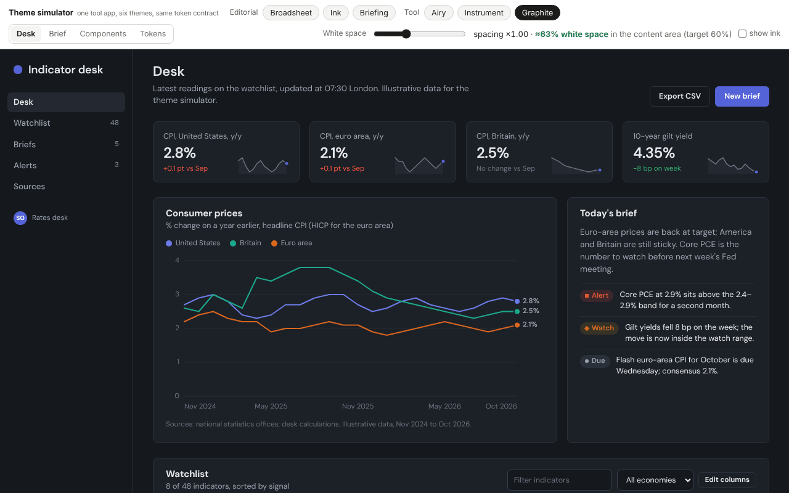

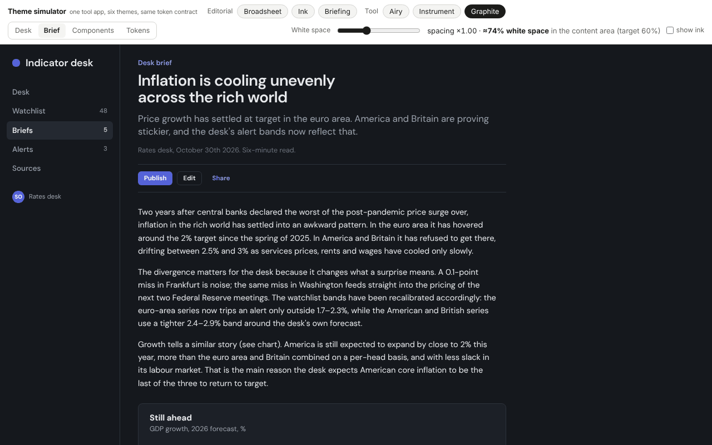


Details:

- Sidebar and active mark: `../assets/screenshots/detail-graphite-sidebar.png`
- Stat tiles with sparklines: `../assets/screenshots/detail-graphite-tiles.png`
- Line chart: `../assets/screenshots/detail-graphite-chart.png`
- Line chart with the hover tooltip: `../assets/screenshots/detail-graphite-chart-hover.png`
- Watchlist table: `../assets/screenshots/detail-graphite-table.png`
- Column chart (article figure): `../assets/screenshots/detail-graphite-column-chart.png`
- Buttons: `../assets/screenshots/detail-graphite-buttons.png`
- Text fields, select, error state: `../assets/screenshots/detail-graphite-text-fields.png`
- Checkbox, radio, switch: `../assets/screenshots/detail-graphite-selection.png`
- Filter chips, status pills, badge: `../assets/screenshots/detail-graphite-chips-badges.png`
- Tabs, breadcrumbs, pagination: `../assets/screenshots/detail-graphite-tabs-crumbs.png`
- Alerts and toast: `../assets/screenshots/detail-graphite-alerts-toasts.png`
- Menu: `../assets/screenshots/detail-graphite-menu.png`
- Dialog: `../assets/screenshots/detail-graphite-dialog.png`
- Empty state: `../assets/screenshots/detail-graphite-empty-state.png`


Phone width (400px): `../assets/screenshots/mobile-graphite-desk.png`


