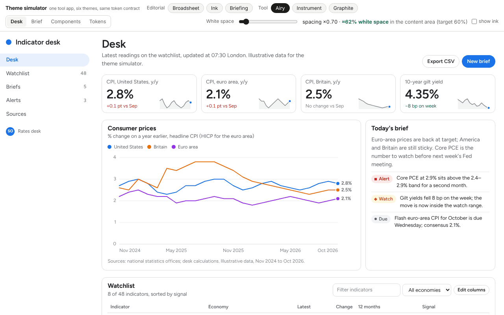
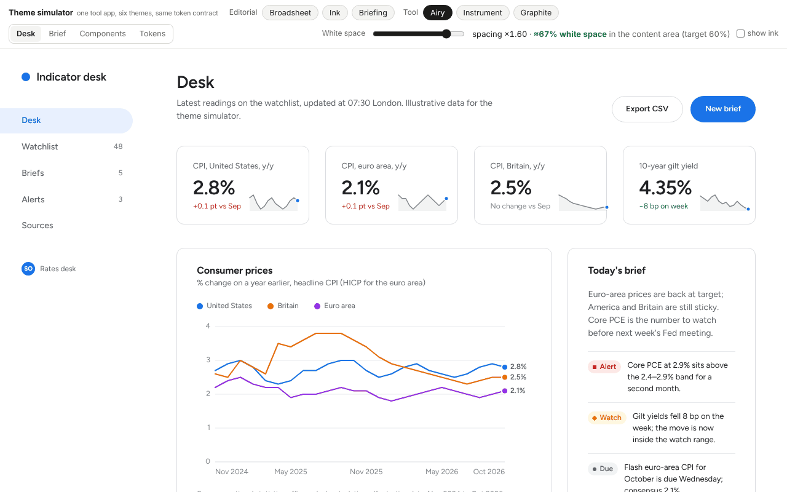
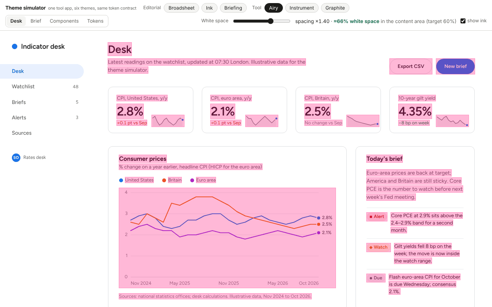
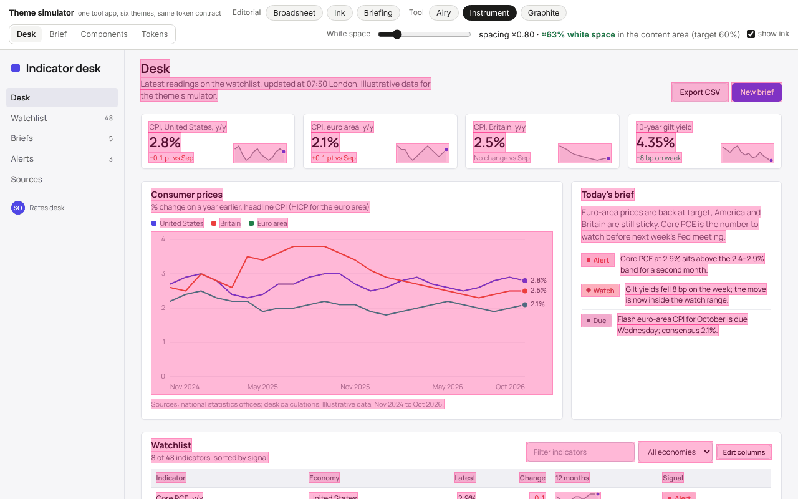

# White space

## The rule of thumb

"About 60% white space" is a heuristic people quote for Google-style interfaces. It is a cousin of the
60-30-10 colour rule (60% dominant neutral, 30% secondary surface, 10% accent) and of the observation
that Google's and Apple's pages leave most of the canvas empty. Nobody specifies it precisely, so this
skill gives it a definition you can measure and a band to aim at:

- **Ink** = text line boxes, form controls and buttons, images, SVG charts, pills, badges and swatches.
- **White space** = everything else inside the region you measure: margins, padding, gaps, empty panel
  area. Borders, hairlines and panel fills do not count as ink.
- **Region** = the visible viewport of the content column (`.main`), not the whole page. The sidebar is a
  constant mostly-empty strip that inflates the number without saying anything about the layout.
- **Band**: roughly **55–68%** for a tool page at desktop width. Airy sits at the top on purpose,
  Instrument at the bottom. Article pages read higher (70–80%) because a 65ch measure leaves the right
  side empty; that is correct for reading and not something to fix.

This is an estimate for conversation and comparison. A chart counts as a solid block even though most of
it is air, so a page with a big chart scores lower than the same layout without one. Compare like with
like, and look at the overlay to see what was counted.

## Reach it with the multiplier, not by deleting content

Every padding, gap and margin in the kit is a multiple of `--u: calc(8px * var(--ws))`. Changing `--ws`
moves all of them together, so the proportions of the layout survive and only the air changes. The
themes ship with defaults that express their character:

| Theme | `--ws` | Why |
|---|---|---|
| Broadsheet, Ink, Briefing | 1.0 | editorial density: rules and hairlines already separate things |
| Airy | 1.4 | white space is the structure; nothing else separates the cards |
| Instrument | 0.8 | density is the feature; 32px table rows |
| Graphite | 1.0 | |

Measured on the simulator's Desk view at 1280×800 (content column, first paint):

| Theme | ×0.7 | ×1.0 | ×1.4 | default |
|---|---|---|---|---|
| Broadsheet | 60% | 64% | 65% | 64% |
| Ink | 61% | 65% | 66% | 65% |
| Briefing | 61% | 64% | 65% | 64% |
| Airy | 62% | 64% | 66% | **66%** (×1.4) |
| Instrument | 62% | 64% | 67% | **63%** (×0.8) |
| Graphite | 61% | 63% | 67% | 63% |

Two things to read from the table. The multiplier moves the number by only 5–7 points across its whole
range, because on a tool page the big areas (chart, table, panels) dominate; so when a page feels
cramped, the fix is usually one fewer thing on the first screen, not more padding. And the themes land in
the same band at their defaults, which is the point: the band is a property of a well-built tool page,
and the themes differ in *how* they spend the space, not how much.

Other views in Airy for scale: Brief (article) 74%, Components gallery 82%.




## Measure it

In the simulator the readout in the top bar shows the estimate live, and "show ink" draws what was
counted:




For any page:

```bash
node scripts/measure_whitespace.js page.html --selector .main --overlay ink.png
node scripts/measure_whitespace.js https://app.example.com --selector main --width 1440 --height 900
node scripts/measure_whitespace.js assets/starter.html --selector .main --theme airy --ws 1.4
```

It prints the percentage, the number of ink boxes and the measured region, and with `--overlay` saves
a screenshot with the counted boxes tinted. It needs Playwright with Chromium.

The counting code, if you want it inline in a page (this is what the simulator runs):

```js
const INK = 'button,input,select,textarea,svg,img,.pill,.badge,.switch i,.avatar,.tab';
function whiteSpace(region) {
  const vp = region.getBoundingClientRect(); let ink = 0;
  const add = r => { const w = Math.min(r.right, vp.right) - Math.max(r.left, vp.left), h = Math.min(r.bottom, vp.bottom) - Math.max(r.top, vp.top); if (w > 0 && h > 0) ink += w * h; };
  (function walk(n) {
    if (n.nodeType === 3) { if (!n.textContent.trim()) return; const rg = document.createRange(); rg.selectNodeContents(n); for (const r of rg.getClientRects()) add(r); return; }
    if (n.nodeType !== 1 || getComputedStyle(n).display === 'none') return;
    if (n.matches(INK)) { add(n.getBoundingClientRect()); return; }
    for (const c of n.childNodes) walk(c);
  })(region);
  return 1 - ink / (vp.width * vp.height);
}
```

## Spending the space well

- Put the summary before the detail and let the first screen hold one chart or one table, not both,
  when the band is hard to reach.
- Margins and gaps scale together; do not add a one-off `margin-top: 40px` to fix a crowded spot. If a
  spot is crowded, something is competing with its neighbour; demote one of them.
- Keep reading text at 65ch and let the right side be empty. Filling it with a second column is the
  classic way to turn an editorial page into a dashboard nobody asked for.
- Density is legitimate: Instrument at 63% is as correct as Airy at 66%. The band is wide on purpose.
