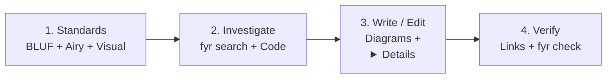

# Airy & Visual Documentation (`fyr-docs`)

Write and maintain scannable, high-signal technical documentation that humans and future AI sessions can grasp in seconds: lead with **BLUF (Bottom Line Up Front)**, keep prose short and airy, replace dense structural paragraphs with **Mermaid diagrams**, and fold heavy reference material inside `<details>`.

> [!NOTE]
> Forked from `docs-writer` in `google-gemini/gemini-cli` (`.gemini/skills/docs-writer`) at `1930f25` (Apache-2.0, `./LICENSE.txt`) and adapted for `fyr`'s airy, visual-first standard and `brain.db` trail records (`skills/VENDORED.md` § Forks).



## Phase 1: Airy & Visual Standards

Apply these rules whenever creating, updating, or reviewing explanatory documentation (`README.md`, `SDD.md`, `TDD.md`, `AGENTS.md` setup/deploy sections, `docs/*.md`, and `SPEC-*`, `GUIDE-*`, `DEPLOY-*` records):

### 1. Structure & BLUF (Bottom Line Up Front)

- **Open with BLUF:** Start every document and every `##` section with a 1–3 sentence overview stating what the subject does, why it matters, and what the reader gets — before any subheadings, lists, or code blocks.
- **No manual table of contents:** Keep hierarchy shallow (`##` → `###` without skipping levels) and remove manual TOC blocks.
- **Procedures:** Introduce sequential steps with one complete sentence, number each step, start with an imperative verb, and put conditions before actions (`"When running outside a git checkout, pass --global."`).
- **Next steps:** End procedural guides with a concise `## Next steps` section when follow-on actions exist.

### 2. Visuals First (`mermaid-syntax`)

- **Draw flows instead of describing them at length:** Any architecture overview, request/data pipeline, component boundary, or lifecycle with 3+ steps or actors gets a Mermaid diagram (`flowchart LR`/`TD`, `sequenceDiagram`, `stateDiagram-v2`, or `erDiagram`).
- **Syntax hygiene (`mermaid-syntax` skill):** Quote node labels containing parentheses, brackets, colons, or slashes (`id["Label (Detail)"]`), avoid HTML tags inside labels, and keep each diagram focused on one concept (≤ 12 nodes).

### 3. White Space, Lists, Tables & `<details>` Folding

- **Short paragraphs:** Cap paragraphs at 2–4 sentences, separated by blank lines around headings, diagrams, code blocks, and alerts.
- **Right container for the data:** Use numbered lists for ordered steps, bullet lists for unordered points, and compact Markdown tables (≤ 5 columns) for parallel comparisons.
- **Progressive disclosure (`<details>`):** Wrap supplementary, exhaustive, or schema-heavy reference material (> 12-row flag/config tables, full SQL/JSON payloads, edge-case matrices) inside collapsible `<details>` blocks so the main flow stays airy:

  ```markdown
  <details>
  <summary>Full CLI flag reference (14 flags)</summary>

  | Flag | Default | Purpose |
  |---|---|---|
  | `--project [DIR]` | `.` | Scope report to a single repository |

  </details>
  ```

### 4. Voice, Language & Formatting

- **Direct and active:** Address the reader as `"you"`, use active voice and present tense (`"The command writes..."`), and state requirements (`"must"`) separately from recommendations (`"prefer"`).
- **Plain, unambiguous words:** Spell out `"for example"` and `"that is"` instead of Latin abbreviations, write unambiguous dates (`2026-11-10` or `November 10, 2026`), and use realistic domain names in examples (never `foo` or `bar`).
- **Typography & alerts:** Use **bold** for UI labels and key terms, `` `code` `` for paths, flags, commands, and symbols, and GitHub alerts (`> [!NOTE]`, `> [!TIP]`, `> [!IMPORTANT]`, `> [!WARNING]`, `> [!CAUTION]`) sparingly — never consecutive or nested.
- **Accessible links:** Write descriptive anchor text (never `"click here"`), use portable relative paths across repo docs, and update inbound `#heading` links whenever a heading changes.

## Phase 2: Preparation

1. **Clarify scope:** Distinguish between authoring a new doc, updating living docs for a code change, or running a full docset audit via [docs-auditing.md](./references/docs-auditing.md).
2. **Read the code and references first:** Run `fyr search --slice <topic>` and `fyr search --refs <path>` to verify exact CLI flags, function signatures, config keys, and existing living records (`fyr record list --kind spec`, `--kind guide`, `--kind deploy`).
3. **Respect repo boundaries:** Never edit `PRD.md` without explicit operator approval in their turn. Root files (`README.md`, `PRD.md`, `SDD.md`, `TDD.md`, `TODO.md`) and `brain.db` records carry no YAML frontmatter. Scratch drafts belong in `.agents/scratch/` (never `/tmp`).

## Phase 3: Execution

- Apply Phase 1's BLUF, short paragraphs, Mermaid diagrams, and `<details>` blocks to every new or touched section.
- Keep `README.md` human-first and copy-pasteable: quick-start and verification commands must match `AGENTS.md` § Setup verbatim.
- Keep `SDD.md` and `TDD.md` as concise summaries + trace tables that link to `SPEC-*` and `ADR-*` records without restating them.
- Preserve literal CLI flags, code blocks, and quoted error strings byte-for-byte when tightening surrounding prose.

## Phase 4: Verification

1. **Code parity:** Confirm every named command, flag, path, `path:line`, and config key exists in the working tree.
2. **Link & Mermaid check:** Verify every relative link resolves and every Mermaid fence uses valid v11 syntax (`mermaid-syntax`).
3. **Harness drift check:** In repositories with `fyr`, run `fyr check` (and `skills/fyr-review/scripts/restatement-grep.sh` when behaviour reversed) so zero stale claims remain.

## Cross-References

- [docs-auditing.md](./references/docs-auditing.md) — three-phase Editor, Software Engineer, and Technical Writer audit workflow for a docset.
- `mermaid-syntax` — Mermaid v11 diagram syntax, escaping rules, and supported chart types.
- `documentation` subagent — owns > 30-line updates across `README.md`, `SDD.md`, `TDD.md`, `SPEC-*`, `GUIDE-*`, and `DEPLOY-*`.
- `fyr-spec` & `fyr-explain-project` — author `SPEC-<app>-<topic>` and `GUIDE-onboarding` records using these standards.
