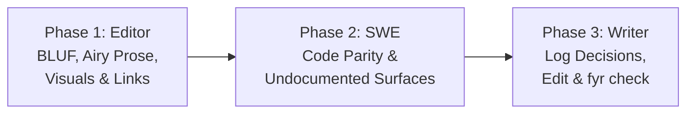

# Procedural Guide: Auditing a Docset

Audit a project's living documentation for technical accuracy, undocumented surfaces, and adherence to `fyr-docs`'s airy, visual-first standards across three focused passes: **Editor**, **Software Engineer**, and **Technical Writer**.

> [!NOTE]
> Adapted from `<upstream>/.gemini/skills/docs-writer/references/docs-auditing.md` in `google-gemini/gemini-cli` at `1930f25` (Apache-2.0, `../LICENSE.txt`).

## Phase 1: Editor & Visual-Airiness Audit

**Goal:** Identify walls of text, missing visuals, style violations, broken links, and stale code snippets across living docs.

1. **Enumerate living docs in scope:**
   - Root explanatory files: `README.md`, `SDD.md`, `TDD.md`, `AGENTS.md` (Setup and Deploy sections), and any `docs/**/*.md` pages.
   - Trail records (in scaffolded `fyr` repos): `fyr record list --kind spec`, `--kind guide`, `--kind deploy` (never audit immutable `change`, `adr`, `handoff`, `review`, `retro`, `bug`, or `testing` records as living prose).
2. **Open the scratch audit report:**
   - Write findings to `.agents/scratch/docs-audit-<YYYY-MM-DD>.md` (get the date from `date +%F`; never `/tmp` and never commit audit scratch files).
3. **Check each document against `fyr-docs` standards:**
   - **Missing BLUF (Bottom Line Up Front):** Flag documents or major `##` sections that dive into flags, tables, or steps without a 1–3 sentence opening summary.
   - **Wall-of-text density & missing visuals:** Flag paragraphs longer than 4 sentences, manual tables of contents, or 3+ component/step architectural and flow explanations that lack a Mermaid diagram (`mermaid-syntax`).
   - **Unfolded reference bulk:** Flag dense tables (> 12 rows), full schemas, or supplementary payload dumps that interrupt the primary reading flow instead of using `

…
…
`.
   - **Voice, tone & clarity:** Flag passive voice, third-person reader references (`"the user"` instead of `"you"`), Latin abbreviations (`e.g.`, `i.e.`), relative dates (`"last week"`), placeholder names (`foo`, `bar`), and non-descriptive link text (`"click here"`).
   - **Snippet & link accuracy:** Use `fyr search --slice` / `fyr search --refs` and file reads to verify every command, flag, file path, symbol, and relative link in the document.
4. **Record actionable findings:**
   - For each issue, append `path:line`, category (`BLUF`, `Visual`, `Folding`, `Accuracy`, `Voice`, `Link`), 1-line problem, and concrete fix to `.agents/scratch/docs-audit-<YYYY-MM-DD>.md`.

## Phase 2: Software Engineer Surface Audit

**Goal:** Catch undocumented user-facing behaviour and stale claims after recent code changes.

1. **Scan entry points and public surfaces:**
   - Inspect CLI verbs/flags (`cmd/`), HTTP/RPC handlers and routes (`internal/`, `web/`), configuration loaders, and environment variables.
2. **Cross-check recent changes:**
   - Read recent `change` records (`fyr record list --kind change --limit 5`) or `git log -n 10 --stat` and run `fyr check` where `PRD.md` exists.
3. **Record coverage gaps:**
   - Append undocumented commands, flags, endpoints, or deploy steps to `.agents/scratch/docs-audit-<YYYY-MM-DD>.md`, naming which living doc or `SPEC-*` / `DEPLOY-*` record owns each surface.

## Phase 3: Technical Writer Implementation

**Goal:** Apply approved fixes cleanly without corrupting literal code, CLI flags, or error strings.

1. **Log decisions:**
   - Record accepted, modified, or deferred audit items in `.agents/scratch/docs-audit-log-<YYYY-MM-DD>.md` (ask the operator first when an audit was requested as report-only).
2. **Apply surgical edits with string safeguards:**
   - **Preserve code blocks and inline spans:** Never alter casing, flags, or identifiers inside fenced code blocks or `` `inline code` ``.
   - **Preserve literal messages:** Never rewrite wording inside quoted error strings, log lines, or UI literals (for example, keep `"Error: Please contact your administrator"` intact even when removing `"please"` from surrounding prose).
   - **Check sentence casing & deep links:** Re-verify capitalization when trimming leading filler words, and update all inbound `#anchor` links when renaming a heading.
   - **Stage `brain.db` records cleanly:** Export each record (`fyr record get <ID> --out .agents/scratch/<ID>.md`), edit, and save back (`fyr record edit <ID> --body-file .agents/scratch/<ID>.md`).
3. **Final verification:**
   - Confirm every relative link and Mermaid block is valid, and run `fyr check` (when `PRD.md` is present) so zero doc, spec, or trace findings remain.
