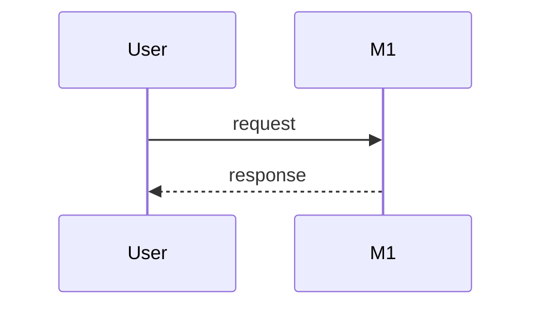

# SDD — <project>

<one line: how the parts of the system fit together>
Status: draft · Last updated: YYYY-MM-DD · Requirements: [PRD.md](PRD.md) · Technical design: [TDD.md](TDD.md)

<!-- The system design: the parts, their boundaries, the main flows and the big decisions — a summary a human reads
     in ten minutes. The detail lives in the records it links (an ADR per decision, a SPEC per surface), never
     restated here. Components are M1… (module); each satisfies PRD requirements by ID; TDD.md has one section per
     component. Kept current by the session that changes the design, in the same commit. -->

## Context

<!-- Who and what the system talks to, and what is out of scope. One diagram; replace the placeholder nodes. -->

## Components

<!-- One row per component: its one responsibility and the requirements it satisfies. -->

| ID | Component | Responsibility | Satisfies |
|---|---|---|---|
| M1 | <`cmd/<app>` or a package> | <one line> | R1 |

## Flows

<!-- One sequence diagram per key flow (a request, a job, a deploy), named after it. -->

### <flow name>

## Decisions

<!-- One line each: the decision, the alternative rejected, and its ADR record (`fyr record get ADR-NNN`). -->

- <decision> — rejected: <alternative> — ADR-NNN.

## Cross-cutting

<!-- Security (trust boundaries, secrets), privacy, observability (logs, metrics), cost — one line each, or "none yet". -->

- **Security:** <one line>.

## Deployment

<!-- Where it runs and how it gets there, in one or two lines; the procedures are the DEPLOY-* records. -->

## Risks

<!-- What could make this design wrong, one line each, with what would show it. -->

- <one line>.

## Trace

<!-- Every Must and Should requirement of PRD.md, and the components that satisfy it. A requirement with no row is a gap. -->

| Requirement | Components |
|---|---|
| R1 | M1 |
