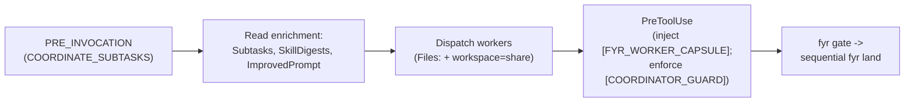

# Swarm — Multi-Agent Parallel Execution

Use parallel execution only when genuinely independent slices justify coordination overhead, and keep workers isolated (`workspace="share"`), write-bounded (`Files:`), and deterministically gated (`fyr gate` + `fyr land`). On `PRE_INVOCATION` turns with `Directive: COORDINATE_SUBTASKS`, the `fyr` pre-hooks supply pre-split `Subtasks`, deduplicated `SkillDigests`, `[COORDINATOR_GUARD]` protection, and automatic `[FYR_WORKER_CAPSULE]` worker enrichment.

## Orchestration routing table

| Work shape | Tool | What `fyr` controls |
|---|---|---|
| One track, 1–6 files | Plan and execute in main session | Turn-0 capsule, read clamp, `Stop` stamp, `fyr verify`, `fyr close` |
| Single recon or blind judgement (`reviewer`, `security`, `verifier`, `explorer`) | `invoke_subagent` | Guarded model routing + `[FYR_WORKER_CAPSULE]` |
| 2+ independent slices (`PLAN-*` wave, multi-file refactor, parallel review) | `run_workflow` (`workflows/phase_loop.py` with `builder` + `workspace="share"`, or `workflows/review_parallel.py` with `"inherit"` for read-only reviews) | Disjoint `Files:` validation, `<= 2` Defect Packet loop-back, anti-stuck governor, `fyr gate` per branch, sequential `fyr land` |
| 2+ slices where workers negotiate interfaces mid-flight | Native `/swarm` (`workspace="share"`, `Files:` lease) | `Files:` lease, `[FYR_WORKER_CAPSULE]`, `fyr gate`, `fyr land` |
| Hard single-surface bug or deep trade-off | Recommend `/boost` to operator (routing row only) | Normal session gates |
| Multi-day autonomous campaign | Recommend `/teamwork` or `/goal` to operator (routing row only) | Per-milestone `fyr verify` from `PLAN-*` |

## Coordinator pre-hook workflow (`COORDINATE_SUBTASKS`)

When `PRE_INVOCATION` returns `Directive: COORDINATE_SUBTASKS` (`Route: /fyr-swarm (isolated subtasks; zero shared memory)`), act as Coordinator over isolated slices instead of editing source files directly on the main checkout.



1. **Respect directive precedence:** `PASS_THROUGH` > `VET_FIRST` > `COORDINATE_SUBTASKS` (`len(subtasks) >= 2`) > `ANSWER_ONLY` / `CORRECTION` > `EXECUTE_IMPROVED_PROMPT` > `ENRICH_AND_PROCEED`. If `VET_FIRST` fires due to conflicts or missing critical anchors, resolve them with the operator before dispatching workers.
2. **Consume `Subtasks:`:** Contains up to `6` deterministic slices (`id`, `role`, `goal`, `files`, `skills`, `verify`) with pairwise-disjoint `files` (fileless exploration slices omit `files`). Use these slices to populate your `Files:` write leases and per-slice verification commands.
3. **Consume `SkillDigests:`:** Delivers compaction-scoped actionable skill digests (`<= 600 B` each, deduplicated per `generation_id` via `read_ledger` `start_line = -4` and automatically re-primed after context compaction). Forward slice-specific constraints when dispatching workers.
4. **Consume `ImprovedPrompt:`:** Surfaces synthesized `[VET_IMPROVED_PROMPT]` targets, `ADR-*`/`BUG-*` constraints, and `verify` hints to embed in worker task prompts.

## Quota check & prefix model routing

1. Run `agy -p "/usage"` (or check `fyr models`) before spawning any parallel wave; record per-dispatch routing (`Dispatch: <ROLE> · <scope> · <model-id> · <THINKING> [· quota <pct>]`) in briefs/scratch rather than emitting a wait-note summary callout (`context/AGENTS.md` reserves the `> **fyr**` summary callout for the final reply only).
2. `PreToolUse` routes and validates worker models from roster name prefixes:
   - `builder-<slice>` / `coder-<slice>` -> builder model (`fyr models --pick builder`, or coordinator model when omitted).
   - `reviewer-<slice>` / `judge-<slice>` / `security-<slice>` / `verifier-<slice>` -> `pro` / cross-family when Anthropic quota is `>= 20%` weekly and `>= 30%` 5h, else Gemini Pro fallback. Fast weak overrides are denied.
   - `explorer-<slice>` / `docs-<slice>` -> `flash`.
3. In native `/swarm`, switch a `waiting` worker's model with `swarm(action="model", ...)` — never `kill` and `add` a fresh conversation just to change models.

## Write-lease brief (`Files:` header) & JIT `[FYR_WORKER_CAPSULE]`

Give every editing worker its own `workspace="share"` copy and disjoint `Files:` paths — two active workers never edit the same file. Each worker starts fresh and sees zero parent context, so keep briefs self-contained in one canonical format (shared with `fyr-handoff` § The worker-mode Kickoff):

- **`PLAN-*` header mapping:** When dispatching from a multi-phase `PLAN-*` (`fyr record get <PLAN-ID>`), map each worker phase's headers directly: `files:` -> `Files:` (and `--lease` in `fyr gate` / `fyr land`), `model:` -> dispatch `Model`/`model` and `Model:` line (omit if unset), `base-check:` -> worker's targeted verification command in `Done when:`, and `judge:` / `judge-model:` -> coordinator's `fyr gate --judge "<criterion>" [--judge-model <id>]` and `fyr land --judge "<criterion>" [--judge-model <id>]`.

```text
Files: <comma-separated repo-relative files or dirs>
Project: this clone, the current directory; never another checkout. Read AGENTS.md, then <fyr record get PLAN-ID; do phase of PLAN-ID only, as a worker | do this task only, as a worker, with no plan: exact task>.
Model: <trimmed model ID; omit line when unset>
Standing approvals (closed set): <phase who: AI boxes or task> and named tests (<base-check or targeted test>); optional change record (or scratch draft if run_workflow lacks trail access); commit on branch work/<name>[-r2] with zero trailers; git checkout --detach HEAD (share worktrees); closing handoff.
Never: push; tick PLAN-* or TODO.md; store records other than closing handoff (and optional change; draft other artifacts under .agents/scratch/agents/ early); merge; touch main; a who: user box or Open: row; a release; a deploy; a real-home install; fyr metrics ingest; edit outside Files:.
Budget & artifact: <= 40 tool calls for specialized subagents (<= 120 for self); write any draft/artifact early under .agents/scratch/agents/, then update it (omit ArtifactMetadata on write_file/edit_file because .agents/scratch/ is a workspace path, not <appDataDir>/brain/<conversation-id>).
Done when: <Checkpoint expect or targeted base-check/test passes> (where Done when names an item under Never, Never wins: name it in the handoff for the coordinator), git checkout --detach HEAD (share worktrees), closing handoff stored, and [done] branch=work/<name> commit=<short-sha> (or finish JSON in run_workflow).
```

- **Automatic `[FYR_WORKER_CAPSULE]` JIT overwrite:** For allowed `invoke_subagent` (`Prompt`) and `swarm(action="add")` (`brief`) calls, `PreToolUse` merges `Model` / `model` routing with an appended `[FYR_WORKER_CAPSULE]` (`<= 1,200 B` wrapped in `=====<18-hex>=====` fences) when **(1)** the brief names file/symbol tokens or `Files:` paths OR `workspacePaths`/`cwd`/`--dir` resolves a checkout, **AND (2)** context lookup finds Hop-0 symbols, `validity >= 0.40` records/memories, or a skill digest (or `coordinator-only` mode is active). Your leading `Files:` header stays verbatim at the top without duplication, and remaining budget fills in strict order: `<= 3` records/memories (`140 B` note cap) > top `1` skill digest (`<= 400 B`) > `Hop-0` AST slice (`<= 600 B`).
- **Idempotency & fallback:** Prompts already carrying `[FYR_WORKER_CAPSULE]` and targetless prompts without an explicit checkout are left untouched. Always keep `Files:` and critical constraints in the brief itself so workers remain self-contained even if a caller ignores non-`Model` `Overwrite` keys.
- **`run_workflow` literal safety & automated phase loop (`workflows/phase_loop.py`):** `PreToolUse` enforces `model="pro"` on guarded `agent()` calls (`[AUTO_SUBAGENT_PRO]`) without mutating Python string literals, so embed `Files:` and relevant context directly in `run_workflow` `agent()` prompts and require calling `finish` matching the script's `schema`. Validate `run_workflow` Python scripts (which support top-level `await`) via `python3 -c "import ast; ast.parse(open('<script>').read(), mode='exec')"` — never `python3 -m py_compile` (fails on top-level `await` and leaves dirty `__pycache__`). For parallel build waves with disjoint leases, prefer `workflows/phase_loop.py` (installed at `<HOME>/.gemini/config/workflows/phase_loop.py`, using expanded `$HOME`, never literal `~`):
  1. Validates pairwise-disjoint `files` leases across all `slices` up front before spawning workers.
  2. Spawns one stateful `builder` subagent (`agents/builder/agent.md`, `type_name="builder"`, `workspace="share"`, `model="inherit"`) per slice so Round 2 runs in the same conversation with full context.
  3. Runs deterministic `fyr gate` (`--lease`, `--max-lines`, plus cross-family `--judge` when enabled) and optional scoped `reviewer`/`security`/`verifier` (`model="pro"`).
  4. On `FAIL`, builds a structured `DefectPacket` (`round`, `source`, `findings`, `error_hash`, `required_fixes`) and loops back to the same stateful `builder` (`<= 2` rounds).
  5. Enforces the fail-closed anti-stuck governor: out-of-lease edit (immediate halt, no loop-back), repeating `error_hash` (stuck loop), round-2 `FAIL`, builder `BLOCKED`, or call-cap breach escalates (`status="ESCALATE"`) with zero partial landings by default.
  6. When all slices succeed (`land=true`), runs `fyr land` strictly sequentially (one branch at a time) followed by one `fyr verify` on `main`.

## Coordinator write guard (`[COORDINATOR_GUARD]`)

On active `COORDINATE_SUBTASKS` turns (`subtask_count >= 2` in `vet_history`) or whenever a `coordinator-only` marker (`<root>/.agents/scratch/coordinator-only` or `~/.config/fyr/coordinator-only`) exists, `PreToolUse` denies direct `write_or_edit` calls on the main checkout with `[COORDINATOR_GUARD]`.

| Write surface | Decision | Notes |
|---|---|---|
| Main checkout source or root docs (except `TODO.md`) | `deny` (`[COORDINATOR_GUARD]`) | Dispatch an isolated `workspace="share"` worker instead |
| `.agents/scratch/**` and `TODO.md` | `allow` | Disabled for `.agents/scratch/**` if `.agents/scratch` contains symlinks |
| Linked git worktrees (`workspace="share"` / `"branch"`) | `allow` | `commonDir != <root>/.git` lets isolated workers edit leased files freely |
| Worker brief sessions (`isWorkerBriefPrompt`) | `allow` | Matches `[FYR_WORKER_CAPSULE]`, `Project: this clone`, `"This is a Kickoff written by fyr auto."`, `Standing approvals:`, or leading `Files:` |
| Operator `!`-prefixed prompt (`!`) | `allow` | Persisted in `vet_history` so intentional direct Coordinator edits pass |

## Watchdog breakers & silent-hang recovery

- **In-band `PreToolUse`/`PostToolUse` Watchdog:**
  - `[INTERACTIVE_STDIN]` blocks interactive editors, pagers, and prompts waiting on stdin, and injects `export GIT_TERMINAL_PROMPT=0; ` via `Overwrite` for network `git` commands.
  - `[POLL_LOOP]` denies `>= 3` consecutive `manage_task` / `manage_subagents` `list`/`status` polls; end the turn to await wakeup or run `fyr watch --check`.
  - `[ERROR_LOOP]` denies `>= 3` consecutive identical failing tool calls or `A-B-A-B` failing error loops recorded across `PreToolUse` and `PostToolUse` in `watchdog_ring` (exempting `finish`, `send_message`, `.agents/scratch/agents/` writes, and `git` commit steps).
  - `[SUBAGENT_BUDGET]` warns at `25`/`90` and blocks at `40` tool calls for specialized subagents (`120` for `self`), nudging completion via artifact write or `finish`.
- **Silent-hang recovery:** Pair child dispatches with `schedule(TimerCondition: "<id>", DurationSeconds: 90)` instead of polling. If a timer fires or a worker appears stalled, inspect read-only with `fyr watch --check --conv <id> --json` (exits `1` with `[INTERACTIVE_WAIT]`, `[STUCK_NO_PROGRESS]`, or `[BUDGET_NEAR_LIMIT]`).

## Wave gate & sequential landing (`fyr gate` -> `fyr land`)

1. **Gate every finished slice (strictly serialized):** From the coordinator tree, check each completed worker worktree/branch against its lease (optionally adding `--judge` for an isolated `Network: true` cross-family diff + `verify.stamp` verdict logged to `metrics.db` `judge_verdicts`, with `--judge-model` to override the auto-picked model):
   ```bash
   fyr gate --lease "<comma-separated Files lease>" [--max-files N --max-lines M] [--judge "<acceptance criterion>" [--judge-model <id>]] <worker-worktree-or-branch>
   ```
   - **Diff & judge caps:** `fyr gate` defaults to `50` files and `1500` lines (`--max-files`/`--max-lines` override legitimately large shards after checking `git diff --stat`), and `--judge` caps diff payloads at `96 KiB` (`120 KiB` total prompt) — when a shard diff reaches `120 KiB`, dispatch an isolated `reviewer` over the 3-dot diff as fallback.
   - **Serial detached-worktree discipline:** While workers edit in parallel, strictly serialize every detached-worktree `fyr verify`, `fyr gate`, and `fyr land` sequence onto `main` — never run two detached gate/verify/land operations concurrently, avoiding worktree, `verify.stamp`, and git index lock collisions.
   - Reject slices reporting out-of-lease edits, secret-shaped filenames, missing/failing tests, commit trailers, or a `judge` `FAIL`; message the worker (or re-dispatch) rather than patching across boundaries yourself.
2. **Land sequentially — one branch at a time:** Merge passing branches onto the target branch strictly in dependency order:
   ```bash
   fyr land --lease "<comma-separated Files lease>" [--max-files N --max-lines M] [--judge "<acceptance criterion>" [--judge-model <id>]] work/<name>
   ```
   A `share` worker detaches HEAD (`git checkout --detach HEAD`) after committing its branch and before `fyr land` runs so `work/<name>` is not held checked out in its worktree. Complete the verify -> gate -> land cycle for one shard before starting the next; resolve any merge conflict cleanly on a single branch before continuing.
3. **Post-wave verify, knee check & cleanup:** Run `fyr verify` once on `main` after the wave lands. Only AFTER `fyr land` succeeds, kill finished `share` workers via `swarm(action="kill", name="<worker>")` (`kill` deletes the worker's `share` workspace permanently). Before dispatching another wave or sub-wave, run `fyr metrics ingest` + `fyr metrics trajectory`: if effective context reaches `TokenKnee` (`>= 60%` / `300k` on Gemini 4+/Claude 5+), halt new dispatches, run `/fyr-handoff`, and continue the next wave in a fresh session (`rules/session-sizing.md`; `change` records are optional).
