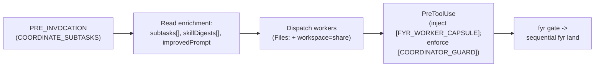

# Swarm — Multi-Agent Parallel Execution

Use parallel execution only when genuinely independent slices justify coordination overhead, and keep workers isolated (`workspace="share"`), write-bounded (`Files:`), and deterministically gated (`fyr gate` + `fyr land`). On `PRE_INVOCATION` turns with `directive: "COORDINATE_SUBTASKS"`, the `fyr` pre-hooks supply pre-split `subtasks[]`, deduplicated `skillDigests[]`, `[COORDINATOR_GUARD]` protection, and automatic `[FYR_WORKER_CAPSULE]` worker enrichment.

## Orchestration routing table

| Work shape | Tool | What `fyr` controls |
|---|---|---|
| One track, 1–6 files | Plan and execute in main session | Turn-0 capsule, read clamp, `Stop` stamp, `fyr verify`, `fyr close` |
| Width ≤ 2, or blind judgement (`reviewer`, `security`, `verifier`) | `invoke_subagent` | Model routing + `[FYR_WORKER_CAPSULE]` (`internal/search/hook_subagent.go`) |
| Width ≥ 3, independent pieces (`PLAN` wave, multi-file refactor, parallel review) | `run_workflow` (`parallel()`, `workspace="share"`, or `"inherit"` for read-only reviews) | `fyr gate` per worker branch, `fyr land` one at a time |
| Width ≥ 3, workers must negotiate interfaces mid-flight | Native `/swarm` (`workspace="share"`, `Files:` lease) | `Files:` lease, `[FYR_WORKER_CAPSULE]`, `fyr gate`, `fyr land` |
| Hard single-surface bug or deep trade-off | Recommend `/boost` to operator (routing row only) | Normal session gates |
| Multi-day autonomous campaign | Recommend `/teamwork` or `/goal` to operator (routing row only) | Per-milestone `fyr verify` from `PLAN-*` |

## Coordinator pre-hook workflow (`COORDINATE_SUBTASKS`)

When `PRE_INVOCATION` returns `directive: "COORDINATE_SUBTASKS"` (`route: "/fyr-swarm (isolated subtasks; zero shared memory)"`), act as Coordinator over isolated slices instead of editing source files directly on the main checkout.



1. **Respect directive precedence:** `PASS_THROUGH` > `VET_FIRST` > `COORDINATE_SUBTASKS` (`len(subtasks) >= 2`) > `ANSWER_ONLY` / `CORRECTION` > `EXECUTE_IMPROVED_PROMPT` > `ENRICH_AND_PROCEED`. If `VET_FIRST` fires due to conflicts or missing critical anchors, resolve them with the operator before dispatching workers.
2. **Consume `enrichment.subtasks[]`:** Contains up to `6` deterministic slices (`id`, `role`, `goal`, `files`, `skills`, `verify`) with pairwise-disjoint `files` (fileless exploration slices omit `files`). Use these slices to populate your `Files:` write leases and per-slice verification commands.
3. **Consume `enrichment.skillDigests[]`:** Delivers compaction-scoped actionable skill digests (`<= 600 B` each, deduplicated per `generation_id` via `read_ledger` `start_line = -4` and automatically re-primed after context compaction). Forward slice-specific constraints when dispatching workers.
4. **Consume `enrichment.improvedPrompt`:** Surfaces synthesized `[VET_IMPROVED_PROMPT]` targets, `ADR-*`/`BUG-*` constraints, and `verify` hints to embed in worker task prompts.

## Quota check & prefix model routing

1. Run `agy -p "/usage"` before spawning any parallel wave, and emit the required 2-space `json` dispatch block (`role`, `scope`, `model`, `thinking`, `quota`).
2. `PreToolUse` (`internal/search/hook_subagent.go`) routes/validates worker models from roster name prefixes:
   - `builder-<slice>` / `coder-<slice>` -> builder model (`fyr models --pick builder`, or coordinator model when omitted).
   - `reviewer-<slice>` / `judge-<slice>` / `security-<slice>` / `verifier-<slice>` -> `pro` / cross-family when Anthropic quota is `>= 20%` weekly and `>= 30%` 5h, else Gemini Pro fallback. Fast weak overrides are denied.
   - `explorer-<slice>` / `docs-<slice>` -> `flash`.
3. In native `/swarm`, switch a `waiting` worker's model with `swarm(action="model", ...)` — never `kill` and `add` a fresh conversation just to change models.

## Write-lease brief (`Files:` header) & JIT `[FYR_WORKER_CAPSULE]`

Give every editing worker its own `workspace="share"` copy and disjoint `Files:` paths — two active workers never edit the same file. Each worker starts fresh and sees zero parent context, so keep briefs self-contained:

```text
Files: internal/pkg/a.go, internal/pkg/a_test.go
Task: <exact behavior change and interfaces>
Rules: Create local branch `work/<name>`, modify ONLY paths matching `Files:`, commit cleanly with zero trailers (never push), and run `fyr verify` (or targeted `go test -race ...`).
Done: Post `[done] branch=work/<name> commit=<short-sha>` with verified command output (or return `finish` JSON in `run_workflow`).
```

- **Automatic `[FYR_WORKER_CAPSULE]` JIT overwrite (`internal/search/hook_subagent.go`):** For allowed `invoke_subagent` (`Prompt`) and `swarm(action="add")` (`brief`) calls, `PreToolUse` merges `Model` / `model` routing with an appended `[FYR_WORKER_CAPSULE]` (`<= 1,200 B` wrapped in `=====<18-hex>=====` fences) when **(1)** the brief names file/symbol tokens or `Files:` paths OR `workspacePaths`/`cwd`/`--dir` resolves a checkout, **AND (2)** context lookup finds Hop-0 symbols, `validity >= 0.40` records/memories, or a skill digest (or `coordinator-only` mode is active). Your leading `Files:` header stays verbatim at the top without duplication, and remaining budget fills in strict order: `<= 3` records/memories (`140 B` note cap) > top `1` skill digest (`<= 400 B`) > `Hop-0` AST slice (`<= 600 B`).
- **Idempotency & fallback:** Prompts already carrying `[FYR_WORKER_CAPSULE]` and targetless prompts without an explicit checkout are left untouched. Always keep `Files:` and critical constraints in the brief itself so workers remain self-contained even if a caller ignores non-`Model` `Overwrite` keys.
- **`run_workflow` literal safety:** `PreToolUse` (`internal/search/hook_workflow.go`) enforces `model="pro"` on guarded `agent()` calls (`[AUTO_SUBAGENT_PRO]`) without mutating Python string literals, so embed `Files:` and relevant context directly in `run_workflow` `agent()` prompts and require calling `finish` matching the script's `schema`.

## Coordinator write guard (`[COORDINATOR_GUARD]`)

On active `COORDINATE_SUBTASKS` turns (`subtask_count >= 2` in `vet_history`) or whenever a `coordinator-only` marker (`<root>/.agents/scratch/coordinator-only` or `~/.config/fyr/coordinator-only`) exists, `PreToolUse` denies direct `write_or_edit` calls on the main checkout with `[COORDINATOR_GUARD]` (`internal/search/hook.go`).

| Write surface | Decision | Notes |
|---|---|---|
| Main checkout source or root docs (except `TODO.md`) | `deny` (`[COORDINATOR_GUARD]`) | Dispatch an isolated `workspace="share"` worker instead |
| `.agents/scratch/**` and `TODO.md` | `allow` | Disabled for `.agents/scratch/**` if `.agents/scratch` contains symlinks |
| Linked git worktrees (`workspace="share"` / `"branch"`) | `allow` | `commonDir != <root>/.git` lets isolated workers edit leased files freely |
| Worker brief sessions (`isWorkerBriefPrompt`) | `allow` | Matches `[FYR_WORKER_CAPSULE]`, `Project: this clone`, `"This is a Kickoff written by fyr auto."`, `Standing approvals:`, or leading `Files:` |
| Operator `!`-prefixed prompt (`!`) | `allow` | Persisted in `vet_history` so intentional direct Coordinator edits pass |

## Wave gate & sequential landing (`fyr gate` -> `fyr land`)

1. **Gate every finished slice:** From the coordinator tree, check each completed worker worktree/branch against its lease:
   ```bash
   fyr gate <worker-worktree-or-branch> --lease "<comma-separated Files lease>"
   ```
   Reject slices reporting out-of-lease edits, secret-shaped filenames, missing/failing tests, or commit trailers; message the worker (or re-dispatch) rather than patching across boundaries yourself.
2. **Land sequentially — one branch at a time:** Merge passing branches onto the target branch strictly in dependency order:
   ```bash
   fyr land --lease "<comma-separated Files lease>" work/<name>
   ```
   Never run two `fyr land` commands concurrently; resolve any merge conflict cleanly on a single branch before continuing.
3. **Post-wave verify & cleanup:** Run `fyr verify` once on `main` after the wave lands. Only AFTER `fyr land` succeeds, kill finished `share` workers via `swarm(action="kill", name="<worker>")` (`kill` deletes the worker's `share` workspace permanently).
